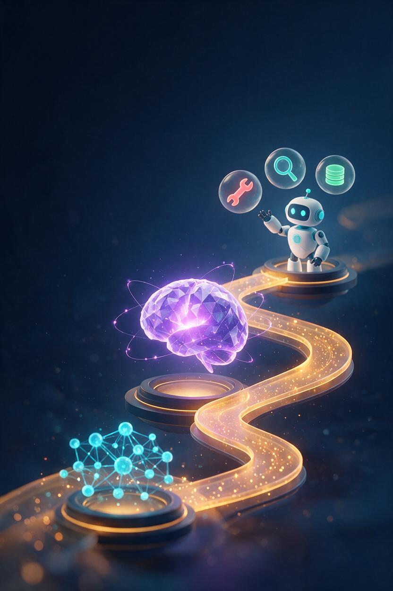

# Agent 从零到专家
## From Zero to Agent Hero —— 一本写给未来的智能体工程师的书



> 从最基础的神经网络、反向传播、Transformer 讲起，一路走到大语言模型、Agent 架构、工具调用、RAG、记忆机制、Skill 体系与多智能体协作。
> 不需要任何 AI 前置知识，只需要一点 Python 和好奇心。

[](https://creativecommons.org/licenses/by-nc-sa/4.0/)
[]()

**[English README →](README_EN.md)** | [📄 全书 PDF 下载](Agent从零到专家.pdf)

---

## 📖 本书结构

**[📜 前言：为什么写这本书](docs/preface.md)**

### 第一部分 · 深度学习地基（Part 1: Foundations）

| 章节 | 标题 | 状态 |
|---|---|---|
| 第 1 章 | [神经网络基础：从感知机到多层网络](docs/part1-foundations/ch01-neural-network-basics.md) | ✅ 已完成 |
| 第 2 章 | [卷积神经网络（CNN）：让机器学会"看"](docs/part1-foundations/ch02-cnn.md) | ✅ 已完成 |
| 第 3 章 | [反向传播算法：亲手用 NumPy 推导并实现](docs/part1-foundations/ch03-backpropagation.md) | ✅ 已完成 |

### 第二部分 · 大语言模型（Part 2: Large Language Models）

| 章节 | 标题 | 状态 |
|---|---|---|
| 第 4 章 | [Token、词嵌入与位置编码：LLM 的"文字观"](docs/part2-llm/ch04-token-embedding-positional-encoding.md) | ✅ 已完成 |
| 第 5 章 | [Transformer 架构详解：注意力就是一切](docs/part2-llm/ch05-transformer.md) | ✅ 已完成 |
| 第 6 章 | [预训练、指令微调与对齐（SFT / RLHF / DPO）](docs/part2-llm/ch06-finetuning-alignment.md) | ✅ 已完成 |
| 第 7 章 | [提示工程（Prompt Engineering）实战](docs/part2-llm/ch07-prompt-engineering.md) | ✅ 已完成 |
| 第 8 章 | [模型推理、量化与本地部署（vLLM / Ollama）](docs/part2-llm/ch08-inference-deployment.md) | ✅ 已完成 |

### 第三部分 · Agent 核心（Part 3: Agent Core）

| 章节 | 标题 | 状态 |
|---|---|---|
| 第 9 章 | [什么是 Agent：从 Chatbot 到自主智能体](docs/part3-agent-core/ch09-what-is-agent.md) | ✅ 已完成 |
| 第 10 章 | [Agent 架构范式：ReAct / Plan-and-Execute / Reflexion](docs/part3-agent-core/ch10-agent-patterns.md) | ✅ 已完成 |
| 第 11 章 | [工具调用（Function/Tool Calling）原理与实战](docs/part3-agent-core/ch11-tool-calling.md) | ✅ 已完成 |
| 第 12 章 | [Agent 通信协议：MCP、A2A 与 Agent 间协作](docs/part3-agent-core/ch12-mcp-a2a.md) | ✅ 已完成 |

### 第四部分 · RAG 与记忆（Part 4: RAG & Memory）

| 章节 | 标题 | 状态 |
|---|---|---|
| 第 13 章 | [RAG 检索增强生成：原理、切片、向量数据库](docs/part4-rag-memory/ch13-rag.md) | ✅ 已完成 |
| 第 14 章 | [Agent 记忆机制：短期/长期记忆、MemGPT、mem0](docs/part4-rag-memory/ch14-memory.md) | ✅ 已完成 |

### 第五部分 · 进阶体系（Part 5: Advanced）

| 章节 | 标题 | 状态 |
|---|---|---|
| 第 15 章 | [Skill 与插件体系：让 Agent 能力可扩展](docs/part5-advanced/ch15-skill-plugin.md) | ✅ 已完成 |
| 第 16 章 | [多智能体系统（Multi-Agent）：协作的艺术](docs/part5-advanced/ch16-multi-agent.md) | ✅ 已完成 |
| 第 17 章 | [Agent 评估、可观测性与安全](docs/part5-advanced/ch17-evaluation-safety.md) | ✅ 已完成 |

### 第六部分 · 实战项目（Part 6: Projects）

| 章节 | 标题 | 状态 |
|---|---|---|
| 第 18 章 | [从零手写一个 Mini-Agent 框架（< 500 行）](docs/part6-projects/ch18-mini-agent-framework.md) | ✅ 已完成 |
| 第 19 章 | [实战：搭建你的个人知识库 Agent](docs/part6-projects/ch19-knowledge-base-agent.md) | ✅ 已完成 |
| 第 20 章 | [实战：多 Agent 协作的自动化工作流](docs/part6-projects/ch20-multi-agent-workflow.md) | ✅ 已完成 |

---

## 🗺️ 学习路线图

```
Python 基础
   │
   ▼
[Part 1] 神经网络 → CNN → 反向传播        ← 理解"模型如何学习"
   │
   ▼
[Part 2] Token → 位置编码 → Transformer → 微调/提示工程   ← 理解"LLM 如何工作"
   │
   ▼
[Part 3] Agent 范式 → 工具调用 → MCP/A2A  ← 理解"Agent 如何行动"
   │
   ▼
[Part 4] RAG → 记忆机制                   ← 理解"Agent 如何获取与记住知识"
   │
   ▼
[Part 5] Skill 体系 → 多 Agent → 评估与安全  ← 理解"Agent 如何规模化"
   │
   ▼
[Part 6] 三个实战项目                     ← 把一切串起来
```

## 🛠️ 环境准备

```bash
python >= 3.10
pip install numpy torch transformers openai langchain chromadb matplotlib
```

各章节代码位于 `code/` 目录，均可独立运行。

## 🤝 贡献

欢迎提交 Issue 和 PR：错别字修正、内容补充、代码改进、翻译都非常欢迎！

## 📄 License

本书内容采用 [CC BY-NC-SA 4.0](https://creativecommons.org/licenses/by-nc-sa/4.0/) 协议，代码采用 MIT 协议。
