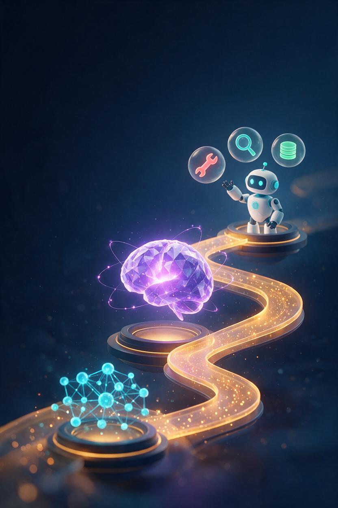

# Agent: From Zero to Hero

> **[中文版 README / Chinese README →](README.md)** | The book itself is written in Chinese; this page is for international visitors.

[](https://creativecommons.org/licenses/by-nc-sa/4.0/)



## What is this?

A complete, open-source Chinese book that takes you from **absolute zero** (what is a neuron?) to **building production-grade AI Agents** — one continuous learning path, no skipped steps.

The core belief: **Agents are the tip of a tower.** The foundation is neural networks, the body is LLMs, and only then come agents. This book climbs the whole tower with you.

## Highlights

- 📖 **20 chapters, 6 parts, 300+ pages** — fully written, not an outline
- 💻 **60+ runnable experiments** — every code block was actually executed; every printed output is real
- 🔢 **Zero black boxes** — hand-compute 3×3 convolutions, derive backprop for a 2-2-1 network, hand-calculate attention weights for 3 tokens
- 🎨 **60+ custom figures** with a consistent visual system
- 📄 **Full PDF included**: [Agent从零到专家.pdf](Agent从零到专家.pdf) (302 pages, A4)

## Table of Contents

| Part | Chapters |
|---|---|
| **Part 1 · DL Foundations** | Neural networks · CNN · Backpropagation (hand-derived in NumPy) |
| **Part 2 · LLMs** | Tokenization/Embedding/Positional encoding · Transformer (from scratch in PyTorch) · SFT/LoRA/RLHF/DPO · Prompt engineering · Inference & deployment (KV cache, quantization, Ollama/vLLM) |
| **Part 3 · Agent Core** | What is an Agent · ReAct/Plan-and-Execute/Reflexion · Tool/Function Calling · MCP & A2A protocols |
| **Part 4 · RAG & Memory** | RAG from scratch (chunking, vector DB, hybrid search) · Memory mechanisms (short/long-term, MemGPT, mem0) |
| **Part 5 · Advanced** | Skill/plugin systems · Multi-agent collaboration · Evaluation, observability & safety |
| **Part 6 · Projects** | A 253-line mini Agent framework · Personal knowledge-base Agent · Multi-agent automated news pipeline |

## Run the code

```bash
python >= 3.10
pip install numpy torch transformers matplotlib
```

All experiment code lives in [`code/`](code/), organized by chapter. LLM-dependent examples use a **mock-LLM + real-API dual-track** design, so everything runs offline out of the box.

## Rebuild the PDF

```bash
./build_pdf.sh   # requires pandoc + xelatex, Chinese font PingFang SC
```

## License

Content: [CC BY-NC-SA 4.0](https://creativecommons.org/licenses/by-nc-sa/4.0/) · Code: MIT

---

*中文读者请直接阅读 [README.md](README.md)。*
