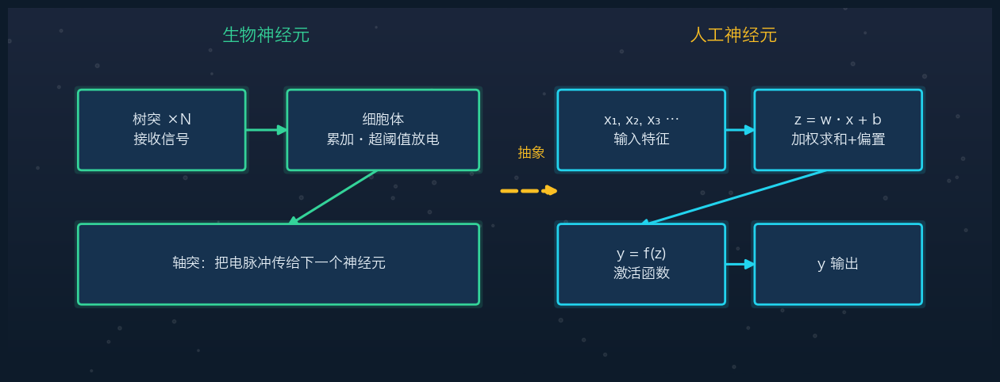
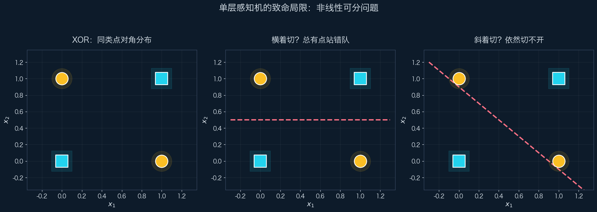
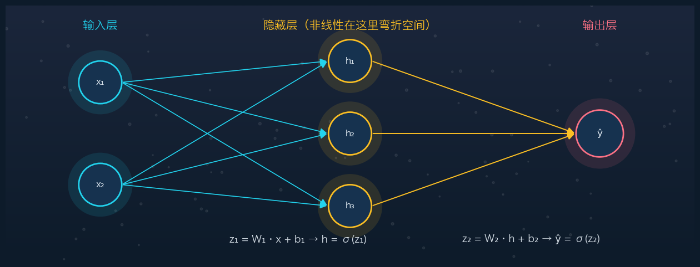
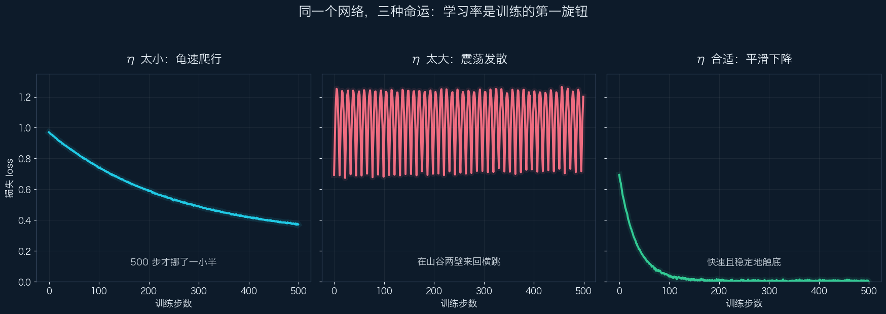

# 第 1 章 神经网络基础：从感知机到多层网络


> **本章目标**：理解神经网络最核心的三件事——**模型如何表达**、**误差如何衡量**、**参数如何学习**。读完本章，你将用纯 NumPy 从零写出一个能解决 XOR 问题的两层神经网络，再用 PyTorch 重写一遍，体会框架的价值。

## 📖 开篇故事：一场被报纸提前透支的胜利

1958 年的纽约，《纽约时报》用近乎科幻的笔调报道了一台刚诞生的机器——感知机 Mark I。这台由美国海军出资建造的设备据称是“一台会走路、说话、看东西、写字、自我复制且拥有意识的电子计算机的胚胎”，发明者 Rosenblatt 预言它终将识别语音、翻译语言。公众以为智能机器呼之欲出。1969 年，Minsky 和 Papert 出版《Perceptrons》一书，用严密的证明给热潮泼了冰水：单层感知机连 XOR 都切不开，堆叠多层又没有可行的训练方法。经费枯竭，第一次“AI 寒冬”降临。而解药（链式法则）要等到十几年后才以“反向传播”之名被重新发现，多层网络的火种才被重新点燃。本章讲的正是这段从“一条直线切不开”到“多层网络万能”的逻辑。

## 1.1 从生物神经元到人工神经元

人脑约有 860 亿个神经元。每个神经元的结构可以简化为：

- **树突**（Dendrites）：接收其他神经元传来的信号；
- **细胞体**（Soma）：把所有信号累加，超过某个阈值就"放电"；
- **轴突**（Axon）：把电脉冲传给下一个神经元。

1943 年，McCulloch 和 Pitts 把这个过程抽象成一个数学模型，这就是**人工神经元**的雏形。1957 年，Rosenblatt 提出感知机（Perceptron），第一次让这个模型可以自动学习。



**类比**：把神经元想象成一位"评委"。每位选手（输入 $x_i$）的表现有一个重要程度（权重 $w_i$），评委打出的总分是加权和；总分超过门槛（偏置 $b$ 调整门槛高低）才亮灯（输出 1）。

这个抽象大胆得近乎粗暴。真实神经元有放电频率、突触延迟、神经递质等几十种复杂行为，人工神经元只保留了"加权 + 阈值"这一件事。但它抓住了要害——**可计算的输入输出映射**。此后七十年，人们不断往这个骨架上添肉，骨架本身从未变过。

## 1.2 感知机：数学模型与致命局限

### 1.2.1 数学模型

感知机是一个线性分类器：

$$
\hat{y} = \sigma\big(\mathbf{w}^\top \mathbf{x} + b\big), \quad \sigma(z) = \begin{cases} 1 & z \ge 0 \\ 0 & z < 0 \end{cases}
$$

- $\mathbf{x} \in \mathbb{R}^d$：输入特征向量；
- $\mathbf{w} \in \mathbb{R}^d$：权重（决定每个特征的重要性）；
- $b \in \mathbb{R}$：偏置（决定决策边界离原点的远近）；
- 决策边界是超平面 $\mathbf{w}^\top \mathbf{x} + b = 0$。

### 1.2.2 阅读数据的能力：OR 与 AND

感知机可以轻松拟合 **AND** 和 **OR**（这是"**线性可分**"问题，即可以用一条直线把两类点分开）：

| $x_1$ | $x_2$ | AND | OR | XOR |
|:---:|:---:|:---:|:---:|:---:|
| 0 | 0 | 0 | 0 | 0 |
| 0 | 1 | 0 | 1 | 1 |
| 1 | 0 | 0 | 1 | 1 |
| 1 | 1 | 1 | 1 | 0 |

AND 和 OR 为什么"简单"？因为它们的四个点可以用一条直线切成两半：AND 的三个 0 抱成一团待在角落，OR 的三个 1 占据外侧。几何上一刀两断，代数上一个超平面搞定，感知机学起来毫不费力。

### 1.2.3 XOR 问题：一条直线切不开

把 XOR 的四个点画在平面上，问题一目了然：



同类的点（●=1 类：左上和右下；■=0 类：左下和右上）对角分布。无论直线怎么画，都无法只把 ● 圈在一侧，因为 XOR 是**非线性可分**的。这个小小的反例在 1969 年被 Minsky 和 Papert 写进《Perceptrons》一书，直接引发第一次"AI 寒冬"。

**关键教训**：单层感知机的表达能力上限就是线性决策边界。要解决非线性问题，必须堆叠多层，前提是有一个可导的激活函数把层与层连接起来。

为什么"对角分布"就无解？不妨反过来想：直线的一侧永远是一个"半平面"，而 ● 类的两个点分别处在两条对角线上，任何半平面要么同时圈进 ○，要么漏掉某个 ●。线性模型的"刀法"只有这一种：一刀，切无限平面为两半。XOR 要求的是两刀，这正是多层网络要出场的原因。

## 1.3 多层感知机（MLP）：万能的函数逼近器

**多层感知机**（Multi-Layer Perceptron, MLP）的结构是：



前向传播的计算分两步：隐藏层 $h = \sigma(W_1 x + b_1)$（非线性在这里），输出层 $\hat{y} = \sigma(W_2 h + b_2)$。

两个要点：

1. **隐藏层负责"弯折"空间**。每一层先做线性变换，再经过非线性激活，相当于把空间"折叠"一次。层数越多，能表达的决策边界越复杂。
2. **万能逼近定理**（Universal Approximation Theorem，Cybenko 1989 / Hornik 1991）：一个含足够多隐藏单元的单隐藏层网络，可以以任意精度逼近任意连续函数 $f: [0,1]^d \to \mathbb{R}$。注意：定理只保证"存在"，不保证"好学"，也不告诉你需要多少神经元，这正是深度网络研究的起点。

MLP 学 XOR 的直觉：隐藏层先学出两条"斜线"，把输入空间切成两个半平面，输出层再把两个半平面的指示信号做 OR。两刀下去，对角区域就被圈出来了。

> 💡 **深入思考**：万能逼近定理经常被误读成"一个隐藏层就够了，深度没必要"。请注意定理证明的是**表达能力**（存在这样一组权重），而不是**可学习性**（梯度下降能找到它）。用浅而宽的网络去表达复杂函数，所需神经元数可能随复杂度指数增长；而深层网络可以用"层层复合"的方式指数级地节省参数，这就是"深度学习"里"深度"二字的分量。存在，不等于找得到；找得到，不等于泛化得好。

## 1.4 激活函数：网络的"非线性引擎"

没有激活函数，100 层线性层叠起来仍然等价于 1 层（$\mathbf{W}_2 \mathbf{W}_1 \mathbf{x} = \mathbf{W} \mathbf{x}$）。激活函数是深度的前提。

| 激活函数 | 公式 | 值域 | 导数 | 主要问题 |
|:---|:---|:---|:---|:---|
| **Sigmoid** | $\sigma(z) = \frac{1}{1+e^{-z}}$ | $(0,1)$ | $\sigma'(z) = \sigma(1-\sigma)$，最大 0.25 | 饱和区梯度趋 0，输出非零中心 |
| **Tanh** | $\tanh(z) = \frac{e^z - e^{-z}}{e^z + e^{-z}}$ | $(-1,1)$ | $1-\tanh^2(z)$，最大 1.0 | 仍有饱和问题 |
| **ReLU** | $\max(0, z)$ | $[0,+\infty)$ | $z>0$ 时为 1，$z \le 0$ 时为 0 | 神经元可能"死亡"（Dead ReLU） |
| **Softmax** | $\frac{e^{z_i}}{\sum_j e^{z_j}}$ | 多分类概率分布 | 与全向量相关 | 只用于输出层 |

几点说明：

- **Sigmoid 的梯度消失**：当 $|z|$ 很大时 $\sigma(z)$ 饱和在 0 或 1，导数趋近 0。深网络中梯度连乘 $n$ 次，$0.25^n$ 迅速归零，这就是**梯度消失**（vanishing gradient），是深网络训练的头号杀手。
- **ReLU 为什么流行**：正区间导数恒为 1，梯度畅通；计算只需一次比较；单侧饱和还带来稀疏性。缺点是负区间导数为 0，若某神经元恒输出负值就永久失活。后续的 Leaky ReLU、GELU 都是针对这一点的改良。
- **Softmax** 把一组实数变成概率分布（全为正、和为 1），用于多分类输出层。它与交叉熵损失是黄金搭档（见 1.5 节）。

> 🎯 **面试高频**："为什么 ReLU 比 Sigmoid 更适合做隐藏层激活？"——标准答案至少要有三层：① **梯度特性**：Sigmoid 导数上界仅 0.25 且两端饱和，深层连乘后梯度迅速归零；ReLU 正区间导数恒为 1，深网络里梯度畅通无阻；② **计算成本**：Sigmoid 要算指数，ReLU 只是一次比较，训练快、推理快；③ **稀疏性**：单侧抑制让约半数神经元输出 0，表征更稀疏。加分项：主动指出 ReLU 的缺点（dead ReLU、非零中心），并给出 Leaky ReLU / GELU 等改良方向，能"先立后破"，说明你不是背答案。1.10 节的实验会给出这三种激活在同一个任务上的量化对比。

## 1.5 损失函数：给误差定价

训练需要把"预测得好不好"变成一个可优化的数字，这就是**损失函数**（Loss Function）。

### 1.5.1 均方误差（MSE）：回归任务

$$
\mathcal{L}_{\text{MSE}} = \frac{1}{n}\sum_{i=1}^{n}(\hat{y}_i - y_i)^2
$$

直觉：所有误差的平方取平均。平方放大了大误差的惩罚，且处处可导。

### 1.5.2 交叉熵（Cross-Entropy）：分类任务

二分类形式：

$$
\mathcal{L}_{\text{CE}} = -\frac{1}{n}\sum_{i=1}^{n}\Big[y_i \log \hat{y}_i + (1-y_i)\log(1-\hat{y}_i)\Big]
$$

直觉：真实答案 $y=1$ 时，只有 $\log \hat{y}$ 项生效：你预测的概率 $\hat{y}$ 越接近 1，损失越接近 0；预测 0.01 时损失就是 $\log 100 \approx 4.6$。交叉熵是**"自信地错"的天价罚单**：预测概率 0.9 且错，罚 $-\log 0.1 \approx 2.3$；预测 0.6 且错，只罚 $-\log 0.4 \approx 0.92$。

多分类（配合 Softmax）形式：

$$
\mathcal{L}_{\text{CE}} = -\sum_{i} y_i \log \hat{y}_i
$$

其中 $y$ 是 one-hot 标签，$\hat{y}$ 是 softmax 输出。

**为什么分类不用 MSE**？MSE + Sigmoid 的组合会在饱和区产生极小梯度、收敛缓慢；交叉熵 + Sigmoid/Softmax 的梯度恰好是 $\hat{y} - y$，形式干净且误差越大梯度越大，收敛更快。

交叉熵的梯度之所以能化简成 $\hat{y} - y$，是设计出来的，不是大自然的馈赠。对数损失的作用，恰好把 Sigmoid/Softmax 输出层的导数"约分"干净，误差大时梯度大、误差小时梯度小，永远不会在饱和区"哑火"。反过来，如果你硬把 MSE 接在 Sigmoid 后面，导数里会多出一个 $\hat{y}(1-\hat{y})$ 因子，预测越自信梯度越接近 0：模型错得越离谱，反而越"听不见"批评。损失函数的选择从来不是约定俗成，而是对梯度通路的工程设计。第 3 章推导反向传播时，你会再次与这个优雅的等式相遇。

## 1.6 梯度下降：在山谷里找最低点

### 1.6.1 核心思想

把损失函数想象成一片山地，参数 $\mathbf{w}$ 是你的位置，梯度 $\nabla_{\mathbf{w}}\mathcal{L}$ 指向上坡最快的方向。那往反方向走一步，就一定下降：

$$
\mathbf{w} \leftarrow \mathbf{w} - \eta \cdot \nabla_{\mathbf{w}}\mathcal{L}
$$

其中 $\eta$（eta）是**学习率**（learning rate）。

**类比**：浓雾天登山，你看不见全景，只能用脚感受脚下的坡度，向下坡方向迈一小步，再感受，再迈步……最终走到某个谷底。

### 1.6.2 学习率：步子太大或太小的代价

- $\eta$ 太小：收敛极慢，训练像蜗牛爬行；
- $\eta$ 太大：在最优点附近来回"震荡"甚至发散，损失越训越大；
- $\eta$ 合适：损失平滑下降。



实践中通常从 $10^{-3}$ 量级试起，配合学习率衰减或 Adam 优化器（第 4 章详述）。

还有一个流传极广的错误直觉：“学习率小一点总归更安全吧？大不了多训几轮。”错。学习率太小不仅有“慢”的代价，还有“差”的代价：梯度下降在非凸地形里本来就要靠足够大的步子（加上随机噪声）跨过鞍点和小坑；步子太小，优化过程可能在半山腰的平台上“躺平”，训练几百轮 loss 纹丝不动。反过来，盲目调大也一样危险——loss 飙成 NaN、权重爆炸，训练直接报废。学习率是所有超参数里最值得优先扫描的一个，1.9 节的实验会让你亲眼看到同一个网络因学习率不同而走上五种命运。

### 1.6.3 凸与非凸：直觉

- **凸函数**（如线性回归 + MSE）只有一个全局最小值，像一只碗，梯度下降走到哪都能滑到底；
- **非凸函数**（几乎所有神经网络）地形起伏，有无数个局部极小值和**鞍点**（一个方向上是谷底、另一个方向上是山脊）。

好消息：高维参数空间里，鞍点远比"坏死的局部极小值"常见，梯度往往至少在一个方向非零，加上随机性（mini-batch 的噪声、初始化的随机性），实践中总能找到"足够好"的解。**我们不追求全局最优，只追求损失足够低。**

### 1.6.4 三种梯度下降

| 变体 | 每步用多少数据 | 特点 |
|:---|:---|:---|
| 批量（BGD） | 全部训练集 | 稳定但慢，一步算一次全量梯度 |
| 随机（SGD） | 单个样本 | 快但噪声极大，路径抖动 |
| **小批量（Mini-batch）** | 32/64/128 个样本 | 深度学习标配：兼顾速度、稳定与 GPU 并行 |

### 1.6.5 反向传播：梯度的连锁计算

多层网络求梯度靠**反向传播**（Backpropagation），本质是微积分的**链式法则**在计算图上的自动应用。对两层网络：

$$
\frac{\partial \mathcal{L}}{\partial \mathbf{W}_1} = \frac{\partial \mathcal{L}}{\partial \hat{y}} \cdot \frac{\partial \hat{y}}{\partial \mathbf{h}} \cdot \frac{\partial \mathbf{h}}{\partial \mathbf{W}_1}
$$

梯度从输出层"逆着前向传播的路径"逐层传回输入侧，这就是 1.7 节代码里 `delta` 一层层往前乘的过程。

## 1.7 实战 1：纯 NumPy 从零实现两层网络解 XOR

现在把理论变成代码。网络结构：2 个输入 → 3 个隐藏单元（tanh）→ 1 个输出（Sigmoid）→ 二分类交叉熵。

```python
import numpy as np

np.random.seed(42)

# ---------- 数据 ----------
X = np.array([[0, 0], [0, 1], [1, 0], [1, 1]], dtype=np.float64)  # (4, 2)
y = np.array([[0], [1], [1], [0]], dtype=np.float64)              # XOR 真值 (4, 1)

# ---------- 超参数 ----------
H, lr, epochs = 3, 0.5, 10000

# ---------- 参数初始化 ----------
W1 = np.random.randn(2, H) * 0.5      # (2, 3)
b1 = np.zeros((1, H))
W2 = np.random.randn(H, 1) * 0.5      # (3, 1)
b2 = np.zeros((1, 1))

# ---------- 激活函数 ----------
def tanh(z):     return np.tanh(z)
def tanh_d(a):   return 1 - a ** 2          # a = tanh(z), 用输出表示导数
def sigmoid(z):  return 1 / (1 + np.exp(-z))
def bce(p, t):   return -np.mean(t * np.log(p) + (1 - t) * np.log(1 - p))  # 交叉熵

# ---------- 训练 ----------
for epoch in range(epochs):
    # -- 前向传播 --
    z1 = X @ W1 + b1        # (4, 3)  线性
    a1 = tanh(z1)           # (4, 3)  非线性
    z2 = a1 @ W2 + b2       # (4, 1)
    a2 = sigmoid(z2)        # 预测概率 ŷ

    loss = bce(a2, y)

    # -- 反向传播 (链式法则, 逐层回传) --
    # 输出层: dL/da2 交叉熵×sigmoid 合并后 = (a2 - y) / n
    d_z2 = (a2 - y) / len(y)                    # (4, 1)
    dW2  = a1.T @ d_z2                          # (3, 1)
    db2  = d_z2.sum(axis=0, keepdims=True)      # (1, 1)

    d_a1 = d_z2 @ W2.T                          # (4, 3) 梯度流回隐藏层
    d_z1 = d_a1 * tanh_d(a1)                    # (4, 3) 乘激活函数导数
    dW1  = X.T @ d_z1                           # (2, 3)
    db1  = d_z1.sum(axis=0, keepdims=True)      # (1, 3)

    # -- 梯度下降更新 --
    W2 -= lr * dW2;  b2 -= lr * db2
    W1 -= lr * dW1;  b1 -= lr * db1

    if epoch % 2000 == 0:
        print(f"epoch {epoch:5d}  loss = {loss:.4f}")

# ---------- 评估 ----------
pred = (a2 > 0.5).astype(int)
print("\n预测:", pred.ravel(), " 真值:", y.ravel(), " 准确率:", (pred == y).mean())
```

运行后你会看到损失从 0.7 左右一路降到 0.01 以下，四个 XOR 样本全部预测正确。**这个不到 40 行的程序，单层感知机永远做不到。**

代码与公式可以逐行对照：`a1 = tanh(z1)` 是前向传播，`d_z1 = d_a1 * tanh_d(a1)` 就是链式法则中的 $\frac{\partial \mathcal{L}}{\partial \mathbf{z}_1} = \frac{\partial \mathcal{L}}{\partial \mathbf{a}_1} \odot \tanh'(\mathbf{z}_1)$。

## 1.8 实战 2：PyTorch 重写同一网络

```python
import torch
import torch.nn as nn

torch.manual_seed(42)

X = torch.tensor([[0., 0.], [0., 1.], [1., 0.], [1., 1.]])
y = torch.tensor([[0.], [1.], [1.], [0.]])

# ---------- 定义模型: 3 行代替手写的全部结构 ----------
model = nn.Sequential(
    nn.Linear(2, 3),   # W1·x + b1
    nn.Tanh(),         # 隐藏层激活
    nn.Linear(3, 1),   # W2·h + b2
    nn.Sigmoid(),      # 输出概率
)

criterion = nn.BCELoss()                              # 二分类交叉熵
optimizer = torch.optim.SGD(model.parameters(), lr=0.5)

for epoch in range(10000):
    pred = model(X)                                   # 前向传播
    loss = criterion(pred, y)                         # 计算损失
    optimizer.zero_grad()                             # 清空旧梯度
    loss.backward()                                   # 反向传播(自动!)
    optimizer.step()                                  # 参数更新

    if epoch % 2000 == 0:
        print(f"epoch {epoch:5d}  loss = {loss.item():.4f}")

with torch.no_grad():
    acc = ((model(X) > 0.5).float() == y).float().mean()
print("准确率:", acc.item())
```

对比一下你手写的内容去了哪里：

| 你手写的 | PyTorch 对应 |
|:---|:---|
| `W1, b1, W2, b2` 初始化 | `nn.Linear` 内部自动完成 |
| `tanh` / `sigmoid` 及导数 | `nn.Tanh()` / `nn.Sigmoid()` |
| 手推的 5 行梯度公式 | `loss.backward()` 一行搞定 |
| `W -= lr * dW` 更新循环 | `optimizer.step()` |
| 均值、维度对齐等易错细节 | 框架内部保证 |

**框架没有替你思考，只是替你搬砖。** 反向传播公式你必须亲手推过一次，才能在 `loss.backward()` 之后的梯度为 `None`、维度不匹配报错时，知道问题出在哪。

## 1.9 实战 3：学习率扫描——同一个网络，五种命运

1.6.2 节说学习率"太大太小都不行"，但空口无凭。我们把 1.7 节的网络封装成函数，只动学习率这一个旋钮，看训练轨迹如何分道扬镳：

```python
import numpy as np

X = np.array([[0., 0.], [0., 1.], [1., 0.], [1., 1.]])
y = np.array([[0.], [1.], [1.], [0.]])

def build(seed=42):                          # 与 1.7 节同款结构: 2 -> 3 -> 1
    g = np.random.default_rng(seed)
    return (g.normal(0, 0.5, (2, 3)), np.zeros(3),
            g.normal(0, 0.5, (3, 1)), np.zeros(1))

def forward(X, W1, b1, W2, b2):
    h = np.tanh(X @ W1 + b1)
    return h, 1 / (1 + np.exp(-(h @ W2 + b2)))

def train(lr, epochs=10000):
    W1, b1, W2, b2 = build()
    marks = {}
    for ep in range(1, epochs + 1):
        h, y_hat = forward(X, W1, b1, W2, b2)
        loss = -np.mean(y * np.log(y_hat + 1e-12) + (1 - y) * np.log(1 - y_hat + 1e-12))
        if ep in (100, 1000, 5000, 10000):
            marks[ep] = loss
        d_z2 = (y_hat - y) / 4                          # 输出层误差信号
        W2 -= lr * (h.T @ d_z2)      ; b2 -= lr * d_z2.sum(0)
        d_z1 = (d_z2 @ W2.T) * (1 - h ** 2)             # 回传 × tanh 导数
        W1 -= lr * (X.T @ d_z1)      ; b1 -= lr * d_z1.sum(0)
    return marks

print(f"学习率 | ep 100  | ep 1000 | ep 5000 | ep 10000 | 结局")
for lr in [0.01, 0.1, 0.5, 5.0, 50.0]:
    m = train(lr)
    row = " | ".join(f"{m[ep]:>7.4f}" for ep in (100, 1000, 5000, 10000))
    if m[10000] > 10:   verdict = "发散：一步跨出山谷，再也回不来"
    elif m[10000] > 0.05: verdict = "龟速：10000 轮仍未收敛"
    else:                verdict = "顺利收敛"
    print(f"{lr:>5} | {row} | {verdict}")
```

在本书写作机器上的真实输出（NumPy 2.0 / Python 3.9，种子固定，你可复现出完全一致的数字）：

```text
学习率 | ep 100  | ep 1000 | ep 5000 | ep 10000 | 结局
 0.01 |  0.6870 |  0.6701 |  0.4401 |  0.0986 | 龟速：10000 轮仍未收敛
  0.1 |  0.6703 |  0.0986 |  0.0063 |  0.0028 | 顺利收敛
  0.5 |  0.4419 |  0.0063 |  0.0010 |  0.0005 | 顺利收敛
  5.0 |  0.5256 |  0.0012 |  0.0001 |  0.0001 | 顺利收敛
 50.0 | 13.8155 | 13.8155 | 13.8155 | 13.8155 | 发散：一步跨出山谷，再也回不来
```

三行结论：

1. **0.01 是"假安全"**：训练 10000 轮，loss 才从 0.69 挪到 0.0986，每一步几乎都在原地打转。小学习率的代价不只是慢，而是可能永远到不了。
2. **0.5 是这题的甜蜜点**：1000 轮就降到 0.006。注意它并非"越保守越好"，也不是"越大越好"，而是存在一个区间。
3. **50 直接宣判死刑**：第一步就冲出可行域，log 里出现 $\log(\text{接近}0)$，loss 爆到 13.8，之后永远卡死：模型对四个样本的预测全部饱和，梯度信号彻底消失，发散之后连回头的机会都没有。

有趣的细节是 5.0 居然也收敛了，而且最终 loss 最低。别被它骗了：XOR 只有 4 个样本、地形简单，大步子反而在这种"小操场"里占便宜。真实任务有百万样本和百万参数，地形陡峭崎岖，大学习率几乎必然震荡发散。这也是为什么实践里没人敢裸奔 5.0，而是用"预热 + 衰减"的调度策略（第 4 章）。

## 1.10 实战 4：激活函数大赛——Sigmoid、Tanh、ReLU 三车对撞

1.4 节的表格给了三种隐藏层激活的"理论体检报告"，但纸面数据不如赛道见真章。规则很简单：同一个 XOR 网络（结构、初始化、学习率全部锁死），只换隐藏层激活函数，看谁最先把 loss 压到 0.05 以下：

```python
import numpy as np

X = np.array([[0., 0.], [0., 1.], [1., 0.], [1., 1.]])
y = np.array([[0.], [1.], [1.], [0.]])

ACTS = {
    "sigmoid": (lambda z: 1 / (1 + np.exp(-z)), lambda a: a * (1 - a)),
    "tanh":    (np.tanh, lambda a: 1 - a ** 2),
    "relu":    (lambda z: np.maximum(z, 0), lambda a: (a > 0).astype(float)),
}

def train(act_name, seed=42, epochs=6000, lr=0.5):
    f, df = ACTS[act_name]
    g = np.random.default_rng(seed)
    W1, b1 = g.normal(0, 1.0, (2, 4)), np.zeros(4)
    W2, b2 = g.normal(0, 1.0, (4, 1)), np.zeros(1)
    for epoch in range(1, epochs + 1):
        a1 = f(X @ W1 + b1)                       # 隐藏层
        y_hat = 1 / (1 + np.exp(-(a1 @ W2 + b2)))  # 输出层固定 sigmoid
        loss = -np.mean(y * np.log(y_hat + 1e-12) + (1 - y) * np.log(1 - y_hat + 1e-12))
        d_z2 = (y_hat - y) / 4
        gW2, gb2 = a1.T @ d_z2, d_z2.sum(0)
        d_z1 = (d_z2 @ W2.T) * df(a1)
        gW1, gb1 = X.T @ d_z1, d_z1.sum(0)
        W1 -= lr * gW1 ; b1 -= lr * gb1 ; W2 -= lr * gW2 ; b2 -= lr * gb2
        if loss < 0.05:
            return epoch, loss, ((y_hat > 0.5) == y).mean()
    return epochs, loss, ((y_hat > 0.5) == y).mean()

print(f"{'隐藏层激活':>10} | {'初始loss':>8} | {'达标epoch(loss<0.05)':>20} | {'最终loss':>8} | 准确率")
for name in ["sigmoid", "tanh", "relu"]:
    ep, loss, acc = train(name)
    print(f"{name:>10} | {'~0.69':>8} | {ep:>20} | {loss:>8.4f} | {acc:.2f}")
```

真实运行输出：

```text
隐藏层激活 |   初始loss |   达标epoch(loss<0.05) |   最终loss | 准确率
   sigmoid |      ~0.69 |                  1095 |    0.0500 | 1.00
      tanh |      ~0.69 |                   267 |    0.0499 | 1.00
      relu |      ~0.69 |                   154 |    0.0495 | 1.00
```

同一条起跑线（初始 loss 都约 0.69），三个终点却差出一个数量级：Sigmoid 用了 1095 轮，Tanh 只用 267 轮，ReLU 更是 154 轮冲线。为什么？答案就藏在 1.4 节那张表的"导数"列里：

- **Sigmoid 的导数上界是 0.25**：误差信号每穿过一层至少打四折，梯度还没走到前面的权重跟前就已经"贫血"；
- **Tanh 导数上界是 1.0**，且输出零中心化（均值约 0），比 Sigmoid 干净一倍不止；
- **ReLU 正区间导数恒为 1**：误差信号全速通过，梯度不衰减。

再想想：这还只是一个隐藏层的差距。如果是 10 层、100 层的深网络，0.25 的连乘是什么概念？$0.25^{10} \approx 10^{-6}$。这就是第 3 章要正面强攻的"梯度消失"，届时我们会用代码逐层实测每层权重的梯度范数，把这条"贫血曲线"画给你看。

顺带一提，ReLU 的 154 轮还不是它的极限：它对初始化更宽容、对学习率更皮实，这些性质在深网络里会被成倍放大。这也是 2012 年 AlexNet 敢用 ReLU 替换 Sigmoid、把训练提速数倍的底气所在（下一章的故事）。

## 1.11 常见名词速查表

| 术语 | 含义 | 一句话直觉 |
|:---|:---|:---|
| **Epoch** | 全部训练数据完整过一遍 | 通读一遍教材 |
| **Iteration / Step** | 一次参数更新 | 做了一道练习题 |
| **Batch** | 一次迭代同时使用的样本数 | 一组练习题一起做 |
| **参数（Parameter）** | 模型自动学出的量（$W, b$） | 学生自己总结的笔记 |
| **超参数（Hyperparameter）** | 人为设定的量（$\eta$、层数、epoch 数） | 老师定的教学计划 |
| **前向传播** | 输入逐层算到输出 | 做题 |
| **反向传播** | 误差逐层回传算梯度 | 对答案找错因 |
| **过拟合（Overfitting）** | 训练集分高、新数据分低 | 背题库而非学方法 |
| **欠拟合（Underfitting）** | 连训练集都学不好 | 压根没学会 |
| **正则化（Regularization）** | 约束模型复杂度防过拟合 | 限制笔记厚度逼你抓重点 |
| **泛化（Generalization）** | 在未见数据上的表现 | 换一套新题还能做对 |
| **学习率 $\eta$** | 每步更新的步长 | 学习的"胆子"大小 |

> 🎯 **面试高频**："Epoch、Iteration、Batch Size 三者什么关系？"这是几乎每家公司的一面都会问的题。换算公式一句话：**1 epoch = 训练集样本数 ÷ batch size 次 iteration**。例如 60000 个样本、batch size = 128，一个 epoch 就是约 469 次参数更新。追问通常还有两个方向：① batch size 太大/太小各有什么问题（太大：显存吃紧、易陷进尖锐极小值附近、泛化变差；太小：梯度噪声大、无法充分利用 GPU 并行）；② 为什么训练 loss 看的是"每个 batch 的平均"，而准确率要按样本数加权。把这张表吃透，这类题就是送分题。

正则化最常用的两种：**L2 正则**（在损失中加 $\lambda \sum w^2$，把权重"拽小"，让模型更平滑）与 **Dropout**（训练时随机丢弃部分神经元，强迫网络不依赖个别节点）。第 3 章会展开。

> ⚠️ **常见误区**："训练 loss 一直在降，模型肯定在越变越好。"——未必。你看到的只是它在**训练集**上的表现；过拟合发生时，训练 loss 照样一路下探，而验证/测试 loss 早在某个点就开始回升。这就像一个学生把题库答案背得滚瓜烂熟（训练 loss = 0），换一套新题就露馅（测试 loss 爆表）。工程铁律：**永远同时监控训练与验证两条曲线**，分歧开始拉大的那个时刻，就是过拟合的开始；早停（early stopping）就是在这个时刻收手。1.10 节实验里我们只看训练 loss 是因为 XOR 总共就 4 个样本、无泛化可言，真实项目里没有这种奢侈品。

## 本章小结

- 人工神经元是生物神经元的数学抽象：**加权求和 + 激活**；感知机是它的线性分类器形态。
- 单层感知机只能画**线性决策边界**，XOR 问题暴露了这一局限，也因此催生了多层网络。
- MLP 通过隐藏层和非线性激活获得**万能逼近**能力；没有非线性激活，再深也等价于单层。
- **Sigmoid/Tanh** 有饱和梯度问题，**ReLU** 是现代默认选择，**Softmax** 专司多分类输出。
- 分类用**交叉熵**、回归用 **MSE**；交叉熵与 Sigmoid/Softmax 组合可让梯度形如 $\hat{y} - y$，收敛干净利落。
- 训练 = **前向传播算损失 → 反向传播算梯度 → 梯度下降更新参数**，学习率是其中最敏感的旋钮：扫描实验显示它能让同一个网络走上"龟速 / 收敛 / 发散"五种命运。
- 激活函数对比实验给出量化结论：同样任务下 Sigmoid 1095 轮、Tanh 267 轮、ReLU 154 轮达标，导数上界（0.25 vs 1.0）是背后的第一推手。
- 手写 NumPy 版本让你理解原理，PyTorch 版本让你专注于结构与实验，两者缺一不可。

写到这里，你已经知道神经网络"怎么学"。但第 1 章的网络处理的是四个数字，如果输入是一张照片：几万个像素排着队进来，全连接网络的参数会立刻爆炸，而且它对像素的空间位置一无所知。下一章的卷积神经网络，就是为解决这个问题而生的。

## 练习题

1. **概念题**：把 10 个线性层（不含激活函数）串联，其整体等价于什么？由此说明激活函数的必要性。
2. **推导题**：证明 Sigmoid 的导数满足 $\sigma'(z) = \sigma(z)(1 - \sigma(z))$。并求 $z = 0$ 处的导数值。
3. **推导题**：对单个样本，推导交叉熵 + Sigmoid 输出层满足 $\frac{\partial \mathcal{L}}{\partial z} = \hat{y} - y$（提示：链式法则，代入 $\sigma'$）。
4. **实验题**：把 1.7 节代码的学习率改为 5、0.1、0.01 分别运行，观察并解释收敛行为的差异。
5. **实验题**：把隐藏单元数从 3 改为 2，再改为 8，各训练 10 次（换随机种子），统计成功次数。隐藏层 2 个单元理论上足以解 XOR，为什么有时仍训练失败？
6. **思考题**：某模型训练准确率 99%，测试准确率 60%。这是过拟合还是欠拟合？给出至少两种可尝试的对策。
7. **编程题**：修改 1.8 节代码，把隐藏层换成 `nn.ReLU()`，并将优化器换成 `torch.optim.Adam(lr=0.01)`，比较收敛速度。
8. **实验题**：把 1.9 节扫描程序的学习率序列改为 `[0.03, 0.3, 3, 30, 300]`，重新运行并总结规律：发散的临界点在哪里？再把训练轮数减半，结论会变吗？
9. **实验题**：给 1.10 节的 `ACTS` 字典增加 Leaky ReLU（负区间斜率 0.1），重新比武。它能超过 ReLU 吗？在 XOR 这种小任务上为什么差距不大？

## 📚 延伸阅读

1. **Rosenblatt, F. (1958). *The Perceptron: A Probabilistic Model for Information Storage and Organization in the Brain*.** Psychological Review, 65(6), 386–408.——感知机的原始论文，读它能感受 1958 年那种乐观的底色：<https://doi.org/10.1037/h0042519>
2. **Minsky, M. & Papert, S. (1969). *Perceptrons: An Introduction to Computational Geometry*.** MIT Press.——终结第一次热潮的那本书，"XOR 不可分"证明的原产地：<https://mitpress.mit.edu/9780262631063/perceptrons/>
3. **Cybenko, G. (1989). *Approximation by Superpositions of a Sigmoidal Function*.** Mathematics of Control, Signals and Systems, 2, 303–314.——万能逼近定理的经典证明：<https://doi.org/10.1007/BF02551274>
4. **Michael Nielsen, *Neural Networks and Deep Learning*.**——至今最好的免费在线教材之一，前两章与本章内容互补，推导极其细致：<http://neuralnetworksanddeeplearning.com/>
5. **3Blue1Brown, *But what is a neural network?*（视频系列）.**——用动画把"加权求和 + 激活"讲得一眼入魂，配合本章食用效果极佳：<https://www.3blue1brown.com/topics/neural-networks>
