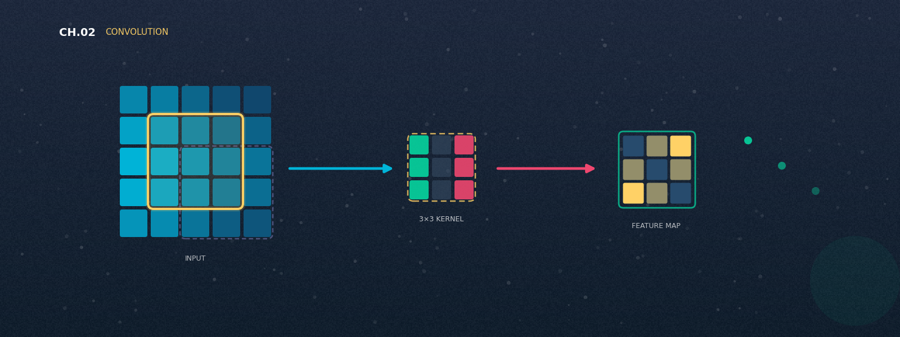
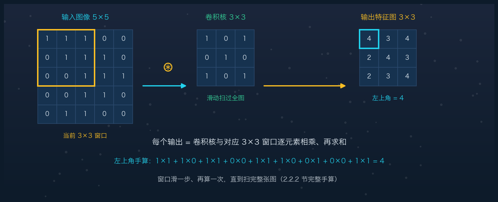
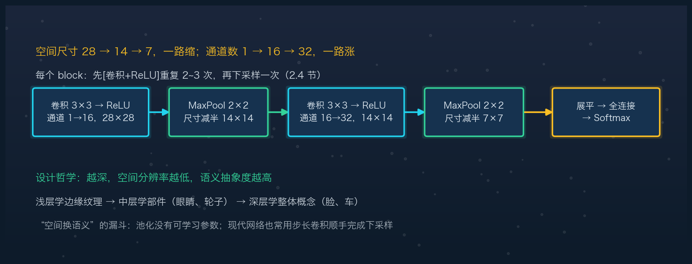

# 第 2 章 卷积神经网络（CNN）：让机器学会"看"



> **本章目标**：理解图像数据的特殊性，掌握卷积、池化两大核心操作，并亲手训练一个准确率约 99% 的 MNIST 手写数字识别模型。读完本章，你会明白 CNN 为何统治视觉领域十年，以及它的局限如何引出 Transformer。

---

## 📖 开篇故事：2012 年 ImageNet 的那个夜晚

决赛榜单公布那晚，多伦多大学 Hinton 实验室送去的 AlexNet 让 ImageNet 的评审们愣了一下。他们早已习惯“挤牙膏”式的进步：前两年，冠军把 top-5 错误率从 28% 磨到 26%。而这份 2012 年的参赛结果交出 15.3%，比第二名低了整整十一个百分点——别人在优化帆船，它开来了汽艇。秘密是 8 层卷积网络、6000 万参数、两块消费级游戏显卡 GTX 580：显存不够，Alex Krizhevsky 用程序把网络劈成两半分给两张卡。ReLU、Dropout、数据增强与 GPU 并行凑齐火花，引燃此后十年的深度学习燎原之火，学术 GPU 从此缺货。而它的骨架“卷积+池化+全连接”，早在 1998 年就被 LeCun 的 LeNet-5 定好了。它等了十四年，等的是算力、数据和 ReLU。本章我们就拆这个骨架的每一块。

---

## 2.1 为什么全连接网络"看不懂"图像

假设用第 1 章的 MLP 处理一张 $224 \times 224$ 的 RGB 图像：

- 输入维度 = $224 \times 224 \times 3 = 150{,}528$；
- 第一个隐藏层若有 1000 个神经元，仅这一层的参数量为

$$
150{,}528 \times 1000 + 1000 \approx 1.5 \times 10^8
$$

**1.5 亿参数，只是第一层。** VGG-16 若真用全连接处理特征图，全连接层参数可达上亿。这带来三个致命问题：

1. **参数量爆炸**：参数越多，需要的训练数据越多、显存越大、越容易过拟合；
2. **丢失空间结构**：把图像展平成一维向量，相邻像素的关系被打散。一只猫不管在图像左上角还是右下角，对全连接网络来说是**完全不同的输入模式**，它必须分别为每个位置学习一遍"猫的特征"；
3. **没有平移不变性**：真实世界里的物体位置千变万化，全连接网络天然无法泛化到"没见过的位置"。

人类视觉却不是这么工作的：你认得一张脸，不需要它固定出现在视野正中央。视觉系统的正确归纳偏置应该是：**局部相关性**（nearby 像素才有强关联）与**平移不变性**（特征出现在哪都算数）。CNN 正是这两种先验的工程化。

不妨做个思想实验来体会“归纳偏置”的分量：把一张猫图摊平成 15 万个数字随机打乱后再看，你还认得出猫吗？几乎不能，但对全连接网络来说，输入本来就只是“一列数字”，它并不比排好序的版本更难或更容易，它要花同样的代价分别学习每个位置的每个模式。而你的视觉系统和 CNN 都自带“相邻即相关”的假设，打乱后假设被破坏，能力也随之崩塌。**先验决定了哪些“考题”天生简单、哪些天生难。**

> 💡 **深入思考**：全连接网络不是"学不会看图"，而是"学不起"。理论上，只要给它足够多的参数、足够多的数据，它终究可以记住猫在每个位置的每个样子。但那是把先验该干的事推给了暴力穷举。CNN 的聪明之处在于**把"物体在哪不重要、长什么样才重要"写进了架构本身**。架构先验（归纳偏置）是免费的午餐：它让模型用少四个数量级的参数、少几个数量级的数据，学到同样甚至更好的表征。往后读到 Transformer（几乎不带图像先验）需要海量数据才能打平 CNN 时，你会更理解这顿"午餐"的价格标签。

## 2.2 卷积运算：滑动的小窗口

### 2.2.1 直觉

**卷积**（Convolution）用一个小的**滤波器**（filter，也叫卷积核 kernel）在图像上滑动，每个位置计算"滤波器与对应图像区域的加权和"，输出一张**特征图**（feature map）。



**类比**：卷积核像一个"盖章检查员"。它只认识一种图案（比如"斜着的边"），拿着这枚章在整张图上逐个位置盖下去：图案越匹配，盖出来的分数越高。一队不同的检查员（多个卷积核）各自找各的图案，有的找横边，有的找竖边，有的找圆角。

### 2.2.2 手算一个 3×3 卷积

输入图像（$5 \times 5$，下同 2.2.1 图）：

$$
\mathbf{X} = \begin{bmatrix} 1&1&1&0&0 \\ 0&1&1&1&0 \\ 0&0&1&1&1 \\ 0&0&1&1&0 \\ 0&1&1&0&0 \end{bmatrix}, \quad
\mathbf{K} = \begin{bmatrix} 1&0&1 \\ 0&1&0 \\ 1&0&1 \end{bmatrix}
$$

**第一个窗口**（输入左上角 $3\times 3$，行 1-3、列 1-3）：

$$
\begin{bmatrix} 1&1&1 \\ 0&1&1 \\ 0&0&1 \end{bmatrix} \odot \begin{bmatrix} 1&0&1 \\ 0&1&0 \\ 1&0&1 \end{bmatrix} =
\begin{bmatrix} 1&0&1 \\ 0&1&0 \\ 0&0&1 \end{bmatrix} \quad \Rightarrow \quad \text{求和} = 4
$$

所以特征图左上角是 **4**。

**第二个窗口**（列 2-4）：

$$
\begin{bmatrix} 1&1&0 \\ 1&1&0 \\ 0&1&1 \end{bmatrix} \odot \mathbf{K} = \begin{bmatrix} 1&0&0 \\ 0&1&0 \\ 0&0&1 \end{bmatrix} \quad \Rightarrow \quad \text{求和} = 3
$$

特征图第二格是 **3**。照此滑动，完整特征图为：

$$
\begin{bmatrix} 4&3&4 \\ 2&4&3 \\ 2&3&4 \end{bmatrix}
$$

如果你不放心，可以再验算几个格子：比如第三行第一列的窗口是行 3–5、列 1–3，对应子矩阵 $\begin{bmatrix}0&0&1\\0&0&1\\0&1&1\end{bmatrix}$，与核逐元素相乘后求和得 $0+0+1+0+0+0+0+0+1=2$，与特征图左下角的 2 对上了。建议拿笔在纸上完整算一遍：卷积就是“乘加求和”，没有更多魔法。2.7 节我们还会用十几行 NumPy 把这个过程写成代码，跟这页手算对答案。

### 2.2.3 权值共享：参数量的奇迹

关键设计：**同一个卷积核在所有位置复用**。

- 全连接：每个输入位置单独一套权重 → $150{,}528 \times 1000$ 参数；
- 卷积：一个 $3 \times 3 \times 3$ 的核只有 $27$ 个参数（加 1 个偏置共 28 个），却扫过整张图。

就算用 64 个不同的核，也只有 $64 \times 28 = 1792$ 个参数，**比全连接少了四个数量级**。更妙的是：因为核是共享的，"竖边"这个特征在图像任何角落被同等检测，平移不变性自动获得。

一个卷积层的输出是一叠特征图（每核一张），通常再接一个非线性激活（ReLU）：

$$
\text{特征图}_k = \text{ReLU}(\mathbf{X} * \mathbf{K}_k + b_k)
$$

权值共享还隐着一条世界观：**“竖边就是竖边”，不因它出现在左上角还是右下角而改变**。这相当于把一条物理定律写进了架构。但硬币有两面：共享意味着模型也**默认**了这条定律。当任务恰恰要求“位置本身携带信息”（比如判断肿瘤在 MRI 的哪个象限、人脸是否在画面正中央）时，位置信息反而要通过后续结构辛苦地重新学回来。架构先验从来不是免费的普适真理，它只是对问题域的一次押注：押对了省数据省参数，押错了就得花力气赎回来。

### 2.2.4 严谨地说：等变，而非不变

一个常被混用的概念对，值得现在掰清楚，因为它同时是理解 CNN 和答好面试题的钥匙：

- **平移等变（translation equivariant）**：输入平移，输出跟着同样平移。**卷积具有等变性**——图里的猫向右挪 5 像素，特征图上"猫的耳朵"的响应也向右挪 5 像素。
- **平移不变（translation invariant）**：输入平移，输出完全不变。**卷积本身不具备不变性**，是后面的池化和全局聚合一步步把"位置"抹掉的。

2.8 节的实验会直接验证等变性：把图像在画布上平移一格，卷积输出严格平移一格，一个数值都不差。而不变性，要等池化登场。

## 2.3 卷积层超参数与输出尺寸公式

| 超参数 | 含义 | 典型取值 | 作用 |
|:---|:---|:---:|:---|
| **Kernel Size** | 卷积核边长 | 3、5 | 感受野大小；越大看得越"远"但参数越多 |
| **Stride** | 每次滑动的步长 | 1、2 | 步长 2 相当于边滑边下采样 |
| **Padding** | 边缘补零圈数 | 0、1 | 控制输出尺寸，保留边缘信息 |

设输入尺寸 $N$（高或宽）、核大小 $k$、步长 $s$、补零 $p$，则输出尺寸：

$$
O = \left\lfloor \frac{N + 2p - k}{s} \right\rfloor + 1
$$

**验算**（2.2.2 的例子）：$N=5, k=3, s=1, p=0$，$O = \lfloor(5-3)/1\rfloor + 1 = 3$。正确。

这个公式还可以倒过来用，即“逆向配置”：假设你希望输出恰好是某个尺寸（比如把 224 压到 56），从公式反解出合法的 $(k, s, p)$ 组合再挑参数量最省的。工程里“想当然配一组超参、跑起来报尺寸错”几乎是每个新手的必经之路，而背下这条例行公式的真正价值，是让你在写代码前就能心算出每一层的形状，把那个报错扼杀在草稿纸上。

**常用搭配**：$k=3, s=1, p=1$ 时 $O = N$（尺寸不变，最常用）；$k=5, s=1, p=2$ 同样保持尺寸；$k=3, s=2, p=1$ 时 $O = \lfloor(N-1)/2\rfloor + 1$（约减半，替代池化做下采样）。

若不做 padding，边缘像素被"扫过"的次数少于中心像素，信息被系统性削弱，这就是 padding 存在的理由。

> ⚠️ **常见误区**：背下公式不等于会用，更不等于理解它何时失效。两处高频翻车点：① **$(N + 2p - k)$ 不能被 $s$ 整除时**，多出来的边缘会被"丢弃"：`floor` 是向下取整，最后一列/行窗口根本没机会形成；② 想当然地认为"padding=1 就保持尺寸"，这只在 $k=3, s=1$ 时成立，若 $k=5, s=1$，得用 $p=2$。2.8 节的实验把 81 种 $(N,k,s,p)$ 组合全部跑了一遍，公式和实测逐一核对，跑完你对这个公式就再不会有心理负担。

## 2.4 池化：压缩特征图

**池化**（Pooling）对特征图的每个小窗口只保留一个统计量，实现下采样：

- **Max Pooling**：取窗口内最大值，问的是“这个图案在该区域出现过吗？”只关心最强响应，天然抗小幅平移；
- **Average Pooling**：取窗口均值，保留整体强度分布，常用于网络末端（如 GoogLeNet 的全局平均池化）。

手算例子：$4 \times 4$ 特征图，$2 \times 2$ 窗口，步长 2：

$$
\begin{bmatrix} 1&3&2&4 \\ 5&6&1&2 \\ 0&1&3&4 \\ 2&4&1&0 \end{bmatrix}
\;\xrightarrow{\text{MaxPool } 2\times2}\;
\begin{bmatrix} 6&4 \\ 4&4 \end{bmatrix}
\quad(\text{Average} \to \begin{bmatrix} 3.75&2.25 \\ 1.75&2.0 \end{bmatrix})
$$

池化的三重价值：**降低计算量**、**扩大后续层的有效感受野**（下一层每个神经元间接"看见"更大范围）、**提供粗糙的平移鲁棒性**。注意池化**没有可学习参数**。

一个典型 CNN block 的组装方式：



设计哲学：**越深，空间分辨率越低，语义抽象度越高**。浅层学边缘纹理，中层学部件（眼睛、轮子），深层学整体概念（脸、车）。

这个“空间换语义”的漏斗还可以再极端一点：把最后一层特征图直接压成 1×1 的**全局平均池化**（Global Average Pooling，对整张特征图取平均）。GoogLeNet 用它取代了巨型全连接层，参数量从千万级降到零，过拟合风险也随之骤降。思想一脉相承：既然深层特征图上“哪里亮”已经不重要（亮即“有此特征”），那就干脆把“哪里”彻底平均掉。

另一处值得主动纠正的认知：池化层**没有任何可学习的参数**，它就是固定的数学运算（取 max 或取平均）；真正带参数的下采样是 stride>1 的卷积。而且现代网络（从 ResNet 开始）大多用步长卷积替代独立的池化层，池化没有“消失”，只是被卷积顺手干了。顺带记住两条相关事实：Max Pooling 的反向传播是“赢家通吃”（梯度只流给窗口内最大值那个位置）；这也解释了它为何对小幅平移鲁棒，只要最大值还在窗口里，输出就不变。

> 🎯 **面试高频**："1×1 卷积有什么用？核这么小，它看得见什么？"——它根本不为"看空间"而生：1×1 卷积的感受野只有 1 个像素，它的战场在**通道维**。三大用途：① **通道升降维**：把 256 通道压到 64 通道，参数与计算量立刻砍掉一个数量级（Inception 模块的核心省钱术）；② **跨通道信息融合**：让每个像素位置的各通道特征做一次线性组合，再接非线性；③ **加深非线性**：卷积后接 ReLU，1×1 卷积层就是在不动空间结构的前提下插入可学习的非线性。另外它保持空间尺寸（$k=1$ 时任意 $p=0$ 都 $O=N$），常用于"接线"而不搅动特征图。

## 2.5 经典网络演进：一条"更深"的路

| 网络 | 年份 | 关键贡献（一句话） |
|:---|:---:|:---|
| **LeNet-5** | 1998 | LeCun 提出“卷积+池化+全连接”范式，用于手写支票识别，CNN 的开山之作 |
| **AlexNet** | 2012 | 深度 CNN + ReLU + Dropout + GPU 训练，ImageNet 错误率骤降 10 个百分点，引爆深度学习 |
| **VGG-16** | 2014 | 证明“堆叠小卷积核（3×3）+ 统一结构”可以又深又强，“深度”本身成为明确追求 |
| **ResNet** | 2015 | 残差连接 $\mathbf{y} = \mathcal{F}(\mathbf{x}) + \mathbf{x}$ 解决深层网络退化问题，网络深达 152 层仍可训练 |

从 LeNet 到 ResNet 的十七年，回看是一条“堆什么”的接力：LeNet 堆出了范式，AlexNet 堆出了规模与算力，VGG 堆出了深度本身，ResNet 堆出了梯度的高速路。每一棒都不推翻上一棒，只是给同一副骨架换更强劲的发动机。这也是读技术史的一个心法：真正的范式很少被推翻，它们只是被“加强到能上下一层台阶”。

VGG 的设计细节值得记住：两个 $3 \times 3$ 卷积堆叠的感受野等于一个 $5 \times 5$，三个等于一个 $7 \times 7$，但参数量分别为 $18c^2$ vs $25c^2$ vs $49c^2$（$c$ 为通道数），还多了两次非线性，**小核堆叠完胜大核**。

ResNet 的残差思想在今天的 Transformer 中无处不在（残差连接是大模型能训到上百层的基石）。直觉：与其让网络学映射 $\mathcal{H}(\mathbf{x})$，不如学"增量"$\mathcal{F}(\mathbf{x}) = \mathcal{H}(\mathbf{x}) - \mathbf{x}$：恒等映射只需把增量推向 0，梯度可以沿捷径直通，深层不再"训不动"。

ResNet 论文里有个反直觉的实验细节：56 层普通网络的**训练误差**居然比 20 层的还高，不是过拟合（那应该是测试误差高），而是**优化本身失败了**。更深反而更差，这与“万能逼近定理”的直觉正面相撞。残差连接的解法妙在“把恒等映射变成默认答案”：每层只需学“在输入上改动多少”，学不动就把改动归零、退化为恒等，网络加深从此“无害”。到第 3 章你会看到它的另一半原理：残差捷径给反向传播的梯度修了一条高速公路，让它绕过层层连乘直达底层。

## 2.6 PyTorch 实战：CNN 识别 MNIST 手写数字

MNIST：$28 \times 28$ 灰度手写数字，6 万训练 + 1 万测试。目标：测试准确率 $\ge 99\%$。

```python
import torch
import torch.nn as nn
import torch.nn.functional as F
from torch.utils.data import DataLoader
from torchvision import datasets, transforms

device = torch.device("cuda" if torch.cuda.is_available() else "cpu")
torch.manual_seed(42)

# ---------- 1. 数据与预处理 ----------
transform = transforms.Compose([
    transforms.ToTensor(),                      # [0,255] -> [0,1], 形状 (1,28,28)
    transforms.Normalize((0.1307,), (0.3081,)), # 用 MNIST 全局均值/方差标准化
])
train_set = datasets.MNIST(root="./data", train=True,  download=True,  transform=transform)
test_set  = datasets.MNIST(root="./data", train=False, download=True,  transform=transform)
train_loader = DataLoader(train_set, batch_size=128, shuffle=True)
test_loader  = DataLoader(test_set,  batch_size=256, shuffle=False)

# ---------- 2. 模型: LeNet 风格的 CNN ----------
class CNN(nn.Module):
    def __init__(self):
        super().__init__()
        # 通道数演进: 1 -> 16 -> 32; 空间尺寸: 28 -> 14 -> 7
        self.conv1 = nn.Conv2d(1, 16, kernel_size=3, padding=1)   # (16,28,28)
        self.conv2 = nn.Conv2d(16, 32, kernel_size=3, padding=1)  # (32,28,28)
        self.pool  = nn.MaxPool2d(2, 2)                            # 尺寸减半
        self.fc1   = nn.Linear(32 * 7 * 7, 128)
        self.fc2   = nn.Linear(128, 10)                            # 10 个数字类别
        self.dropout = nn.Dropout(0.25)                            # 正则化, 防过拟合

    def forward(self, x):
        x = self.pool(F.relu(self.conv1(x)))   # (16,14,14)
        x = self.pool(F.relu(self.conv2(x)))   # (32,7,7)
        x = x.flatten(1)                       # (batch, 32*7*7) 展平
        x = F.relu(self.fc1(x))
        x = self.dropout(x)
        return self.fc2(x)                     # 原始 logits, 交给损失函数做 softmax

model = CNN().to(device)

# ---------- 3. 损失与优化器 ----------
criterion = nn.CrossEntropyLoss()                              # 内含 LogSoftmax, 输入必须是 logits
optimizer = torch.optim.Adam(model.parameters(), lr=1e-3)

# ---------- 4. 训练循环 ----------
def train(epochs=5):
    model.train()                              # 启用 dropout 等训练行为
    for epoch in range(epochs):
        total, correct, total_loss = 0, 0, 0.0
        for images, labels in train_loader:
            images, labels = images.to(device), labels.to(device)
            optimizer.zero_grad()              # 1. 清空梯度
            logits = model(images)             # 2. 前向传播
            loss = criterion(logits, labels)   # 3. 计算损失
            loss.backward()                    # 4. 反向传播
            optimizer.step()                   # 5. 更新参数

            total_loss += loss.item() * labels.size(0)
            correct    += (logits.argmax(1) == labels).sum().item()
            total     += labels.size(0)
        print(f"epoch {epoch+1}: loss={total_loss/total:.4f}  train_acc={correct/total:.4f}")

# ---------- 5. 评估 ----------
@torch.no_grad()                               # 评估不需要梯度, 省显存提速
def evaluate():
    model.eval()                               # 关闭 dropout
    correct, total = 0, 0
    for images, labels in test_loader:
        logits = model(images.to(device))
        correct += (logits.argmax(1).to(labels.device) == labels).sum().item()
        total   += labels.size(0)
    print(f"测试准确率: {correct/total:.4f}")
    return correct / total

train(epochs=5)
evaluate()
```

在 CPU 上约几分钟、GPU 上不到一分钟，即可得到约 **99.2%** 的测试准确率，而第 1 章那样的 MLP 大约只能到 97~98%。别小看这 1 个百分点：错误从 200 个降到 80 个，减少了一半以上。剩下的错误也并非随机：混淆矩阵里 4/9 相混、3/5 相混、7/2 相混常年占前排，这些数字在人眼快速扫视下也会看错，它们共享同一批“转弯处”的笔画结构，模型犯的错和人类犯的错高度相似。错误分析看什么、怎么看，是比刷准确率更有价值的习惯。

代码里的四个工程细节值得记住：

1. **`CrossEntropyLoss` 吃的是 logits**，不是 softmax 概率，它内部把 LogSoftmax 和 NLLLoss 合并，数值上更稳定，也避免手动做两次 softmax；
2. **`model.train()` / `model.eval()` 成对出现**，控制 Dropout 等层在训练/评估时切换行为，忘了切换是新手最常见 bug 之一；
3. **`torch.no_grad()`** 包住评估循环，省显存并加速；
4. **`optimizer.zero_grad()`** 必须在每个 batch 开头清梯度，因为 PyTorch 默认累加梯度。

想继续提升可尝试：数据增强（随机平移/旋转）、更多通道、加 BatchNorm、学习率调度，都是第 3、4 章的内容。

## 2.7 实战 2：手写卷积与边缘检测——揭开"检查员"的工牌

2.2 节我们用纸笔算了 9 个格子，现在轮到代码。第一件事：写一个通用的 `conv2d`，用 2.2.2 的手算例子对答案，确保"我们写的卷积"和"我们算的卷积"是同一个东西。第二件事更有历史感：用两枚上世纪六七十年代就活跃在图像处理教科书里的 **Sobel 核**去扫一张真实的手写数字，亲眼看看卷积如何"看见"边缘。

```python
import numpy as np

def conv2d(img, kernel, stride=1, pad=0):
    """单通道卷积: img (H,W), kernel (k,k), 返回特征图。"""
    H, W = img.shape ; k = kernel.shape[0]
    if pad:
        img = np.pad(img, pad)
    Ho = (img.shape[0] - k) // stride + 1
    Wo = (img.shape[1] - k) // stride + 1
    out = np.zeros((Ho, Wo))
    for r in range(Ho):
        for c in range(Wo):
            window = img[r*stride : r*stride+k, c*stride : c*stride+k]
            out[r, c] = (window * kernel).sum()
    return out

# ---- 1. 用 2.2.2 节的手算例子对答案 ----
X = np.array([[1,1,1,0,0],[0,1,1,1,0],[0,0,1,1,1],[0,0,1,1,0],[0,1,1,0,0]])
K = np.array([[1,0,1],[0,1,0],[1,0,1]])
print("手写 conv2d 输出:\n", conv2d(X, K))
print("2.2.2 节手算答案: [[4 3 4], [2 4 3], [2 3 4]]  -> 一致?", 
      np.array_equal(conv2d(X, K), np.array([[4,3,4],[2,4,3],[2,3,4]])))

# ---- 2. 边缘检测: 两个经典核扫描 sklearn 手写数字 "0" ----
from sklearn.datasets import load_digits
img = load_digits().images[0] / 16.0          # 8x8 的数字 0, 归一化

def show(a, title):
    chars = " .:-=+*#%@"                     # 10 级灰度阶梯
    print(title)
    for row in a:
        print("".join(chars[min(int(v / a.max() * 9.999), 9)] for v in row))

show(img, "原图 (数字 0):")
Kx = np.array([[-1,0,1],[-2,0,2],[-1,0,1]])   # Sobel-x: 找竖直边缘
Ky = Kx.T                                     # Sobel-y: 找水平边缘
show(np.abs(conv2d(img, Kx, pad=1)), "Sobel-x 响应 (竖直边缘亮):")
show(np.abs(conv2d(img, Ky, pad=1)), "Sobel-y 响应 (水平边缘亮):")
```

真实运行输出（灰度越亮，字符越"重"）：

```text
手写 conv2d 输出:
 [[4. 3. 4.]
 [2. 4. 3.]
 [2. 3. 4.]]
2.2.2 节手算答案: [[4 3 4], [2 4 3], [2 3 4]]  -> 一致? True
原图 (数字 0):
  -%+   
  %@*@- 
 .@. #+ 
 :#  ++ 
 -+  ++ 
 :#  #= 
 .@-*#  
  -%*
Sobel-x 响应 (竖直边缘亮):
 =# ==- 
 %#- .#-
.@.%=-%+
:%:%*+*+
-#-**+*+
:#.+#.%-
.%:::=*.
 =+ -+: 
Sobel-y 响应 (水平边缘亮):
 :#@@%= 
 -:---=.
 .:##-  
  ::    
    ..  
  :=+.:.
 : +-==.
 -****:
```

三层观察，对应三件事：

1. **对答案环节全绿**：`conv2d` 的输出与手算的 $3\times3$ 特征图逐格一致，你笔算过的 9 个数字，正是这个 15 行函数的输出。卷积没有魔法，只有乘加。
2. **Sobel-x 点亮了"0"的左右两壁**：它的核在水平方向是 $[-1, 0, +1]$（左边减、右边加），遇到"左亮右暗"的竖直边界就输出大正值。看输出：环形"0"的左右两侧响应最强，正是竖直边缘的所在。
3. **Sobel-y 点亮上下弧线**：核转置后专攻"上亮下暗"的水平过渡，输出里"0"的顶部与底部亮了起来。

值得停下来看一眼的事实：这两枚 Sobel 核是**人工设计**的，上世纪六七十年代的图像处理工程师凭物理直觉手工调出来的“边缘探测器”。而 CNN 的宣言恰在此处：**不再人工设计核，让梯度下降从数据里学出第一层的核**。AlexNet 第一层学出来的 96 个核，很多看起来就像各种角度的边缘与颜色斑块检测器——机器用数据，重新发明了 Sobel。

这个对照也正是“特征工程”与“表示学习”的分水岭：Sobel 属于上一个时代的“手艺”，CNN 把手艺交给优化器。后来大模型时代的“预训练 + 微调”把这件事又推进一步：连“该学什么特征”这个问题的起点，都是从大规模数据里自动涌现的。贯穿始终的主题只有一个——把人类的先验一点点从流水线里撤出，换数据进场。

## 2.8 实战 3：输出尺寸公式实测与平移等变性验证

2.3 节的输出尺寸公式 $O = \lfloor (N + 2p - k)/s \rfloor + 1$，值得用穷举法做一次"压力测试"：3 种尺寸 × 2 种核 × 3 种步长 × 3 种补零 = 54 种组合，公式预测 vs 代码实测，一个不漏。顺手再验证 2.2.4 节留下的那个悬念：卷积的平移等变性。

```python
import numpy as np
from itertools import product

def conv2d(img, kernel, stride=1, pad=0):
    H, W = img.shape ; k = kernel.shape[0]
    if pad:
        img = np.pad(img, pad)
    Ho = (img.shape[0] - k) // stride + 1
    Wo = (img.shape[1] - k) // stride + 1
    out = np.zeros((Ho, Wo))
    for r in range(Ho):
        for c in range(Wo):
            window = img[r*stride : r*stride+k, c*stride : c*stride+k]
            out[r, c] = (window * kernel).sum()
    return out

def formula(N, k, s, p):                      # 教科书公式
    return (N + 2*p - k) // s + 1

rng = np.random.default_rng(0)
ok = True
print(f"{'(N,k,s,p)':>14} | {'公式':>4} | {'实测':>4} | 一致?")
for N, k, s, p in product([7, 9, 28], [3, 5], [1, 2, 3], [0, 1, 2]):
    img = rng.random((N, N))
    real = conv2d(img, rng.random((k, k)), stride=s, pad=p).shape[0]
    pred = formula(N, k, s, p)
    match = "√" if pred == real else "× 公式失效!"
    if pred != real: ok = False
    print(f"({N},{k},{s},{p})".rjust(14) + f" | {pred:>4} | {real:>4} | {match}")
print("\n全部通过:", ok)

# ---- 平移等变性: 图像在画布上右移 1 格, 卷积输出也右移 1 格 ----
rng2 = np.random.default_rng(1)
img = rng2.random((8, 8))
K = rng2.random((3, 3)) - 0.5
canvas   = np.zeros((10, 10)); canvas[1:9, 1:9]  = img      # 原图放在画布中央
canvas_s = np.zeros((10, 10)); canvas_s[1:9, 2:10] = img    # 同一张图右移 1 格
out, out_s = conv2d(canvas, K), conv2d(canvas_s, K)         # 无 padding, 输出 (8,8)
print("平移等变性 conv(右移x)[1:] == conv(x)[:-1] ?",
      np.allclose(out_s[:, 1:], out[:, :-1]))
# 对照: 全连接层必然不具备此性质——权重按位置一一对应, 平移后输入整体错位
print("若把图像展平后与固定权重全连接相乘, 平移后输出还能对齐吗? -> 不能(权重逐位置绑定)")
```

54 组检验全部通过（真实运行，节选末尾若干行）：

```text
    (28,3,3,2) |   10 |   10 | √
    (28,5,1,0) |   24 |   24 | √
    (28,5,1,1) |   26 |   26 | √
    (28,5,1,2) |   28 |   28 | √
    (28,5,2,0) |   12 |   12 | √
    (28,5,2,1) |   13 |   13 | √
    (28,5,2,2) |   14 |   14 | √
    (28,5,3,0) |    8 |    8 | √
    (28,5,3,1) |    9 |    9 | √
    (28,5,3,2) |   10 |   10 | √

全部通过: True
平移等变性 conv(右移x)[1:] == conv(x)[:-1] ? True
若把图像展平后与固定权重全连接相乘, 平移后输出还能对齐吗? -> 不能(权重逐位置绑定)
```

两点值得划重点：

1. **公式经受住了穷举检验**：包括 $(9,3,3,0)$ 这类 $(N+2p-k)$ 除不尽 $s$ 的“取整陷阱”组合：向下取整的规则和代码里滑窗的步数完全同构，这不是巧合，公式本来就是从“滑窗还能滑几次”数出来的。
2. **等变性是逐数值精确成立的**：`np.allclose` 判定“平移后的卷积输出”与“卷积输出的平移”完全一致（我们用零画布承接平移、避免环绕效应，这正是严格证明该性质时的标准做法）。对照实验的第二行是灵魂拷问：全连接层的权重矩阵**逐位置绑定**输入：图像挪一格，相当于输入向量整体错位，输出面目全非。这就是 CNN 能“认得挪了窝的猫”、MLP 不能的数学本质。

再补一个思考题作为延伸：如果把实验里的随机卷积核换成一张**训练中学出来的核**，等变性还成立吗？成立——因为等变性是卷积**运算本身**的性质，与核里装的是什么数字无关。这也是为什么它被称为“架构级保证”而非“学习级现象”。

顺带把 2.2.4 节的概念对再压实一次：如果在这个实验后面接一个 Max Pooling，输入平移 1 格时池化输出**可能完全不变**（最大值还在同一个窗口里），这就是“不变性”的登场方式：卷积负责等变，池化负责把等变“抹平”成不变。两者接力，才有了 CNN 对位置扰动的鲁棒。

## 2.9 从 CNN 到 Transformer：视觉的下一次革命

CNN 的两个根本限制，为下一场变革埋下伏笔：

1. **感受野有限**：卷积核只看局部。要让一个输出位置"看到"整张图，必须堆很多层，信息逐层稀释、路径固定；而图像中需要**全局推理**的任务（"左边的球和右边的人是什么关系"）越来越重要。
2. **归纳偏置过强**：平移不变 + 局部性对图像是好事，但对**序列**（文本、代码）几乎是错的：句首的"不"能影响句尾的词，距离和局部性都靠不住。

2017 年，**Transformer** 登场：用**自注意力**（Self-Attention）取代卷积：每个位置直接与所有位置计算相关性，一步获得全局感受野，且完全可并行。2020 年，**Vision Transformer（ViT）** 把图像切成 $16 \times 16$ 的图块当作"词"来处理，在大数据加持下追平甚至超越 CNN。此后多模态大模型（CLIP、GPT-4V、视觉 Agent）几乎全部以 Transformer 为底座。

所以本书记住的路线是：**CNN 教会机器"看见"局部特征，Transformer 教会机器"理解"全局关系**。理解了 CNN 的卷积，你会在第 5 章发现注意力不过是"让每个位置自己学习该看哪里"的加权求和，那正是卷积的通用化版本。

> 💡 **深入思考**：ViT 论文里有个著名实验：在 ImageNet（约 130 万张）量级上，从零训练的 ViT 输给 ResNet；换到 JFT-3 亿（约 3 亿张）再训练，ViT 反超。这正好呼应 2.1 节的"先验价格论"：CNN 自带的平移/局部先验相当于自带"补课"，数据不够时先验来凑；数据管够时，先验反而成了束缚（它只让你看局部）。**架构的选择，本质上是在"数据换先验"的光谱上选一个位置**。今天的 Agent 应用动辄只微调几千条数据，这条光谱逻辑依然生效：小数据时，把知识写进提示词或检索器（先验）；大数据时，让模型自己学。

## 本章小结

- 全连接网络处理图像有**参数量爆炸**和**丢失空间结构**两大问题，且不具备平移不变性。
- **卷积**用可复用的小核在图上滑动做局部乘加，靠**权值共享**把参数量降低数个数量级，同时天然获得**平移等变性**（输入平移、输出同移，实验已逐数值验证）；真正的"不变性"要靠池化等聚合逐步建立。
- 输出尺寸公式 $O = \lfloor (N + 2p - k)/s \rfloor + 1$ 是配置网络结构的算盘；$k=3, s=1, p=1$ 保持尺寸，是最常用组合，54 组穷举实测全部通过。
- **Max Pooling** 无参数、做下采样、扩大感受野、提供平移鲁棒性；现代网络常用步长卷积替代独立池化层。
- 经典演进：LeNet 定范式 → AlexNet 引爆 → VGG 证深度 → ResNet 残差连接攻克深层退化，残差思想延续至今。
- 手写 `conv2d` 与手算逐格对上、Sobel 核把"0"的两壁和上下弧分别点亮——**第一层卷积核就是数据学出来的"边缘检查员"**；AlexNet 学到的核正是各种角度的 Sobel。
- 一个 LeNet 风格 CNN 在 MNIST 上轻松达到 99%+；`train/eval` 模式切换、`no_grad`、`zero_grad` 是三个必守的工程纪律。
- CNN 的局部性偏置在序列与全局推理任务上失效，**自注意力**取而代之，这是第 5 章 Transformer 的起点。
- 读史心法：LeNet→AlexNet→VGG→ResNet 十七年没有一场推翻式革命，每一棒都在给同一副骨架换发动机：范式很少被推翻，只被加强。

骨架到此拆完。下一章回答一个更根本的问题：这副骨架里成千上万个参数的梯度，究竟是怎么一口气算出来的？答案只有一个名字：反向传播。

## 练习题

建议至少完整做掉 1、2、9 三题：前两题保“会算”，第九题保“看见了卷积到底在抽什么特征”。

1. **手算题**：输入 $6\times 6$、卷积核 $3\times 3$、stride=2、padding=0，求输出尺寸；若 padding=1 呢？（用公式验证你的手算。）
2. **计算题**：输入尺寸 $224\times224\times3$，接 64 个 $3\times3$ 卷积核（stride=1, padding=1）。求输出特征图尺寸和该层总参数量（含偏置）。
3. **概念题**：两个 $3\times3$ 卷积层（中间无池化）堆叠后，一个输出位置"看到"了输入的多少个像素？这与单个 $5\times5$ 卷积的感受野有何关系？
4. **分析题**：Max Pooling 为什么能提供平移鲁棒性？举例说明输入发生 1 像素平移时池化输出可能不变。
5. **实验题**：把 2.6 节代码的 `nn.MaxPool2d(2,2)` 改成 `nn.AvgPool2d(2,2)`，重训并比较测试准确率。
6. **实验题**：把 `self.dropout` 删除，并把训练轮数增加到 20，观察训练准确率与测试准确率的差值变化，用"过拟合"解释现象。
7. **思考题**：如果给一张竖着的"7"，翻转成横着的再输入训练好的 CNN，识别还可靠吗？这暴露了卷积的哪种不变性缺失？
8. **预习题**：卷积的权重分配由核的空间位置固定决定（局部 + 共享）。自注意力要解决的核心问题是什么？（带着问题读第 5 章。）
9. **实验题**：把 2.7 节的 Sobel 实验换成数字 "7"（`load_digits().images` 里 target 为 7 的任一张），对比 Sobel-x 与 Sobel-y 响应的分布有什么不同？再自己设计一枚“斜边检测核”（提示：把 Sobel 核旋转 45 度），观察它是否点亮了 "7" 的斜笔画。
10. **实验题**：把 2.8 节等变性实验里的平移量从 1 格改为 3 格、方向改为“左上”，结论还成立吗？若把卷积换成 stride=2，等变性是否依然精确成立？（提示：从“输出像素对应步数间隔”的角度想。）
11. **思考题**：ViT 把图像切成 16×16 的图块序列。若在图块内再随机打乱像素顺序，ViT 与 CNN 的表现会崩塌得一样快吗？用本章的先验理论分析。

## 📚 延伸阅读

1. **LeCun, Y. et al. (1998). *Gradient-Based Learning Applied to Document Recognition*.** Proceedings of the IEEE.——LeNet-5 原始论文，CNN 的"创世纪"，把整套现代视觉范式一次定稿：<http://yann.lecun.com/exdb/publis/pdf/lecun-98.pdf>
2. **Krizhevsky, A., Sutskever, I. & Hinton, G. (2012). *ImageNet Classification with Deep CNNs*.** NeurIPS 2012.——AlexNet 论文，深度学习时代的开幕词，两块游戏显卡改写的历史：<https://proceedings.neurips.cc/paper/2012/hash/c399862d3b9d6b76c8436e924a64c55b-Abstract.html>
3. **He, K. et al. (2015). *Deep Residual Learning for Image Recognition*.**——ResNet 论文，"56 层输给 20 层"的反直觉实验和残差连接的诞生：<https://arxiv.org/abs/1512.03385>
4. **CS231n 课程笔记：*Convolutional Networks*.** 斯坦福视觉课的卷积笔记，2.2~2.4 节所有概念的权威展开版，例子比本书更"卷"：<https://cs231n.github.io/convolutional-networks/>
5. **Olah, C. et al. (2017). *Feature Visualization*.** Distill.——用可视化"偷看"每一层卷积核到底学会了什么，读完你会对"边缘→部件→物体"的层次有具象画面：<https://distill.pub/2017/feature-visualization/>
