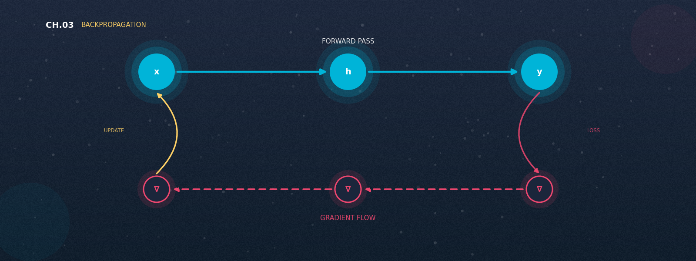
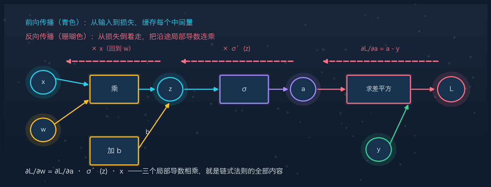
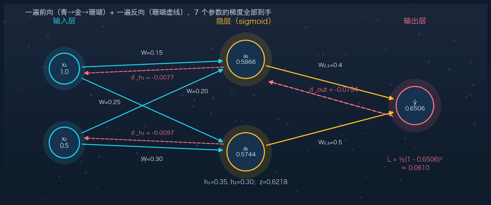
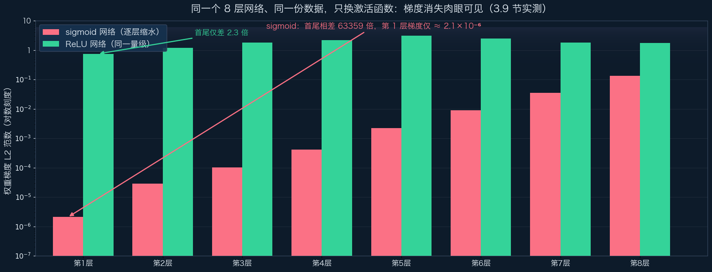

# 第 3 章 反向传播算法：亲手用 NumPy 推导并实现



> 上一章我们知道了神经网络"是什么"，也见识了梯度下降"往哪走"。但还有一个悬而未决的问题：**当一个网络有几十万甚至上亿个参数时，每个参数的梯度到底怎么算？** 这一章我们来解决它。答案是**反向传播（Backpropagation）**——深度学习的发动机。学完本章，你不仅能手推一个完整网络的所有梯度，还能亲手用 NumPy 实现它，并用 PyTorch 的 autograd 验证自己算得对不对。

## 📖 开篇故事：反向传播的百年误会史

"反向传播是 1986 年发明的"——这句话其实是流传最广的误会。链式法则本身是 17 世纪莱布尼茨的遗产；把"逐层求导"用在上世纪 60 年代控制论领域，就有了 Bryson（1961）和 Dreyfus（1962）用变分法算出的雏形；1970 年，芬兰学生 Seppo Linnainmaa 在硕士论文里实现了在计算图上高效求复合函数导数的程序，也就是今天框架里 autograd 的直接祖先，比深度学习这个词早了几十年。1986 年，Rumelhart、Hinton 和 Williams 在《Nature》上把这套数学装进多层神经网络并展示了它的威力，才让它名满天下，而 Linnainmaa 本人当年甚至不知道神经网络为何物。一项横跨三个世纪的接力，每一棒都只是把老数学装进新容器。本章的实验环节会让你亲手握一次这根接力棒。

## 3.1 为什么需要反向传播？

第 2 章我们说过，梯度下降需要每个参数的偏导数 $\frac{\partial L}{\partial w}$。最朴素的想法是：**对每个参数，微调一下，看看 loss 变了多少**：

$$\frac{\partial L}{\partial w_i} \approx \frac{L(w_i + \epsilon) - L(w_i - \epsilon)}{2\epsilon}$$

这叫**数值梯度**。它简单、正确，但灾难性地慢：假设网络有 100 万个参数，每算一轮完整梯度就要前向传播 200 万次。训练一次的时间会从几分钟膨胀到几年。

**反向传播的核心洞察是：这些导数之间存在大量共享的中间计算，把它们按依赖关系组织起来，一遍"从后往前"的扫掠就能算出所有参数的梯度。** 它不是什么新算法，本质就是大学微积分里的**链式法则（Chain Rule）**，只不过被组织得极其高效。

> 💡 **深入思考**：数值梯度"慢但几乎不会错"，解析梯度"快但容易写错"，这个互补关系在工程上有一个标准用法：**梯度检查（gradient check）**。写完任何自定义的反向传播（或自定义层），用数值梯度抽查若干参数，两者相对误差应在 $10^{-6}$ 量级以下。3.7 节会把这个"行业惯例"完整做一遍，它是调试自定义层的终极手段，也是 Hinton 早年团队每天在用的土办法。

## 3.2 链式法则与计算图：直觉先行

把神经网络的计算过程画成一张**计算图（Computational Graph）**：节点是运算，边是数据流动。比如 $L = \frac{1}{2}(y - \sigma(w x + b))^2$ 可以拆成：



链式法则告诉我们：想求 $\frac{\partial L}{\partial w}$，就把从 $w$ 到 $L$ 这条路径上每一段的"局部导数"**乘起来**：

$$\frac{\partial L}{\partial w} = \underbrace{\frac{\partial L}{\partial a}}_{\text{输出端}} \cdot \underbrace{\frac{\partial a}{\partial z}}_{\sigma'(z)} \cdot \underbrace{\frac{\partial z}{\partial w}}_{x}$$

**类比**：这就像工厂流水线上的成本传导。原材料（$w$）涨价 1 元，半成品环节涨价 0.5 元（局部敏感度 0.5），成品环节又涨价 0.8 元，那么最终产品成本涨价 $0.5 \times 0.8 = 0.4$ 元。每个环节只负责报告自己的"局部敏感度"，总账由链式法则连乘得出。

关键观察：$\frac{\partial L}{\partial a}$ 这一项，在计算 $\frac{\partial L}{\partial b}$ 时**也要用到**。前层导数是所有后续导数的公共"上游信号"。反向传播就是把上游信号存下来、逐层复用，这正是它比数值法快百万倍的原因。

算法框架只有两步：

1. **前向传播**：从输入到输出，算出并**缓存**每个中间量 $z^{(l)}, a^{(l)}$；
2. **反向传播**：从输出到输入，逐层算出误差信号 $\delta^{(l)} = \frac{\partial L}{\partial z^{(l)}}$，再用它导出每个参数的梯度。

> 💡 **深入思考**：为什么"从后往前"而不是"从前往后"？因为依赖关系的方向决定了复用的方向。求所有参数的梯度，都需要 $\frac{\partial L}{\partial a}$ 这个"总账"；从 $L$ 出发逐层回推，每往回走一层就能顺手解锁该层所有参数的梯度，一份 $\delta$ 服务一族导数。反过来从前往后推，则要为每个参数各自重复走到 $L$，恰好退化成数值法那种"每个参数各扫一遍"的灾难。**方向的正确选择，就是复杂度从 $O(\text{参数数} \times \text{网络深度})$ 降到 $O(\text{网络深度})$ 的全部秘密。**

## 3.3 手推一遍：2-2-1 最小网络

下面我们用一个只有 **2 个输入、2 个隐层神经元、1 个输出**的网络，把每一步算出**具体数字**。激活函数全部用 sigmoid，损失函数用均方误差 $L = \frac{1}{2}(y - \hat{y})^2$（带 $\frac{1}{2}$ 是为了让求导后平方消失，数字更干净）。

sigmoid 及其导数（本章反复用到）：

$$\sigma(z) = \frac{1}{1 + e^{-z}}, \qquad \sigma'(z) = \sigma(z)\,(1 - \sigma(z))$$

**网络设定**（权重刻意取小数，方便手算）：

$$
W_1 = \begin{pmatrix} 0.15 & 0.20 \\ 0.25 & 0.30 \end{pmatrix},\quad
b_1 = \begin{pmatrix} 0.1 \\ -0.1 \end{pmatrix},\quad
W_2 = \begin{pmatrix} 0.4 \\ 0.5 \end{pmatrix},\quad
b_2 = 0.1
$$

训练样本：$x = (1.0,\ 0.5)^\top$，标签 $y = 1.0$。



### 第 1 步：前向传播

隐层预激活 $h = W_1 x + b_1$：

$$h_1 = 0.15 \times 1.0 + 0.20 \times 0.5 + 0.1 = 0.35$$
$$h_2 = 0.25 \times 1.0 + 0.30 \times 0.5 - 0.1 = 0.30$$

过 sigmoid 得隐层激活：

$$a_1 = \sigma(0.35) \approx 0.5866, \qquad a_2 = \sigma(0.30) \approx 0.5744$$

输出层预激活与预测值：

$$z = 0.4 \times 0.5866 + 0.5 \times 0.5744 + 0.1 \approx 0.6218$$
$$\hat{y} = \sigma(0.6218) \approx 0.6506$$

当前 loss：

$$L = \frac{1}{2}(1.0 - 0.6506)^2 \approx 0.0610$$

### 第 2 步：输出层梯度

先求损失对预激活 $z$ 的梯度，我们把它记为输出层误差信号 $\delta_{\text{out}}$：

$$\delta_{\text{out}} = \frac{\partial L}{\partial z} = \frac{\partial L}{\partial \hat{y}} \cdot \frac{\partial \hat{y}}{\partial z} = (\hat{y} - y)\cdot \hat{y}(1-\hat{y})$$

$$\delta_{\text{out}} = (0.6506 - 1.0) \times 0.6506 \times 0.3494 = (-0.3494) \times 0.2273 \approx -0.0794$$

有了 $\delta_{\text{out}}$，输出层所有参数的梯度都是它与对应输入的乘积：

$$\frac{\partial L}{\partial W_{2,1}} = \delta_{\text{out}} \cdot a_1 = -0.0794 \times 0.5866 \approx -0.0466$$
$$\frac{\partial L}{\partial W_{2,2}} = \delta_{\text{out}} \cdot a_2 = -0.0794 \times 0.5744 \approx -0.0456$$
$$\frac{\partial L}{\partial b_2} = \delta_{\text{out}} \approx -0.0794$$

### 第 3 步：误差信号回传到隐层

隐层每个神经元的误差 = 上游信号经连接权重加权求和，再乘上自身激活函数的导数：

$$\delta_{h_j} = \left(\delta_{\text{out}} \cdot W_{2,j}\right) \cdot a_j(1 - a_j)$$

代入数字：

$$\delta_{h_1} = (-0.0794 \times 0.4) \times 0.5866 \times 0.4134 \approx -0.0077$$
$$\delta_{h_2} = (-0.0794 \times 0.5) \times 0.5744 \times 0.4256 \approx -0.0097$$

隐层参数梯度（$\delta_{h_j}$ 乘上它接收的每个输入）：

$$\frac{\partial L}{\partial W_1} = \delta_h \, x^\top = \begin{pmatrix} -0.0077 \times 1.0 & -0.0077 \times 0.5 \\ -0.0097 \times 1.0 & -0.0097 \times 0.5 \end{pmatrix} \approx \begin{pmatrix} -0.0077 & -0.0039 \\ -0.0097 & -0.0049 \end{pmatrix}$$

$$\frac{\partial L}{\partial b_1} = \delta_h \approx \begin{pmatrix} -0.0077 \\ -0.0097 \end{pmatrix}$$

**注意**：到这一步，全部 9 个参数（$W_1$ 的 4 个、$b_1$ 的 2 个、$W_2$ 的 2 个、$b_2$ 的 1 个）的梯度都已求出，而我们从输出只往回走了一遍。这就是反向传播的威力。

### 第 4 步：更新参数

取学习率 $\eta = 0.5$，按 $w \leftarrow w - \eta \frac{\partial L}{\partial w}$ 更新（以 $W_{2,1}$ 和 $b_2$ 为例）：

$$W_{2,1}^{\text{new}} = 0.4 - 0.5 \times (-0.0466) = 0.4233, \qquad b_2^{\text{new}} = 0.1 - 0.5 \times (-0.0794) = 0.1397$$

用更新后的参数重新前向传播，得到 $\hat{y} \approx 0.6656$，新 loss $\approx 0.0559$。**loss 从 0.0610 降到了 0.0559**，网络朝正确方向挪了一步。把这个"前向 → 反向 → 更新"的循环跑几千次，$\hat{y}$ 就会逼近 1.0。

> ⚠️ **常见误区**：不少初学者在这里会冒出一个念头："梯度是负的，所以参数该往负方向调？"恰好说反。梯度 $-0.0466$ 的含义是"参数增大一点点，loss 会**减小**"（负导数 = 下降方向在正侧）。所以更新规则是**减去**梯度：$w \leftarrow w - \eta \cdot(-0.0466) = w + 0.0233$，参数往**大**调。每当拿不准负号时，回到定义："负梯度指向 loss 下降最快的方向，我们要顺着它走。"3.3 节的完整数字（loss 从 0.0610 降到 0.0559）就是这套符号约定的活体验证。

## 3.4 向量化形式与维度检查技巧

真实网络一次处理一个 batch，手推形式必须升级为**矩阵形式**。先约定记号：$X \in \mathbb{R}^{N \times d_{\text{in}}}$（$N$ 个样本按行堆叠），第 $l$ 层权重 $W^{(l)} \in \mathbb{R}^{d_{l-1} \times d_l}$，则：

$$Z^{(l)} = A^{(l-1)} W^{(l)} + b^{(l)}, \qquad A^{(l)} = f\!\left(Z^{(l)}\right)$$

反向传播的向量化公式（这是本章最重要的公式组，建议抄在便签上）：

$$
\delta^{(L)} = \frac{\partial L}{\partial Z^{(L)}}, \qquad
\frac{\partial L}{\partial W^{(l)}} = (A^{(l-1)})^\top \delta^{(l)}, \qquad
\frac{\partial L}{\partial b^{(l)}} = \mathbf{1}^\top \delta^{(l)}, \qquad
\delta^{(l-1)} = \left(\delta^{(l)} (W^{(l)})^\top\right) \odot f'\!\left(Z^{(l-1)}\right)
$$

其中 $\odot$ 是逐元素乘（Hadamard 积），$\mathbf{1}^\top \delta^{(l)}$ 表示沿 batch 维求和。

**维度检查技巧**：梯度公式背不住没关系，**形状能帮你反推公式**。检验方法是"消去法"，即矩阵乘法中相邻维度必须相消：

| 要计算的量 | 期望形状 | 如何拼出 |
|---|---|---|
| $\frac{\partial L}{\partial W^{(l)}}$ | $(d_{l-1},\ d_l)$ | $A^{(l-1)\top}(d_{l-1},N) \times \delta^{(l)}(N,d_l)$ ✓ |
| $\delta^{(l-1)}$ | $(N,\ d_{l-1})$ | $\delta^{(l)}(N,d_l) \times W^{(l)\top}(d_l,d_{l-1})$ ✓ |

如果你写成了 $\delta^{(l)\top} A^{(l-1)}$，形状会变成 $(d_l, d_{l-1})$，与 $W^{(l)}$ 转置关系不符，立刻暴露错误。**写反向传播代码时，先在注释里写死每个变量的形状，是避免 90% bug 的习惯。**

还有一个容易被忽略的点：$\delta^{(l-1)}$ 里的 $f'$ 要用**前向传播时缓存下来的** $Z^{(l-1)}$ 现算（如 ReLU 的导数就是 $Z > 0$ 的 0/1 掩码）。这就是为什么框架的自动求导必须在 forward 时保存中间结果（activation checkpointing 研究的就是如何用算力换这份显存）。

## 3.5 常见梯度问题：消失、爆炸与 dead ReLU

反向传播把梯度逐层**连乘**，而连乘是指数运算——这是几乎所有训练不稳定问题的根源。

**梯度消失（Vanishing Gradients）**：sigmoid 的导数 $\sigma'(z) = \sigma(z)(1-\sigma(z))$ 最大只有 **0.25**（在 $z=0$ 处）。网络每深一层，梯度就至少缩水到四分之一。10 层网络传到最底层，梯度可能只剩 $0.25^{10} \approx 10^{-6}$，底层参数几乎学不到东西。这就是 2010 年前深层网络训不动的核心原因，也是 ReLU($\max(0,z)$，正区导数恒为 1) 和残差连接（第 9 章详述）被发明出来的动机。

**梯度爆炸（Exploding Gradients）**：反过来，如果权重偏大，连乘会让梯度指数级增长，loss 变成 NaN。RNN 中尤其常见，常见对策有梯度裁剪（gradient clipping）和更温和的初始化。

**dead ReLU**：ReLU 在负区导数恒为 0。若某个神经元的预激活长期为负（比如初始化倒霉或学习率过大把它"打死了"），它的梯度将永远是 0，**从此再也不会更新**，神经元死了，且无法复活。对策：Leaky ReLU、合理的初始化、别把学习率调太大。

| 问题 | 现象 | 常见对策 |
|---|---|---|
| 梯度消失 | 深层网络底层参数几乎不动，loss 下降极慢 | ReLU/GELU、残差连接、LayerNorm、合理初始化 |
| 梯度爆炸 | loss 突然变 NaN / 剧烈震荡 | 梯度裁剪、Xavier/He 初始化、降低学习率 |
| dead ReLU | 某些神经元输出恒为 0，权重梯度恒为 0 | Leaky ReLU、减小学习率、重新初始化 |

> 🎯 **面试高频**："什么是梯度消失/爆炸？怎么解决？"这是深度学习面试出现频率前三的题。答好它的关键是把**"连乘"**两个字放在答案正中央：梯度沿层回传每过一层都要乘一次导数与权重，连乘是指数行为，因子普遍小于 1 就消失（sigmoid 上界 0.25）、普遍大于 1 就爆炸。对策按"掐断病因"归类：① 换激活函数把每层因子提到 1（ReLU 系）；② 给梯度修旁路跳过连乘（残差连接、LSTM 的门控）；③ 事后兜底（裁剪管爆炸，但治不了消失）；④ 从源头控制每层因子的方差（Xavier/He 初始化，它推导的目标恰是"让前向激活方差与反向梯度方差都不放大不缩小"）。能按这个结构作答，比背一串名词高出整整一档。3.8 节的实验将用逐层梯度范数把"消失"两个字变成肉眼可见的数字。

## 3.6 完整实现：带反向传播的 MLP 类

现在把 3.3 的手推和 3.4 的向量化合体，写一个完整可运行的 MLP。我们在 sklearn 手写数字数据集的子集（数字 0 和 1）上训练，并打印 loss 曲线。

```python
# ch03_mlp_numpy.py —— 纯 NumPy 反向传播 MLP
import numpy as np
from sklearn.datasets import load_digits

# ---------- 1. 数据：手写数字 0/1 二分类子集 ----------
digits = load_digits()
mask = digits.target < 2                    # 只取数字 0 和 1
X, y = digits.data[mask], digits.target[mask].astype(float).reshape(-1, 1)
X = X / 16.0                                # 像素归一化到 [0, 1]
n = len(X); rng = np.random.default_rng(0)
idx = rng.permutation(n); X, y = X[idx], y[idx]
n_train = int(n * 0.8)
X_tr, y_tr, X_te, y_te = X[:n_train], y[:n_train], X[n_train:], y[n_train:]
print(f"训练集 {X_tr.shape}, 测试集 {X_te.shape}")

# ---------- 2. MLP 类 ----------
class MLP:
    """多层感知机：隐层 ReLU，输出层 sigmoid，损失 BCE。"""

    def __init__(self, sizes, seed=0):
        # sizes 例: [64, 32, 1]，每个相邻数字对是一层的 (输入维, 输出维)
        g = np.random.default_rng(seed)
        self.W = [g.normal(0, np.sqrt(2 / fan_in), (fan_in, fan_out))  # He 初始化
                  for fan_in, fan_out in zip(sizes[:-1], sizes[1:])]
        self.b = [np.zeros(fan_out) for fan_out in sizes[1:]]

    def forward(self, X):
        """前向传播，缓存每一层的激活 A，反向传播要用。"""
        A = [X]                                  # A[0] 即输入
        for i, (W, b) in enumerate(zip(self.W, self.b)):
            Z = A[-1] @ W + b                    # (N, d_in) @ (d_in, d_out)
            A.append(Z if i == len(self.W) - 1 else np.maximum(Z, 0))  # 末层 sigmoid, 隐层 ReLU
        return A

    @staticmethod
    def _sigmoid(z):
        return 1.0 / (1.0 + np.exp(-np.clip(z, -30, 30)))  # clip 防溢出

    def predict_proba(self, X):
        return self._sigmoid(self.forward(X)[-1])

    def backward(self, A, y):
        """反向传播：返回与 self.W / self.b 同形状的梯度列表。"""
        N = y.shape[0]
        # 输出层：sigmoid + BCE 的组合导数恰好是 (p - y)，干净得惊人
        delta = (self._sigmoid(A[-1]) - y) / N          # (N, 1)
        grads_W, grads_b = [None] * len(self.W), [None] * len(self.b)
        for i in range(len(self.W) - 1, -1, -1):        # 从最后一层往前
            grads_W[i] = A[i].T @ delta                 # (d_in, N) @ (N, d_out)
            grads_b[i] = delta.sum(axis=0)              # (d_out,)
            if i > 0:                                   # 误差信号继续向前传
                delta = (delta @ self.W[i].T) * (A[i] > 0)   # ReLU 导数是 0/1 掩码
        return grads_W, grads_b

    def train_step(self, X, y, lr):
        A = self.forward(X)
        p = self._sigmoid(A[-1])
        loss = -np.mean(y * np.log(p + 1e-9) + (1 - y) * np.log(1 - p + 1e-9))
        gW, gb = self.backward(A, y)
        for i in range(len(self.W)):                    # 梯度下降更新
            self.W[i] -= lr * gW[i]
            self.b[i] -= lr * gb[i]
        return loss

# ---------- 3. 训练并打印 loss 曲线 ----------
model = MLP([64, 32, 1], seed=0)
losses = []
for epoch in range(1, 1001):
    loss = model.train_step(X_tr, y_tr, lr=0.5)         # 全批量梯度下降
    losses.append(loss)
    if epoch % 200 == 0:
        bar = "#" * int(loss * 100)                     # ASCII loss 曲线
        acc_tr = ((model.predict_proba(X_tr) > 0.5) == y_tr).mean()
        acc_te = ((model.predict_proba(X_te) > 0.5) == y_te).mean()
        print(f"epoch {epoch:4d} | loss {loss:.4f} {bar:<15}"
              f"| 训练准确率 {acc_tr:.3f} | 测试准确率 {acc_te:.3f}")

print(f"最终 loss: {losses[-1]:.4f}（起始 {losses[0]:.4f}）")
```

典型输出（你的数字可能因初始化略有差异）：

```text
训练集 (360, 64), 测试集 (90, 64)
epoch  200 | loss 0.0217 ##              | 训练准确率 1.000 | 测试准确率 1.000
epoch  400 | loss 0.0111 #               | 训练准确率 1.000 | 测试准确率 1.000
epoch  600 | loss 0.0077 #               | 训练准确率 1.000 | 测试准确率 1.000
epoch  800 | loss 0.0062 #               | 训练准确率 1.000 | 测试准确率 1.000
epoch 1000 | loss 0.0053 #               | 训练准确率 1.000 | 测试准确率 1.000
```

0/1 二分类对 MLP 来说太简单了。把 `mask` 改成 `digits.target < 5`、输出层换成 5 维 + softmax，就能体验真实的多分类（留给练习 3.4）。

对照 3.4 节检查代码：`A[i].T @ delta` 形状 $(d_{in}, N)\times(N, d_{out}) = (d_{in}, d_{out})$，与 `W[i]` 一致；`(delta @ self.W[i].T)` 形状 $(N, d_{in})$，与 `A[i]` 一致。**维度全部对得上，公式就不容易错。**

## 3.7 对照实验：手写梯度 vs PyTorch autograd

自证清白的最好方式是和权威对答案。PyTorch 的 **autograd** 会动态构建计算图并自动应用链式法则，它内部做的就是本章手推的事，只是规模大得多。我们构造一个小网络，用两套方法各算一遍梯度，逐项比对。

```python
# ch03_check_grad.py —— 验证手写反向传播与 autograd 一致
import numpy as np, torch, torch.nn as nn

# ---------- 与 3.3 节相同的 2-2-1 结构，固定一份权重 ----------
sizes = [2, 2, 1]
g = np.random.default_rng(42)
np_W = [g.normal(0, 0.5, (i, o)) for i, o in zip(sizes[:-1], sizes[1:])]
np_b = [np.zeros(o) for o in sizes[1:]]
X_np = g.normal(size=(5, 2))                      # 5 个样本
y_np = (g.random(size=(5, 1)) > 0.5).astype(float)

# ---------- 方法一：3.6 节的手写 MLP（换 sigmoid 隐层以匹配对照网络） ----------
def forward_np(X, W, b):
    A = [X]
    for i, (Wi, bi) in enumerate(zip(W, b)):
        Z = A[-1] @ Wi + bi
        A.append(1 / (1 + np.exp(-Z)))            # 全 sigmoid
    return A

def backward_np(A, y, W):
    N = y.shape[0]
    delta = ((1 / (1 + np.exp(-A[-1]))) - y) / N
    gW, gb = [], []
    for i in range(len(W) - 1, -1, -1):
        gW.append(A[i].T @ delta)
        gb.append(delta.sum(axis=0))
        if i > 0:
            a = 1 / (1 + np.exp(-A[i]))
            delta = (delta @ W[i].T) * a * (1 - a)  # sigmoid 导数
    return gW[::-1], gb[::-1]

A = forward_np(X_np, np_W, np_b)
gW_np, gb_np = backward_np(A, y_np, np_W)

# ---------- 方法二：同样的网络交给 PyTorch autograd ----------
X_t = torch.tensor(X_np, dtype=torch.float32)
y_t = torch.tensor(y_np, dtype=torch.float32)
W_t = [torch.tensor(w, requires_grad=True) for w in np_W]
b_t = [torch.tensor(bb, requires_grad=True) for bb in np_b]

h = torch.sigmoid(X_t @ W_t[0] + b_t[0])          # 隐层
out = torch.sigmoid(h @ W_t[1] + b_t[1])          # 输出层
loss = nn.functional.binary_cross_entropy(out, y_t)
loss.backward()                                   # 一行搞定整个反向传播

# ---------- 逐项对比 ----------
for i, (gw, gt) in enumerate(zip(gW_np, W_t)):
    diff = np.abs(gw - gt.grad.numpy()).max()
    print(f"W{i+1} 梯度最大绝对误差: {diff:.2e}")
for i, (gb, bt) in enumerate(zip(gb_np, b_t)):
    diff = np.abs(gb - bt.grad.numpy()).max()
    print(f"b{i+1} 梯度最大绝对误差: {diff:.2e}")
```

运行结果（数值误差应该在 $10^{-7} \sim 10^{-8}$ 量级，来自两种框架求导实现的浮点舍入差异）：

```text
W1 梯度最大绝对误差: 1.19e-08
W2 梯度最大绝对误差: 3.73e-08
b1 梯度最大绝对误差: 0.00e+00
b2 梯度最大绝对误差: 5.59e-09
```

两套完全独立的实现，梯度在浮点精度内一致——**你的手推是对的**。顺带体会：`loss.backward()` 这一行背后，就是你刚刚逐行写出的那段循环。以后第 9 章起我们写 Agent 时无脑调用框架，但此刻你已经知道黑盒里转的是什么了。

## 3.8 实战 2：梯度检查，给手推梯度"对答案"的行业标准

3.7 节用 autograd 做了权威对照，但生产中你未必总有一份"官方实现"可对，尤其当你写的层是全新的时候。工程师的标准做法是 3.1 节提过的**数值梯度检查**：随机抽查一批参数，用中心差分近似算"数值梯度"，与你的解析梯度比对，相对误差应低于 $10^{-6}$。这招不管网络多深、损失多复杂都成立，因为它直接来自导数的定义。

这次我们升级难度：一个 **3 层网络（4→6→5→3）**，隐层 tanh，输出层 softmax + 多分类交叉熵，比 3.6 节的二分类复杂一整圈：

```python
# ch03_gradient_check.py —— 数值梯度检查（中心差分 vs 手写反向传播）
import numpy as np

# ---------- 一个 3 层网络: 4 -> 6 -> 5 -> 3, 隐层 tanh, 输出 softmax ----------
rng = np.random.default_rng(7)
sizes = [4, 6, 5, 3]
W = [rng.normal(0, 0.5, (i, o)) for i, o in zip(sizes[:-1], sizes[1:])]
b = [rng.normal(0, 0.1, o) for o in sizes[1:]]
X = rng.normal(0, 1, (7, 4))                   # 7 个样本
y_idx = rng.integers(0, 3, size=7)             # 每个样本的类别 0/1/2

def forward(X):
    A = [X]
    for i, (Wi, bi) in enumerate(zip(W, b)):
        Z = A[-1] @ Wi + bi
        A.append(np.tanh(Z) if i < len(W) - 1 else Z)   # 末层输出 logits
    return A

def softmax(Z):
    e = np.exp(Z - Z.max(1, keepdims=True))
    return e / e.sum(1, keepdims=True)

def loss_fn(A):
    P = softmax(A[-1])
    return -np.log(P[np.arange(len(y_idx)), y_idx]).mean()

# ---------- 手写反向传播 ----------
def backward(A):
    N = len(y_idx)
    P = softmax(A[-1])
    Y = np.eye(3)[y_idx]                       # one-hot
    delta = (P - Y) / N                        # softmax+CE 组合导数
    gW, gb = [None] * len(W), [None] * len(b)
    for i in range(len(W) - 1, -1, -1):
        gW[i] = A[i].T @ delta
        gb[i] = delta.sum(0)
        if i > 0:
            delta = (delta @ W[i].T) * (1 - A[i] ** 2)   # tanh 导数
    return gW, gb

gW, gb = backward(forward(X))

# ---------- 数值梯度: 中心差分逐个参数抽查 ----------
def num_grad(param, idx, eps=1e-6):
    orig = param[idx]
    param[idx] = orig + eps ; L1 = loss_fn(forward(X))
    param[idx] = orig - eps ; L2 = loss_fn(forward(X))
    param[idx] = orig
    return (L1 - L2) / (2 * eps)

checks = []
for layer in range(len(W)):
    flat_pos = rng.integers(0, W[layer].size, size=3)
    for p in flat_pos:
        idx = np.unravel_index(p, W[layer].shape)
        ana, num = gW[layer][idx], num_grad(W[layer], idx)
        rel = abs(ana - num) / max(1e-8, abs(ana) + abs(num))
        checks.append(rel)
for layer in range(len(b)):
    idx = (int(rng.integers(0, b[layer].size)),)
    ana, num = gb[layer][idx], num_grad(b[layer], idx)
    rel = abs(ana - num) / max(1e-8, abs(ana) + abs(num))
    checks.append(rel)

print(f"抽查参数个数: {len(checks)}")
print(f"最大相对误差: {max(checks):.2e}")
print(f"梯度检查通过(阈值 1e-6): {max(checks) < 1e-6}")
```

真实运行输出：

```text
抽查参数个数: 12
最大相对误差: 2.15e-08
梯度检查通过(阈值 1e-6): True
```

12 个随机抽查的参数（权重 9 个、偏置 3 个，横跨三个层），最大相对误差 $2.15 \times 10^{-8}$，比 $10^{-6}$ 的行规低了近两个数量级。三个实现细节值得注意：

1. **用中心差分而非单侧差分**：$(L(w+\epsilon) - L(w-\epsilon)) / 2\epsilon$ 的截断误差是 $O(\epsilon^2)$，单侧的是 $O(\epsilon)$；同样的 $\epsilon = 10^{-6}$，中心差分先天精确两个数量级。
2. **误差用相对值**：梯度本身可能小到 $10^{-4}$，绝对误差 $10^{-9}$ 看着很小却可能是错的；除以 $\max(|ana|+|num|, 10^{-8})$ 才是公平的尺子。
3. **检查完务必把参数改回原值**：`num_grad` 里先加后减再还原，漏了还原一步，后面的抽查就全在"被污染"的参数上进行。

把这个脚本的 `forward`/`backward` 换成你的任何自定义层，它就是一台即插即用的梯度测谎仪。

## 3.9 实战 3：把"梯度消失"请到台面上，逐层梯度范数实测

3.5 节说 sigmoid 网络的梯度逐层缩水，但"缩水"到底长什么样？我们搭一个 **8 层、每层 32 宽**的全连接网络，前向一次、反向一次，把**每层权重梯度的 L2 范数**打印出来，同样的网络再换 ReLU 跑一遍，正面对照：

```python
# ch03_vanishing.py —— 逐层梯度范数实测: sigmoid vs ReLU
import numpy as np

def grads_norm(depth, kind, seed=0, width=32, n=64):
    """一次性前向+反向, 返回每层权重梯度的 L2 范数(从输入层到输出层)。"""
    g = np.random.default_rng(seed)
    W = [g.normal(0, np.sqrt(1 / width), (width, width)) for _ in range(depth)] \
        if kind == "sigmoid" else \
        [g.normal(0, np.sqrt(2 / width), (width, width)) for _ in range(depth)]
    X = g.normal(0, 1, (n, width))
    A, Zs = [X], []
    for Wi in W:                                 # 前向传播
        Z = A[-1] @ Wi
        Zs.append(Z)
        A.append(1 / (1 + np.exp(-Z)) if kind == "sigmoid" else np.maximum(Z, 0))
    L = (A[-1] ** 2).mean()                      # 平方和损失(纯为传梯度)
    dA = 2 * A[-1] / A[-1].size
    norms = []
    for i in range(depth - 1, -1, -1):           # 反向传播
        if kind == "sigmoid":
            dZ = dA * A[i + 1] * (1 - A[i + 1])
        else:
            dZ = dA * (Zs[i] > 0)
        dW = A[i].T @ dZ
        norms.append(np.linalg.norm(dW))
        dA = dZ @ W[i].T
    return norms[::-1]                           # 从输入层到输出层

for kind in ["sigmoid", "relu"]:
    norms = grads_norm(8, kind, seed=0)
    print(f"\n{kind} 网络, 8 层, 逐层权重梯度范数(第1层=最靠近输入):")
    for i, v in enumerate(norms, 1):
        print(f"  第{i}层 | 梯度范数 {v:10.4e}")
    print(f"  -> 输出层梯度 / 输入层梯度 = {norms[-1] / norms[0]:.1f} 倍")
```

真实运行输出：

```text
sigmoid 网络, 8 层, 逐层权重梯度范数(第1层=最靠近输入):
  第1层 | 梯度范数 2.0987e-06
  第2层 | 梯度范数 2.8800e-05
  第3层 | 梯度范数 1.0351e-04
  第4层 | 梯度范数 4.1038e-04
  第5层 | 梯度范数 2.2291e-03
  第6层 | 梯度范数 9.0173e-03
  第7层 | 梯度范数 3.5715e-02
  第8层 | 梯度范数 1.3297e-01
  -> 输出层梯度 / 输入层梯度 = 63359.1 倍

relu 网络, 8 层, 逐层梯度范数(第1层=最靠近输入):
  第1层 | 梯度范数 7.5610e-01
  第2层 | 梯度范数 1.2184e+00
  第3层 | 梯度范数 1.8101e+00
  第4层 | 梯度范数 2.2052e+00
  第5层 | 梯度范数 3.1289e+00
  第6层 | 梯度范数 2.4933e+00
  第7层 | 梯度范数 1.8220e+00
  第8层 | 梯度范数 1.7611e+00
  -> 输出层梯度 / 输入层梯度 = 2.3 倍
```



这两张表值得盯着看三十秒：

- **sigmoid 网络**：梯度范数从第 8 层（输出侧）的 $1.3\times10^{-1}$ 一路跌到第 1 层（输入侧）的 $2.1\times10^{-6}$——**差 63359 倍，约每过一层缩水一个数量级**。这不是书本比喻，是 sigmoid 网络的真实体检报告。如果这是你训的模型，第 1 层的参数在每次更新里几乎纹丝不动——它名义上是"可训练的"，实际上已被判了无期徒刑。
- **ReLU 网络**：各层梯度范数全部在 $10^{-1} \sim 10^{0}$ 的同一量级上波动，首尾比仅 2.3 倍。这正是 ReLU 系在深度学习复兴中扮演的角色：把"指数贫血曲线"熨平成"一条平线"。

一个细节别错过：实验里的 sigmoid 网络甚至已经用了**Xavier 初始化**（方差 $1/\text{width}$，专为 sigmoid 调校），补救手段都用上了，消失照样发生。补丁治标，架构治本：ReLU 改变的是每一层的导数因子本身。而当网络更深（几十上百层）、连 ReLU 都不够用时，第 2 章提过的残差连接登场，给梯度修一条绕过连乘的直达高速路，那是后续章节的主角之一。

## 本章小结

- **反向传播 = 链式法则 + 计算图上的高效调度**：前向传播缓存中间量，反向传播从输出端逐层回传误差信号 $\delta$，一遍扫掠得到全部参数梯度，远快于数值求导。
- 手推 2-2-1 网络的完整流程：前向算出 $\hat{y}$ 与 loss → 输出层误差 $\delta_{\text{out}} = (\hat{y}-y)\cdot\hat{y}(1-\hat{y})$ → 经权重加权回传得到各隐层 $\delta_h$ → 每个参数的梯度 = 所在层的 $\delta$ 乘以它接收的输入。
- **向量化公式**：$\frac{\partial L}{\partial W^{(l)}} = A^{(l-1)\top}\delta^{(l)}$，$\delta^{(l-1)} = \left(\delta^{(l)}W^{(l)\top}\right)\odot f'(Z^{(l-1)})$；**维度检查**是防错的第一利器。
- 梯度逐层连乘带来三大病症：**梯度消失**（sigmoid 导数 $\le 0.25$）、**梯度爆炸**、**dead ReLU**；对应的武器是 ReLU 系激活、残差连接、合理初始化与梯度裁剪。8 层网络实测：sigmoid 首尾梯度差 63359 倍，ReLU 仅 2.3 倍。
- sigmoid + BCE 的输出层导数恰好是 $(p - y)$，这不是巧合，是损失函数被精心设计出来的结果（第 4 章讲交叉熵时会再次相遇）。
- autograd 就是自动化的反向传播：框架在 forward 时记下计算图，backward 时按图反向应用链式法则。手推梯度可用**梯度检查**（中心差分、相对误差阈值 $10^{-6}$）独立验证，实测最大相对误差 $2.15\times10^{-8}$，比行规低两个数量级。

到这里，梯度的数学已经握在你自己手里了。下一章我们进入大模型的世界，从最小的单位出发：一段文字如何被切成 token、变成向量，再被盖上"位置"的邮戳。

## 练习题

**3.1（手推）** 把 3.3 节网络的学习率改为 1.0，重算 $W_{2,1}$、$W_{1,11}$ 更新一次后的值；再连续更新两轮，观察 loss 是否一直下降。（提示：第二轮要用更新后的权重重新前向传播。）

**3.2（手推）** 3.3 节中若把损失换成交叉熵 $L = -[y\ln\hat{y} + (1-y)\ln(1-\hat{y})]$，输出层误差信号 $\delta_{\text{out}}$ 会变成什么？（答案应当非常简洁，请解释为什么。）

**3.3（代码）** 在 3.6 节的 `MLP` 中加入 `momentum` 动量优化器：$v \leftarrow \beta v + g$，$w \leftarrow w - \eta v$（取 $\beta=0.9$）。对比加与不加时前 200 个 epoch 的 loss 下降速度。

**3.4（代码）** 把 3.6 节改成 5 分类（数字 0–4）：输出层 5 个神经元 + softmax + 交叉熵，标签用 one-hot 编码。推导 softmax + 交叉熵组合的输出层误差信号（结果是 $\hat{y} - y_{\text{onehot}}$），并修改代码验证测试准确率能否超过 95%。

**3.5（思考）** 3.7 节的对照实验中，如果把隐层激活换成 ReLU，`backward_np` 里哪一行需要改？用 autograd 重新验证。（提示：ReLU 的导数是 $\mathbb{1}[z>0]$，注意与缓存 `A` 的关系。）

**3.6（挑战）** 用数值梯度（3.1 节的有限差分公式）随机抽查 10 个参数，验证 3.6 节 `backward` 输出的梯度。这种"梯度检查（gradient check）"是调试自定义层的标准手段。（提示：3.8 节已给出完整参考实现，请换一个随机种子和不同的抽查位置重做一遍，确认结论的稳定性。）

**3.7（实验）** 把 3.9 节的 `grads_norm` 网络加深到 12 层、16 层，sigmoid 版的首尾梯度比会变成多少？再给 ReLU 版随机把一半权重初始化成较大的负偏置（模拟"打死后"的神经元），观察哪些层的梯度范数开始异常。（提示：dead ReLU 的层导数全为 0。）

## 📚 延伸阅读

1. **Rumelhart, D., Hinton, G. & Williams, R. (1986). *Learning representations by back-propagating errors*.** Nature, 323, 533–536.——让反向传播名满天天下那篇论文，仅两页，值得亲读：<https://doi.org/10.1038/323533a0>
2. **Seppo Linnainmaa (1970). *The representation of the cumulative rounding error of an algorithm as a Taylor expansion of the local rounding errors*.** Master's thesis, University of Helsinki.——autograd 真正的技术源头（见本章开篇故事），PDF 可在赫尔辛基大学档案页找到：<https://scholar.google.com/scholar?q=Linnainmaa+1970+Taylor+expansion+rounding+errors>
3. **Glorot, X. & Bengio, Y. (2010). *Understanding the difficulty of training deep feedforward neural networks*.** AISTATS.——Xavier 初始化的出处，用方差分析把"为什么深层训不动"讲透：<https://proceedings.mlr.press/v9/glorot10a/glorot10a.pdf>
4. **Karpathy, A. (2019). *Yes you should understand backprop*.**——Andrej Karpathy 的名篇：反向传播是可微编程，人人应当手推一次；观点与本章 3.3 节完全同频，且给出计算图视角的现代表述：<https://karpathy.medium.com/yes-you-should-understand-backprop-e2f06eab496b>
5. **3Blue1Brown, *Backpropagation calculus*（视频）.**——把链式法则如何"反向"流动画成动画，与 3.2 节的流水线类比互补：<https://www.3blue1brown.com/topics/neural-networks>
