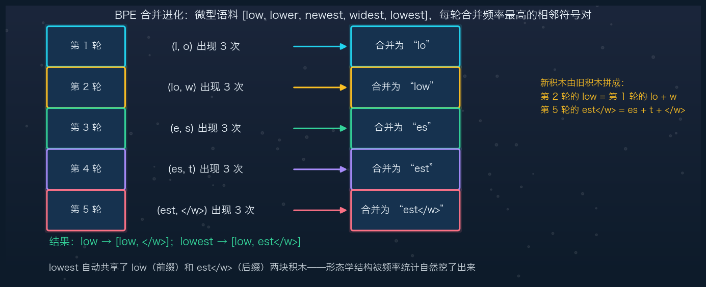
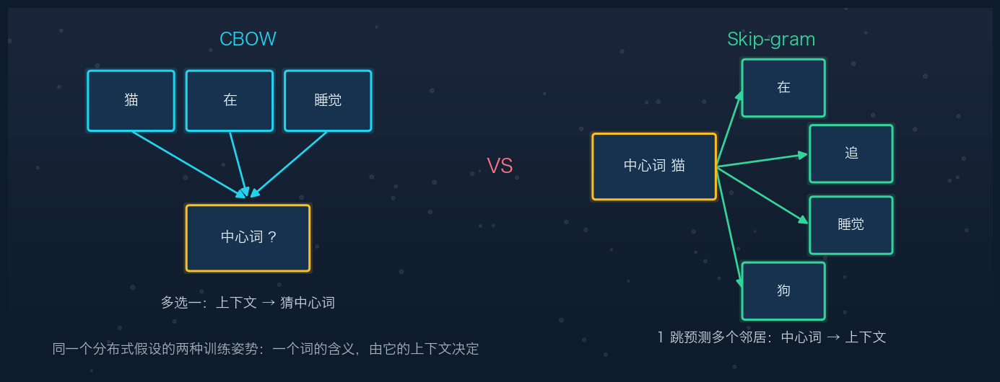

# 第 4 章 Token、词嵌入与位置编码：LLM 的"文字观"


上一章的反向传播告诉我们梯度如何流动，这一章要回答一个更朴素的问题：一段文字如何一步步变成模型能计算的数字，这决定了模型"眼里的文字"长什么样。


读完本章，你将能回答：为什么让模型数一数 "strawberry" 里有几个 r 会出洋相？为什么"国王 − 男人 + 女人 ≈ 女王"？为什么注意力机制天生"脸盲"——分不清谁在前谁在后？

---

## 📖 开篇故事：八个人的论文，与一个"没有 RNN"的赌注

2017 年，Google Brain 的八位研究员决定做一件离经叛道的事：扔掉序列模型的一切积木（RNN、卷积、对齐结构），只留注意力。这篇投给 NIPS 2017 的论文标题起得像战书：《Attention Is All You Need》。它的出身其实很朴素：起初只是机器翻译组想要一个训练更快、能超过自家 GNMT 的翻译模型，注意力不过是他们眼里"更并行的替代品"。论文最初引用寥寥，数年后却以十万计。一个后话同样耐人寻味：八位作者后来陆续离开了 Google，各自创办或加入了 Cohere、Character.AI、Sakana AI 等如今如雷贯耳的公司。标题说"只需要注意力"，而注意力的输入从哪来？正是本章这三件事：把文字切成 token、把 token 变成向量、给向量盖上"位置"的邮戳。

---

## 4.1 Tokenization：把文字切成模型能吃的积木

### 4.1.1 为什么不直接用字符或单词

| 方案 | 序列长度 | 词汇表大小 | 问题 |
|---|---|---|---|
| **按字符** | 太长（1 汉字 1 token，英文 1 词 4~6 字符） | 极小 | 一个词被拆碎，"猫"和"狗"在字符层面毫无联系，模型要自己学会 "c-a-t" 是一个整体 |
| **按单词** | 最短 | 巨大（新词、专有名词层出不穷） | 词表爆炸；"unlikely / unhappy" 明明共享 "un-" 前缀却毫无共享信息；**OOV**（Out-Of-Vocabulary）：没见过的词没法编码 |
| **子词（Subword）** ★ | 折中 | 适中（3 万~20 万） | 常见词完整保留，罕见词拆成有意义的碎片 |

**子词是工业界的答案**：高频词不切（"the" 就是一个 token），低频词切成碎片（"tokenizer" → "token" + "izer"）。它像一套大小不一的积木，常用积木做得大，冷门的用小块拼。

> ⚠️ **常见误区**："BPE 解决了 OOV 问题"，这句话要精确到"缓解"才算对。BPE 的真正承诺是"**没有任何输入会无法编码**"：任何字符串（哪怕是你键盘乱敲的表情）都能最终退化到字节级再编码，`o200k_base` 这类词表干脆把 256 个字节塞进词表，天然兜底。但"能编码"不等于"编码得好"：一个训练语料里从没出现过的火星语，会被切成一堆碎字节 token，模型对它的"理解"仅相当于看乱码，序列长、语义密度低、上下文窗口被快速吃掉。所以工程上讲"OOV 问题被 BPE 化解"，准确的说法是"OOV 变成了'次优切分'问题"。能讲清这层辨析，比背十遍"BPE 解决 OOV"有用得多。

### 4.1.2 BPE：从字节对到子词的"合并进化"

**BPE（Byte Pair Encoding，字节对编码）** 原本是 1994 年的一种压缩算法，2016 年被 Sennrich 等人搬进 NLP。流程简单得惊人：

1. 把语料中每个词拆成字符序列（词尾加 `</w>` 标记）；
2. 统计所有**相邻符号对**的出现频率；
3. 把频率最高的那一对**合并**成一个新符号，回到第 2 步，重复 N 次。我们用微型语料 `[low, lower, newest, widest, lowest]` 手工走一遍：



注意最后一行：语料里的 "lowest" 自动共享了 "low"（前缀）和 "est</w>"（后缀）两块积木，这正是子词的精髓：**形态学结构被自然挖掘出来，无需任何语言学规则**。真实训练时，语料是数万亿 token 的网络文本，合并几万轮，就得到 GPT 类模型的词表。

同一思想家族还有两位成员，一句话区分：

- **WordPiece**（BERT 用）：流程与 BPE 几乎相同，但合并标准不是频率最高，而是**使语言模型似然提升最大的对**，等价于优先合并"互信息高"的碎片对；
- **SentencePiece**（LLaMA、T5 用）：**语言无关**，把文本当 Unicode 字符流处理，空格也转成特殊符号 `▁`，因此对中文这种"没有空格"的语言同样适用。

### 4.1.3 亲手实测：tiktoken 里的中英文

光说不练假把式。用 OpenAI 开源的 `tiktoken`（`pip install tiktoken`）实测：

```python
import tiktoken

enc = tiktoken.get_encoding("o200k_base")  # GPT-4o 系列使用的词表

for s in ["草莓", "strawberry", "我爱吃草莓", "I love eating strawberries"]:
    ids = enc.encode(s)
    pieces = [enc.decode([i]) for i in ids]   # 逐个解码，看每块"积木"
    print(f"{s!r:30} -> {len(ids)} 个token: {pieces}")
```

```text
'草莓'                        -> 2 个token: ['草', '莓']
'strawberry'                  -> 3 个token: ['st', 'raw', 'berry']
'我爱吃草莓'                  -> 5 个token: ['我', '爱', '吃', '草', '莓']
'I love eating strawberries'  -> 4 个token: ['I', ' love', ' eating', ' strawberries']
```

信息量很大的三行输出：

1. **中英文效率不同**：英文按子词切，一个常见词往往 1 个 token；汉字基本一字一 token（汉字数太多、单字复用率高，BPE 很少合并出中文多字块）。粗略换算：**1 token ≈ 0.75 个英文单词 ≈ 1 个汉字**；
2. **英文空格被吸进 token**：`' love'`（带前导空格）是一个整体，这解释了为什么 LLM 偶尔在英文单词中间多打一个空格：token 边界和单词边界不重合；
3. **著名趣案**：让模型数 "strawberry" 里有几个 r，早期 GPT 经常答错。原因就在第二行输出：模型看到的不是 10 个字母，而是 `st / raw / berry` 三块积木；让它数字母，就像让你数一截香肠里有几粒肉分子，字面上就没这个颗粒度。让模型先拼出单词再数（思维链），能极大缓解。

### 4.1.4 Token 就是"计价货币"

**Token 是 LLM 世界的基本计量单位**，两个直接影响钱包的推论：

- **计费**：API 按 token 收费（常见定价为"每百万 token 若干美元"），输入与输出分别计价，输出通常贵数倍。第 7 章你会看到，一次 Agent 任务可能把长上下文反复发送十几轮，token 数量直接决定成本曲线；
- **上下文窗口（Context Window）**：模型一次能"看"多少 token 是硬上限（如 8K、128K、1M），决定了 RAG 里能塞几篇文档、Agent 的记忆能存多长。工程上一切"截断、摘要、压缩"手段，本质上都是在和这个上限博弈。

> **一句话记住 4.1 节**：Tokenizer 是文字与数字之间的翻译官，翻译质量决定了模型对世界的"分辨率"，也决定了你的账单。

### 4.1.5 实战 1：从零训练一个 mini-BPE 分词器

4.1.2 的手工推演是"看教练游"，现在轮到我们下水：用 15 个词的语料，把 BPE 的**训练**（学出合并规则）和**编码**（用规则切新词）两阶段完整实现一遍。这个 mini 分词器和 `tiktoken` 的骨架在逻辑上逐行同构，只是规模差了五个数量级：

```python
# ch04_train_bpe.py —— 从零训练一个 mini-BPE 分词器
from collections import Counter

corpus = ["low", "low", "lowest", "slower", "lower", "newer", "newest", "wider",
          "newest", "widest", "slower", "lower", "low", "newest", "wider"]

# 第 0 步：每个词拆成字符序列，词尾加 </w> 标记
words = Counter(corpus)
splits = {w: list(w) + ["</w>"] for w in words}

def pair_freqs(splits, words):
    """统计所有相邻符号对在整个语料中的加权出现次数。"""
    freq = Counter()
    for w, cnt in words.items():
        syms = splits[w]
        for a, b in zip(syms, syms[1:]):
            freq[(a, b)] += cnt          # 词频加权: 出现 4 次的词贡献 4 票
    return freq

def merge(splits, pair):
    """把符号对 pair 合并成新符号，更新所有词的切分。"""
    new_splits = {}
    for w, syms in splits.items():
        out, i = [], 0
        while i < len(syms):
            if i < len(syms) - 1 and (syms[i], syms[i+1]) == pair:
                out.append(syms[i] + syms[i+1])   # 合并!
                i += 2
            else:
                out.append(syms[i]); i += 1
        new_splits[w] = out
    return new_splits

print("== BPE 训练: 每轮合并频率最高的相邻符号对 ==\n")
n_merges = 12
merge_rules = []                        # 按学习顺序存下每条规则
for step in range(1, n_merges + 1):
    freq = pair_freqs(splits, words)
    if not freq: break
    pair, cnt = max(freq.items(), key=lambda kv: kv[1])
    splits = merge(splits, pair)
    merge_rules.append(pair)
    print(f"第{step:2d}轮: 合并 {pair} (出现 {cnt} 次)  -> 新符号 '{pair[0]+pair[1]}'")

# 学到的词表 = 初始字符 + 每轮合并出的新符号
vocab = sorted(set(s for w in words for s in splits[w]))
print(f"\n词表大小: {len(vocab)} (初始字符 {len(set(''.join(corpus)))} 个 + 合并符号)")

def encode(word, rules):
    """真正的 BPE 编码: 从字符出发, 按学习顺序逐条应用合并规则。"""
    syms = list(word) + ["</w>"]
    for pair in rules:                    # 规则必须按学到的先后次序使用
        out, i = [], 0
        while i < len(syms):
            if i < len(syms) - 1 and (syms[i], syms[i+1]) == pair:
                out.append(syms[i] + syms[i+1]); i += 2
            else:
                out.append(syms[i]); i += 1
        syms = out
    return syms

print("\n== 用训练好的分词器切几个词(含训练时没见过的) ==")
for w in ["lowest", "slower", "wider", "lowering"]:
    print(f"  {w:>10} -> {encode(w, merge_rules)}")

chars_before = sum(len(w) + 1 for w in corpus)          # 每词多一个 </w> 标记
tokens_after = sum(words[w] * len(splits[w]) for w in words)
print(f"\n语料压缩: {chars_before} 个字符 -> {tokens_after} 个 token "
      f"(压缩率 {chars_before / tokens_after:.2f} 字符/token)")
```

真实运行输出：

```text
== BPE 训练: 每轮合并频率最高的相邻符号对 ==

第 1轮: 合并 ('w', 'e') (出现 9 次)  -> 新符号 'we'
第 2轮: 合并 ('l', 'o') (出现 8 次)  -> 新符号 'lo'
第 3轮: 合并 ('r', '</w>') (出现 7 次)  -> 新符号 'r</w>'
第 4轮: 合并 ('lo', 'we') (出现 5 次)  -> 新符号 'lowe'
第 5轮: 合并 ('s', 't') (出现 5 次)  -> 新符号 'st'
第 6轮: 合并 ('st', '</w>') (出现 5 次)  -> 新符号 'st</w>'
第 7轮: 合并 ('lowe', 'r</w>') (出现 4 次)  -> 新符号 'lower</w>'
第 8轮: 合并 ('n', 'e') (出现 4 次)  -> 新符号 'ne'
第 9轮: 合并 ('ne', 'we') (出现 4 次)  -> 新符号 'newe'
第10轮: 合并 ('lo', 'w') (出现 3 次)  -> 新符号 'low'
第11轮: 合并 ('low', '</w>') (出现 3 次)  -> 新符号 'low</w>'
第12轮: 合并 ('newe', 'st</w>') (出现 3 次)  -> 新符号 'newest</w>'

词表大小: 12 (初始字符 10 个 + 合并符号)

== 用训练好的分词器切几个词(含训练时没见过的) ==
      lowest -> ['lowe', 'st</w>']
      slower -> ['s', 'lower</w>']
       wider -> ['w', 'i', 'd', 'e', 'r</w>']
    lowering -> ['lowe', 'r', 'i', 'n', 'g', '</w>']

语料压缩: 91 个字符 -> 31 个 token (压缩率 2.94 字符/token)
```

四行观察，行行对应 BPE 的核心机制：

1. **合并顺序由频率驱动**：`('w','e')` 以 9 次登顶第 1 轮，它同时出现在 low/lowest/lower/newer/newest 系列（词频加权：`low` 出现 3 次，每次贡献一票）。BPE 是彻底的"数据至上"：哪两个碎片常挨着，哪对就先合并，没有任何语言学知识介入。
2. **规则的"复利"效应**：第 4 轮合并 `('lo','we')` 时，`lo` 和 `we` 都已是前面轮次造出的符号：**新积木由旧积木拼成，层层生息**。第 12 轮甚至直接拼出了完整的 `newest</w>`。
3. **切未见过的词**：`lowering` 语料里没有，但被切成 `[lowe, r, i, n, g, </w>]`，前缀 `lowe` 是学过的积木，词根被复用了。这就是 4.1.1 节"子词方案"承诺的兑现现场：**没有 OOV，只有切得细与切得粗**。
4. **压缩率 2.94 字符/token**：91 个字符压成 31 个 token，这就是 tokenizer 的存在意义，在不损失"可还原性"的前提下让序列变短、语义块变大。真实词表几万次合并后，常见英文词稳定落在 1~1.3 token/词。

一个值得亲手验证的细节：`merge_rules` 里规则的**先后顺序**不能打乱：把列表反转后再去 `encode`，切分结果会不同。顺序即历史：BPE 的词表是一棵按频率长出来的树，不是一张无序的表。

---

## 4.2 词嵌入 Embedding：从符号到语义

### 4.2.1 One-hot 的三宗罪

Tokenizer 给出的是 token id，一个整数。最直接的数字化方法是 **one-hot 编码**：词表大小 $|V|$，第 $i$ 个词就是第 $i$ 位为 1、其余为 0 的向量，如猫 → $(1,0,0,0,0)$，狗 → $(0,1,0,0,0)$。三宗罪：

1. **维度灾难**：GPT-4o 词表约 20 万，每个词要 20 万维向量；
2. **语义荒漠**：任意两个不同词的 one-hot 内积都是 0："猫"和"狗"的距离，与"猫"和"经济学"的距离**完全相等**，所有词两两正交，语义信息为零；
3. **计算浪费**：每个向量只有一个非零元素，矩阵乘法 99.999% 在做乘零的无用功。

### 4.2.2 分布式假设与 Word2Vec

语言学的**分布式假设（Distributional Hypothesis）** 指出：**一个词的含义，由它的上下文决定**（Firth 名言："You shall know a word by the company it keeps"）。"猫"和"狗"几乎出现在相同上下文里（"___ 在沙发上睡觉"），所以语义相近；"经济学"的上下文则几乎不与它们重叠。

**Word2Vec**（2013，Mikolov 等）把这个假设变成训练目标，两种模式：



Skip-gram 的目标：对语料中每一对 (中心词 $w$，邻居 $c$)，最大化

$$P(c \mid w) = \frac{\exp(\mathbf{u}_c^\top \mathbf{v}_w)}{\sum_{c' \in V} \exp(\mathbf{u}_{c'}^\top \mathbf{v}_w)}$$

其中 $\mathbf{v}_w$ 是词 $w$ 的"主人向量"，$\mathbf{u}_c$ 是词 $c$ 的"邻居向量"。训练完，每个词用它的向量 $\mathbf{v}_w \in \mathbb{R}^{d}$（$d$ 常取 50~300，故称**稠密向量**）来表示，这就是**词嵌入（Word Embedding）**。工程上常用**负采样（Negative Sampling）** 替换分母那个天文数字级的全词表求和：只随机抽几个负例做二分类。

### 4.2.3 本质：Embedding 层就是一张查表

最关键的祛魅时刻。神经网络里神秘的 "Embedding 层"（无论 Word2Vec 还是 LLM 的），本质是**一张可训练的查找表**：一个矩阵 $E \in \mathbb{R}^{|V| \times d}$，第 $i$ 行就是 token id 为 $i$ 的词向量，取词向量就是**按行索引**：

```python
import numpy as np

rng = np.random.default_rng(0)
vocab_size, embed_dim = 50000, 256
E = rng.normal(0, 0.02, (vocab_size, embed_dim))   # 训练前：随机数；训练后：语义

ids = [812, 47, 905]          # "猫 追 狗" 的 token id
X = E[ids]                    # 一行代码，得到 (3, 256) 的词向量序列
print(X.shape)                # (3, 256)
```

有个常被忽略的等价关系：`E[ids]` 完全等价于 `one_hot(ids) @ E`：one-hot 乘矩阵恰好是"选出对应行"。one-hot 并没有被抛弃，只是**没人真去乘 20 万维的稀疏矩阵，直接下标查表，复杂度 $O(1)$**；训练时梯度也只更新被查过的那几行。

### 4.2.4 见证奇迹：语义算术

如果嵌入真的编码了语义，语义关系就应表现为向量空间中的**几何方向**。经典结论：

$$\mathbf{v}_{king} - \mathbf{v}_{man} + \mathbf{v}_{woman} \approx \mathbf{v}_{queen}$$

"性别"这个抽象关系，竟然是空间中一个稳定的位移向量。我们不下载任何预训练模型，用 72 句微型语料从零复现这个现象（共现计数 + PPMI + SVD，是 Word2Vec 之前的经典方法，思路相同）：

```python
import numpy as np

# 语料：两个"话题"各有稳定的搭配模式
corpus = [f"{a} {v} {f}" for a in ["小猫", "小狗", "小鸟", "小鱼"]
                        for v in ["吃", "追", "看"] for f in ["饭", "面", "菜"]]
corpus += [f"{p} {v} {d}" for p in ["我", "你", "他", "她"]
                        for v in ["喝", "倒", "端"] for d in ["水", "茶", "咖啡"]]
vocab = sorted(set(w for s in corpus for w in s.split()))
idx = {w: i for i, w in enumerate(vocab)}; n = len(vocab)

M = np.zeros((n, n))                       # 1) 共现矩阵：同句中的词互相记一票
for s in corpus:
    for a in s.split():
        for b in s.split():
            if a != b:
                M[idx[a], idx[b]] += 1
pxy = M / M.sum()                           # 2) PPMI：共现远超随机概率才计分
px, py = pxy.sum(1, keepdims=True), pxy.sum(0, keepdims=True)
ppmi = np.maximum(np.log((pxy + 1e-12) / (px @ py + 1e-12)), 0)
U, S, _ = np.linalg.svd(ppmi, full_matrices=False)
Emb = U[:, :8] * S[:8]                      # 3) SVD 取前 8 维作为词向量

def cos(a, b):
    va, vb = Emb[idx[a]], Emb[idx[b]]
    return va @ vb / (np.linalg.norm(va) * np.linalg.norm(vb))

def nearest(vec, exclude):
    sims = Emb @ vec / (np.linalg.norm(Emb, axis=1) * np.linalg.norm(vec) + 1e-12)
    return [vocab[i] for i in np.argsort(-sims) if vocab[i] not in exclude][:3]

print("cos(小猫, 小狗) =", round(cos("小猫", "小狗"), 3))
print("cos(小猫, 茶)   =", round(cos("小猫", "茶"), 3))
print("小鱼 − 小鸟 + 小猫 ≈", nearest(Emb[idx["小鱼"]] - Emb[idx["小鸟"]] + Emb[idx["小猫"]], {"小鱼", "小鸟", "小猫"}))
print("她 − 我 + 茶     ≈", nearest(Emb[idx["她"]] - Emb[idx["我"]] + Emb[idx["茶"]], {"她", "我", "茶"}))
```

```text
cos(小猫, 小狗) = 1.0
cos(小猫, 茶)   = -0.0
小鱼 − 小鸟 + 小猫 ≈ ['小狗', '吃', '菜']
她 − 我 + 茶     ≈ ['咖啡', '水', '倒']
```

72 句话，十几行代码，"动物类聚、人称类聚"学得干干净净，两个类比全部命中正确答案。**语义不需要人来标注——它藏在语料的共现结构里，好的向量表示把它"拎"了出来。** 在真实语料上训练 Word2Vec/GloVe 才有完整的 king−man+woman≈queen；而真实 LLM 的 Embedding 随整个模型端到端训练，比静态查表更聪明，但 4.2.3 那张表，依然是它的骨架。

> 💡 **深入思考**：`cos(小猫, 小狗) = 1.0`、`cos(小猫, 茶) = -0.0`，这对极端数字其实暴露了微型语料的"过于整齐"：两个话题的上下文零重叠，向量空间便被切成了两个互不相交的子空间。真实语言的分布是连续的（"小猫"和"茶"总在"宠物下午茶"这类句子里偶尔相遇），相似度会落在 0.3~0.8 的灰色地带。这是所有分布语义方法的共同宿命：**嵌入学到的"语义"，完全以语料的共现结构为上限**，语料里没有的关系，向量空间里就没有。它既是这个方法强大的原因（无需人工标注），也是它所有偏见的来源（语料的偏见原样进入几何）。

---

## 4.3 位置编码：让注意力知道"谁在前"

### 4.3.1 注意力天生"脸盲"

第 5 章会证明一个关键性质：**自注意力是置换等变的**——把输入序列的行任意打乱，输出只是跟着同样打乱，每个 token 得到的新表征**完全不变**（本节末的实验会验证）：

$$\text{Attention}(\pi X) = \pi \cdot \text{Attention}(X), \quad \forall \text{ 置换 } \pi$$

原因：注意力只做"两两求内积再加权求和"，内积不在乎谁先谁后。**没有位置信息，"猫追狗"和"狗追猫"是同一个句子**：主谓宾、时态、因果，全都依赖顺序。所以必须在送入注意力之前，给每个 token 打上"我在第几位"的标记，这就是**位置编码（Positional Encoding, PE）**。主流做法分两派：**加在输入向量上**（Sinusoidal / Learned），或**改造注意力计算本身**（RoPE / ALiBi）。

> 🎯 **面试高频**："为什么 Transformer 需要位置编码？"答题模板分三步：① **机制根源**：自注意力的每一步计算（QK 内积、加权求和）对下标完全对称，打乱输入等价于打乱输出，天然无序；② **语言事实**：词序承载语法与语义（"猫追狗"≠"狗追猫"），无序的模型等于把所有词装进一个"词袋"；③ **方案光谱**：加法式（Sinusoidal、Learned，把位置烙进输入向量）与运算式（RoPE、ALiBi，把位置写进注意力打分公式），顺带比较外推性与 KV Cache 友好度。能把第①步的"对称性"讲出来，就已经跑赢了大部分背题的竞争者；能补一句"CNN 靠卷积的滑动天然带相对位置、RNN 靠递归天然带绝对顺序、Transformer 是唯一裸奔的"，就是满分答案。

### 4.3.2 正弦位置编码：一座会旋转的钟

原始 Transformer（《Attention Is All You Need》，2017）把第 $pos$ 个位置映射为一个 $d$ 维向量，与词嵌入相加：

$$PE_{(pos,\,2i)} = \sin\!\Big(\frac{pos}{10000^{2i/d}}\Big), \qquad PE_{(pos,\,2i+1)} = \cos\!\Big(\frac{pos}{10000^{2i/d}}\Big)$$

其中 $i = 0, 1, \dots, d/2 - 1$ 标记"第几对维度"。**直觉：一座钟表**。把每一对维度 $(2i, 2i{+}1)$ 想成表盘上一根指针：

- 低维对（$i$ 小）：**秒针**，转得飞快，$pos$ 每走一步正弦值都剧烈变化，负责区分紧挨着的相邻位置；
- 高维对（$i$ 大）：**分针、时针**，转得极慢，几十步才转完一圈，负责标记"大致在段落前部还是尾部"。

每根针幅值恒为 1（$\sin^2 + \cos^2 = 1$，任意位置的 PE 范数恒为 $\sqrt{d/2}$），但**指针组合的相位（钟面读数）在每个位置都独一无二**。这是二进制计数器的连续版：低位快变、高位慢变，组合起来无歧义表达任意大的 pos。它还有一条代数性质：对固定偏移 $k$，$PE_{pos+k}$ 可由 $PE_{pos}$ 经一个**只依赖 $k$ 的旋转**得到（和角公式展开即证）。推论：两个位置的 PE 内积只取决于**相对距离** $k$，与绝对位置无关，模型因此更容易学会"相隔三位的词"这类相对模式。

```python
import numpy as np

def sinusoidal_pe(max_len, d):
    """第 pos 个位置的 d 维正弦编码向量（上式）"""
    pe = np.zeros((max_len, d))
    pos = np.arange(max_len)[:, None]                       # (L, 1)
    div = np.exp(np.arange(0, d, 2) * -(np.log(10000.0) / d))  # 10000^{-2i/d}
    pe[:, 0::2] = np.sin(pos * div)                         # 偶数维：sin
    pe[:, 1::2] = np.cos(pos * div)                         # 奇数维：cos
    return pe
```

可视化代码（建议亲手跑；第一行配置中文字体，缺了会画出一堆方框）：

```python
import matplotlib.pyplot as plt

plt.rcParams["font.sans-serif"] = ["PingFang SC", "Hiragino Sans GB", "SimHei"]
pe = sinusoidal_pe(max_len=100, d=64)
fig, axes = plt.subplots(1, 2, figsize=(11, 3.5))
for pair, label in [(0, "维度对0（秒针）"), (5, "维度对5（分针）"), (31, "维度对31（时针）")]:
    axes[0].plot(pe[:, 2 * pair], label=label)   # 左图：三根"指针"的摆动轨迹
axes[0].legend()
axes[1].imshow(pe, aspect="auto", cmap="RdBu")    # 右图：热力图，频率条纹
axes[1].set_xlabel("维度"); axes[1].set_ylabel("位置 pos")
plt.tight_layout(); plt.savefig("sinusoidal_pe.png", dpi=150)
```

左图三条曲线快慢分明；右图明暗相间、条纹渐宽，低维高频、高维低频，一目了然。

### 4.3.3 实战 2：位置编码的"相对距离"性质实测

4.3.2 的最后那个结论（"PE 内积只依赖相对距离"）不该停留在"和角公式可证"的纸面上。我们用代码把它钉死，顺手看看内积如何随距离衰减（这将直接影响注意力对"远处 token"的天然关注度）：

```python
# ch04_pe_distance.py —— 正弦位置编码的相对距离性质实测
import numpy as np

def sinusoidal_pe(max_len, d):
    pe = np.zeros((max_len, d))
    pos = np.arange(max_len)[:, None]
    div = np.exp(np.arange(0, d, 2) * -(np.log(10000.0) / d))
    pe[:, 0::2] = np.sin(pos * div)
    pe[:, 1::2] = np.cos(pos * div)
    return pe

pe = sinusoidal_pe(max_len=64, d=16)

# ---- 1. 同样相对距离的位置对, PE 内积完全相等 ----
print("== 相对距离 k=3 的三对位置, 内积逐一对比 ==")
for i in [0, 20, 47]:
    print(f"  PE[{i}] · PE[{i+3}] = {pe[i] @ pe[i+3]:.6f}")
print("  -> 三组数字完全相同: 内积只由相对距离决定")

# ---- 2. 内积随相对距离衰减: 位置离得越远, "相似度"越低 ----
print("\n== 相对距离 k 从 0 到 32, 内积逐步衰减 ==")
for k in [0, 1, 2, 4, 8, 16, 32]:
    v = pe[0] @ pe[k]
    print(f"  k={k:2d}:  PE[0]·PE[k] = {v:8.4f}  {'#' * max(0, int(v * 12))}")
print("  -> k=0 时为 d/2=8 (向量自身内积), 之后向 0 附近震荡衰减")
```

真实运行输出：

```text
== 相对距离 k=3 的三对位置, 内积逐一对比 ==
  PE[0] · PE[3] = 5.543101
  PE[20] · PE[23] = 5.543101
  PE[47] · PE[50] = 5.543101
  -> 三组数字完全相同: 内积只由相对距离决定

== 相对距离 k 从 0 到 32, 内积逐步衰减 ==
  k= 0:  PE[0]·PE[k] =   8.0000  ################################################################################################
  k= 1:  PE[0]·PE[k] =   7.4852  #########################################################################################
  k= 2:  PE[0]·PE[k] =   6.3683  ############################################################################
  k= 4:  PE[0]·PE[k] =   5.5597  ##################################################################
  k= 8:  PE[0]·PE[k] =   4.6972  ########################################################
  k=16:  PE[0]·PE[k] =   4.2140  ##################################################
  k=32:  PE[0]·PE[k] =   3.5413  ##########################################
  -> k=0 时为 d/2=8 (向量自身内积), 之后向 0 附近震荡衰减
```

两组数字各自说了一件事：

1. **三组内积精确相等（到小数点后 6 位）**：$PE_0 \cdot PE_3 = PE_{20} \cdot PE_{23} = PE_{47} \cdot PE_{50} = 5.543101$。不管这对位置住在序列的开头、中间还是尾部，只要相对距离是 3，"钟面夹角"就完全一样。**位置 0 和位置 47 对模型而言没有"地段差异"，只有"相对关系"**，这就是正弦编码对"相对模式"天然友好的实证。
2. **相似度随距离单调走低**：$k=0$ 时内积是 $d/2 = 8$（自己和自己），$k=32$ 时只剩 3.54，"离得越远越不像"。注意这只是**编码层面的几何性质**，不是注意力权重的衰减规律；但它的存在意味着：如果词嵌入的范数和 PE 相当，**位置这一项会在注意力打分里自带一个"近处略亲、远处略疏"的底色**，模型要表达"千里之外的强关联"（长距离依存），需要学出克服这份底色的权重。这既占了便宜（多数依存确实是近处的），也添了负担（长程关系更难学）。

### 4.3.4 可学习位置编码：让梯度自己找答案

GPT-2 和 BERT 换了个更"深度学习味"的方案：把 PE 本身设为**可训练参数**：一张 `(max_len, d)` 的表，随训练更新，加到词嵌入上。优点是实现简单、数据充分时效果不输正弦方案；缺点是表有多大就只能处理多长序列，**超过 max_len 的位置直接无解**（GPT-2 的 1024 上限就是这么来的），且不易迁移"远处"的经验。

### 4.3.5 RoPE：主流 LLM 的选择

**RoPE（Rotary Position Embedding，旋转位置编码）** 是当前开源主流（LLaMA、Qwen、Mistral 等）的选择，思路不在输入上做加法，而是**对注意力的 Q、K 做位置旋转**。把第 $m$ 个位置的查询向量按维度两两一组，每组 $(q_{2i}, q_{2i+1})$ 视为复平面上的一个点，旋转角度与位置成正比（$\theta_i = 10000^{-2i/d}$，与正弦方案的"表针频率"完全同构）：

$$\big(q_{2i},\, q_{2i+1}\big) \longmapsto R(m\theta_i)\big(q_{2i},\, q_{2i+1}\big), \qquad R(\theta) = \begin{pmatrix} \cos\theta & -\sin\theta \\ \sin\theta & \phantom{-}\cos\theta \end{pmatrix}$$

对键向量在位置 $n$ 做同样旋转。计算注意力分数 $q_m^\top k_n$ 时，两个旋转角相减：

$$\langle R(m\theta)\, q,\; R(n\theta)\, k \rangle = \langle q,\; R\big((n - m)\theta\big) k \rangle$$

旋转矩阵正交：$(R(m\theta))^\top R(n\theta) = R((n{-}m)\theta)$。**注意力分数只依赖相对距离 $n - m$，与绝对位置无关**——把 4.3.2 的"钟表相位"直接刻进了注意力打分公式。用最小代码验证：

```python
def rope(x, pos, base=10000.0):
    """把向量 x 的相邻两维看作平面上的点，按位置 pos 旋转"""
    d = x.shape[-1]
    ang = pos * base ** (-2 * np.arange(d // 2) / d)   # 每对维度的旋转角
    q1, q2 = x[0::2], x[1::2]
    out = np.empty_like(x)
    out[0::2] = q1 * np.cos(ang) - q2 * np.sin(ang)
    out[1::2] = q1 * np.sin(ang) + q2 * np.cos(ang)
    return out

q = np.array([1.0, 0.5, -0.3, 0.8])
print("q@3 · q@7 =", round(rope(q, 3) @ rope(q, 7), 4))   # -0.0876
print("q@1 · q@5 =", round(rope(q, 1) @ rope(q, 5), 4))   # -0.0876：相对距离同为 4，打分一致
```

RoPE 兼具"精确相对位置"和"外推潜力"（配合 NTK-aware 缩放等技巧可把 4K 上下文扩到 128K），且**只改 Q、K 不改 V**，对推理时的 KV Cache（第 6 章详讲）极为友好，这是它胜出的工程理由。

**ALiBi** 一句话带过：不加任何位置向量，而是给注意力分数加上与距离成正比的负偏置 $-m\,|i - j|$（离得越远，分数被打越低），实现极简、外推性极好（BLOOM、MPT 在用），但表达力弱于 RoPE，渐成非主流。

### 4.3.6 四种方案对比

| 方案 | 作用位置 | 位置信息形式 | 相对位置 | 超长外推 | 代表模型 |
|---|---|---|---|---|---|
| **Sinusoidal** | 输入嵌入（相加） | 固定三角函数 | 隐式（内积依赖距离） | 尚可 | 原始 Transformer |
| **Learned** | 输入嵌入（相加） | 可训练参数表 | 学习得到 | 差（超表长即失效） | GPT-2、BERT |
| **RoPE** | Q、K（旋转） | 旋转角度 ∝ 位置 | 精确 | 好（配缩放技巧） | LLaMA、Qwen、Mistral |
| **ALiBi** | 注意力分数（减偏置） | 线性距离惩罚 | 精确（线性衰减） | 很好 | BLOOM、MPT |

> 💡 **深入思考**：细看这张表会发现一个耐人寻味的迁移路径：**位置信息正在从"输入"搬进"运算"**。Sinusoidal/Learned 把位置烙在送进模型的向量上（位置是输入的一部分）；RoPE/ALiBi 把位置写进注意力的打分公式（位置是运算的一部分）。后者赢了，原因有二：其一，打分公式里可以做"相对距离"的精确代数（4.3.5 的旋转相减），加法式只能靠几何性质近似；其二，位置不再占用词嵌入的维度带宽：相加方案里位置信号与语义信号挤在同一组分量里互相干扰。这是一个可泛化的架构设计原则：**当你想让模型对某类信息"精确而结构化"地敏感，就把它从输入特征升级为运算结构**。往后读 MoE 的路由、读 attention bias，你会反复见到这个原则。

---

## 4.4 串起来：从一段文字到 Transformer 的门口

现在把本章所有零件装配成一条完整流水线，**零依赖深度学习框架，纯 NumPy**，并顺手验证 4.3.1 的置换不变性。这段代码就是第 5 章的"入场门票"（`sinusoidal_pe` 见 4.3.2）：

```python
import numpy as np

# ===== ① Tokenizer：演示用字符级（中文按字切分）=====
text = "猫追狗"
vocab = sorted(set("猫追狗跑"))
tok2id = {t: i for i, t in enumerate(vocab)}
ids = np.array([tok2id[c] for c in text])      # token id 序列，如 [1, 3, 0]

# ===== ② 词嵌入：查表（真实模型中 E 是训练出来的）=====
d, rng = 16, np.random.default_rng(0)
E = rng.normal(0, 1.0, (len(vocab), d))
X = E[ids]                                     # (3, d)：每个 token 一个稠密向量

# ===== ③ 位置编码：正弦 PE，加到词嵌入上 =====
PE = sinusoidal_pe(len(ids), d)
X_pe = X + PE                                  # 词义（查表）+ 位置（正弦）

# ===== ④ 一步自注意力：验证位置编码的作用 =====
W_q, W_k, W_v = (rng.normal(0, 0.5, (d, d)) for _ in range(3))

def attention(X):
    Q, K, V = X @ W_q, X @ W_k, X @ W_v        # 每个位置生成三个角色
    S = Q @ K.T / np.sqrt(d)                   # 两两打分
    A = np.exp(S - S.max(-1, keepdims=True))    # 数值稳定的 softmax
    A = A / A.sum(-1, keepdims=True)           # 归一化成权重
    return A @ V                               # 加权汇聚邻居信息

perm = [2, 1, 0]                               # 把句子倒过来："狗追猫"
ids2 = ids[perm]
out_a, out_b = attention(X), attention(E[ids2])
print("无PE，乱序后每个词的输出不变?", np.allclose(out_b[perm], out_a))       # True：脸盲！
out_a, out_b = attention(X_pe), attention(E[ids2] + PE)
print("有PE，乱序后每个词的输出不变?", np.allclose(out_b[perm], out_a))       # False：有位置感了
```

至此，一段中文已经完成了"模型视角"的全部预处理，回望开篇那张流水线图，每一步我们都亲手实现过了。第 5 章，我们就从 Q、K、V 这三个角色出发，拆开注意力机制内部的每一颗螺丝。

---

## 4.5 本章小结

- **Tokenizer（BPE 家族）** 在字符（太碎）与单词（词表爆炸、OOV）之间取平衡，产出子词 token；**token 是 LLM 世界的计量单位**，计费按它，上下文窗口也按它；中英文切分效率差异巨大（strawberry → st/raw/berry 解释了"数 r 笑话"）；mini-BPE 实验证实：15 个词的语料、12 轮频率驱动的合并，`lowering` 自动复用学过的 `lowe` 积木，无 OOV，只有切得粗与细；
- **词嵌入**的动机来自分布式假设，本质是**一张 $|V| \times d$ 的可训练查找表**（one-hot × 矩阵的惰性版本）；良好的嵌入让语义关系表现为几何结构（king − man + woman ≈ queen）；嵌入的语义上限就是语料的共现结构，强大与偏见同源；
- **注意力是置换等变的**，必须注入位置信息：Sinusoidal 用"快慢指针"组合唯一编码位置且内积天然只依赖相对距离（实测：相对距离同为 3 的三对位置内积精确相等；相似度随距离从 8 衰减到 3.5）；Learned 简单但不可外推；**RoPE 旋转 Q、K 使注意力分数只依赖相对距离，是当前开源主流**；ALiBi 用距离惩罚实现极简外推；方案演进的趋势：位置信息从"输入特征"升级为"运算结构"；
- 一段文字的完整旅程：**文字 → token id → 查表得词嵌入 → 加位置编码 → 进入注意力**。纯 NumPy 已能复现全程。入场门票到手：下一章我们走进 Transformer 内部，从 Q、K、V 三个角色开始拆注意力。

## 4.6 练习题

1. **（动手）** 把 4.1.3 的 tiktoken 代码换用 `cl100k_base`（GPT-4 词表）重新运行，观察 "strawberry" 被切成了哪几块、token 数是否变化；再统计一篇千字中文文章的 token 数，按每百万 token 3 美元估算成本。
2. **（动手）** 在 BPE 手工演示中，若语料换成 `[low, lowest, lower, slow, slower]`，写出前 5 轮合并顺序，并解释 "slow" 与 "low" 为什么不共享 "slow" 这块积木，却能共享其他碎片。
3. **（计算）** 证明：对 one-hot 向量 $e_i$ 有 $e_i^\top E = E[i]$，并据此说明为什么 Embedding 层的反向传播只需更新 batch 中出现过的行。
4. **（计算）** 设 $d=4$，手工算出 $PE_{(0)}$ 与 $PE_{(1)}$（正弦方案），再分别计算 $PE_0^\top PE_1$ 与 $PE_{10}^\top PE_{11}$，验证"内积只依赖相对距离"。
5. **（编程）** 修改 4.4 的代码：用 `rng.normal(0, 1, (max_len, d))` 模拟"可学习 PE"重做置换实验；再把 `rope` 扩展成矩阵版 `rope_batch(X)`（对每个位置批量旋转）替换"加法"方案，观察乱序实验的结论是否一致。
6. **（思考）** RoPE 只旋转 Q 和 K、不动 V，为什么这对推理时的 KV Cache 是重大利好？（提示：缓存里存的是历史位置的 K 和 V，未来每个新 token 都要与它们打分。）
7. **（实验）** 把 4.1.5 的 mini-BPE 语料中加入 `"slowly"` 和 `"quickly"` 各 3 次，重训 12 轮，观察前 12 轮的合并规则有何变化；再故意把 `encode` 里的规则顺序反转，切分结果与正序差在哪几个词上？
8. **（实验）** 把 4.3.3 的实验换 $d=64$ 重跑：$k=3$ 的内积变成多少？衰减曲线更陡还是更缓？用"钟表指针多了一倍"解释你的观察。
9. **（思考）** 你的 Agent 需要处理 10 万字的长文档，上下文窗口 128K token。用本章的"1 汉字 ≈ 1 token"估算能否全量塞入；若不能，从"tokenizer 层 / 检索层 / 摘要层"三个层面各给出一种压缩策略，并说明各自牺牲了什么。

## 📚 延伸阅读

1. **Vaswani, A. et al. (2017). *Attention Is All You Need*.** NeurIPS 2017.——一切的起点，4.3.2 的正弦位置编码定义就在它的第 3.5 节：<https://arxiv.org/abs/1706.03762>
2. **Sennrich, Haddow & Birch (2016). *Neural Machine Translation of Rare Words with Subword Units*.** ACL.——把 1994 年的 BPE 压缩算法搬进 NLP 的那篇论文，4.1 节全部内容的源头：<https://arxiv.org/abs/1508.07909>
3. **Mikolov, T. et al. (2013). *Efficient Estimation of Word Representations in Vector Space*.**——Word2Vec 原始论文，king−man+woman≈queen 首次在此报告，附录里还有"国家—首都"等一堆类比表：<https://arxiv.org/abs/1301.3781>
4. **Su, J. et al. (2021). *RoFormer: Enhanced Transformer with Rotary Position Embedding*.**——RoPE 的出处，把"旋转只依赖相对角度"讲得最系统的一篇（读第 3.3 节的图即可）：<https://arxiv.org/abs/2104.09864>
5. **Jay Alammar, *The Illustrated Transformer*.**——英文世界里传播最广的 Transformer 图解博客，与本书第 4~5 章互补，尤其适合对照 Q/K/V 的直觉：<https://jalammar.github.io/illustrated-transformer/>
6. **OpenAI, *tiktoken*（GitHub 仓库）.**——本章实测用的分词器源码，附各词表的交互式编码演示页：<https://github.com/openai/tiktoken>
