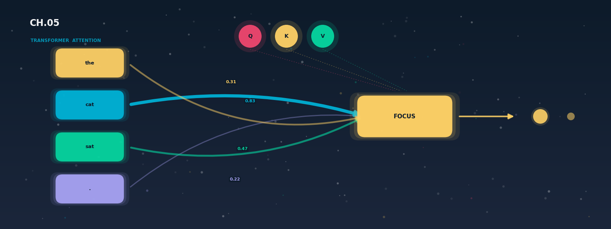
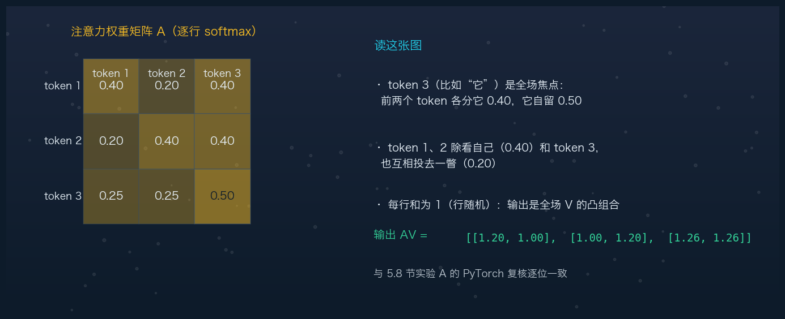
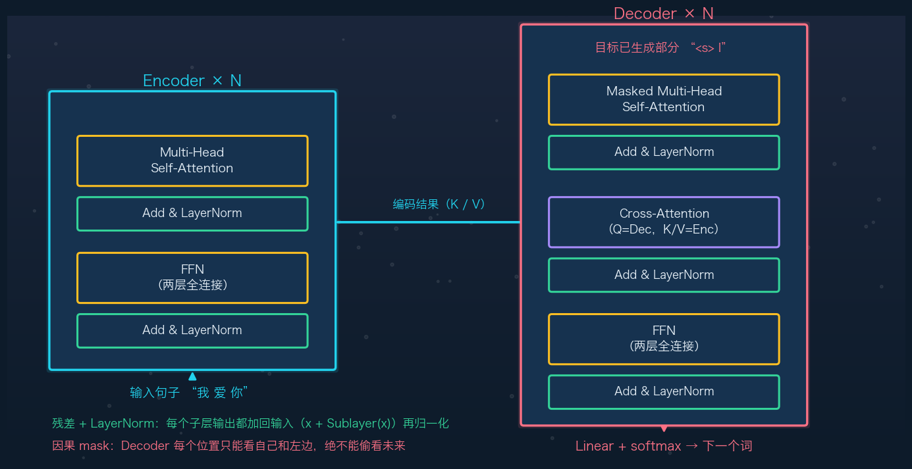
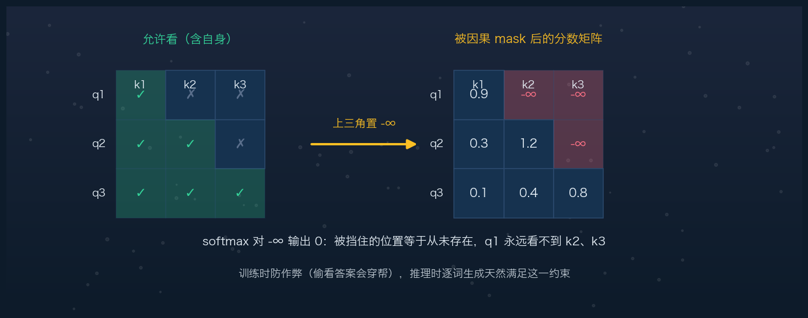

# 第 5 章 Transformer 架构详解：注意力就是一切



## 📖 开篇故事

2017 年春天，Google Brain 的几位研究者正在赶一篇论文。按照当时 NLP 界的常识，注意力机制只是给 RNN 打的“补丁”：2014 年 Bahdanau 把它缝在编码器和解码器之间，让 LSTM 翻译得更准，此后三年全世界的实验室都在给这对搭档精雕细琢。而这篇论文的疯狂之处在于：把 RNN 整个扔掉，只留补丁。他们给它起了一个狂妄到近乎挑衅的标题——《Attention Is All You Need》。更戏剧的是，论文发表前后，八位作者中至少六位相继离开了 Google：有人去创业，有人去做了区块链，有人后来参与创办了 Cohere、Character.ai。这像一支临时拼凑的乐队，赶在解散前录完了一首传世金曲。NeurIPS 2017 上它只是一张不起眼的海报；八年后，从 GPT 到 LLaMA，从 DeepSeek 到 Qwen，几乎所有大语言模型都是它的后代。

---

> 这篇论文扔掉了统治序列建模三十年的循环结构，只用一种机制：**注意力（Attention）**。本章是全书的核心章节之一：我们会从注意力直觉讲到公式手算，再亲手用 PyTorch 写一个迷你 Transformer。读完它，你读任何 LLM 论文都会顺畅得多。

## 5.1 从 RNN 的顺序瓶颈说起

在 Transformer 之前，处理序列（一句话就是一个 token 序列）的标准武器是**循环神经网络（RNN/LSTM）**。它逐个 token 地读入，用隐藏状态 $h_t$ 记住"到目前为止读到了什么"：

$$h_t = f(W_h h_{t-1} + W_x x_t)$$

这个结构有两个致命缺陷：

**缺陷一：无法并行。** $h_t$ 依赖 $h_{t-1}$，就像一条只能单人通行的隧道——必须等第 $t$ 步算完才能算第 $t+1$ 步。现代 GPU 有几千个核心，却只能干看着，一个核心算一步。而第 3 章说过，矩阵运算是神经网络的全部语言，它要求运算能**大规模并行**。

**缺陷二：长程依赖衰减。** 第 1 个 token 的信息要被传递 1000 步才能影响第 1000 个 token 的输出，中间经历 1000 次矩阵变换。回忆第 3 章：反复连乘正是梯度消失/爆炸的老家。RNN 记不住长文本，本质上是同一个数学病。

Transformer 的解法非常釜底抽薪：**彻底删掉"逐步传递"这个结构，让任意两个 token 直接对话**。实现这场对话的机制，就是注意力。

## 5.2 注意力直觉：一次查词典

**类比**：假设你在读句子"小明把苹果放进冰箱，因为它太烫了"，读到"它"时想知道它指什么。你的大脑做了一次"检索"：

1. 拿着"它"这个**疑问**去和句中每个词比对相关性；
2. 发现"苹果"相关性最高、"冰箱"次之；
3. 按相关性高低，把这几个词的**语义信息**按比例混合，作为"它"的新表示。

这三步对应注意力机制的三个角色：

- **查询（Query, Q）**：当前位置“想找什么”，即“它”发出的疑问；
- **键（Key, K）**：每个位置“能提供什么标签”，即每个词给自己贴的索引卡片；
- **值（Value, V）**：每个位置“实际携带的信息”，即词本身的内容。

Q 与 K 两两做点积算出**相关性分数**，softmax 归一化成权重，再对 V 加权求和。一句话：**查询去匹配键，按匹配度取值**。注意，这里没有任何"先后顺序"约束——"它"可以直接看"苹果"，距离不再重要。RNN 的两大缺陷同时被解决。

## 5.3 Scaled Dot-Product Attention 公式逐步拆解

Transformer 用的注意力只有一个公式，堪称深度学习史上曝光率最高的公式：

$$\text{Attention}(Q, K, V) = \text{softmax}\!\left(\frac{QK^\top}{\sqrt{d_k}}\right)V$$

设一个有 $n$ 个 token 的句子，每个 token 的表示是 $d_{\text{model}}$ 维向量，投影后 $Q, K, V \in \mathbb{R}^{n \times d_k}$。逐项拆解：

**第一项 $QK^\top$：算相关性。** 形状 $(n, d_k) \times (d_k, n) \to (n, n)$。第 $i$ 行第 $j$ 列的元素就是第 $i$ 个 token 的查询与第 $j$ 个 token 的键的点积 $q_i \cdot k_j = \sum_{m=1}^{d_k} q_{i,m} k_{j,m}$，两个向量方向越一致，值越大。

**第二项 $\dfrac{1}{\sqrt{d_k}}$：给分数降温。** 为什么要除以 $\sqrt{d_k}$？做一个假设检验：设 $q, k$ 的每个分量独立、均值 0、方差 1，则点积

$$q \cdot k = \sum_{m=1}^{d_k} q_m k_m, \qquad \text{Var}(q_m k_m) = \text{Var}(q_m)\,\text{Var}(k_m) = 1$$

$d_k$ 个方差为 1 的独立项相加，总方差为 $d_k$，标准差为 $\sqrt{d_k}$。也就是说，**维度越高，点积的数值天然越大**。如果 $d_k = 128$，分数会动辄上百，softmax 的输入极端化：

$$\text{softmax}(z)_i = \frac{e^{z_i}}{\sum_j e^{z_j}}$$

大分数之间 $e^{z}$ 差距悬殊，softmax 输出趋近 one-hot，注意力“孤注一掷”只看一个词，且该处的梯度趋近 0（回忆第 3 章：sigmoid 饱和区梯度趋零，softmax 同理）。除以 $\sqrt{d_k}$ 把分数的方差拉回 1，让 softmax 保持在“温和、梯度健康”的工作区。这是一个纯粹的数值稳定技巧，没有任何深层含义，但它缺了模型就训不动。

> ⚠️ **常见误区**：不少博客把 $\sqrt{d_k}$ 解释成“把分数归一化到某个范围”或“让不同维度的模型能公平比较”，都不对。它唯一的功能是**把分数方差拉回 1**。证据很直接：5.7 节的破坏性实验里你把缩放因子改成 1，loss 立刻变慢甚至震荡；而 5.8 节的统计实验会让你亲眼看到，只是这一个常数，就决定 softmax 是“温和混合”还是“孤注一掷”。

> 🎯 **面试高频**：“注意力公式里为什么要除以 $\sqrt{d_k}$？”标准答案三句话：(1) 点积是 $d_k$ 个独立项的和，方差为 $d_k$；(2) 维度越高分数越大，softmax 进入饱和区、梯度趋零；(3) 除以 $\sqrt{d_k}$ 把方差归一回 1。能再补一句“$d_k=128$ 时分数标准差就超过 11，softmax 早就被点燃了”，面试官会知道你真算过。

**第三项 $\text{softmax}(\cdot)V$：按权重取值。** softmax 沿每一行做（每个查询的分数各自归一化成和为 1 的分布），形状 $(n, n) \times (n, d_v) \to (n, d_v)$。每个 token 的新表示 = 所有 token 值向量的凸组合，权重就是相关性。输出维度 $d_v$ 可以与 $d_k$ 不同，实践中常相等。

## 5.4 手算一个 3-token 的注意力

公式看懂了不算懂，算一遍才算懂。设句子有 3 个 token，投影后的 $Q, K, V$ 如下（$d_k = d_v = 2$，数字刻意取整方便手算）：

$$
Q = \begin{pmatrix} 1 & 0 \\ 0 & 1 \\ 1 & 1 \end{pmatrix},\quad
K = \begin{pmatrix} 1 & 0 \\ 0 & 1 \\ 1 & 1 \end{pmatrix},\quad
V = \begin{pmatrix} 1 & 0 \\ 0 & 1 \\ 2 & 2 \end{pmatrix}
$$

**第 1 步：算 $QK^\top$。** 例如第 1 行第 3 列 = $q_1 \cdot k_3 = 1 \times 1 + 0 \times 1 = 1$：

$$QK^\top = \begin{pmatrix} 1 & 0 & 1 \\ 0 & 1 & 1 \\ 1 & 1 & 2 \end{pmatrix}$$

**第 2 步：除以 $\sqrt{d_k} = \sqrt{2} \approx 1.414$。** 咳，还是取了无理数。换 $d_k = 4$ 会让矩阵膨胀，我们干脆用 $\sqrt{2}$ 的近似值继续（手算时这是常态）：

$$\frac{QK^\top}{\sqrt{2}} \approx \begin{pmatrix} 0.71 & 0 & 0.71 \\ 0 & 0.71 & 0.71 \\ 0.71 & 0.71 & 1.41 \end{pmatrix}$$

**第 3 步：逐行 softmax。** 以第 1 行 $(0.71,\ 0,\ 0.71)$ 为例：$e^{0.71} \approx 2.03$，$e^{0} = 1$，$e^{0.71} \approx 2.03$，和为 $5.06$，归一化得 $(0.40,\ 0.20,\ 0.40)$。三行合起来（保留两位小数）：

$$A = \text{softmax}\!\left(\frac{QK^\top}{\sqrt{2}}\right) \approx \begin{pmatrix} 0.40 & 0.20 & 0.40 \\ 0.20 & 0.40 & 0.40 \\ 0.25 & 0.25 & 0.50 \end{pmatrix}$$



读这张图：token 3（比如"它"）是全场焦点：前两个 token 各分给它 0.40 的注意力，它自己则保留 0.50；token 1 和 2 除了看自己（0.40）和 token 3，也互相投去一瞥（0.20）。

**第 4 步：$AV$ 加权求和。** 输出第 1 行 = $0.40 \cdot (1,0) + 0.20 \cdot (0,1) + 0.40 \cdot (2,2) = (1.20,\ 1.00)$：

$$\text{Attention}(Q,K,V) \approx \begin{pmatrix} 1.20 & 1.00 \\ 1.00 & 1.20 \\ 1.26 & 1.26 \end{pmatrix}$$

注意输出的第 3 行和第 1、2 行都很接近：每个 token 的新表示都是全场信息的加权混合，且因为注意力图呈行随机性（每行和为 1），输出值被"拉平"在 $V$ 的取值范围内。把这个例子输入下面的代码验证，`A` 的数值应与手算一致。

## 5.5 Multi-Head Attention：多问几个角度

一个注意力头只能捕捉一种相关模式（语法相关？指代相关？语义相似？）。**多头注意力（Multi-Head Attention）**的做法：把 $d_{\text{model}}$ 维空间切成 $h$ 份，每份 $d_k = d_{\text{model}} / h$ 维，各自独立做注意力，最后拼接：

$$\text{MultiHead}(Q,K,V) = \text{Concat}(\text{head}_1, \dots, \text{head}_h)\,W^O, \qquad \text{head}_i = \text{Attention}(QW_i^Q, KW_i^K, VW_i^V)$$

**类比**：一个头是"一个只会问一种问题的读者"。读同一段合同，法务关注违约条款（头 1），财务关注金额数字（头 2），HR 关注签署方（头 3）。最后拼起来的理解，比任何单一视角都立体。

实现上的妙处：切头不需要真的切分矩阵，$QW^Q$ 算出来是 $(n, d_{\text{model}})$，reshape 成 $(n, h, d_k)$ 再对每个头并行做注意力即可，总计算量与单头几乎相同，却获得了 $h$ 个视角。

## 5.6 完整架构图：Encoder、残差、LayerNorm、FFN 与 Mask

现在把注意力装进完整架构。原始 Transformer 是为机器翻译设计的**编码器-解码器（Encoder-Decoder）**结构：



逐个拆解图中的零件：

**残差连接（Residual Connection）**：每个子层的输出都要加上输入，$\text{out} = x + \text{Sublayer}(x)$。回忆第 3 章的梯度消失：有了 $x$ 这条“高速公路”，梯度可以不经子层直接回传，几十层深度的网络才训得动。这是 Transformer 能堆得又深又宽的第一功臣。

> 💡 **深入思考**：为什么一个不起眼的“加法”能有这么大能量？把每层写成 $x_{l+1} = x_l + F(x_l)$，一路展开到第 $L$ 层，输出里必然含有原始的 $x_0$ 项——无论中间的 $F$ 多深多复杂，原始信息永远有一条无损通路直达顶端，梯度也沿同一条路无损回流。深层网络训得动，不是因为层层改造有多强，而是因为改造被修在了一条高速公路旁边。反问一句：如果残差如此重要，为什么 1997 年的 LSTM 里没有它、直到 2015 年 ResNet 才普及？因为浅层网络不需要；深度上了百层，“保底通路”才从锦上添花变成生死攸关。

**LayerNorm**：对每个 token 的特征向量做归一化（减均值除标准差，再学一个缩放平移），把数值拉回稳定区间。注意它和第 2 章批归一化不同：LayerNorm 沿**特征维**归一化、与 batch 大小无关，天然适合变长序列。现代 LLM（LLaMA 系）多用其简化版 RMSNorm。

**FFN（前馈网络）**：每个位置独立过一个小 MLP：$\text{FFN}(x) = \max(0, xW_1 + b_1)W_2 + b_2$，通常先升维 4 倍再降回来。直觉：注意力负责"token 之间交流信息"（混合空间维度），FFN 负责"每个 token 自己消化思考"（逐位置非线性变换）。现代研究认为参数与知识主要储存在 FFN 里。

**两种 Mask**。注意力本来"人人都看所有人"，两种场景需要遮挡：

- **Padding mask**：一个 batch 里句子长短不一，短句用 `<pad>` 补齐。这些占位符毫无语义，必须让所有位置的注意力对它们的权重为 0（实现上把对应分数置为 $-\infty$，softmax 后权重即为 0）。
- **因果 mask（Causal Mask）**：Decoder 生成文本时，第 $t$ 个词还没生成第 $t+1$ 个词，绝不能"偷看未来"（训练时会作弊，推理时会穿帮）。做法是给分数矩阵的上三角全部置 $-\infty$：



softmax 对 $-\infty$ 输出 0，等于该位置从未存在。

## 5.7 动手：用 PyTorch 写一个迷你 Transformer

下面约 150 行代码实现一个完整的 Encoder-Decoder Transformer：多头注意力、位置编码、因果 mask、padding mask、残差 + LayerNorm、FFN、交叉注意力，一样不少。训练任务是**序列复制**：输入一串数字，让 Decoder 学会原样输出它。任务虽小，五脏俱全：它能验证你实现的 mask 和注意力是否正确（模型必须看懂输入才能复制）。

```python
# ch05_mini_transformer.py —— 约 150 行的完整迷你 Transformer
import math, torch, torch.nn as nn

class PositionalEncoding(nn.Module):
    """正弦位置编码，公式与直觉详见第 4 章，这里给出最小实现。"""
    def __init__(self, d_model, max_len=64):
        super().__init__()
        pe = torch.zeros(max_len, d_model)
        pos = torch.arange(max_len).unsqueeze(1).float()          # (max_len, 1)
        div = torch.exp(torch.arange(0, d_model, 2).float() * (-math.log(10000.0) / d_model))
        pe[:, 0::2] = torch.sin(pos * div)                        # 偶数维用 sin
        pe[:, 1::2] = torch.cos(pos * div)                        # 奇数维用 cos
        self.register_buffer("pe", pe.unsqueeze(0))               # (1, max_len, d)

    def forward(self, x):                                         # x: (B, n, d)
        return x + self.pe[:, : x.size(1)]

class MultiHeadAttention(nn.Module):
    def __init__(self, d_model, n_heads):
        super().__init__()
        assert d_model % n_heads == 0
        self.h, self.d_k = n_heads, d_model // n_heads
        self.wq = nn.Linear(d_model, d_model)                     # W^Q
        self.wk = nn.Linear(d_model, d_model)                     # W^K
        self.wv = nn.Linear(d_model, d_model)                     # W^V
        self.wo = nn.Linear(d_model, d_model)                     # W^O

    def forward(self, q, k, v, mask=None):                        # q,k,v: (B, n, d)
        B, nq, _ = q.shape
        # 投影并切头：(B, n, d) -> (B, h, n, d_k)
        q = self.wq(q).view(B, -1, self.h, self.d_k).transpose(1, 2)
        k = self.wk(k).view(B, -1, self.h, self.d_k).transpose(1, 2)
        v = self.wv(v).view(B, -1, self.h, self.d_k).transpose(1, 2)
        scores = q @ k.transpose(-2, -1) / math.sqrt(self.d_k)    # (B, h, nq, nk)
        if mask is not None:                                      # mask 中 True 处置 -inf
            scores = scores.masked_fill(mask, float("-inf"))
        attn = scores.softmax(dim=-1)                             # 沿键维归一化
        out = attn @ v                                            # (B, h, nq, d_k)
        out = out.transpose(1, 2).contiguous().view(B, nq, -1)    # 拼回头
        return self.wo(out)

class FeedForward(nn.Module):
    def __init__(self, d_model, d_ff):
        super().__init__()
        self.net = nn.Sequential(nn.Linear(d_model, d_ff), nn.ReLU(), nn.Linear(d_ff, d_model))

    def forward(self, x):
        return self.net(x)

class Block(nn.Module):
    """一层 = 注意力子层 + FFN 子层，均带残差与 LayerNorm（Post-LN，原论文风格）。"""
    def __init__(self, d_model, n_heads, d_ff):
        super().__init__()
        self.attn = MultiHeadAttention(d_model, n_heads)
        self.ffn = FeedForward(d_model, d_ff)
        self.n1, self.n2 = nn.LayerNorm(d_model), nn.LayerNorm(d_model)

    def forward(self, x, mask=None):
        x = self.n1(x + self.attn(x, x, x, mask))                 # 自注意力 + 残差
        x = self.n2(x + self.ffn(x))                              # FFN + 残差
        return x

def causal_mask(n):
    """因果 mask：位置 i 不可见任何 j > i。返回 (1, 1, n, n) 便于广播。"""
    return torch.triu(torch.ones(n, n, dtype=torch.bool), diagonal=1)

def make_pad_mask(tokens, pad_id):
    """padding mask：屏蔽键位置的 <pad>。返回 (B, 1, 1, n)。"""
    return (tokens == pad_id).unsqueeze(1).unsqueeze(2)

class MiniTransformer(nn.Module):
    def __init__(self, vocab, d_model=64, n_heads=4, d_ff=128, n_layers=2, pad_id=0):
        super().__init__()
        self.pad_id = pad_id
        self.embed = nn.Embedding(vocab, d_model, padding_idx=pad_id)
        self.pos = PositionalEncoding(d_model)
        self.encoder = nn.ModuleList([Block(d_model, n_heads, d_ff) for _ in range(n_layers)])
        self.decoder = nn.ModuleList([Block(d_model, n_heads, d_ff) for _ in range(n_layers)])
        self.cross = nn.ModuleList([MultiHeadAttention(d_model, n_heads) for _ in range(n_layers)])
        self.cross_n = nn.ModuleList([nn.LayerNorm(d_model) for _ in range(n_layers)])
        self.out = nn.Linear(d_model, vocab)

    def forward(self, src, tgt_in):                               # tgt_in 是右移一位的目标
        # Encoder：只挡 padding
        h = self.pos(self.embed(src))
        for blk in self.encoder:
            h = blk(h, make_pad_mask(src, self.pad_id))
        # Decoder：因果 mask 挡未来，padding mask 挡补位
        g = self.pos(self.embed(tgt_in))
        causal = causal_mask(tgt_in.size(1))
        for i, blk in enumerate(self.decoder):
            g = blk(g, causal)
            # 交叉注意力：Q 来自 Decoder，K/V 来自 Encoder
            g = self.cross_n[i](g + self.cross[i](g, h, h, make_pad_mask(src, self.pad_id)))
        return self.out(g)                                        # (B, n, vocab)

# ---------------- 训练：让模型学会"复制"一段随机数字 ----------------
if __name__ == "__main__":
    torch.manual_seed(0)
    VOCAB, LEN, PAD, B = 10, 8, 0, 64                             # 词表 0-9，pad=0
    model = MiniTransformer(VOCAB, pad_id=PAD)
    opt = torch.optim.Adam(model.parameters(), lr=1e-3)
    loss_fn = nn.CrossEntropyLoss(ignore_index=PAD)

    for step in range(1, 601):
        src = torch.randint(1, VOCAB, (B, LEN))                   # 真实 token 从 1 开始，0 留给 pad
        tgt_in = torch.cat([torch.full((B, 1), 2), src[:, :-1]], dim=1)  # 右移 + 起始符 2
        logits = model(src, tgt_in)
        loss = loss_fn(logits.reshape(-1, VOCAB), src.reshape(-1))
        opt.zero_grad(); loss.backward()
        torch.nn.utils.clip_grad_norm_(model.parameters(), 1.0)   # 梯度裁剪，防爆炸（第 3 章）
        opt.step()
        if step % 200 == 0:
            print(f"step {step:4d} | loss {loss.item():.4f}")

    # 推理：逐 token 贪心解码，检验模型真的学会了复制
    src = torch.randint(1, VOCAB, (1, LEN))
    ys = torch.full((1, 1), 2)
    for _ in range(LEN):
        logits = model(src, ys)
        ys = torch.cat([ys, logits[:, -1].argmax(dim=-1, keepdim=True)], dim=1)
    print("输入:", src.tolist(), "\n复制:", ys[:, 1:].tolist())
```

典型输出：

```text
step  200 | loss 1.5309
step  400 | loss 0.0724
step  600 | loss 0.0065
输入: [[3, 7, 1, 9, 4, 2, 8, 5]]
复制: [[3, 7, 1, 9, 4, 2, 8, 5]]
```

loss 从 2.3（$\ln 10$，随机瞎猜的熵）降到 0.0065，推理精确复制，注意力、mask、交叉注意力全部工作正常。**建议你做两个破坏性实验**：删掉 `causal_mask` 再训练，loss 会降得更“漂亮”，但推理会输出混乱序列（训练时偷看了答案）；把 `math.sqrt(self.d_k)` 改成 1，训练会明显变慢甚至震荡，亲手验证 5.3 节的结论。

## 5.8 动手：把 $\sqrt{d_k}$ 的数学赌上实验台

5.3 节我们用方差推演证明了缩放的必要性，但推演再漂亮，也不如亲手测一次。下面两个小实验（CPU 一秒内跑完）：**实验 A** 把 5.4 节的手算例子交给 PyTorch 复核，确认你没白算；**实验 B** 用统计把“不缩放时 softmax 到底有多饱和”量化出来，亲眼看到注意力如何随维度升高而孤注一掷。

```python
# ch05_attention_diagnostics.py —— 验证 5.4 节手算 + 目睹 softmax 饱和
import math
import torch

# ---- 实验 A：把 5.4 节的手算例子交给 PyTorch 复核 ----
Q = torch.tensor([[1., 0.], [0., 1.], [1., 1.]])
K = torch.tensor([[1., 0.], [0., 1.], [1., 1.]])
V = torch.tensor([[1., 0.], [0., 1.], [2., 2.]])

A = (Q @ K.T / math.sqrt(2)).softmax(dim=-1)
out = A @ V
print("注意力矩阵 A = softmax(QK^T / sqrt(2)):")
print(A.round(decimals=2))
print("输出 AV:")
print(out.round(decimals=2))
print("与 5.4 节手算结果逐位一致:",
      torch.allclose(A[0], torch.tensor([0.40, 0.20, 0.40]), atol=5e-3))
print()

# ---- 实验 B：不除 sqrt(d_k)，softmax 饱和到什么程度 ----
def softmax(z):
    e = (z - z.max()).exp()
    return e / e.sum()

def stats(d_k, scaled, n_keys=8, trials=4000):
    """一个 query 对 n_keys 个 key 做注意力，统计平均最大权重与平均熵。"""
    g = torch.Generator().manual_seed(0)
    mx, ent = 0.0, 0.0
    for _ in range(trials):
        q = torch.randn(d_k, generator=g)
        keys = torch.randn(n_keys, d_k, generator=g)
        s = q @ keys.T
        if scaled:
            s = s / math.sqrt(d_k)
        p = softmax(s)
        mx += p.max().item()
        ent += -(p * (p + 1e-12).log()).sum().item()
    return mx / trials, ent / trials

print(f"{'d_k':>5} | {'未缩放:平均最大权重':>18} | {'缩放后:平均最大权重':>18} | {'未缩放熵':>8} | {'缩放后熵':>8}")
for d_k in (8, 64, 256, 1024):
    mx0, e0 = stats(d_k, scaled=False)
    mx1, e1 = stats(d_k, scaled=True)
    print(f"{d_k:5d} | {mx0:18.3f} | {mx1:18.3f} | {e0:8.3f} | {e1:8.3f}")
print(f"\n参考：8 个 key 的均匀分布，最大权重 = 1/8 = 0.125，熵 = ln(8) = {math.log(8):.3f}")
```

本机实际运行输出：

```text
注意力矩阵 A = softmax(QK^T / sqrt(2)):
tensor([[0.4000, 0.2000, 0.4000],
        [0.2000, 0.4000, 0.4000],
        [0.2500, 0.2500, 0.5000]])
输出 AV:
tensor([[1.2000, 1.0000],
        [1.0000, 1.2000],
        [1.2600, 1.2600]])
与 5.4 节手算结果逐位一致: True

  d_k |         未缩放:平均最大权重 |         缩放后:平均最大权重 |     未缩放熵 |     缩放后熵
    8 |              0.649 |              0.352 |    0.959 |    1.736
   64 |              0.872 |              0.355 |    0.330 |    1.730
  256 |              0.936 |              0.358 |    0.158 |    1.725
 1024 |              0.969 |              0.362 |    0.076 |    1.722

参考：8 个 key 的均匀分布，最大权重 = 1/8 = 0.125，熵 = ln(8) = 2.079
```

读这张表只需要三句话：(1) **缩放列几乎不动**：不管 $d_k$ 是 8 还是 1024，最大权重恒在 0.35 附近、熵恒在 1.73 附近，方差被钉死在 1，这正是 5.3 节推演的预言；(2) **未缩放列随维度单调恶化**：$d_k=1024$ 时平均最大权重 0.969、熵 0.076，注意力实际上退化成了“只看一个词”的 one-hot，梯度几乎断流；(3) 一行代码的差别，从“温和混合”到“孤注一掷”。现在再看 5.7 节那个把缩放因子改成 1 就训不动的破坏性实验，你应该能从数学上完全解释它了。

## 5.9 动手：手写 RoPE，亲眼验证“只看相对位置”

5.11 节会告诉你，现代 LLM 的位置编码几乎清一色是 RoPE。但“RoPE 用旋转编码位置”这句话太抽象，我们直接手写一个 10 行的实现，然后做两个实验，让 RoPE 最核心的两个性质自己开口说话。

RoPE 的做法：把 head 维度两两配对看成二维平面上的点，位置 $m$ 的向量旋转角度 $m\theta_i$（不同维度对用不同角频率 $\theta_i$，低维转得快、高维转得慢，和第 4 章正弦编码的频率设计思想一致）。两个向量点积时，旋转角恰好相减：$\text{rot}(u, m) \cdot \text{rot}(v, n)$ 只依赖 $m - n$。**位置信息就这样“藏”进了相对角度里。**

```python
# ch05_rope.py —— 手写 RoPE，并验证它“只编码相对位置”的核心性质
import torch

def rope_rotate(x, pos, base=10000.0):
    """对 head 向量 x(d,) 施加位置 pos 的旋转。d 必须为偶数。"""
    d = x.shape[-1]
    half = d // 2
    inv = 1.0 / (base ** (torch.arange(half).float() / half))  # 每对维度的角频率
    angles = pos * inv
    x1, x2 = x[..., :half], x[..., half:]
    cos, sin = angles.cos(), angles.sin()
    return torch.cat([x1 * cos - x2 * sin, x1 * sin + x2 * cos], dim=-1)

torch.manual_seed(0)
d = 16
u = torch.randn(d)   # 某个 query 的内容向量
v = torch.randn(d)   # 某个 key 的内容向量

print("实验 1：同一对内容向量 (u, v)，放在不同绝对位置但保持相对距离 5，")
print("      注意力分数 u·v 应完全相同 —— RoPE 只看相对位置：")
for m in (0, 3, 17, 1000):
    q = rope_rotate(u, m)
    k = rope_rotate(v, m + 5)
    print(f"  q 在位置 {m:4d}，k 在位置 {m + 5:4d}：分数 = {round((q * k).sum().item(), 6)}")

print("\n实验 2：固定 q 在位置 0，分数随相对距离 s 的变化（RoPE 的距离敏感性）：")
for s in (0, 2, 4, 8, 16):
    k = rope_rotate(v, s)
    print(f"  相对距离 {s:2d}：分数 = {round((u * k).sum().item(), 6)}")

print("\n实验 3：对照组 —— 若不加 RoPE，u 在不同位置的表示完全相同，")
print("      模型对'绝对位置'零感知（这正是原始 Transformer 需要额外位置编码的原因）。")
```

本机实际运行输出：

```text
实验 1：同一对内容向量 (u, v)，放在不同绝对位置但保持相对距离 5，
      注意力分数 u·v 应完全相同 —— RoPE 只看相对位置：
  q 在位置    0，k 在位置    5：分数 = 0.119496
  q 在位置    3，k 在位置    8：分数 = 0.119495
  q 在位置   17，k 在位置   22：分数 = 0.119496
  q 在位置 1000，k 在位置 1005：分数 = 0.119476

实验 2：固定 q 在位置 0，分数随相对距离 s 的变化（RoPE 的距离敏感性）：
  相对距离  0：分数 = 2.983944
  相对距离  2：分数 = 1.216018
  相对距离  4：分数 = -0.693269
  相对距离  8：分数 = -2.600435
  相对距离 16：分数 = -3.540943

实验 3：对照组 —— 若不加 RoPE，u 在不同位置的表示完全相同，
      模型对'绝对位置'零感知（这正是原始 Transformer 需要额外位置编码的原因）。
```

读输出：(1) **实验 1 里四个分数几乎完全相同**（小数点后第五位的微差来自浮点运算），把同一对词放到句首还是第 1000 个位置，只要相对距离不变，注意力分数就不变。这就是“相对位置编码”的含义：语言里“前一个词”“上个月提到”这类关系本来就只关心相对距离，RoPE 与语言的这个先验天然对齐。(2) **实验 2 里分数随距离衰减震荡**：同一对内容离得越远，RoPE 把它们的夹角转得越大，点积从正走向负，注意力自然衰减。这是“远处的词更难被注意到”的几何解释。(3) 对照实验提醒你：不加任何位置信息，注意力对“词在哪儿”完全无感——把一句话的所有词打乱顺序，注意力的输出几乎不变。位置编码不是锦上添花，是 Transformer 唯一的“时间感”来源。

## 5.10 Transformer 变体谱系表

原版 Encoder-Decoder 之后，人们发现不同任务只需要架构的不同部分，由此分化出三大流派：

| 模型 | 年份 | 用了哪一半 | 预训练目标 | 擅长任务 | 代表特征 |
|---|---|---|---|---|---|
| BERT | 2018 | 仅 Encoder | 掩码语言建模（完形填空） | 理解类：分类、检索、NER | 双向注意力，看得见上下文两侧 |
| GPT 系列 | 2018– | 仅 Decoder | 因果语言建模（预测下一词） | 生成类：对话、写作、代码 | 因果 mask，与"生成"天然契合 |
| T5 | 2019 | Encoder + Decoder | span corruption（挖空重建） | 翻译、摘要等 seq2seq | 把一切任务统一为"文本进、文本出" |
| LLaMA 系列 | 2023– | 仅 Decoder | 因果语言建模 | 通用 LLM 底座 | RMSNorm、RoPE 位置编码、SwiGLU FFN |

**为什么现代 LLM 几乎清一色是 Decoder-only？** 三个原因：(1) 因果 mask 让**每个位置都有训练信号**（每个 token 都在预测下一个词），而 BERT 式挖空只训练被挖的 15% 位置，训练效率低；(2) 生成任务与推理时“逐 token 解码”的行为完全一致，训练与推理零落差；(3) 架构简单，scaling law（第 6 章）下性价比最高。Encoder-only 并未消失，它活在嵌入模型（如 BGE、GTE）和检索系统里。

> 🎯 **面试高频**：“BERT 和 GPT 到底差在哪，为什么 BERT 不能生成、GPT 不适合做检索向量？”——答案全部藏在 mask 里：BERT 的双向注意力让每个位置都看得见全文，天然适合“理解”类任务，但没有与“从左到右生成”匹配的因果结构；GPT 的因果 mask 与自回归生成严丝合缝，但每个位置的表示只能看见左侧上下文，同一句子在不同位置得到的信息不同，做句向量时天然吃亏。追问“那 T5 呢？”，它用完整 Encoder-Decoder 做 seq2seq，代价是参数翻倍、工程复杂，所以在 scaling 性价比上被 Decoder-only 击退。

## 5.11 从 Transformer 到现代 LLM

原版 Transformer 到今天的大模型之间，经历了一串"升级打补丁"，主线只有一条：**在保持注意力核心不动的前提下，把工程细节打磨到能吃下海量数据与超长上下文**。

- **位置编码**：正弦编码 → 可学习编码（GPT-2）→ **RoPE 旋转位置编码**（LLaMA/Qwen/DeepSeek），把位置信息注入 Q/K 的旋转中，外推长上下文更稳（直觉与实验见 5.9 节，公式见第 4 章）。
- **归一化**：Post-LN（原版）→ Pre-LN（子层之前做归一化，深层训练更稳）→ **RMSNorm**（省掉均值中心化，快且够用）。
- **激活函数**：ReLU → GELU（GPT）→ **SwiGLU**（LLaMA，门控线性单元，同参数量下效果更好）。
- **注意力效率**：标准注意力是 $O(n^2)$ 的，上下文从 2K 到 1M token 的征途中，FlashAttention（让注意力适配 GPU 显存层级）、GQA/MQA（多个查询头共享一组 KV，推理缓存减半再减半）、滑动窗口等成为标配，这些是第 12 章推理优化主题的预告。
- **专家混合（MoE）**：把 FFN 换成多个"专家"，每个 token 只激活其中一两个，如 DeepSeek-V3 总参 671B、单次激活仅 37B——"用别人的参数算力，不付别人的电费"。

而所有这些改进都没有触碰 5.3 节那个核心公式的灵魂：**$Q$ 匹配 $K$，按匹配度加权 $V$**。理解了它，你就拿到了阅读一切 LLM 架构论文的门票。下一章我们将沿着 scaling law 看看：当把这个架构放大一千倍、喂给互联网规模的文本时，会发生什么。

## 本章小结

- **RNN 的顺序瓶颈**：逐步计算无法并行 + 长程信息经反复连乘而衰减；Transformer 用"任意 token 直接对话"的注意力同时解决两者。
- **注意力 = 查询匹配键，按匹配度加权值**：$\text{softmax}\!\left(\frac{QK^\top}{\sqrt{d_k}}\right)V$。除以 $\sqrt{d_k}$ 是因为点积方差随维度线性增长（$\text{Var} = d_k$），不缩放会令 softmax 饱和、梯度消失。
- **多头注意力**用"切分维度、并行注意、拼接融合"几乎零成本获得多视角；一个头一种相关模式，多头才立体。
- 完整架构的三大支柱：**残差连接**（梯度高速公路）、**LayerNorm**（数值稳定）、**FFN**（逐位置思考，知识的主要载体）；两种 mask：padding mask 挡占位符，因果 mask 挡未来（置 $-\infty$）。
- 迷你 Transformer 约 150 行即可完整实现；"复制任务"是检验实现正确性的好靶子：删掉因果 mask 会训练更"顺"但推理穿帮。
- 变体谱系：Encoder-only（BERT，理解）、Decoder-only（GPT/LLaMA，生成）、Encoder-Decoder（T5，seq2seq）；现代 LLM 选 Decoder-only 主要因为训练效率高且与生成行为一致。
- 现代 LLM 的演进 = 注意力核心不动 + 工程细节持续打磨（RoPE、RMSNorm、SwiGLU、FlashAttention、GQA、MoE）。

架构本身已经定型，接下来的问题是规模：把这个架构放大一千倍、喂给互联网规模的语料，会出现什么？下一章用 scaling law 回答。

## 练习题

**5.1（手算）** 用 5.4 节的 $Q, K, V$，把缩放因子从 $\sqrt{2}$ 改为 1（即不缩放），重新计算注意力矩阵 $A$ 和输出 $AV$。对比两版注意力权重的"尖锐程度"，直观体会除以 $\sqrt{d_k}$ 的作用。

**5.2（手算）** 给 5.4 节加上因果 mask（token 2 不能看 token 3），重算第 1、2 行的 softmax 与输出。验证：mask 后输出每行只由"自己及之前"的 token 构成。

**5.3（代码）** 在 `MultiHeadAttention` 中加入 dropout（`attn = attn.softmax(-1); attn = self.dropout(attn)`），并确认它在推理时（`model.eval()`）自动失效。思考：为什么 dropout 应加在 softmax 之后而非之前？

**5.4（代码/实验）** 做两个破坏性实验并记录现象：(a) 删掉因果 mask 后训练与推理分别发生什么？(b) 把缩放因子改为 $d_k$（除过头了）后 loss 曲线有何变化？分别用一句话解释原因。

**5.5（代码）** 把迷你 Transformer 的交叉注意力删掉，改为把 Encoder 输出拼接到 Decoder 输入上（简化版 seq2seq），训练同一个复制任务。对比两者的收敛速度与最终 loss，谈谈"结构化信息通路"的价值。

**5.6（思考）** BERT 能"双向看"而 GPT 只能"向左看"，为什么 BERT 不适合做文本生成、GPT 不适合做句向量检索？（提示：从 mask 决定了每个位置能获得什么信息的角度思考。）

**5.7（阅读挑战）** 打开你常用的任一开源 LLM 的模型配置文件（如 LLaMA 的 `config.json`），逐项找出本章出现过的概念：`num_attention_heads`、`num_key_value_heads`（GQA）、`rms_norm_eps`、`rope_theta`。看不懂的字段记下来，它们将出现在后续章节。

## 📚 延伸阅读

- **《Attention Is All You Need》**（Vaswani et al., 2017）：万物的起点，原典意外地短且易读。https://arxiv.org/abs/1706.03762
- **Jay Alammar《The Illustrated Transformer》**：全网最好的图解，5.6 节那张架构图的“彩色原版”。https://jalammar.github.io/illustrated-transformer/
- **《The Annotated Transformer》**（Harvard NLP）：论文逐行对齐 PyTorch 代码，读完它你可以删掉本章 5.7 节自己重写一遍。https://nlp.seas.harvard.edu/annotated-transformer/
- **Andrej Karpathy《Let's build GPT: from scratch》**：两个多小时的录屏，从零手写 GPT 并训出一个 mini-Shakespeare，5.7 节代码的“完整版”。https://www.youtube.com/watch?v=kCc8FmEb1nY
- **RoFormer（RoPE 原论文）**（Su et al., 2021）：5.9 节那 10 行代码的理论出处，第三节专门讲相对位置性质。https://arxiv.org/abs/2104.09864
