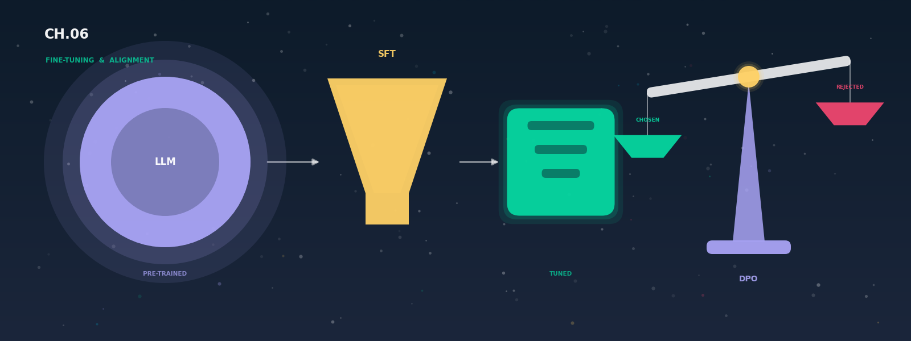
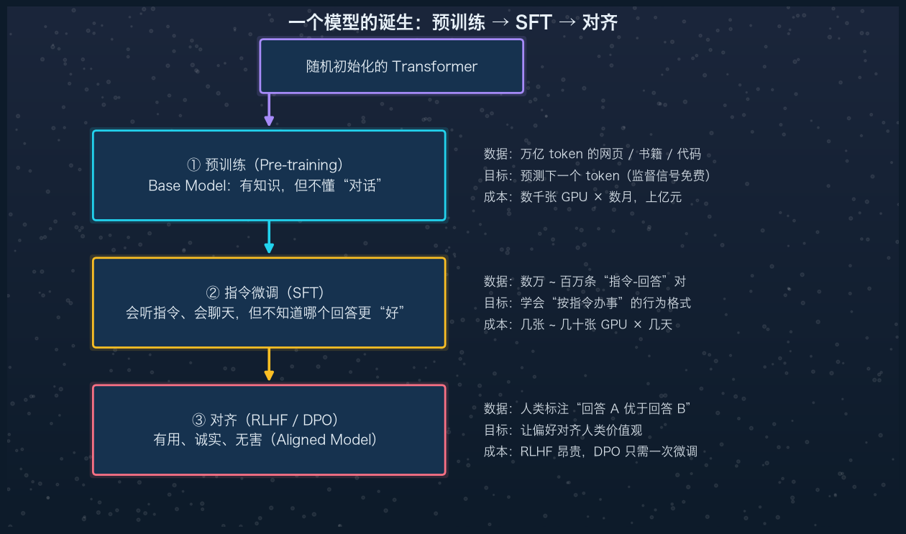
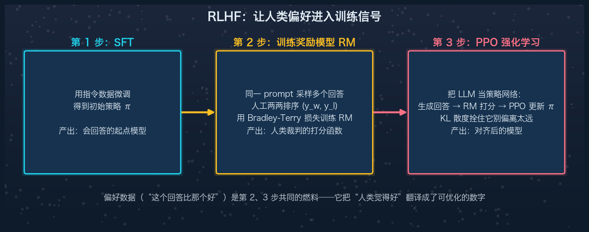

# 第 6 章 预训练、指令微调与对齐（SFT / RLHF / DPO）



## 📖 开篇故事

2020 年 6 月，OpenAI 发布 GPT-3：1750 亿参数，写诗写代码样样精通——但你很难跟它“对话”。你问“中国的首都是哪里？”，它常常接着罗列一串同类问题：“法国的首都是哪里？日本的首都是哪里？”因为它是一台续写机器，你给它一个问题，它续写出一整页问题。2022 年初，OpenAI 在 InstructGPT 论文里开出药方：用一万三千条人工撰写的指令-回答做 SFT，再用三万三千条人类偏好标注做 RLHF，总共不到五万条数据，成本不到预训练的零头，结果 13 亿参数的 InstructGPT 让人类标注者更喜欢它的回答，胜过了 1750 亿参数的 GPT-3。参数缩小百倍、体验反超，这可能是深度学习历史上性价比最高的一笔交易。2022 年 11 月 30 日，这套配方套在 GPT-3.5 上变成了 ChatGPT，上线 5 天用户破百万，Sam Altman 发推官宣这个数字，整个硅谷连夜修改 roadmap。

---

> 第 5 章我们造出了 Transformer 这台"机器"，但它还只是一台空转的发动机：随机初始化的权重什么也不会。本章回答一个问题：**一个什么都不会的随机模型，是怎么一步步变成 ChatGPT 那样"听得懂人话、办得成事情"的助手的？** 答案是三段旅程：预训练给它"知识"，指令微调给它"规矩"，对齐给它"价值观"。我们会亲手用 PyTorch 写一个 LoRA 层、跑通一次完整的 SFT，再把 RLHF 与 DPO 的公式直觉讲到你能向面试官复述的程度。对 Agent 工程师而言，这一章决定你何时该写提示词、何时该微调、何时该绕开微调。

## 6.1 三段旅程：预训练 → SFT → 对齐

先建立全景地图。现代 LLM 的诞生几乎无一例外经过三个阶段，每个阶段的目标、数据和成本截然不同：



| 阶段 | 一句话目标 | 数据形态 | 数据量级 | 类比 |
|---|---|---|---|---|
| 预训练 | 学会语言与世界知识 | 无标注原始文本 | $10^{12}$~$10^{13}$ token | 读完整个图书馆 |
| SFT | 学会"听指令办事" | (指令, 标准回答) | $10^4$~$10^6$ 条 | 新员工入职培训 |
| 对齐 | 学会"答得让人满意" | (回答A, 回答B, 人类偏好) | $10^4$~$10^5$ 对 | 师傅带着改作业 |

注意这张表的隐含结论：**三个阶段解决的问题互不重叠**。预训练模型你问"中国的首都"，它可能续写"是哪里？这是一个地理问题……"。它在续写文本，而不是回答问题。SFT 之后才学会"被问到就回答"这个行为模式；对齐之后才学会"回答要礼貌、要拒答危险问题"。

**给 Agent 工程师的实用推论**：你日常用的 GPT/Claude/Qwen 都是走完三阶段的成品。当你自己微调模型时，几乎永远从第二阶段（SFT）起步：基座模型的行为格式还没定型，预训练的成本你也付不起。

> ⚠️ **常见误区**：“我要让模型学会我们公司的领域知识，所以准备十万条知识问答做 SFT。”——方向大概率错了。**SFT 教的是“行为”，不是“知识”**。知识在预训练阶段就已经压进了权重（万亿 token 的量级），几万条 SFT 数据把新知识“硬塞”进去，往往学得慢、忘得快（灾难性遗忘见 6.3 节），还可能把通用能力训坏。领域知识的正确打开方式通常是：检索增强（把知识放在上下文里，第 4 部分主题）或继续预训练（大语料、低成本），SFT 留给“教它怎么回答”。反问一下：如果几万条数据就能注入可靠知识，OpenAI 为什么还要用万亿 token 做预训练？

## 6.2 预训练目标：预测下一个 token

第 5 章说过，Decoder-only 架构里每个位置都在做同一件事：给定左边所有 token，预测下一个。把这个直觉写成数学。语料是一条长 token 序列 $x_1, x_2, \dots, x_T$，模型参数为 $\theta$，预训练就是最大化整个序列的似然：

$$\mathcal{L}_{\text{pretrain}}(\theta) = -\sum_{t=1}^{T} \log P_\theta(x_t \mid x_{<t})$$

这就是**自回归语言建模（causal language modeling）**，每一项就是第 3 章见过的交叉熵损失。注意它不需要任何人工标注："答案"就藏在原文的下一个字里，所以互联网上海量文本天然全是训练数据。这是 LLM 能 scale 到万亿 token 的根本原因：**监督信号是免费的**。

一个常被忽视的细节：因为因果 mask（第 5 章），长度为 $T$ 的序列一次前向就产出 $T$ 个训练信号（每个位置都在预测自己的下一个 token）。这也是为什么 Decoder-only 的训练效率高于 BERT 式挖空（只有 15% 位置有监督信号）。

**Scaling Law**：OpenAI 与 DeepMind(Chinchilla) 的研究表明，预训练 loss 随模型参数量 $N$、数据量 $D$、算力 $C$ 呈幂律下降，例如 $\mathcal{L}(N) \approx (N_c/N)^{\alpha_N}$。实际含义很朴素：**loss 是可预测的，钱花在"模型变大"还是"数据变多"上可以算出来**（Chinchilla 的结论：两者应等比例增长，模型每大一倍，数据也要多一倍）。这就是为什么业界敢一次性烧上亿元训练一个模型，开工前就知道大概能到什么水平。

## 6.3 微调与灾难性遗忘

有了基座模型，想让它擅长某个具体任务（如医疗问答），最直觉的做法是拿领域数据继续训练，这就是**微调（fine-tuning）**。但直接微调会踩一个经典坑：

**灾难性遗忘（Catastrophic Forgetting）**：模型在新任务上训练时，权重被全面更新，旧任务上学到的表示被破坏。类比：你为了备考驾照交规，把大学四年学的数学全"覆盖"了——驾照拿到了，微积分不会了。神经网络没有"这块权重存数学、那块存交规"的分区，所有知识纠缠在同一份权重里，学新忘旧是默认行为。

常见缓解手段，从弱到强：

- **小学习率**：微调学习率通常比预训练小一个数量级（如 $10^{-5}$），少动旧权重；
- **混入通用数据**：领域数据里掺 10% 通用语料，不断“复习”；
- **冻结底层、只训上层**：浅层学的是通用语言特征，少动；深层任务相关，多动；
- **参数高效微调（PEFT）**：干脆不动旧权重，只加一小撮新参数，这就是下一节的主角 LoRA，也是工程上最主流的解法。

以上都是经验招法，不是定理。6.9 节会把“遗忘”与这几种缓解手段全部搬上实验台，让你看到它们各自的真实成色。

## 6.4 LoRA：给权重打"低秩补丁"

**全量微调（full fine-tuning）**要更新模型的全部参数。一个 7B 模型，仅 AdamW 优化器的两个动量状态就要占 $7\text{B} \times 2 \times 4\text{B} = 56\text{GB}$ 显存，再加权重和梯度，没有 8 张 A100 免谈。**LoRA（Low-Rank Adaptation）** 的核心思想：冻结原权重 $W$ 不动，把"微调带来的变化" $\Delta W$ 约束为两个低秩矩阵的乘积：

$$y = x(W + \Delta W) = xW + \frac{\alpha}{r}\, xBA, \qquad A \in \mathbb{R}^{r \times d_{\text{in}}},\ B \in \mathbb{R}^{d_{\text{out}} \times r},\ r \ll \min(d_{\text{in}}, d_{\text{out}})$$

**为什么可以低秩？** 直觉：预训练模型已经具备通用能力，微调只是"拨一下方向盘"，需要的调整是低维的。论文实证发现 $\Delta W$ 的奇异值谱衰减极快，前几个方向就占了绝大部分能量，秩 $r=8$ 往往足够。

**参数量对比**：设 $d_{\text{in}} = d_{\text{out}} = d = 4096$，全量更新一层要 $d^2 \approx 16.8\text{M}$ 个参数；LoRA 只要 $2rd = 2 \times 8 \times 4096 \approx 65\text{K}$，是原来的 **0.39%**。秩 $r$ 的影响很直接：$r$ 越大，补丁的表达能力越强，但参数与显存线性增长。经验法则：简单任务（格式对齐、风格迁移）$r=4\sim 8$ 足够；复杂领域适配用 $r=16\sim 64$；$r$ 再大收益递减，因为瓶颈已不在补丁容量。

**初始化的小心机**：$B$ 初始化为 0、$A$ 高斯初始化，使得训练第 0 步 $\Delta W = BA = 0$，模型行为与原模型完全一致，微调从"零扰动"开始平滑地长出来。

**QLoRA 一句话**：把冻结的基座权重量化到 4-bit（第 8 章详谈）再叠 LoRA，微调一个 65B 模型从“要 8 张 A100”变成“一张 48GB 显卡就行”。量化省显存、LoRA 省可训练参数，两者正交、可叠加。

> 🎯 **面试高频**：“LoRA 为什么有效？”高分答案分三层：(1) **低秩假设**：预训练模型已经具备能力，微调只是“拨方向盘”，实测 $\Delta W$ 的奇异值谱衰减极快，前几个方向占绝大部分能量，$r=8$ 已够用；(2) **零扰动起步**：$B=0$ 初始化使 $\Delta W = 0$，训练从原模型行为平滑长出（还有一个彩蛋：第一步只有 $B$ 收到梯度，6.5 节实验实测过）；(3) **部署友好**：训完可以 $W \leftarrow W + \frac{\alpha}{r}BA$ 合并回原矩阵，推理零开销、可以训多个 LoRA 热切换。追问“$r$ 怎么选”就答 6.4 节的经验法则，追问“为什么不直接训 $\Delta W$”就答参数量 $d^2$ vs $2rd$。

## 6.5 动手：手写一个 LoRA 层并做参数量实验

下面的代码完整可运行（CPU 即可，约 1 秒）。我们实现一个 `LoRALinear`，并用三个实验验证本节的所有论断：

```python
import torch
import torch.nn as nn
import math


class LoRALinear(nn.Module):
    """把普通线性层 y = xW 改造成 y = x(W + scaling * B @ A)。"""

    def __init__(self, in_features, out_features, r=8, alpha=16):
        super().__init__()
        self.weight = nn.Parameter(torch.randn(out_features, in_features) * 0.02)
        self.bias = nn.Parameter(torch.zeros(out_features))
        # 关键一步：冻结原始权重，从此它不再接受梯度
        self.weight.requires_grad_(False)
        self.bias.requires_grad_(False)
        # LoRA 两片小矩阵：A 高斯初始化，B 初始化为 0
        self.r = r
        self.scaling = alpha / r
        self.lora_A = nn.Parameter(torch.randn(r, in_features) / math.sqrt(r))
        self.lora_B = nn.Parameter(torch.zeros(out_features, r))

    def forward(self, x):
        base = x @ self.weight.T + self.bias          # 冻结部分：原模型输出
        delta = (x @ self.lora_A.T) @ self.lora_B.T   # LoRA 分支：低秩修正
        return base + self.scaling * delta


def count_params(module, only_trainable=True):
    return sum(p.numel() for p in module.parameters()
               if (p.requires_grad or not only_trainable))


def build_model(hidden, r):
    return nn.Sequential(*[LoRALinear(hidden, hidden, r=r) for _ in range(4)])


if __name__ == "__main__":
    torch.manual_seed(0)

    # 实验 1：B=0 时，LoRA 层输出应与普通线性层完全一致
    x = torch.randn(3, 64)
    plain = nn.Linear(64, 64)
    lora = LoRALinear(64, 64, r=8)
    with torch.no_grad():
        lora.weight.copy_(plain.weight)
        lora.bias.copy_(plain.bias)
    print("B=0 时 LoRA 与原层输出一致:",
          torch.allclose(plain(x), lora(x), atol=1e-6))

    # 实验 2：hidden=4096 的 4 层 MLP，全量 vs LoRA 的可训练参数量
    hidden = 4096
    full = nn.Sequential(*[nn.Linear(hidden, hidden) for _ in range(4)])
    for r in (4, 8, 16):
        model = build_model(hidden, r)
        full_params = count_params(full)
        lora_params = count_params(model)
        print(f"hidden={hidden}, r={r:2d} | "
              f"全量微调 {full_params/1e6:6.2f}M | "
              f"LoRA {lora_params/1e6:5.2f}M | "
              f"占比 {lora_params/full_params*100:5.2f}%")

    # 实验 3：训练 3 步，观察哪些参数收到梯度、冻结权重是否被改动
    model = build_model(hidden=64, r=8)
    opt = torch.optim.SGD(model.parameters(), lr=0.05)
    frozen_before = [p.detach().clone()
                     for p in model.parameters() if not p.requires_grad]
    for step in range(3):
        opt.zero_grad()
        loss = model(torch.randn(8, 64)).pow(2).mean()
        loss.backward()
        got = sorted({n.split('.')[-1] for n, p in model.named_parameters()
                      if p.grad is not None and p.grad.abs().sum() > 0})
        print(f"第 {step+1} 步收到梯度的参数: {got}")
        opt.step()
    moved = any(not torch.equal(b, a) for b, a in
                zip(frozen_before,
                    [p for p in model.parameters() if not p.requires_grad]))
    print("冻结权重是否被改动:", moved)
```

本机实际运行输出：

```text
B=0 时 LoRA 与原层输出一致: True
hidden=4096, r= 4 | 全量微调  67.13M | LoRA  0.13M | 占比  0.20%
hidden=4096, r= 8 | 全量微调  67.13M | LoRA  0.26M | 占比  0.39%
hidden=4096, r=16 | 全量微调  67.13M | LoRA  0.52M | 占比  0.78%
第 1 步收到梯度的参数: ['lora_B']
第 2 步收到梯度的参数: ['lora_A', 'lora_B']
第 3 步收到梯度的参数: ['lora_A', 'lora_B']
冻结权重是否被改动: False
```

三个实验各验证一件事：

1. **零扰动初始化**：`B=0` 时输出与原层逐位一致，微调从原模型的行为出发；
2. **参数量暴降**：$r=8$ 时可训练参数仅为全量的 0.39%，与 6.4 节的估算 $2rd/d^2$ 精确吻合；
3. **梯度只流向 LoRA**：冻结权重三步训练后纹丝不动。注意一个有趣的细节：**第 1 步只有 `lora_B` 收到梯度**！这是数学必然：$\frac{\partial \mathcal{L}}{\partial A}$ 的链式路径要经过 $B$，而 $B=0$ 把梯度乘没了；$B$ 被更新一步后不再为零，第 2 步起 $A$ 才开始学习。这也是为什么 $A$ 必须随机初始化而不能也是 0（否则两个矩阵永远卡在 0，对称性无法打破，回忆第 3 章的权重初始化讨论）。

工程实践中你不会手写 LoRA，直接用 `peft` 库三行搞定：`LoraConfig(r=8, target_modules=["q_proj", "v_proj"])` + `get_peft_model(model, config)`。但手写一遍之后你会知道 `target_modules` 里那些名字背后到底发生了什么。

## 6.6 动手：跑一次真正的 SFT

现在把 SFT 的完整流程跑通。为避免大模型下载，我们用 GPT-2 分词器 + 一个随机初始化的 7.2M 小模型，在 16 条"问答对"上微调（CPU 约 35 秒）。**这个例子展示的是 SFT 的流程与机制，不是模型的智能**。小模型只是把答案"背下来"，但管道与训练 7B 模型时一模一样：

```python
import torch
from torch.utils.data import DataLoader
from datasets import Dataset
from transformers import AutoTokenizer, GPT2Config, GPT2LMHeadModel

torch.manual_seed(42)

# 1. 迷你指令数据集：16 条常识问答
PAIRS = [
    ("中国的首都是哪里？", "北京"), ("法国的首都是哪里？", "巴黎"),
    ("日本的首都是哪里？", "东京"), ("英国的首都是哪里？", "伦敦"),
    ("水的化学式是什么？", "H2O"), ("太阳从哪边升起？", "东方"),
    ("一周有几天？", "7天"), ("1加1等于几？", "2"),
    # ... 共 16 条
]
data = [{"prompt": f"用户：{q}\n助手：", "answer": a} for q, a in PAIRS]
dataset = Dataset.from_list(data)          # <- datasets 库登场

# 2. 分词 + label 掩码：prompt 部分置 -100，只在答案上算 loss
tok = AutoTokenizer.from_pretrained("gpt2")
tok.pad_token = tok.eos_token
MAX_LEN = 64

def encode(example):
    prompt_ids = tok(example["prompt"], add_special_tokens=False)["input_ids"]
    answer_ids = tok(example["answer"] + tok.eos_token,
                     add_special_tokens=False)["input_ids"]
    input_ids = (prompt_ids + answer_ids)[:MAX_LEN]
    labels = ([-100] * len(prompt_ids) + answer_ids)[:MAX_LEN]
    pad = MAX_LEN - len(input_ids)
    return {"input_ids": input_ids + [tok.pad_token_id] * pad,
            "labels": labels + [-100] * pad,
            "attention_mask": [1] * (MAX_LEN - pad) + [0] * pad}

loader = DataLoader(dataset.map(encode).with_format("torch"),
                    batch_size=4, shuffle=True)

# 3. 随机初始化的小模型（7.2M 参数）
config = GPT2Config(vocab_size=tok.vocab_size, n_positions=MAX_LEN,
                    n_embd=128, n_layer=4, n_head=4)
model = GPT2LMHeadModel(config)

def generate(prompt, max_new_tokens=12):
    model.eval()
    ids = tok(prompt, return_tensors="pt", add_special_tokens=False)["input_ids"]
    out = model.generate(ids, max_new_tokens=max_new_tokens, do_sample=False,
                         attention_mask=torch.ones_like(ids),
                         pad_token_id=tok.pad_token_id)
    text = tok.decode(out[0][ids.shape[1]:], skip_special_tokens=True)
    model.train()
    return repr(text)

print("训练前回答:", generate("用户：中国的首都是哪里？\n助手："))

# 4. 训练循环：与第 3 章的写法没有任何不同
opt = torch.optim.AdamW(model.parameters(), lr=1e-3)
model.train()
for epoch in range(120):
    total = 0.0
    for batch in loader:
        out = model(**batch)      # labels 传入后内部自动右移并算交叉熵
        out.loss.backward()
        opt.step(); opt.zero_grad()
        total += out.loss.item()
    if (epoch + 1) % 30 == 0:
        print(f"epoch {epoch+1:3d} | loss {total/len(loader):.4f}")

# 5. 看效果
for q in ("中国的首都是哪里？", "一周有几天？", "1加1等于几？"):
    print(f"问：{q}  答：{generate('用户：' + q + chr(10) + '助手：')}")
```

本机实际运行输出：

```text
训练前回答: ' Candle inputsWeaponsWeaponsSenior decent decent...'
epoch  30 | loss 0.9831
epoch  60 | loss 0.1061
epoch  90 | loss 0.0394
epoch 120 | loss 0.0224
问：中国的首都是哪里？  答：'北京'
问：一周有几天？  答：'7天'
问：1加1等于几？  答：'2'
```

这段代码里有 SFT 的全部精髓，请逐条对照：

- **指令模板**：`用户：{q}\n助手：{a}` 这个格式本身没有魔力，魔力在于**训练与推理使用完全一致的模板**。真实模型用 `<|im_start|>user ...` 之类的特殊 token，思想相同；
- **label 掩码（-100）**：prompt 部分不参与 loss。PyTorch 交叉熵默认忽略 `-100`。为什么要掩码？模型需要学的是"如何回答"，而不是"如何复述用户的问题"。不掩码也能训练，但一半梯度浪费在学提问上；
- **训练前乱说、训练后按模板回答**：随机模型输出一堆英文碎片，120 轮后精确输出"北京"。这就是 SFT 在做的事：**把模型的输出行为约束进"被问到就回答"的模式里**。换用真实基座模型（如 Qwen2.5-0.5B）和几千条指令数据，同样的代码就能产出真正可用的领域助手。

## 6.7 RLHF：让人类偏好进入训练信号

SFT 之后模型会回答了，但"会回答"不等于"答得好"。面对开放式问题（"帮我写一封道歉信"），不存在唯一标准答案，却明显存在"这个比那个好"。**RLHF（基于人类反馈的强化学习）** 把这种比较偏好变成训练信号，分三步：



**第 2 步：奖励模型（Reward Model, RM）**。收集同一个 prompt 的多个回答，让人工标注两两偏好 $(y_w, y_l)$（win / lose），用 **Bradley-Terry 模型** 训练 RM 给"好回答"打高分：

$$\mathcal{L}_{\text{RM}} = -\log \sigma\big(r_\phi(x, y_w) - r_\phi(x, y_l)\big)$$

直觉：$\sigma$ 是 sigmoid，好回答的分比差回答高得越多，$\sigma(\cdot)$ 越接近 1、loss 越小。RM 学的是"人类裁判的打分函数"。

**第 3 步：PPO**。把 LLM 当作策略 $\pi_\theta$：生成回答 $y$ 是"动作"，RM 的分数是"奖励"，再加一项与 SFT 模型 $\pi_{\text{ref}}$ 的 KL 散度惩罚防止跑偏：

$$\max_\theta\; \mathbb{E}_{y \sim \pi_\theta(\cdot|x)}\left[r_\phi(x, y)\right] - \beta\,\text{KL}\!\left(\pi_\theta \,\|\, \pi_{\text{ref}}\right)$$

**RLHF 的局限**（这也是 DPO 诞生的动机）：(1) 训练管线复杂：同时维护 4 个模型（策略、参考、奖励、价值网络），显存与工程成本高；(2) PPO 对超参数极敏感，训练中奖励可能剧烈震荡；(3) **奖励黑客（reward hacking）**：模型会找到 RM 的漏洞，比如学会“回答越长分越高”，开始说正确的废话；(4) 人类标注贵且慢，且标注者之间的一致性有限。

> 💡 **深入思考**：PPO 目标里那项 $-\beta\,\text{KL}(\pi_\theta \| \pi_{\text{ref}})$ 为什么要存在？因为 RM 只是个“人类偏好的廉价近似”，它在训练数据分布之外是外推、是猜测。没有 KL 锚，策略会大踏步奔向 RM 的高分区域——包括 RM 判断错的那些角落，这就是奖励黑客的几何本质。KL 惩罚相当于给模型拴了一根橡皮筋：“可以离参考模型远，但离得越远，拉力越大”，逼它只在“已经验证过安全”的邻域里优化。你可以把这个思想记成一句话：**优化一个不可靠的评价函数时，步子必须拴在可靠的地基上**。这个思想在后面 Agent 章节里还会反复出现（评估器不可靠时，评估只能当方向盘，不能当油门）。

## 6.8 DPO：跳过强化学习，直接用偏好对优化

DPO（Direct Preference Optimization, 2023）的洞察：PPO 里"奖励模型 + 强化学习"这一大圈，可以被一个闭式变换消掉。在最优解处，奖励可以表示为策略与参考策略的对数比，代回 Bradley-Terry 偏好模型，直接得到对偏好数据的可微损失：

$$\mathcal{L}_{\text{DPO}}(\theta) = -\log \sigma\!\left[\beta \log \frac{\pi_\theta(y_w|x)}{\pi_{\text{ref}}(y_w|x)} - \beta \log \frac{\pi_\theta(y_l|x)}{\pi_{\text{ref}}(y_l|x)}\right]$$

读起来吓人，拆开就是常识：$\pi_\theta(y_w|x)/\pi_{\text{ref}}(y_w|x)$ 是"当前模型相比参考模型，给好回答的概率涨了多少"。损失要求：**好回答的概率要涨，差回答的概率要跌**，两者的差距越大越好（经 sigmoid 饱和）。$\beta$ 控制允许偏离参考模型的幅度。

与 RLHF 对比，DPO 不需要训练 RM、不需要在线采样、不需要 PPO，**就是一次带特殊损失的微调**，普通的 SFT 代码改个 loss 就能跑。稳定性与成本全面占优，2024 年后成为开源社区对齐的主流（Llama、Qwen 的对齐阶段都用了 DPO 或其变体）。

**一句话认识两个变体**：

- **KTO**：偏好数据从“成对比较”放宽为“单条回答 + 好/坏标签”（对标用户点踩点赞），标注成本大降，效果接近 DPO；
- **ORPO**：把 SFT 与偏好对齐合进一个损失，一次训练同时学会“怎么答”和“哪个好”，连参考模型都省了。

## 6.9 动手：亲眼看见灾难性遗忘，再亲手止住它

6.3 节说“新旧知识纠缠在同一份权重里，学新忘旧是默认行为”——这是本书少数几个没在正文实验过的论断，现在补上。设定一个“增量业务”场景：模型先学会分类 5 个类别（任务 A，老业务），接着只拿新业务数据（任务 B：另 5 个类别）继续微调，同一个分类头，什么防护都不做。CPU 上几秒跑完：

```python
# ch06_forgetting.py —— 在"增量类别"设定下亲眼看见灾难性遗忘，再亲手止住它
import torch
import torch.nn as nn
import torch.nn.functional as F

torch.manual_seed(0)
D = 16

def make_task(seed, n_cls=5, offset=0, n=600):
    """一个任务 = n_cls 个类别，每类围绕一个随机中心成簇。offset 用于错开类别编号。"""
    g = torch.Generator().manual_seed(seed)
    centers = torch.randn(n_cls, D, generator=g) * 3
    y = (torch.rand(n, generator=g) * n_cls).long()
    X = torch.randn(n, D, generator=g) + centers[y]
    return centers, X, y + offset

def sample(centers, offset=0, n=400, seed=0):
    """同一组中心采新样本（测试集：同任务、没见过的数据）。"""
    g = torch.Generator().manual_seed(seed)
    n_cls = centers.shape[0]
    y = (torch.rand(n, generator=g) * n_cls).long()
    X = torch.randn(n, D, generator=g) + centers[y]
    return X, y + offset

# 任务 A：类别 0~4（"上线前已经学会的旧业务"）
# 任务 B：类别 5~9（"新业务"，与旧业务共享同一个分类头）
cA, Xa, ya = make_task(1, offset=0)
cB, Xb, yb = make_task(2, offset=5)
Xa_t, ya_t = sample(cA, offset=0, seed=11)
Xb_t, yb_t = sample(cB, offset=5, seed=22)

def build():
    return nn.Sequential(nn.Linear(D, 64), nn.ReLU(),
                         nn.Linear(64, 64), nn.ReLU(), nn.Linear(64, 10))

def train(model, X, y, X_replay=None, y_replay=None, epochs=300, lr=1e-3):
    opt = torch.optim.Adam(model.parameters(), lr=lr)
    for _ in range(epochs):
        xb, yb_ = X, y
        if X_replay is not None:                    # replay：每轮混入 10% 旧数据
            idx = torch.randint(0, X_replay.shape[0], (X.shape[0] // 10,))
            xb = torch.cat([X, X_replay[idx]])
            yb_ = torch.cat([y, y_replay[idx]])
        loss = F.cross_entropy(model(xb), yb_)
        opt.zero_grad(); loss.backward(); opt.step()

def acc(model, X, y):
    with torch.no_grad():
        return (model(X).argmax(-1) == y).float().mean().item()

# 方案一：裸微调（无任何防护）—— 亲眼看灾难性遗忘
m1 = build()
train(m1, Xa, ya)
print(f"方案一 裸微调 | 只学过 A 时      : A 测试 {acc(m1, Xa_t, ya_t):6.2%}")
train(m1, Xb, yb)
print(f"             | 再裸学 B 之后     : B 测试 {acc(m1, Xb_t, yb_t):6.2%} | A 测试 {acc(m1, Xa_t, ya_t):6.2%}")

# 方案二：微调 B 时混入 10% 旧数据（replay）
m2 = build()
train(m2, Xa, ya)
train(m2, Xb, yb, X_replay=Xa, y_replay=ya)
print(f"方案二 replay| 学完 A、B 之后    : B 测试 {acc(m2, Xb_t, yb_t):6.2%} | A 测试 {acc(m2, Xa_t, ya_t):6.2%}")

# 方案三：冻结第一层（赌"浅层特征通用"）
m3 = build()
train(m3, Xa, ya)
for p in m3[0].parameters():
    p.requires_grad_(False)
train(m3, Xb, yb)
print(f"方案三 冻底层| 学完 A、B 之后    : B 测试 {acc(m3, Xb_t, yb_t):6.2%} | A 测试 {acc(m3, Xa_t, ya_t):6.2%}")
```

本机实际运行输出：

```text
方案一 裸微调 | 只学过 A 时      : A 测试 100.00%
             | 再裸学 B 之后     : B 测试 100.00% | A 测试 41.25%
方案二 replay| 学完 A、B 之后    : B 测试 100.00% | A 测试 100.00%
方案三 冻底层| 学完 A、B 之后    : B 测试 100.00% | A 测试 20.00%
```

三个结果，三个教训：

1. **裸微调：A 从 100% 掉到 41.25%**。模型明明“有能力”同时做好两个任务（容量绰绰有余），但 B 的训练信号把共享的特征和分类头拉向了新决策边界，旧类的表征被挤压变形。**遗忘不是因为容量不够，而是因为旧任务不在损失函数里**；
2. **replay：两个任务都 100%**。仅仅每轮混入 10% 旧数据（成本几乎不变），旧任务就重新回到了损失函数里，“复习”两个字就是这么便宜而有效；
3. **冻结底层反而最糟（20%）**——这是个诚实的“翻车”结果，也正因此值得记住：本实验里两个任务的输入分布差异太大，第一层特征本身就冲突，“浅层通用”的假设并不总成立。**6.3 节的缓解手段是启发式，不是定理**。在你的数据上，哪一招有效要靠实验说话。

## 6.10 动手：把 DPO 损失缩到一张四张牌的牌桌上

DPO 公式看起来吓人。我们把它缩到极致：一个只有 4 个候选回答的“模型”（softmax over 4 个 logits），偏好对 $(y_w, y_l)$，参考模型固定。在这个玩具上跑三件事：优化 300 步看概率走向；验证平移不变性（练习题 6.6 的答案）；看 $\beta$ 的缰绳作用。

```python
# ch06_dpo_toy.py —— 把 DPO 损失缩小到一个 4 词"词表"上，看清它到底在优化什么
import math
import torch
import torch.nn.functional as F

torch.manual_seed(0)

# 迷你设定：模型面对一个 prompt 有 4 个候选回答（词表 4 个"词"）。
# π_ref 是参考模型（SFT 刚结束时的模型），对 4 个回答各有一个偏好 logits。
ref_logits = torch.tensor([1.0, 0.5, -1.0, -2.0])
Y_WIN, Y_LOSE = 0, 2           # 人类偏好：回答 0 好，回答 2 差

def dpo_loss(logits, beta=0.1):
    logp = F.log_softmax(logits, dim=-1)
    logp_ref = F.log_softmax(ref_logits, dim=-1)
    ratio_w = (logp - logp_ref)[Y_WIN]
    ratio_l = (logp - logp_ref)[Y_LOSE]
    return -F.logsigmoid(beta * (ratio_w - ratio_l))

# ---- 演示 1：DPO 训练 300 步，看好/差回答的概率走向 ----
logits = torch.nn.Parameter(ref_logits.clone())
opt = torch.optim.SGD([logits], lr=0.5)
print("step | DPO loss | P(好回答) | P(差回答)")
for step in range(301):
    loss = dpo_loss(logits)
    opt.zero_grad(); loss.backward(); opt.step()
    if step % 60 == 0:
        p = F.softmax(logits.detach(), dim=-1)
        print(f"{step:5d} | {loss.item():8.4f} | {p[Y_WIN]:9.3f} | {p[Y_LOSE]:9.3f}")

# ---- 演示 2：DPO 的"平移不变性"（练习题 6.6 的答案） ----
base = dpo_loss(torch.tensor([1.0, 0.5, -1.0, -2.0]))
shift = dpo_loss(torch.tensor([2.0, 1.5, 0.0, -1.0]))   # 全部 logits +1
both_up = dpo_loss(torch.tensor([3.0, 2.5, 1.0, 0.0]))  # 全部 logits +2
print(f"\n原始 logits 的 loss:        {base.item():.6f}")
print(f"全部 logits +1 后的 loss:    {shift.item():.6f}  (好/差回答概率一起上涨，loss 不变)")
print(f"全部 logits +2 后的 loss:    {both_up.item():.6f}  (还是不变 —— DPO 只看相对差距)")
print("平移不变性成立:", math.isclose(base.item(), shift.item(), abs_tol=1e-6)
      and math.isclose(base.item(), both_up.item(), abs_tol=1e-6))

# ---- 演示 3：beta 的缰绳作用 —— beta 越大，允许偏离参考模型的幅度越小 ----
for beta in (0.05, 0.1, 1.0):
    l = dpo_loss(torch.tensor([2.0, 0.5, -1.5, -2.0]), beta=beta)  # 已明显偏离 ref
    print(f"beta={beta:<4} | 同一偏离程度的 loss = {l.item():.4f}")
```

本机实际运行输出：

```text
step | DPO loss | P(好回答) | P(差回答)
    0 |   0.6931 |     0.565 |     0.073
   60 |   0.5634 |     0.857 |     0.007
  120 |   0.4667 |     0.954 |     0.001
  180 |   0.3936 |     0.983 |     0.000
  240 |   0.3376 |     0.993 |     0.000
  300 |   0.2937 |     0.997 |     0.000

原始 logits 的 loss:        0.693147
全部 logits +1 后的 loss:    0.693147  (好/差回答概率一起上涨，loss 不变)
全部 logits +2 后的 loss:    0.693147  (还是不变 —— DPO 只看相对差距)
平移不变性成立: True
beta=0.05 | 同一偏离程度的 loss = 0.6564
beta=0.1  | 同一偏离程度的 loss = 0.6210
beta=1.0  | 同一偏离程度的 loss = 0.2014
```

三个演示各自回答一个问题：

1. **DPO 到底在优化什么**：好回答概率从 0.565 涨到 0.997、差回答跌到 0，loss 从 $\ln 2$（初始时 log-ratio 为 0，损失恰好是 $-\log\sigma(0)$）单调下降。**拉大“好与差的概率差距”就是它的全部目标**。注意 softmax 归一化在此充当免费的守门员：抬高 $y_w$ 的 logits 同时必然压低其它候选，不会出现“全部回答概率一起涨”的空转；
2. **为什么它防“死记硬背”**：演示 2 用实验给出练习题 6.6 的答案：把所有 logits 整体 +1、+2（相当于“把每个回答的概率都抬上去”），loss 纹丝不动。因为损失只看**对数比的差**，纯粹的整体抬升不提供任何梯度信号，模型没有动机去背好答案；
3. **$\beta$ 就是 KL 锚的化身**：同样的偏离程度，$\beta=0.05$ 时 loss 只微增（缰绳松，跑得远），$\beta=1.0$ 时 loss 猛增（缰绳紧，被拽回参考模型附近）。6.7 节那个“优化不可靠评价函数要拴在地基上”的思想，在 DPO 里被压缩成了一个标量超参数。

## 本章小结

- **三阶段各司其职**：预训练注入知识（next token prediction，监督信号免费，故能 scale 到万亿 token）；SFT 注入行为格式；对齐注入偏好与价值观。
- **预训练损失** $\mathcal{L} = -\sum_t \log P_\theta(x_t|x_{<t})$，因果 mask 让每个位置都产出一个训练信号；Scaling Law 让"烧钱换 loss"成为可计算的投资。
- **灾难性遗忘**：新旧知识纠缠在同一份权重里，学新必忘旧；缓解手段从小学习率、混入通用数据一路到 PEFT。
- **LoRA**：冻结 $W$，只训低秩补丁 $\Delta W = \frac{\alpha}{r}BA$。$r=8$ 时参数约为全量的 0.4%；$B=0$ 初始化保证零扰动起步，也导致第 1 步只有 $B$ 有梯度；QLoRA = 4-bit 量化基座 + LoRA。
- **SFT 代码三要素**：指令模板（训练/推理一致）、label 掩码（prompt 置 -100）、标准训练循环。
- **RLHF**：SFT → 奖励模型（Bradley-Terry：$\mathcal{L} = -\log\sigma(r_w - r_l)$）→ PPO（奖励 - KL 惩罚）。强大但管线重、易奖励黑客。
- **DPO**：用闭式变换消掉 RM 与 RL，直接在偏好对上优化 $\mathcal{L} = -\log\sigma(\beta\log\frac{\pi_\theta(y_w)}{\pi_{\text{ref}}(y_w)} - \beta\log\frac{\pi_\theta(y_l)}{\pi_{\text{ref}}(y_l)})$，本质是"一次换了个损失的微调"。KTO 用单条好坏标签，ORPO 合并 SFT 与对齐。

权重是重武器：要数据、要算力、要走训练管线。工程里还有一根免费、即时、人人可用的杠杆——不改一个权重，只改模型的输入。下一章的提示工程告诉你：一个烂提示词能让 GPT-4 表现得像玩具，一个好提示词能让 7B 小模型干出超乎预期的活。什么时候该动权重、什么时候该动输入，两章合起来才是完整的判断框架。

## 练习题

**6.1（手算）** 设模型 hidden 维度 $d = 2048$，对全部 32 层的 $W_Q, W_V$（各 $2048 \times 2048$）施加 $r=16$ 的 LoRA。(a) 可训练参数量是多少？(b) 若模型共 1.3B 参数，占比多少？(c) $r$ 翻倍到 32，参数量与占比如何变？

**6.2（概念）** 为什么 LoRA 的 $A$ 用高斯初始化而 $B$ 用零初始化？如果把两者都置零会怎样？都随机初始化又会怎样（提示：第 0 步的 $\Delta W$ 不再是 0，有何影响）？

**6.3（代码）** 在 6.5 节的 `LoRALinear` 基础上实现 `merge_and_unload()`：把 $\frac{\alpha}{r}BA$ 加回 `self.weight` 并删除 LoRA 参数，验证合并前后对同一输入的输出完全一致。想想为什么上线部署时常做这个合并。

**6.4（代码/实验）** 修改 6.6 节的 SFT 代码：(a) 去掉 label 掩码（prompt 也计入 loss），对比 loss 曲线与回答质量；(b) 把指令模板从 `用户：...助手：` 换成 `Q:...A:` 训练，但推理时仍用旧模板提问，观察输出，亲身体会"模板一致性"的重要。

**6.5（手算）** 设奖励模型对某 prompt 的两个回答打分 $r_w = 2.0$、$r_l = 0.5$。计算 Bradley-Terry 损失值；若 RM 把分差拉大到 $r_w = 4.0$，损失变为多少？这说明 RM 在鼓励什么？

**6.6（思考）** DPO 损失中，如果 $\pi_\theta$ 对 $y_w$ 和 $y_l$ 的概率同时等比例上升，损失会下降吗？这个性质如何防止 DPO 退化成"单纯背诵好答案"？

**6.7（开放）** 你所在的团队要给客服场景微调一个 7B 模型，已有 3 万条真实客服对话。请给出完整方案：选基座还是已对齐模型？全量还是 LoRA（$r$ 取多少）？是否需要对齐阶段，用什么数据？每一问给出一句理由。

## 📚 延伸阅读

- **InstructGPT 论文《Training language models to follow instructions with human feedback》**（Ouyang et al., 2022）：本章开篇故事的原始出处，13k/33k/31k 数据配比、1.3B 胜 175B 的实验细节都在里面。https://arxiv.org/abs/2203.02155
- **LoRA 论文《Low-Rank Adaptation of Large Language Models》**（Hu et al., 2021）：6.4 节的 "$\Delta W$ 低秩" 实证在第五节，值得一读。https://arxiv.org/abs/2106.09685
- **DPO 论文《Direct Preference Optimization》**（Rafailov et al., 2023）：6.8 节那套闭式推导的完整版，附录里还有一份“你的 RLHF 为什么训不动”的排错指南。https://arxiv.org/abs/2305.18290
- **QLoRA 论文**（Dettmers et al., 2023）："一张 48GB 卡微调 65B" 的完整账单。https://arxiv.org/abs/2305.14314
- **Lilian Weng《RLHF》长文**：奖励模型、PPO、对齐税，配图密度极高，适合把 6.7 节串成体系。https://lilianweng.github.io/posts/2022-01-27-align-with-human-feedback/
