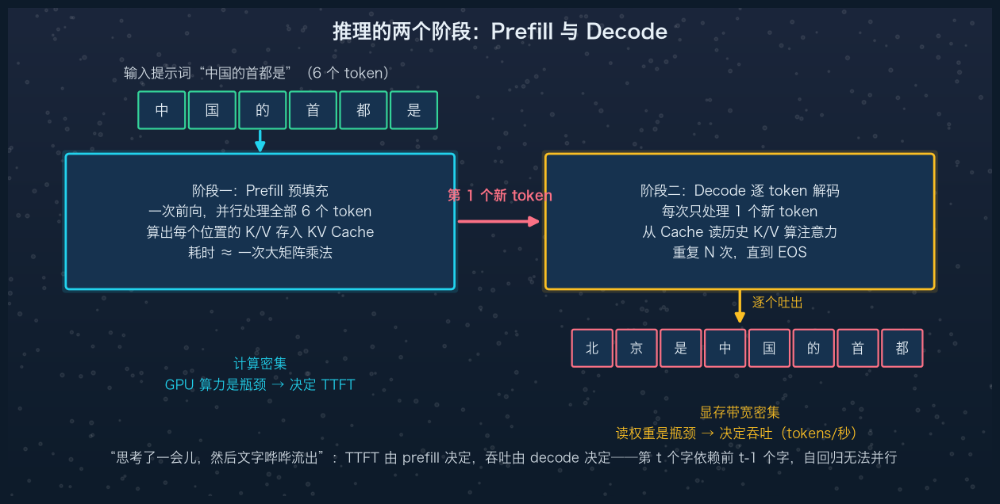
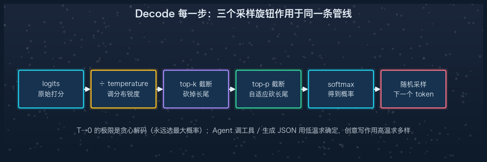

# 第 8 章 模型推理、量化与本地部署


## 📖 开篇故事

故事的主角是一位保加利亚开发者 Georgi Gerganov。他此前以把 Whisper 移植成 whisper.cpp 而小有名气。2023 年 3 月初，Meta 向研究者发放不到两周的 LLaMA 权重流到了 4chan 和种子网络上，一场民间大模型运动就此点燃。一周后，他用纯 C/C++ 写出了 llama.cpp：不依赖 PyTorch、不依赖任何框架，几天之内就让 7B、13B 的模型在 MacBook 的 CPU 上跑了起来。后来他把底层张量库抽成了 ggml，社区在此基础上定义了 GGUF 量化格式；Ollama 以及一整代“本地大模型”工具，都是站在这套代码上长出来的。一个人，一台没有独立显卡的笔记本，一门“过时”的语言。就是这么寒酸的一套配置，写出了后来支撑整个本地推理生态的代码。而它背后没有任何魔法，只有本章要讲的这几笔算术：KV Cache 的账、显存带宽的账、量化的账。

---

> 训练出一个模型只是开始，让它在你手边的机器上跑起来、跑得快、跑得便宜，才是 Agent 工程师每天要面对的现实。本章回答三个非常实际的问题：模型生成文字时到底在算什么（为什么第一个字出来得慢、后面越来越快）？为什么 7B 模型标称 14GB 显存，跑起来却远超这个数（KV Cache 的账）？以及，没有 A100 的普通人，怎么用量化 + Ollama 在自己的笔记本上跑大模型？每个论断我们都配了能在本机跑通的实验。

## 8.1 推理的两个阶段：Prefill 与 Decode

给模型一段提示词让它生成回答，整个过程分为两个阶段，性能特征截然不同：



**类比**：prefill 像考试时一口气读完整个题干（读题可以很快，因为是并行扫读）；decode 像一个字一个字地写答案，每写一个字都要把题干和已写的答案"回头看一眼"。写答案没法并行：第 $t$ 个字依赖于前 $t-1$ 个字，这是自回归模型的宿命。

两个阶段的瓶颈不同，所以优化方向也不同：

- **Prefill 是计算瓶颈（compute-bound）**：一次处理几千个 token，GPU 的矩阵乘法单元被喂得饱饱的，瓶颈在 FLOPS；
- **Decode 是显存带宽瓶颈（memory-bound）**：每生成 1 个 token，都要把全部模型权重从显存读一遍，但只做了 1 个 token 的计算，计算单元大部分时间在"等数据"。这就是为什么"提升 decode 速度"的答案不是更强的 GPU 算力，而是更高的显存带宽，或者把权重变小（量化，见 8.5 节）。

你在 ChatGPT 界面上看到的“思考了一会儿，然后文字哗哗流出”，就是这两个阶段的可视化：**首 token 延迟（TTFT, Time To First Token）** 由 prefill 决定，之后的**吞吐（tokens/秒）** 由 decode 决定。

> 💡 **深入思考**：为什么说 decode 是“显存带宽瓶颈”？算一笔粗账：生成 1 个 token，只需读一次全部权重（7B × 2B = 14GB），但相应的矩阵乘计算量极小——GPU 的算力单元几乎全程在“等数据搬完”。把 GPU 想成一个仓库工人：prefill 是一次搬运一整车货（搬一趟干一整天，运力拉满）；decode 是每搬一块砖都要把整个仓库重走一遍——瓶颈在脚程不在力气。所以消费级 GPU 跑本地模型，**显存带宽比 TOPS 更决定体验**；也所以量化（把仓库变小）能直接提速，而换更强算力的卡常常白花钱。

对 Agent 产品来说，这两个数字直接对应两种"用户体验事故"：TTFT 太长，用户看到的是转圈光标（对话产品里超过两秒就开始流失耐心）；吞吐太低，用户看到的是打字机卡成幻灯片。而两者的优化手段不同甚至冲突（vLLM 的连续批处理拉吞吐但会抬 TTFT）。所以先测哪个慢，再决定优化谁。

## 8.2 KV Cache：用显存换时间

Decode 阶段有一个明显的浪费：生成第 100 个 token 时，前 99 个 token 的 K、V 在第 1~99 步已经全部算过了，它们的值永远不会变（因果 mask 保证历史 token 不受未来影响）。**KV Cache** 就是把这些历史 K/V 存下来，每步只为新 token 算一次 K/V 并追加进缓存：

$$\text{无缓存：第 } t \text{ 步重算 } t \text{ 个 token 的注意力} \Rightarrow \text{总计算量 } O(L^2 d)$$
$$\text{有缓存：第 } t \text{ 步只算 1 个 token，查表取历史} \Rightarrow \text{总计算量 } O(Ld)$$

天下没有免费的午餐——缓存要吃显存。每个 token、每一层，都要存一份 K 和一份 V：

$$M_{\text{KV}} = \underbrace{2}_{\text{K 和 V}} \times \underbrace{L_{\text{layers}}}_{\text{层数}} \times \underbrace{H_{\text{kv}}}_{\text{KV 头数}} \times \underbrace{d_{\text{head}}}_{\text{每头维度}} \times \underbrace{S}_{\text{序列长度}} \times \underbrace{b}_{\text{每元素字节数}}$$

**手算一个 7B 模型（LLaMA-2-7B，FP16）**：$L=32$ 层，$H_{\text{kv}}=32$ 个头，$d_{\text{head}}=128$，上下文 $S=4096$，$b=2$ 字节：

$$M_{\text{KV}} = 2 \times 32 \times 32 \times 128 \times 4096 \times 2\ \text{B} = 2^{34}\ \text{B} = 2\ \text{GB}$$

模型权重本身 $7\text{B} \times 2\text{B} = 14\text{GB}$，KV Cache 再加 2GB——这还只是**单条请求、4K 上下文**。若批量服务 32 个并发请求、上下文拉到 32K，KV Cache 就要 $2\text{GB} \times 8 \times 32 = 512\text{GB}$，远超权重本身！这就是 vLLM 的 PagedAttention（像操作系统管理内存页一样管理 KV Cache）和 GQA/MQA（让多个查询头共享一组 KV，直接把 $H_{\text{kv}}$ 从 32 砍到 8 甚至 1，缓存成倍缩小）成为现代推理引擎标配的原因。其中 GQA/MQA 的原理，在第 5 章讲注意力效率时已有铺垫。

> 🎯 **面试高频**：“KV cache 为什么只在 decode 阶段受益？”——因为 prefill 本来就是**一次并行前向**，所有 token 的 K/V 一次算完、当场就用，不存在重复计算可省；浪费只发生在 decode：每生成 1 个 token 都重算全部历史。更精确地说，prefill 是 KV cache 的“生产者”（算好存下来），decode 是“消费者”（只查不重算）——cache 用显存买的，是 decode 的重复计算。追问“那 prefill 能不能用 cache？”——能：多轮对话里新一轮的旧上下文 K/V 已在 cache 里，只需 prefill 新增部分，这正是前缀缓存/系统提示词复用的原理。

> ⚠️ **常见误区**：“7B 模型标 14GB 显存，我 16GB 的卡刚好装下。”——装得下，跑不动。除了权重，还有 KV cache（随上下文与并发线性增长）、激活值、框架开销；高并发长上下文下，KV cache 能轻松涨到权重的几倍。生产上一个 80GB A100 能同时服务多少条 7B 请求，往往由 KV cache 的账而不是权重决定——这也是 8.1/8.2 两节反复在算这笔账的原因。

## 8.3 动手实测：KV Cache 开与关的耗时差

理论说完，亲手测一次。用 transformers 的 `generate(use_cache=...)` 开关即可对比。我们用一个随机初始化的 GPT-2 架构模型（8 层、隐维 512，51M 参数，计时只与计算量有关，随机权重不影响结论）：

```python
import time
import torch
from transformers import AutoTokenizer, GPT2Config, GPT2LMHeadModel

torch.manual_seed(0)

tok = AutoTokenizer.from_pretrained("gpt2")
config = GPT2Config(vocab_size=tok.vocab_size, n_positions=256,
                    n_embd=512, n_layer=8, n_head=8)
model = GPT2LMHeadModel(config).eval()
print(f"模型参数量: {sum(p.numel() for p in model.parameters())/1e6:.1f}M")

prompt = "The quick brown fox jumps over the lazy dog. " * 6  # 约 61 token
ids = tok(prompt, return_tensors="pt")["input_ids"]
mask = torch.ones_like(ids)
N_NEW, N_RUN = 120, 2


def bench(use_cache: bool) -> float:
    times = []
    for _ in range(N_RUN):
        start = time.perf_counter()
        with torch.no_grad():
            model.generate(ids, attention_mask=mask, max_new_tokens=N_NEW,
                           do_sample=False, use_cache=use_cache,
                           pad_token_id=tok.eos_token_id)
        times.append(time.perf_counter() - start)
    return sum(times) / len(times)


if __name__ == "__main__":
    t_cache = bench(use_cache=True)
    t_nocache = bench(use_cache=False)
    print(f"前缀 {ids.shape[1]} token，生成 {N_NEW} 个 token（{N_RUN} 次平均）：")
    print(f"  开启 KV Cache: {t_cache:.2f} 秒")
    print(f"  关闭 KV Cache: {t_nocache:.2f} 秒")
    print(f"  加速比: {t_nocache / t_cache:.1f}x")

    # 验证：两种设置下贪心解码的输出应当逐 token 一致
    out1 = model.generate(ids, attention_mask=mask, max_new_tokens=N_NEW,
                          do_sample=False, use_cache=True,
                          pad_token_id=tok.eos_token_id)
    out2 = model.generate(ids, attention_mask=mask, max_new_tokens=N_NEW,
                          do_sample=False, use_cache=False,
                          pad_token_id=tok.eos_token_id)
    print("两种设置生成结果一致:", torch.equal(out1, out2))
```

本机实际运行输出（CPU，计时数值随机器波动，但加速比的量级稳定）：

```text
模型参数量: 51.1M
前缀 61 token，生成 120 个 token（2 次平均）：
  开启 KV Cache: 0.49 秒
  关闭 KV Cache: 1.95 秒
  加速比: 4.0x
两种设置生成结果一致: True
```

这组数字里有两件事值得停下来看。一是**加速比随生成长度增长**：无缓存的每步成本随前缀长度线性上升（要重算越来越多 token），序列越长差距越夸张，真实模型上常见几十倍差距。二是**两种设置输出逐 token 一致**：KV Cache 是纯粹的计算优化，不改变任何数学结果，可以放心默认开启（事实上 transformers 默认就是开的）。

## 8.4 采样三旋钮：temperature、top-k、top-p

Decode 阶段每一步都产出词表上的概率分布，**怎么从这个分布里挑出下一个 token**，就是采样参数管的事。三个旋钮按顺序作用于同一条管线：



- **temperature（温度）$T$**：logits 除以 $T$ 再 softmax。$T<1$ 拉大差距、分布变尖（保守，像"稳重的人说话"）；$T>1$ 抹平差距、分布变匀（放飞）；$T \to 0$ 的极限就是**贪心解码**（永远选概率最大的）。
- **top-k**：只保留概率最高的 $k$ 个候选，其余概率清零。简单直接，但"该留几个"随分布形状变化：分布平的时候 $k=50$ 太挤，分布尖的时候 $k=50$ 又太松。
- **top-p（核采样）**：保留**累计概率刚超过 $p$ 的最小词集**。分布尖时自动只留两三个，分布平时自动放宽到几十个，候选集大小自适应，是目前最主流的截断方式。

用纯 NumPy 把整条管线模拟一遍（词表缩小到 6 个词，方便直接看数）：

```python
import numpy as np

np.random.seed(42)

tokens = ["的", "是", "我", "猫", "飞", "量子"]
logits = np.array([2.2, 2.0, 1.8, 1.5, 1.0, 0.5])


def softmax(z):
    e = np.exp(z - z.max())          # 数值稳定：减最大值不改变结果
    return e / e.sum()


def sample_with(logits, temperature=1.0, top_k=None, top_p=None, n=2000):
    """完整采样管线：温度 → top-k 截断 → top-p 截断 → 归一化 → 采样"""
    z = logits / temperature                       # 第 1 步：温度缩放
    if top_k is not None:                          # 第 2 步：只留概率最高的 k 个
        idx = np.argsort(z)[::-1][top_k:]
        z[idx] = -np.inf
    if top_p is not None:                          # 第 3 步：核采样
        p = softmax(z)
        order = np.argsort(p)[::-1]
        cum = np.cumsum(p[order])
        # 保留"累计概率恰好越过 p"的最小词集（含越线那个词）
        cum_before = cum - p[order]
        keep = order[cum_before < top_p]
        z = np.full_like(z, -np.inf)
        z[keep] = logits[keep] / temperature
    p = softmax(z)
    draws = np.random.choice(len(tokens), size=n, p=p)
    return p, draws


def show(name, p, draws):
    dist = {t: round(float(prob), 3) for t, prob in zip(tokens, p) if prob > 1e-4}
    print(f"{name:<26} 分布={dist} 多样性={len(set(draws))}种")


if __name__ == "__main__":
    show("低温 T=0.3（接近贪心）", *sample_with(logits, temperature=0.3))
    show("常温 T=1.0（原样输出）", *sample_with(logits, temperature=1.0))
    show("高温 T=2.0（接近均匀）", *sample_with(logits, temperature=2.0))
    print()
    show("top-k=2（只留前 2 个）", *sample_with(logits, top_k=2))
    show("top-p=0.8（核采样）", *sample_with(logits, top_p=0.8))
    show("T=0.7 + top-p=0.9（常用组合）",
         *sample_with(logits, temperature=0.7, top_p=0.9))
    print("\n贪心解码永远选:", tokens[np.argmax(logits)])
```

本机实际运行输出（每种设置采样 2000 次，随机种子固定可复现）：

```text
低温 T=0.3（接近贪心）        分布={'的': 0.527, '是': 0.271, '我': 0.139, '猫': 0.051, '飞': 0.01, '量子': 0.002} 多样性=6种
常温 T=1.0（原样输出）        分布={'的': 0.288, '是': 0.236, '我': 0.193, '猫': 0.143, '飞': 0.087, '量子': 0.053} 多样性=6种
高温 T=2.0（接近均匀）        分布={'的': 0.227, '是': 0.205, '我': 0.186, '猫': 0.16, '飞': 0.125, '量子': 0.097} 多样性=6种

top-k=2（只留前 2 个）       分布={'的': 0.55, '是': 0.45} 多样性=2种
top-p=0.8（核采样）          分布={'的': 0.335, '是': 0.274, '我': 0.225, '猫': 0.166} 多样性=4种
T=0.7 + top-p=0.9（常用组合） 分布={'的': 0.373, '是': 0.28, '我': 0.21, '猫': 0.137} 多样性=4种

贪心解码永远选: 的
```

对照着读：低温把头部概率从 0.288 推到 0.527（更保守），高温把 6 个词压到几乎均匀；top-k=2 机械地只留 2 个词，top-p=0.8 则自适应地留了 4 个。**Agent 场景的实践结论**：调用工具、生成 JSON、写代码时把 temperature 调到 0~0.3（要确定性）；头脑风暴、写创意文案时放到 0.8~1.2（要多样性）。OpenAI 兼容 API 里这三个参数就是 `temperature`、`top_p`、`max_tokens` 旁边的那几位老朋友。

> 🎯 **面试高频**：“temperature=0 是贪心解码吗？”——数学上，$T \to 0$ 的极限就是 argmax，所以“是”；工程上，$T=0$ 分支通常直接改走 argmax，等价。但三个细节能拉开区分度：(1) logits 并列最大时，argmax 取谁取决于实现（返回首个或最后一个索引）；(2) 批量推理里 padding 与浮点顺序会让结果有微扰，所以“temperature=0 等于可复现”不绝对；(3) 部分 API 对 temperature 有下限 clamp，传 0 未必真的是 0。结论：把 T=0 理解成贪心，但别把“贪心”当成“绝对确定”去写合同。

## 8.5 量化：把权重“压缩存档”

第 8.1 节说 decode 的瓶颈是读权重的带宽。那最直接的加速办法就是**让权重变小**。量化（Quantization）把每个参数用更少的比特存储：

| 精度 | 每参数字节 | 7B 模型权重 | 直觉类比 | 质量损失 |
|---|---|---|---|---|
| FP32 | 4 B | 28 GB | 无损原图 | 无（训练标准） |
| FP16/BF16 | 2 B | 14 GB | 高清图 | 几乎无，推理标准 |
| INT8 | 1 B | 7 GB | 压缩图 | 极小（<1% 常见） |
| INT4 | 0.5 B | 3.5 GB | 表情包级压缩 | 可感知但可用，需技巧 |

**直觉**：FP16 里相邻权重值可能只差 0.0001，这种精度对"下一个词选谁"几乎没影响。INT4 只有 16 个可取值，粗暴四舍五入会明显伤模型，所以现代量化不是简单截断，而是带"校准"的映射（GPTQ）或分组缩放（AWQ 保护重要权重）。

选型直觉一句话：**显存只够 Q4 就用 Q4（先跑起来），质量敏感就用 Q8（INT8 几乎无损）；中间态选 Q5/Q6（GGUF 提供全档位）**。8.8 节的实验会告诉你这些档位背后的精度账，以及为什么"逐张量量化"在真实权重上会崩、而"分组量化"救得回来。

三种主流量化格式/算法对比：

| | GGUF | GPTQ | AWQ |
|---|---|---|---|
| 类型 | 文件格式 + CPU 友好运行时 | 量化算法 | 量化算法 |
| 主战场 | llama.cpp / Ollama 本地跑 | GPU 推理（vLLM 支持） | GPU 推理（vLLM 支持） |
| 核心思想 | 分块量化 + 混合精度，CPU 友好 | 逐层用二阶信息校准误差 | 按激活幅度保护 1% 关键权重 |
| 典型精度 | Q2~Q8 多档（Q4_K_M 最常用） | INT4/INT3 | INT4 |
| 一句话 | 笔记本跑模型的首选 | 老牌 GPU 量化 | 同精度下质量略优于 GPTQ |

第 6 章的 QLoRA 就是“INT4 基座 + FP16 LoRA”的组合拳：量化负责把模型塞进显存，LoRA 负责微调时不碰量化权重。8.8 节会把“INT4 可用但需要技巧”的那门技巧（分组缩放）用实验拆开。

## 8.6 本地部署工具三选一

| | Ollama | llama.cpp | vLLM |
|---|---|---|---|
| 定位 | 本地模型管理器（"Docker for LLM"） | 底层推理引擎（C/C++） | 生产级推理服务器 |
| 上手难度 | 一行命令 | 需要编译/配置 | 需要 GPU + Python 环境 |
| 硬件 | CPU / Mac 统一内存 / 消费级 GPU | 同左，极致可移植 | NVIDIA GPU（数据中心级） |
| 杀手锏 | 模型拉取/切换/REST API 全自动 | GGUF 量化，树莓派都能跑 | PagedAttention + 连续批处理，高并发吞吐 |
| 适用场景 | 个人开发、Agent 原型 | 嵌入式、无 GPU 环境、被 Ollama 封装 | 团队级 API 服务、成百上千并发 |

选择口诀：**自己电脑上开发调试用 Ollama；没 GPU 或要嵌进设备用 llama.cpp；要对外提供服务、扛并发用 vLLM**。Ollama 底层其实就是 llama.cpp，可以理解成给它套了层易用的壳。

选定工具前，先过一道"显存预算"的门。**能跑多大的模型，是一道乘法题**：

$$\text{显存需求} \approx \underbrace{\text{参数量} \times \text{量化后每参数字节}}_{\text{权重}} + \underbrace{M_{\text{KV}}(\text{上下文，并发})}_{\text{8.2 节的账}} + \underbrace{1\sim2\ \text{GB}}_{\text{激活与框架开销}}$$

按这道公式给一张速查表（单并发、中等上下文的粗略值）：

| 你的机器 | 推荐档位 | 能跑的模型 |
|---|---|---|
| 8GB 显卡 / 16GB Mac | 7B Q4 | Qwen/Llama 3B~8B，够日常开发 |
| 16GB 显卡 / 32GB Mac | 7B Q8 或 14B Q4 | 小团队内部用，质量敏感选 Q8 |
| 24GB（4090/3090） | 14B Q8 或 32B Q4 | 单卡生产、小并发可搏一搏 |
| 48GB（A6000/双 4090） | 70B Q4 | 才摸到"旗舰"的门槛 |

注意 Mac 的统一内存让“显存”和“内存”同池，这是 MacBook 能跑大模型的唯一原因，代价是带宽不如独显，吞吐别期望太高；而 GPU 的显存一旦沾满，系统会直接拒载模型，没有“交换分区”可以侥幸（CPU/GPU 混合卸载的方案存在，但速度会断崖）。

顺带一个真实的演进样本：这套工具链的分工正在慢慢“上移”：个人开发先 Ollama，等并发上来换 vLLM，等团队成熟再把两者合进 K8s 上的推理网关。选型不止是三个工具的差别，而是同一台 Agent 的三个成长阶段：今天你的原型跑在笔记本上，明天它可能就要扛住几十路的并发。从第一天就用 OpenAI 兼容接口写代码，就是给这一天买的保险。

## 8.7 Ollama 常用命令速查

```bash
ollama pull qwen2.5:7b          # 下载模型（默认 Q4 量化，约 4.7GB）
ollama run qwen2.5:7b           # 下载并进入交互式对话
ollama list                     # 查看本地已有模型
ollama ps                       # 查看正在运行的模型及显存占用
ollama rm qwen2.5:7b            # 删除模型
ollama serve                    # 启动后台服务（默认监听 11434 端口）

# REST API：与 Agent 代码对接的入口
curl http://localhost:11434/api/generate -d '{
  "model": "qwen2.5:7b",
  "prompt": "用一句话解释 KV Cache",
  "stream": false
}'

# Ollama 还提供 OpenAI 兼容接口：base_url 填 http://localhost:11434/v1
# 第 7 章的 API 示例代码只需改 base_url 即可直接对接本地模型
```

还差一块拼图：怎么把第 7 章的"四要素"变成本地模型的默认人格？答案是 `Modelfile`，Ollama 的镜像定义文件，把 system prompt、采样参数和基础模型打包成一个可复用的"定制款"：

```text
# Modelfile：把第 7 章的提示词工程固化到模型层
FROM qwen2.5:7b
PARAMETER temperature 0.3
SYSTEM """
你是一名严谨的运维助手。
只基于用户提供的资料回答，资料中没有就说不知道。
输出一律使用 JSON，字段为 cause / suggestion / risk。
"""
```

`ollama create ops-assistant -f Modelfile` 之后，`ollama run ops-assistant` 拿到的就是一个自带人格与采样策略的专用模型。第 7 章"system 是宪法"的分层，在本地部署里就长这个样子。

最后一句是关键：**本地模型也讲 OpenAI 协议**。这意味着你在第 7 章写的提示词代码、后面章节要写的 Agent 框架，只要换一个 `base_url`，就能在“云端大模型”和“本地小模型”之间自由切换——这正是我们把部署放在 Agent 核心章节之前讲的原因。

## 8.8 动手：把权重量化，实测 INT8 / INT4 的精度账

8.5 节说 INT4 “可感知但可用，需技巧”。这门技巧到底是什么？我们写一个 20 行的 absmax 量化器，对一层真实的 (512×512) 权重实测两组实验：**实验 A** 用普通权重，验证 INT8 几乎无损、INT4 误差可观；**实验 B** 给 3% 的通道注入 25 倍离群值（真实 LLM 权重里确实存在这类“离群通道”，这是量化算法真正的心脏病），看“逐张量共享一个 scale”怎么崩掉，以及“分组 scale”怎么把伤害隔离住：

```python
# ch08_quantization.py —— 对一层真实权重量化，实测 INT8 / INT4 的精度账
import torch
import torch.nn as nn

torch.manual_seed(0)
W = nn.Linear(512, 512).weight.detach()          # (512, 512)，默认初始化的普通权重
W_llm = W.clone()
W_llm[:, :16] *= 25        # 给 3% 的通道注入离群值 —— 模拟真实 LLM 权重的"离群通道"
x = torch.randn(8, 512)

def absmax_quant(w, bits, group=None):
    """absmax 量化：映射到整数格点再反量化。group=None 逐张量共享一个 scale，
    否则每 group 个连续权重（沿输入维切块）共享一个 scale。"""
    qmax = 2 ** (bits - 1) - 1
    if group is None:
        scale = w.abs().max() / qmax
        wq = torch.round(w / scale).clamp(-qmax - 1, qmax)
        return wq * scale
    n, d = w.shape
    w2 = w.reshape(n, d // group, group)
    scale = w2.abs().amax(dim=-1, keepdim=True) / qmax
    wq = torch.round(w2 / scale).clamp(-qmax - 1, qmax)
    return (wq * scale).reshape(n, d)

def report(name, w, wq, bits):
    w_err = (w - wq).norm() / w.norm()                   # 权重相对误差
    y1, y2 = x @ w.T, x @ wq.T
    out_err = (y1 - y2).norm() / y1.norm()               # 输出相对误差
    mem = w.numel() * bits / 8 / 1e6                     # 该层权重显存(MB)
    print(f"{name:<26} 权重误差 {w_err:7.2%} | 输出误差 {out_err:7.2%} | 显存 {mem:5.2f} MB")

print(f"===== 权重 A：普通初始化（无离群值），形状 {tuple(W.shape)} =====")
report("FP16 基准", W, W, 16)
report("INT8 逐张量", W, absmax_quant(W, 8), 8)
report("INT4 逐张量", W, absmax_quant(W, 4), 4)
report("INT4 分组 scale=64", W, absmax_quant(W, 4, group=64), 4)

print(f"\n===== 权重 B：3% 通道注入 25 倍离群值（贴近真实 LLM 权重） =====")
report("FP16 基准", W_llm, W_llm, 16)
report("INT8 逐张量", W_llm, absmax_quant(W_llm, 8), 8)
report("INT4 逐张量", W_llm, absmax_quant(W_llm, 4), 4)
report("INT4 分组 scale=64", W_llm, absmax_quant(W_llm, 4, group=64), 4)
print("\n读表：离群值让‘全矩阵共享一个 scale’的量化瞬间崩掉（少数大值把刻度撑爆，")
print("     其余权重全被压扁到几个格点）；分组 scale 把伤害隔离在离群通道附近，")
print("     这正是 AWQ/GGUF 坚持‘分组缩放、保护重要权重’的原因。")
```

本机实际运行输出：

```text
===== 权重 A：普通初始化（无离群值），形状 (512, 512) =====
FP16 基准                    权重误差   0.00% | 输出误差   0.00% | 显存 0.52 MB
INT8 逐张量                   权重误差   0.39% | 输出误差   0.39% | 显存 0.26 MB
INT4 逐张量                   权重误差   7.14% | 输出误差   7.04% | 显存 0.13 MB
INT4 分组 scale=64           权重误差   6.98% | 输出误差   6.97% | 显存 0.13 MB

===== 权重 B：3% 通道注入 25 倍离群值（贴近真实 LLM 权重） =====
FP16 基准                    权重误差   0.00% | 输出误差   0.00% | 显存 0.52 MB
INT8 逐张量                   权重误差   2.16% | 输出误差   2.19% | 显存 0.26 MB
INT4 逐张量                   权重误差  22.83% | 输出误差  23.57% | 显存 0.13 MB
INT4 分组 scale=64           权重误差   9.41% | 输出误差   9.57% | 显存 0.13 MB

读表：离群值让‘全矩阵共享一个 scale’的量化瞬间崩掉（少数大值把刻度撑爆，
     其余权重全被压扁到几个格点）；分组 scale 把伤害隔离在离群通道附近，
     这正是 AWQ/GGUF 坚持‘分组缩放、保护重要权重’的原因。
```

读表先看权重 A：INT8 误差 0.39%，基本无损；INT4 逐张量 7.14%，“可感知”名副其实。而分组量化在这种权重上收益微弱（7.14%→6.98%），因为均匀分布的权重没有“难啃的骨头”——**分组量化的价值不在普通权重，而在离群值**。真正的一幕在权重 B：同样 INT4，逐张量误差从 7% 暴涨到 22.83%（少数大值把全局刻度撑爆，其余 97% 的普通权重被压扁到两三个格点），分组 scale 把误差拉回 9.41%，伤害被隔离在含离群通道的分组里。**AWQ 保护重要权重、GGUF 分块量化，修的都是这一个问题**。这个实验还解释了 8.5 节表格里“INT4 需技巧”的“技巧”二字的分量：不是调参玄学，是把刻度算术做对。

## 8.9 动手：贪心解码的“复读机”，采样如何救场

8.4 节说 temperature 调高能换多样性，但对“为什么确定性和多样性是天生一对矛盾”还没给出实验。最后这个实验用一个“迷你语言模型”（在 30 个词的小语料上数 bigram 计数，一个纯 Python 的马尔可夫链）展示 LLM 推理最著名的退化现象：**贪心解码的复读机循环**。这个现象在真实 LLM 上真实存在（同一个模型、同一提示，贪心解码时常陷入重复短语循环，采样则缓解），我们的迷你版把它放大到肉眼可见：

```python
# ch08_greedy_loop.py —— 贪心解码的"复读机"退化，以及采样如何救场
import math
import random
from collections import Counter

CORPUS = ("the cat sat on the mat the cat saw the dog "
          "the dog sat on the floor the cat chased the mouse "
          "the mouse ran to the hole the dog barked at the cat").lower()

# 第 1 步：数 bigram，得到一个真实（但极小）的"迷你语言模型"
counts = {}
for a, b in zip(CORPUS.split(), CORPUS.split()[1:]):
    counts.setdefault(a, Counter())[b] += 1

def softmax(z):
    e = [math.exp(v - max(z)) for v in z]
    s = sum(e)
    return [v / s for v in e]

def generate(start, n=14, mode="greedy", temperature=1.0, seed=0):
    """greedy：永远选计数最大的下一个词；sample：按温度缩放后的分布随机抽。"""
    rng = random.Random(seed)
    out, cur = [start], start
    for _ in range(n):
        c = counts[cur]
        words, cnts = list(c.keys()), list(c.values())
        if mode == "greedy":
            cur = max(words, key=lambda w: c[w])        # 永远选概率最大的
        else:
            logits = [math.log(v) for v in cnts]
            probs = softmax([l / temperature for l in logits])
            cur = rng.choices(words, probs)[0]
        out.append(cur)
    return " ".join(out)

def diversity(text):
    words = text.split()
    return len(set(words)) / len(words)

print("语料（30 词）:", CORPUS[:60] + "...")
print("\n贪心解码（永远选最大概率）:")
g = generate("the")
print("  ", g, f"  词汇多样性 = {diversity(g):.2f}")

for T in (1.0, 0.5):
    print(f"\n采样解码（temperature={T}）:")
    s = generate("the", mode="sample", temperature=T, seed=0)
    print("  ", s, f"  词汇多样性 = {diversity(s):.2f}")

print("\n注：每一步都选‘当前最优’，反而掉进了循环 —— 局部最优的陷阱。")
print("    这就是为什么写代码、调工具要贪心，写散文要采样（第 8.4 节的实践结论）。")
```

本机实际运行输出：

```text
语料（30 词）: the cat sat on the mat the cat saw the dog the dog sat on th...

贪心解码（永远选最大概率）:
   the cat sat on the cat sat on the cat sat on the cat sat   词汇多样性 = 0.27

采样解码（temperature=1.0）:
   the mouse ran to the dog sat on the dog sat on the cat chased   词汇多样性 = 0.60

采样解码（temperature=0.5）:
   the mouse ran to the mat the dog the cat saw the mat the dog   词汇多样性 = 0.53

注：每一步都选‘当前最优’，反而掉进了循环 —— 局部最优的陷阱。
    这就是为什么写代码、调工具要贪心，写散文要采样（第 8.4 节的实践结论）。
```

输出怎么读？先看贪心解码：它掉进了 4 词循环，"the cat sat on"转了一圈又一圈，多样性 0.27。机制很朴素：贪心只看当前一步的最优，"the"后面"cat"概率最大，可一旦状态回到"the"，下一个词又必然是"cat"，**局部最优拼成全局死循环**。注意模型本身没有任何毛病，每一步的选择都"正确"。再看采样救场：同样的转移表，按概率随机抽词（本例里"the"后面最热的"cat"也只有约三分之一的概率被抽中），循环就自然被打断，多样性翻倍到 0.60。这正是 8.4 节"写创意文案调高温"的机制级解释：采样不是噪声，是逃离局部最优的扰动。T=0.5 则介于两者之间：比贪心多样、比 T=1.0 稳重——温度这个旋钮拧的是"逃出循环的能力"和"输出可预测性"之间的平衡。这也回答了练习题 8.4 的背景：为什么 repetition_penalty（重复惩罚）也是一种解法？它不是改变分布形状，而是把走过的路标记为"已走过的路"。

## 本章小结

- **推理两阶段**：prefill 并行处理提示词（计算密集，决定首 token 延迟 TTFT），decode 逐 token 串行生成（显存带宽密集，决定吞吐）。自回归的串行性是 decode 无法并行的根源。
- **KV Cache**：缓存历史 K/V 把 decode 从 $O(L^2 d)$ 降到 $O(Ld)$，实测一个 51M 模型上 120 token 生成提速约 4 倍且输出逐位一致；代价是显存 $M_{\text{KV}} = 2 L H_{\text{kv}} d_{\text{head}} S b$，LLaMA-2-7B 在 4K 上下文单请求就要 2GB，高并发长上下文下远超权重本身，催生了 PagedAttention 与 GQA/MQA。
- **采样三旋钮**：temperature 调分布锐度（$T\to0$ 退化为贪心），top-k 机械截断，top-p 自适应截断（主流）。Agent 要确定性用低温，要创意用高温。
- **量化**：INT8 几乎无损、INT4 可用需技巧；GGUF 服务本地 CPU（llama.cpp/Ollama），GPTQ/AWQ 服务 GPU（vLLM），AWQ 靠保护关键权重在同精度下略优。
- **部署选型**：个人开发 Ollama、无 GPU/嵌入式 llama.cpp、生产高并发 vLLM；显存预算 = 量化后权重 + KV cache + 开销，16GB Mac 就能跑 7B Q4；Ollama 的 OpenAI 兼容接口 + Modelfile（固化 system prompt）让本地模型与云端 API 无缝互换。

到这里，把一个 LLM 从随机权重带到自己手边的机器上跑起来，整条链路你已经亲手走完了。但到目前为止，模型始终住在聊天窗口里：你问一句，它答一句。下一章开始进入本书的主战场：把“下一步做什么”的决策权交给模型，让它从聊天机器人长成会自己干活的 Agent。

## 练习题

**8.1（手算）** 某 13B 模型：40 层、40 个 KV 头、$d_{\text{head}}=128$，FP16。计算：(a) 上下文 8192 时单请求的 KV Cache 大小；(b) 32 并发时总量；(c) 若改用 GQA（KV 头降到 8），能省多少？

**8.2（手算）** 设词表大小 $V=32000$，decode 阶段每步的 logits 计算（最后乘词表投影矩阵）需要读多大的矩阵？若隐维 $d=4096$、FP16，仅此一步要读多少字节？这解释了 decode 为什么是带宽瓶颈吗？

**8.3（代码）** 修改 8.3 节的实验：固定生成 120 token，把前缀从 61 token 逐步加到 200 token，画出"加速比 vs 前缀长度"的曲线。曲线形状符合 $O(L^2)$ vs $O(L)$ 的预测吗？

**8.4（代码）** 在 8.4 节的采样代码中加一个 `repetition_penalty`（重复惩罚）：已出现过的 token 的 logits 除以 1.2 再采样。用高温采样 5000 次，对比加惩罚前后"的"字的出现频率。

**8.5（实验）** 用 Ollama 拉取同一个小模型的 Q4 与 Q8 两个量化版本（如 `qwen2.5:0.5b` 的不同 tag），对同一组 5 个问题分别提问，对比回答质量与生成速度（`ollama run --verbose` 可看 tokens/秒）。INT4 的质量损失在你这组问题上可感知吗？

**8.6（思考）** 为什么量化对 decode 加速明显、对 prefill 加速有限？（提示：回到 8.1 节两个阶段的瓶颈分析。）

**8.6b（思考）** 你在 MacBook（16GB 统一内存）上同时开着浏览器、IDE，想跑一个 7B Q4 的本地模型服务 Agent 开发。除权重的 4.7GB 外，还有哪几笔显存/内存开销？（提示：8.2 节的 KV cache 账 + 8.6 节的激活与开销 + 系统本身。）

**8.7（设计）** 你的团队要给一个内部文档问答 Agent 选部署方案：日均 2000 次请求、单次上下文约 8K token、数据不出内网、预算最多一台带 2×4090 的服务器。请给出选型（模型大小、量化精度、推理框架）并估算能否扛住，写出计算过程。

**8.8（动手）** 为你自己的开发机写一个 `Modelfile`：选定一个本地已有的模型，把你在第 7 章练习里写过的 system prompt 固化进去，用 `ollama create` 打包，对比打包前后同一问题的回答差异，体会“宪法在镜像里”与“宪法在调用代码里”两种工程方式的取舍。

## 📚 延伸阅读

- **vLLM 博客《Efficient Memory Management for Large Language Model Serving with PagedAttention》**（2023）：KV cache 的账怎么算到操作系统那去，本章 8.2 节那 512GB 的最佳后续。https://blog.vllm.ai/2023/06/20/vllm.html
- **PagedAttention 论文《Efficient Memory Management for LLM Serving》**（Kwon et al., 2023）：同主题的完整学术版。https://arxiv.org/abs/2309.06180
- **llama.cpp 仓库**：本章开篇故事的现场，README 就是半部本地推理史；8.8 节实验的“分组量化”在那里叫 block-wise quantization。https://github.com/ggerganov/llama.cpp
- **AWQ 论文《AWQ: Activation-aware Weight Quantization》**（Lin et al., 2023）：8.8 节实验里"保护离群通道"思想的原论文。https://arxiv.org/abs/2306.00978
- **GPTQ 论文《GPTQ: Accurate Post-Training Quantization》**（Frantar et al., 2022）：8.5 节表格里"逐层二阶校准"的那一列，展开读。https://arxiv.org/abs/2210.11423
- **Karpathy《Intro to LLMs》一小时讲座**（2023）：sampling/temperature 之外，把本章放进大图景的最佳速成课。https://www.youtube.com/watch?v=zjkBMFhXjSg
