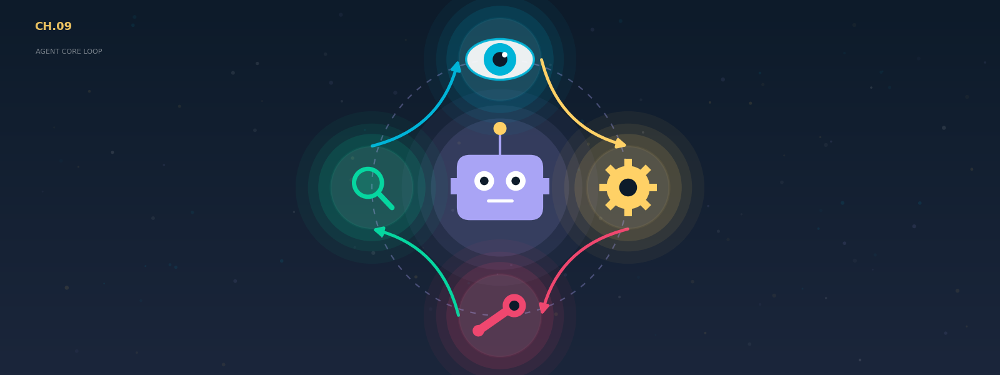
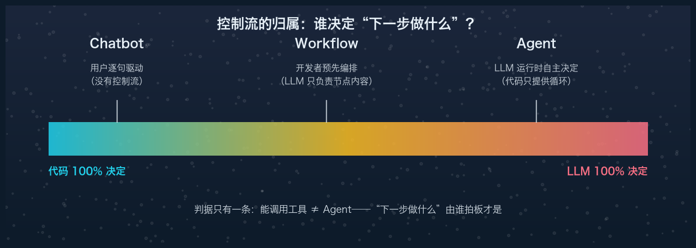
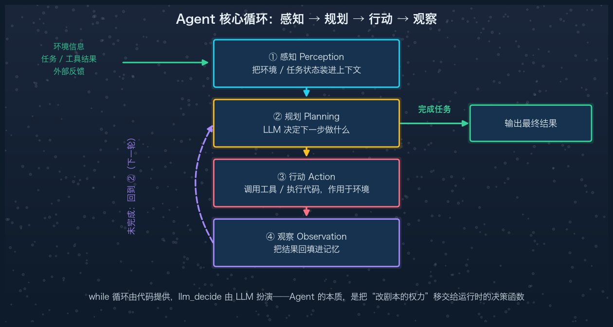
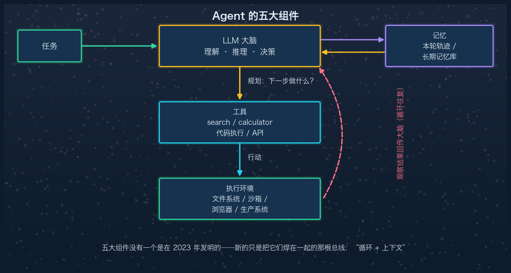
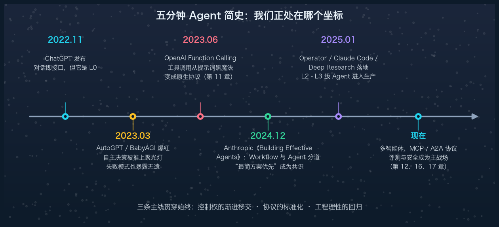

# 第 9 章 什么是 Agent：从 Chatbot 到自主智能体



## 📖 开篇故事：两个月十万 star 的狂热

2023 年 3 月 30 日，一位名叫 Toran Bruce Richards 的开发者把一个叫 AutoGPT 的项目传上了 GitHub。它在当时看去近乎科幻：你给它一个目标，比如"帮我调研并规划一个新产品的上市方案"，它会自己把目标拆成任务、自己上网搜索、自己写文件、自己给自己派下一步活，全程无人干预——GPT-4 第一次以"数字员工"而非"聊天窗口"的形态出现在普通人面前。短短约两个月，这个项目冲到十万 star，成为 GitHub 历史上增长最快的仓库之一，社交媒体上人人都在晒自己的"自主员工"。但认真跑过它的人很快发现了另一面：它经常陷入无休止的循环，烧掉一堆 API 费用后交出一堆没人要的文件，最出圈的成就之一是"成功地注册了一个 Twitter 账号"。狂热与幻灭一起到来，"Agent"这个词从此既让人心跳加速，又让人眉头紧锁。它到底是什么？和聊天机器人有什么本质区别？为什么有时像天才、有时像脱缰野马？这些正是本章要回答的问题，而且我们会用可以运行的代码，而不是口号来回答。

---

> 2023 年，"Agent"突然成了 AI 圈最热的词：AutoGPT 一周涨几万 star，各家模型厂商争相发布"智能体"产品。但如果追问一句"Agent 和普通聊天机器人到底差在哪"，多数人只会说"更聪明"。本章要把这个词拆开揉碎：我们会给出一个可以操作的工程判据：**控制流的归属**，画出 Agent 的核心循环与五大组件，给自主性分出 L0 到 L4 五个等级，最后用不到 50 行纯 Python 写出一个真的会"自己决定下一步"的最简 Agent。它是第三部分所有章节的地基：第 10 章的架构范式、第 11 章的工具调用、第 16 章的多智能体，全部长在这 50 行代码的骨架上。

本章路线图：9.1 立判据（控制流归属），9.2–9.3 拆结构（核心循环 + 五大组件），9.4 定坐标（自主性分级），9.5–9.7 上代码（mock 版 → 对照实验 → 真实 API 版），9.8–9.9 看生态与历史。第一次读建议按顺序；如果你已经在用各种框架，也可以直接从 9.5 的 50 行代码和 9.6 的对照实验切入，再回头补概念，代码先行，一样成立。

如果只允许你带走一句话，那就是：**Agent 不是更聪明的聊天机器人，而是把"下一步做什么"的决策权交给 LLM 的系统**。本章其余部分，都只是这句话的展开、证明与工程化。

## 9.1 三个常被混用的词：Chatbot、Workflow、Agent

先回答最要紧的问题：**Agent 的定义到底是什么？** 行业里说法很多，我们采用 Anthropic 在工程博客《Building Effective Agents》（2024-12）中的划分，它最有可操作性：

> Workflows are systems where LLMs and tools are orchestrated through **predefined code paths**. Agents, on the other hand, are systems where LLMs **dynamically direct their own processes and tool usage**, maintaining control over how they accomplish a task.
>
> （工作流：LLM 和工具沿**预定义的代码路径**被编排。Agent：LLM **动态指挥自己的流程与工具使用**，并始终掌控着任务的完成方式。）

翻译成大白话，判据只有一个：**"下一步做什么"由谁决定？** 这个决策权，术语上叫**控制流（control flow）**。把三种系统按控制流的归属摆到一条光谱上：



- **Chatbot（聊天机器人）**：你说一句，它答一句。它没有“多步任务”的概念：每一轮都是独立的一问一答，答完即止，没有任何控制流可言。
- **Workflow（工作流）**：开发者提前用代码画好路线图（if/else 分支、串行的节点），LLM 只是被塞进某些节点里的"内容生成器"。比如"客服分流"工作流：代码先判断用户意图，再决定调用哪个 LLM 节点、传什么参数，LLM 始终没有决定"走哪条路"的权力。
- **Agent（智能体）**：代码只提供一个循环和一组工具，**每一步走哪条路、用哪个工具、何时停止，全部由 LLM 在运行时看着实际情况决定**。

一个高频误区要先纠正：**能调用工具 ≠ Agent**。如果你的系统"每次都先搜索再回答"，那工具调用顺序是你写死的，这是 Workflow。Anthropic 把 Workflow 和 Agent 统称为"agentic 系统"，两者没有高下之分，只有场景适配：

顺带把术语说准：英文里 "agentic" 这个形容词泛指"让 LLM 参与控制决策"的各类系统，所以 Workflow 也算 agentic 系统，但它不是 Agent。中文语境里这两个词常被混为一谈，读完本章你要能在文档评审里把话说清楚："这个系统是 agentic 架构，但控制流在代码手里，所以它是 Workflow，不是 Agent"。一句话，专业度立判。

| 维度 | Chatbot | Workflow | Agent |
|---|---|---|---|
| 控制流归属 | 用户逐句驱动 | 开发者预先编排 | LLM 运行时自主决定 |
| 工具 | 无 | 固定节点调用 | LLM 自选工具、自定参数 |
| 执行步数 | 恒为 1 步 | 固定 | 不定，LLM 自己判断何时终止 |
| 可预测性 / 可调试性 | 高 | 高 | 低——换来的是灵活性 |
| 延迟与成本 | 最低 | 可控 | 最高（每步都要 LLM 推理） |
| 典型例子 | 网页版问答 | Dify 编排的客服分流 | Claude Code、Deep Research |

这张表的最后一行是刻意的提醒：**Agent 用不确定性和成本换灵活性**。Anthropic 在同一篇文章里给出的工程建议是"找到最简单的方案，仅在必要时才增加复杂性"。很多任务用单次 LLM 调用加检索就足够了，不需要 Agent。什么时候才真的需要，9.4 节的分级表会给出判据。

平时评审别人的系统（或在面试里被考），可以用一个 30 秒鉴别法，只问三个问题：**第一步之后还有第二步吗**（没有就是 Chatbot）？**第二步是由代码预先安排的，还是看情况定的**（预先安排就是 Workflow）？**什么条件下停**（由人/代码定是 Workflow，由模型自己判断是 Agent）？三个问题答完，系统在光谱上的位置就定了，不需要争论产品文案里有没有写"智能体"三个字。

> ⚠️ **常见误区**："接了工具就是 Agent""用了 LangChain 就是 Agent"。工具调用只是**动作的执行方式**，"下一步做什么"由谁拍板才是判据——顺序写死的多步工具调用，依然是 Workflow 披着 Agent 的皮。反方向的误区同样流行："Agent 比 Workflow 高级，新项目就该上 Agent"。记住：Anthropic 特意把两者统称为 agentic 系统，只有场景适配，没有身份高下。需求能被 if/else 穷举的任务，上 Agent 纯属给自己找麻烦。

## 9.2 Agent 的核心循环：感知 → 规划 → 行动 → 观察

剥掉所有花哨的概念，Agent 的运转方式是一个古老得惊人的循环。1959 年，Newell 和 Simon 的**通用问题求解器（GPS）**就在做同一件事，只是当年用符号规则，今天换成 LLM：



四个环节各司其职：

- **感知（Perception）**：把"世界现在什么样"翻译成 LLM 能读的文本：用户任务、历史轨迹、工具返回值。LLM 的全部世界观都来自上下文窗口，感知层就是它的眼睛和耳朵。
- **规划（Planning）**：大脑的核心动作。LLM 读着当前上下文回答一个问题："下一步，做什么？"可能是调一个工具、给一个结论、也可能是宣布失败。
- **行动（Action）**：把决策真正作用到外部世界：发一次搜索、跑一段代码、调一个 API。注意：**LLM 本身只会生成文本**，真正"动手"的是循环里的 Python 代码（第 11 章工具调用会详细展开）。
- **观察（Observation）**：行动的后果回填记忆，成为下一轮规划的输入。这一步是 Agent 与"一次性生成"的分水岭：**外部世界的反馈进入了决策回路**。

用形式化语言描述，这是一个以 LLM 为**策略函数（policy）** 的决策过程：设第 $t$ 轮的观察为 $o_t$，LLM 依据历史做决策 $a_t = \pi_{\text{LLM}}(o_1, o_2, \dots, o_t)$，环境执行并返回新观察 $o_{t+1} = E(a_t)$。循环往复直到 LLM 输出终止动作。对照伪代码，只有 10 行：

```text
def agent_loop(task):
    memory = [task]                          # ① 感知：任务进入记忆
    while True:
        action = llm_decide(memory)          # ② 规划：LLM 决定下一步
        if action.is_final:                  #    终止判断也交给 LLM
            return action.answer
        result = execute(action)             # ③ 行动：代码执行工具调用
        memory.append(result)                 # ④ 观察：回填记忆
```

`while True` 是代码提供的；`llm_decide` 里面装的是 LLM。**Agent 的本质，就是把"改剧本的权力"从开发者手里移交给了这个函数。** 第 10 章会讲：同样是这个循环，`llm_decide` 的内部策略不同，就构成了 ReAct、Plan-and-Execute 等不同架构范式。

这里顺便拆掉一个容易糊的概念：感知和观察有什么区别，不都是把信息装进上下文吗？区别在方向和时刻：**感知是循环的输入**（第 ① 步，在决策之前把世界装进上下文），**观察是行动的回响**（第 ④ 步，把行动的后果追加回上下文）。一个发生在"动手前"，一个发生在"动手后"；前者决定 LLM 看到什么，后者决定它下一轮还能看到什么。把这个区别想清楚，后面第 10 章 ReAct 的 Observation、第 11 章 `role="tool"` 回填，你都会一眼认出它们都是同一个东西的实现。

> 🎯 **面试高频**："Agent 和一个普通的 while 循环有什么区别？"——Agent 岗位面试几乎必考这道题，但它容不下含糊的回答。标准答案就藏在上面的伪代码里：**循环本身一模一样**（9.5 节的全部代码里，循环只有 6 行），区别在循环体里那个决策函数由谁扮演——规则写死的是状态机，LLM 运行时决定的是 Agent。如果面试官追问"那 Agent 的价值在哪、代价是什么"，就答：价值是把决策权交给看过现场情况的决策者，代价是路径不可预知、每步都有延迟与成本，所以工程上要用步数上限、白名单工具把不确定性圈在笼子里。

## 9.3 Agent 的五大组件

把循环拆成零件，就得到业界公认的五大组件。每个组件在本书中都有专属章节：

| 组件 | 职责 | 类比 | 详见 |
|---|---|---|---|
| **LLM 大脑** | 理解任务、推理、决策、生成 | 驾驶员的头脑 | 第 4–8 章 |
| **规划** | 任务分解、步骤排序、自我修正 | 导航与战术 | 第 10 章 |
| **记忆** | 短期（上下文/轨迹）+ 长期（向量库） | 草稿纸 + 档案柜 | 第 13、14 章 |
| **工具** | 计算、搜索、代码执行、外部 API | 手和瑞士军刀 | 第 11 章 |
| **执行环境** | 沙箱、文件系统、浏览器 | 考场与操练场 | 第 17 章 |

组装成一张架构图：



两个容易忽略的要点：

**记忆分两种**。短期记忆就是上下文窗口里的**轨迹（trajectory）**：每一轮的决策与观察按顺序堆叠，是 LLM 的"工作内存"；长期记忆则要把信息存进上下文窗口之外（数据库、向量库），需要时检索回来。上下文窗口再大也是有限的，两种记忆的衔接是第 14 章的主题。

**执行环境是安全边界**。Agent 的行动会真实地修改世界（删文件、发邮件、下单）。生产系统中，"LLM 能行动到什么范围"必须由环境层约束：沙箱隔离、白名单工具、敏感操作人工确认。自主性越高，环境层的设计越要紧（第 17 章）。

还有一点值得消化的观察：这五个组件**没有一个是在 2023 年发明的**。LLM 是 2018 年 Transformer 的孙辈，记忆是数据库与检索的老问题，工具是软件工程的 RPC，执行环境是安全沙箱。Agent 革命真正的新东西，是把这五件旧零件焊在一起的那根总线——"循环 + 上下文"。这也解释了为什么本章敢说"50 行代码讲清 Agent"：零件你都认识，新的只是接线方式。

## 9.4 自主性分级：从 L0 到 L4

"自主"不是有无开关，而是一条连续光谱。参照自动驾驶的分级（L0 辅助 → L4 全自动驾驶），我们把 Agent 的自主性同样分成五级：

| 级别 | 名称 | 谁在决策"下一步" | 自动驾驶类比 | 典型形态 |
|---|---|---|---|---|
| **L0** | 无自主 | 用户逐句引导，模型只接话 | 人全权驾驶 | 网页版聊天问答 |
| **L1** | 工具辅助 | 代码决定何时调工具，LLM 只填内容 | 定速巡航，人握方向盘 | "先搜索后回答"的增强问答 |
| **L2** | 流程内自主 | 任务边界内 LLM 自选步骤 | 车道居中 + 自适应巡航 | 限步数、白名单工具的 ReAct Agent |
| **L3** | 有界自主 | LLM 长程决策，人审核关键节点 | 特定路段脱手，随时接管 | Claude Code：改文件前请求确认 |
| **L4** | 全自主 | LLM 全权决策、自我纠错、无人值守 | 全场景无人驾驶 | Deep Research 类长任务（尚不成熟） |

这张表解释了两件事。其一，**市面上大多数"Agent 产品"其实是 L1/L2 级**：它们在开发者圈定的窄域里自主，这与自动驾驶至今没有真正量产 L4 是同一个道理：自主度每升一级，对规划质量、记忆容量、错误恢复的要求都指数级上升。其二，**工程实践从低级别起步**：先写 Workflow（L1），发现某些分支实在无法穷举再升级为 L2 Agent，把不确定性控制在有限范围内。Anthropic 的建议"找到最简单的方案"，在这张表上就是"用你能接受的最自主级别解决任务"。

拿表里的典型形态练一遍手：网页版 ChatGPT 是 L0；带联网检索的搜索引擎问答是 L1（检索时机由代码定）；本书 9.5 节 48 行 Agent 是 L2（限步数、白名单工具）；Claude Code 是 L3（长程自主但改文件前要人确认）；"一夜无人值守跑完调研并写完报告"的 Deep Research 目标 L4，但今天的产品仍常在关键处需要人推一把。给产品分级时记住一个铁律：**级别看的是"谁拍板"，不是宣传语里的"全自动"**。

> 💡 **深入思考**：自主性不是纯粹的资产，而是一笔**用可预测性换灵活性**的交易。升一级，你换来的是"不用再穷举分支"；你付出的，是验证、护栏与归因成本的指数级上升——这就是为什么开篇故事里的 AutoGPT 跑起来像脱缰野马：它给了模型近乎 L4 的决策权，却没有配备 L4 应有的护栏、预算与终止条件。下次有人问"能不能让 Agent 完全自主"，先反问一句：任务失败一次的代价是多少？答案决定了你敢把方向盘交出去多远。

## 9.5 动手：48 行的最简 Agent

理论到此为止，动手写一个真 Agent。任务是一个需要**多步、且步骤无法预先写死**的问题：

> "长江的长度大约是黄河的多少倍？"

解它需要：先查长江的长度（第 1 步），再查黄河的长度（第 2 步），最后做除法（第 3 步），给出结论（第 4 步）。注意：这不是 Workflow：下面代码里的循环结构完全不知道会走几步、先调搜索还是先调计算器，**这些决策全部出自 `mock_llm` 函数**。

本机没有 API key？没关系。我们用**确定性 mock LLM** 顶替真模型的位置：它是个写死的规则函数，但接口与真 LLM 完全一致：读"任务 + 已有轨迹"，输出"下一步决策"。真实 LLM 版本在 9.7 节，届时只换这一个函数，循环一行不改。

```python
# ch09_mini_agent.py —— 约 45 行的最简 Agent：由 mock LLM 决定"下一步干什么"
import re

def calculator(expr):
    """工具 1：四则运算计算器（正则把关，拒绝任何非算术字符）。"""
    assert re.fullmatch(r"[\d.+\-*/() ]+", expr), "非法表达式"
    return str(eval(expr))

def search(query):
    """工具 2：一个只有两行知识的'搜索引擎'。"""
    KB = {"中国最长的河流": "长江，全长约 6300 千米",
          "黄河": "黄河，全长约 5464 千米"}
    for key, fact in KB.items():
        if key in query:
            return fact
    return "未找到相关结果"

TOOLS = {"calculator": calculator, "search": search}

def mock_llm(task, trace):
    """确定性 mock LLM：读'任务 + 已有轨迹'，决定下一步（模拟真实 LLM 的决策）。"""
    seen = " || ".join(trace)
    if "长江" not in seen:
        return "search: 中国最长的河流是哪条"         # 思考：先查长江长度
    if "5464" not in seen:
        return "search: 黄河"                         # 思考：再查黄河长度
    m = re.search(r"calculator: (.*?) => ([\d.]+)", seen)
    if not m:
        a, b = re.findall(r"(\d+) 千米", seen)[:2]    # 从观察里"读出"两个数字
        return f"calculator: {a} / {b}"               # 思考：算出倍数
    return "final: 长江的长度约为黄河的 " + m.group(2) + " 倍"

def run_agent(task, max_steps=6):
    trace = []                                         # 轨迹 = Agent 的短期记忆
    for step in range(1, max_steps + 1):
        decision = mock_llm(task, trace)               # ① 规划：决定下一步
        tool, _, arg = decision.partition(": ")
        print(f"第 {step} 步  决策: {decision}")
        if tool == "final":                            # ② 判断：宣布任务完成
            print(f"\n{arg}")
            return arg
        observation = TOOLS[tool](arg)                 # ③ 行动：调用工具
        trace.append(f"{decision} => {observation}")  # ④ 观察：结果记入轨迹
        print(f"        观察: {observation}\n")
    return "（超过最大步数，强制停止）"

if __name__ == "__main__":
    run_agent("长江的长度大约是黄河的多少倍？")
```

运行结果（Python 3.9+）：

```text
第 1 步  决策: search: 中国最长的河流是哪条
        观察: 长江，全长约 6300 千米

第 2 步  决策: search: 黄河
        观察: 黄河，全长约 5464 千米

第 3 步  决策: calculator: 6300 / 5464
        观察: 1.1530014641288433

第 4 步  决策: final: 长江的长度约为黄河的 1.1530014641288433 倍

长江的长度约为黄河的 1.1530014641288433 倍
```

对照 9.2 节的核心循环逐行认领：`trace` 就是**记忆**（短期记忆，按轮次堆叠决策与观察）；`mock_llm(task, trace)` 是**规划**；`TOOLS[tool](arg)` 是**行动**；`trace.append(...)` 是**观察**；`max_steps` 是**执行环境的护栏**，防止 LLM 决策失误时死循环。四步走完，答案有据可查：6300 和 5464 来自两次"搜索"，倍数来自计算器，**每一个数字都能在轨迹里指出处**。这种"可追溯性"正是 Agent 相对一次性生成最大的品质差异。

再体会 mock LLM 的意义：它虽然是我们手写的规则，但它**占据了真实 LLM 的位置**：看一样的输入（任务 + 轨迹）、给一样的输出（下一步决策）。这种"接口不变、实现可替换"的写法叫**依赖注入**，它把"Agent 工程师最关心的两件事"干净地分开了：循环怎么搭（确定，可控），决策怎么做（LLM 负责，不确定）。下一节就把真大脑插进去。

还有一个容易被一带而过的设计选择：为什么任务偏偏选"长江是黄河的多少倍"？因为它是检验 Agent 的**最小充分条件**：需要多步（一问一答不可能直接算出）、步骤顺序天然存在依赖（先有数字才能做除法）、且"先查谁"存在多种合理路线（先黄河也完全可以）。如果任务只满足"多步"而不满足"路线不唯一"，你其实无法区分"代码写死了路线"和"模型选了路线"，那它就退化成了一道 Workflow 能解的题。

> 💡 **深入思考**：mock LLM 的价值远不止"没有 key 也能学习"。真实项目里，Agent 的循环代码要写单元测试、要进 CI 流水线——而 LLM 是整个系统里最不确定的组件，直接联调会让测试忽红忽绿。用确定性替身替换掉最不确定的组件，让循环、解析、护栏这些"真正属于你的代码"可以被反复验证，是 Agent 工程里最重要的测试策略之一。本书第三部分所有实验都沿用这个双轨写法，读到第 18 章你会发现，它就是我们手写框架的架构基石。

## 9.6 对照实验：同一道题，Workflow 与 Agent 当场对垒

9.1 节的判据讲了很多，现在让它当场现形。我们准备一个三行知识的"高峰数据库"，再写两个版本的程序回答山峰比较问题：**Workflow 版**把路线写死（先查珠峰、再查乔戈里峰、做减法），**Agent 版**沿用 9.5 节的循环，由 mock LLM 在运行时读任务、定路线。然后拿两道题去考它们：第一道恰好落在 Workflow 的路线上，第二道只是换了两座山。看之前先记住三个看点：任务 A 上两者应该都对（路线压中题）；任务 B 上 Workflow 应该答非所问（路线没盖住题）；Agent 版两道题一行代码都不改（决策在运行时发生）。带着预测看输出，印象会深一倍：

```python
# ch09_workflow_vs_agent.py —— 控制流归属实证：同一道题，Workflow 与 Agent 表现对比
# 运行：python3 ch09_workflow_vs_agent.py（Python 3.9+，零依赖）
import re

KB = {
    "珠穆朗玛峰": "珠穆朗玛峰：海拔 8848.86 米，世界最高峰。",
    "乔戈里峰": "乔戈里峰：海拔 8611 米，世界第二高峰。",
    "干城章嘉峰": "干城章嘉峰：海拔 8586 米，世界第三高峰。",
}
MOUNTAINS = list(KB)

def search(query):
    for key, fact in KB.items():
        if key in query:
            return fact
    return "未找到相关结果"

def calculator(expr):
    assert re.fullmatch(r"[\d.+\-*/() ]+", expr), "非法表达式"
    return str(round(float(eval(expr)), 2))

TOOLS = {"search": search, "calculator": calculator}

# ---------- 版本一：Workflow（控制流写死在代码里，LLM/规则无权改变路线） ----------
def workflow_answer():
    """注意：这个函数从头到尾没读过任务内容——
    先查珠峰、再查乔戈里峰、最后做减法，路线图是开发者预先画死的。"""
    obs1 = search("珠穆朗玛峰")                   # 步骤 1：写死查珠峰
    obs2 = search("乔戈里峰")                     # 步骤 2：写死查乔戈里峰
    a = float(re.search(r"海拔 ([\d.]+) 米", obs1).group(1))
    b = float(re.search(r"海拔 ([\d.]+) 米", obs2).group(1))
    diff = calculator(f"{a} - {b}")               # 步骤 3：写死做减法
    return f"珠穆朗玛峰比乔戈里峰高 {diff} 米"

# ---------- 版本二：Agent（控制流在运行时由"LLM"看情况决定） ----------
def mock_llm(task, trace):
    """mock LLM：真的在'读'任务与轨迹——查哪座山、先查谁、算什么，
    全部在运行时根据任务文本和已有观察决定。"""
    seen = " || ".join(trace)
    peaks = sorted([m for m in MOUNTAINS if m in task], key=task.index)  # 从任务里"读"出主角
    todo = [m for m in peaks if m not in seen]
    if todo:
        return f"search: {todo[0]}"               # 思考：下一座没查过的山
    nums = re.findall(r"海拔 ([\d.]+) 米", seen)
    if len(nums) >= 2 and "calculator" not in seen:
        return f"calculator: {nums[0]} - {nums[1]}"   # 思考：从观察里读出两个海拔
    m = re.search(r"calculator: .*? => (-?[\d.]+)", seen)
    diff = abs(float(m.group(1)))
    higher, lower = (peaks[0], peaks[1]) if nums[0] > nums[1] else (peaks[1], peaks[0])
    pretty = int(diff) if diff == int(diff) else diff
    return f"final: {higher}比{lower}高 {pretty} 米"

def agent_answer(task):
    trace = []
    for step in range(1, 6):
        decision = mock_llm(task, trace)
        tool, _, arg = decision.partition(": ")
        print(f"  第 {step} 步  决策: {decision}")
        if tool == "final":
            return arg
        obs = TOOLS[tool](arg)
        trace.append(f"{decision} => {obs}")
        print(f"          观察: {obs}")

if __name__ == "__main__":
    for task in ["珠穆朗玛峰比乔戈里峰高多少米？",
                 "干城章嘉峰和乔戈里峰哪个更高？高多少？"]:
        print(f"========== 任务：{task} ==========")
        print("[Workflow] 固定路线执行：查珠峰 → 查乔戈里峰 → 做减法")
        print(f"[Workflow] 回答: {workflow_answer()}   ← 注意它回答的是谁")
        print("[Agent] 逐步决策：")
        print(f"[Agent] 回答: {agent_answer(task)}\n")
```

实际运行输出（Python 3.9.6）：

```text
========== 任务：珠穆朗玛峰比乔戈里峰高多少米？ ==========
[Workflow] 固定路线执行：查珠峰 → 查乔戈里峰 → 做减法
[Workflow] 回答: 珠穆朗玛峰比乔戈里峰高 237.86 米   ← 注意它回答的是谁
[Agent] 逐步决策：
  第 1 步  决策: search: 珠穆朗玛峰
          观察: 珠穆朗玛峰：海拔 8848.86 米，世界最高峰。
  第 2 步  决策: search: 乔戈里峰
          观察: 乔戈里峰：海拔 8611 米，世界第二高峰。
  第 3 步  决策: calculator: 8848.86 - 8611
          观察: 237.86
  第 4 步  决策: final: 珠穆朗玛峰比乔戈里峰高 237.86 米
[Agent] 回答: 珠穆朗玛峰比乔戈里峰高 237.86 米

========== 任务：干城章嘉峰和乔戈里峰哪个更高？高多少？ ==========
[Workflow] 固定路线执行：查珠峰 → 查乔戈里峰 → 做减法
[Workflow] 回答: 珠穆朗玛峰比乔戈里峰高 237.86 米   ← 注意它回答的是谁
[Agent] 逐步决策：
  第 1 步  决策: search: 干城章嘉峰
          观察: 干城章嘉峰：海拔 8586 米，世界第三高峰。
  第 2 步  决策: search: 乔戈里峰
          观察: 乔戈里峰：海拔 8611 米，世界第二高峰。
  第 3 步  决策: calculator: 8586 - 8611
          观察: -25.0
  第 4 步  决策: final: 乔戈里峰比干城章嘉峰高 25 米
[Agent] 回答: 乔戈里峰比干城章嘉峰高 25 米
```

盯住任务 B 的 Workflow 输出：用户问的是干城章嘉峰和乔戈里峰，它却一本正经地报出珠峰对乔戈里峰的差值——**答非所问，而且毫无自知**。它没有出错，它只是忠实执行了写死的路线图；错的是路线图没有覆盖这道题。这不是 demo 里故意埋的 bug，而是 Workflow 的结构性宿命：**分支是穷举出来的，穷举之外的世界它一无所知**。真实系统里，这就是"用户稍微换个问法，系统就答非所问"的病根。

再看 Agent 版：`mock_llm` 第一步就从任务文本里认出了两座主角山，第三步算出 8586 - 8611 = -25.0（一个负数！），第四步立刻调整表述方向，答出"乔戈里峰比干城章嘉峰高 25 米"。两道题、零行代码修改。**不是代码变聪明了，而是决策权在运行时被交到了"看过题目"的函数手里**。这就是 9.1 节那条判据的全部含义，现在你可以用一次真实运行向任何人证明它。

当然，公平起见也要说 Workflow 的好话：任务 A 上两者表现一致，而 Workflow 版**快、便宜、行为完全可预测**。如果你的业务问题就是"珠峰比乔戈里峰高多少"这一道题，Workflow 才是正确答案。判据从来不是"谁更高级"，而是"你的问题空间能不能被穷举"。

这个实验还藏着一个容易错过的细节：Agent 版第 3 步算出了 **-25.0**，一个负数。写死路线的 Workflow 遇到负数大概率会直接输出"高 -25 米"这种荒唐话，而 Agent 版的决策函数看到了这个观察、读懂了它的含义（前者更矮）、调整了表述方向。"看到意外并正确应对"恰恰是自主决策最值钱的时刻，也是任何预先穷举的分支表最难覆盖的时刻。9.4 节说"自主度每升一级，错误恢复要求指数级上升"，这里的 -25.0 就是一次最小规模的错误恢复实战。

把实验带回家，还有两个可以立刻动手的变体：把两座山的顺序对调（"乔戈里峰和珠穆朗玛峰哪个高"），验证 Agent 版依旧零改动通过；把 Workflow 版的减法换成加法，观察它在任务 A 上立刻崩塌。两个变体各花五分钟，但会让你对"控制流归属"的记忆从"青过眼"变成"跑过手"。本书的立场始终是：能动手的概念，就不要只动眼。

## 9.7 换上真大脑：真实 API 版（需自行填 key）

把 `mock_llm` 换成真实 LLM，唯一的变化是：决策不再来自写死的规则，而是模型读提示词后的生成。工具、循环、终止逻辑**一行都不用动**：

```python
# ch09_real_llm_agent.py —— 真实 API 版：只把 mock_llm 换成 real_llm，循环一行不改
# 前置：pip install openai；export OPENAI_API_KEY=sk-你的key（本文件需自行填 key 才能运行）
from openai import OpenAI
from ch09_mini_agent import run_agent      # 复用上一节的 Agent 循环

client = OpenAI()                           # 自动读取环境变量 OPENAI_API_KEY

PROMPT = """你是一个任务规划器。根据"任务 + 已有执行轨迹"决定下一步动作。
可用动作（严格按此格式，只输出一行，不要解释）：
search: <搜索关键词>          # 查询事实
calculator: <算术表达式>      # 四则运算
final: <最终结论>             # 证据足够时给出答案
轨迹中的每条记录形如 "动作 => 观察结果"。"""

def real_llm(task, trace):
    """真实 LLM 版决策函数：与 mock_llm 签名完全一致，即插即用。"""
    resp = client.chat.completions.create(
        model="gpt-4o-mini",               # 可换成任何 chat 模型
        temperature=0,                      # 任务规划要确定性，温度设 0
        messages=[
            {"role": "system", "content": PROMPT},
            {"role": "user", "content": f"任务: {task}\n轨迹: {trace}"},
        ],
    )
    return resp.choices[0].message.content.strip()

if __name__ == "__main__":
    import ch09_mini_agent
    ch09_mini_agent.mock_llm = real_llm     # 猴子补丁：一行完成"mock 换真"
    ch09_mini_agent.run_agent("长江的长度大约是黄河的多少倍？")
```

三个值得停下来的细节。**其一，`temperature=0`**：规划要的是"在给定证据下做正确决策"，不是发散创意，低温度能显著降低轨迹的随机性。**其二，提示词规定了输出协议**（`search: xxx` / `calculator: xxx` / `final: xxx`）：真实 LLM 的输出是自由文本，循环必须靠固定格式才能解析出"调哪个工具、传什么参数"。这套协议在真实框架里通常由 JSON Schema 和 function calling 机制固化（第 11 章）。**其三，同一个任务真模型未必走同样的路径**：它可能第 1 步就查"长江 黄河 长度"，也可能多绕一步。这正是 Agent 的题中之义——路径是运行时决定的，你只验收结果和轨迹。

还要提前给一个工程忠告："mock 能跑通，换真模型一定也能跑通"是错觉。循环层面确实一行不改，但真模型带来三类新故障：**格式抖动**（偶尔多一个空格、一段解释，解析器就崩）、**决策漂移**（同一任务两次运行走出不同轨迹）、**死循环倾向**（反复查同一个关键词不撒手）。所以真实版才需要 `temperature=0`、严格的输出协议和 `max_steps` 三重保险。mock 版看不出来，是因为确定性替身从不犯这三类错。给 Agent 换真大脑的那天，就是给它上缰绳的那天。

## 9.8 框架生态速览

理解了循环和组件，再看清一色的 Agent 框架就不神秘了：**它们提供的都是 9.5 节那 50 行的工业强化版**：更好的循环控制、更完善的工具协议、更省心的记忆管理。按定位各用一句话说清：

| 框架 | 一句话定位 | 适合谁 |
|---|---|---|
| **LangGraph** | 把 Agent 写成显式"状态图"：节点是步骤，边是控制流，需要精确控制流的复杂 Agent | 想把控制流画出来、逐步调优的工程师 |
| **CrewAI** | "船员"隐喻的多智能体框架：给每个 Agent 分配角色，按剧情协作 | 想快速搭多角色流水线（研究员+写手+审校）的团队 |
| **AutoGen**（微软） | 以"Agent 对话"为一等公民：多个 Agent 互相对话直至解决任务 | 研究多智能体交互、允许较多试错成本的场景 |
| **Dify** | 低代码可视化平台：拖拽编排 Workflow 与 Agent | 非编程背景、要快速出 demo 的业务团队 |
| **OpenAI Agents SDK** | 官方轻量 SDK：原生工具循环 + 多 Agent 交接（handoff） | 深度使用 OpenAI 生态、追求最小依赖的工程师 |

选型心法只有一条，而且还是 Anthropic 给的：**先直接用 LLM API 手写，确实不够用了再上框架**。框架的抽象层会遮蔽提示词和响应细节，而出问题的恰恰总是这些细节："对底层代码的错误假设是客户错误的常见来源"。本书到第 18 章都会坚持手写，就是要让你先看到每一行循环，将来再读框架源码时知道它替你做了什么。

真到了选框架的那天，用四个问题把候选者筛一遍：**控制流看得见吗**（LangGraph 的状态图显式，某些框架藏在魔法里）；**工具怎么接入**（原生 function calling，还是自定义协议）；**记忆怎么管理**（轨迹能否裁剪、能否外接存储）；**失败了怎么调**（有没有轨迹回放与逐步调试）。四个问题的答案，比 GitHub star 数可靠得多，毕竟你已经手写过一遍，知道每个抽象层底下应该是什么。

## 9.9 五分钟 Agent 简史：我们正处在哪个坐标

把本章的概念放进时间线，你会看清它们各自的来路，也会看清我们正站在哪里：



（时间线只列了与本书主线相关的节点；MCP 发布于 2024 年 11 月、A2A 于 2025 年发布，均属“协议标准化”主线，将在第 12 章展开。）

三条主线贯穿这段历史。**第一条是控制权的渐进移交**：从人逐句驱动（L0），到开发者编排（Workflow），再到 LLM 运行时自主（Agent），9.4 节的分级表就是这段历史的地图。**第二条是协议的标准化**：自主决策要规模化，就必须先把"怎么调工具、怎么连接服务"从各家私有写法收敛成公共标准，这正是第 11、12 章的主题。**第三条是工程理性的回归**：AutoGPT 时代相信"自主性会自己变好"，如今业界相信"护栏、评测与最简方案"，第 17 章的主题。理解了这三条主线，后续每一章你都能对上号；读完第 20 章回头看这张时间线，你会发现本书第三到第五部分的目录，就是按这三条线展开的。

## 本章小结

- **Agent 与 Chatbot/Workflow 的唯一工程判据是控制流归属**：下一步做什么由代码预先决定是 Workflow，由 LLM 运行时决定才是 Agent（Anthropic《Building Effective Agents》）；能调用工具不等于 Agent。
- **核心循环是 感知 → 规划 → 行动 → 观察**：$a_t = \pi_{\text{LLM}}(o_1, \dots, o_t)$，$o_{t+1} = E(a_t)$，循环往复直至 LLM 判定终止；它可追溯到 1959 年的通用问题求解器。
- **五大组件**：LLM 大脑（决策）、规划（策略）、记忆（短期轨迹 + 长期检索）、工具（行动手段）、执行环境（安全边界）。
- **自主性 L0–L4 分级**：从无自主到全自主是一条连续光谱，市面产品多为 L1/L2；工程上从低级别起步，按需升级。
- **48 行代码即可跑通一个真 Agent**：mock LLM 与真实 LLM 通过同一接口（任务 + 轨迹 → 下一步决策）互换，这就是依赖注入；换真模型只改一个函数。
- **对照实验给出了判据的实证**：路线写死的 Workflow 在换题后答非所问且毫无自知；决策权在运行时的 Agent 两道题零改动通过；但任务可穷举时，Workflow 依然是更快更省的正确选择。
- **框架是循环的工业强化版**：先手写理解底层，再按控制流精度、多智能体需求、低代码需求选型。
- **Agent 简史三条主线**：控制权渐进移交、协议标准化、工程理性回归，后续章节分别对应这三条线。

## 练习题

**9.1（概念）** 判断以下系统是 Chatbot、Workflow 还是 Agent，各用一句话说明控制流归属：(a) Dify 上拖拽搭建的"评论自动分类 → 情绪分析 → 自动回复"流程；(b) 只回答问题的网页版模型；(c) Claude Code 读需求后自己决定先搜索代码库、再改文件、再跑测试。

**9.2（代码）** 给 9.5 节的最简 Agent 新增一个工具 `wiki: <词条>`（在 `search` 的知识库里多放几条事实），再改 `mock_llm` 的规则，让它先查"长江"的**发源地**再算倍数。体会：加工具不需要动循环，只需要注册进 `TOOLS` 并让决策者知道它的存在。

**9.3（代码/实验）** 把 `run_agent` 的 `max_steps` 改成 3，观察程序如何"强制停止"。然后给 `mock_llm` 制造一个 bug：让它永远返回 `search: 长江`，再次运行。解释为什么"步数上限 + 终止动作"是 Agent 循环缺一不可的两道保险。

**9.4（思考）** 9.5 节的 `mock_llm` 是不是"假 Agent"？从控制流归属的判据出发论证你的观点。（提示：决策信息在什么时刻、由谁掌握？如果 `mock_llm` 的规则是看到任务前写死的，这算谁的自主？）

**9.5（分级）** 给以下系统标 L0–L4 并说明：(a) 限步数的 ReAct Agent；(b) 删文件前必须人工点确认的编码 Agent；(c) 一夜无人值守跑完的 Deep Research；(d) 每次输入都固定"先检索后回答"的问答系统。

**9.6（阅读挑战）** 打开 LangGraph 官方文档的 Quickstart，找到它对应 9.2 节循环的三个零件：状态（记忆）、节点（决策）、条件边（终止判断）。截图记下三者在代码里的位置，第 18 章手写框架时回来对照。

**9.7（思考）** Anthropic 为什么建议"从最简单的方案开始，仅在必要时才增加复杂性"？结合 9.1 节的对比表，从成本、延迟、可调试性三个角度各给出一条理由。

**9.8（代码/实验）** 给 9.6 节的 Workflow 版"升级"：让它先读任务，用 if/else 判断问的是哪两座山再决定查谁。跑通任务 B 之后回答：它现在是 Agent 了吗？如果把知识库扩到 100 座山、问题变成"三座山总共多高"，这段代码的命运是什么？由此体会"分支穷举"为什么是 Workflow 的死穴。

**9.9（时间线）** 把 9.9 节的时间线图扩展到 2030 年：你认为 L4 级 Agent 落地前，哪三块短板（规划质量、长期记忆、错误恢复、安全护栏……）必须补齐？为每块短板写一句"当前最可能的补法"，读完第 16、17 章后回来给自己的预测打分。

**练习提示**：动手题（9.2/9.3/9.8）请务必真的运行：本章所有概念都长在 50 行代码里，改一遍比读三遍有用；概念题（9.1/9.4/9.5/9.7）适合找一位同伴互相讲，能给别人讲清"控制流归属"，才算真的过关。

## 📚 延伸阅读

- **Anthropic《Building Effective Agents》**（2024-12）：本章控制流判据与"最简方案优先"原则的出处，Agent 工程第一必读：https://www.anthropic.com/engineering/building-effective-agents
- **Lilian Weng《LLM Powered Autonomous Agents》**（2023-06）：以"规划 + 记忆 + 工具"三件套剖析 Agent 的奠基性长文：https://lilianweng.github.io/posts/2023-06-23-agent/
- **OpenAI《A Practical Guide to Building Agents》**：面向业务场景的 Agent 设计入门手册（PDF）：https://cdn.openai.com/business-guides-and-resources/a-practical-guide-to-building-agents.pdf
- **AutoGPT 仓库**：开篇故事的主角，翻一翻 2023 年春天那个让十万人疯狂的 README：https://github.com/Significant-Gravitas/AutoGPT
- **Hugging Face Agents Course**：免费的官方实践课程，可与本章的手写循环互相印证：https://huggingface.co/learn/agents-course

（下一章，我们把这 50 行循环里的 `llm_decide` 拆开，看三种最经典的"决策策略"：ReAct、Plan-and-Execute 与 Reflexion。）
