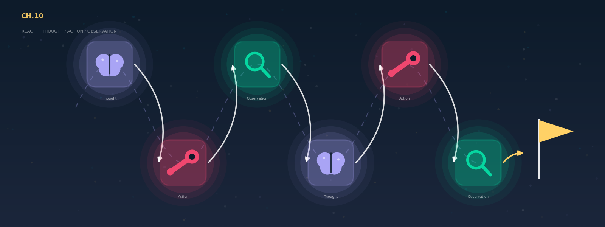
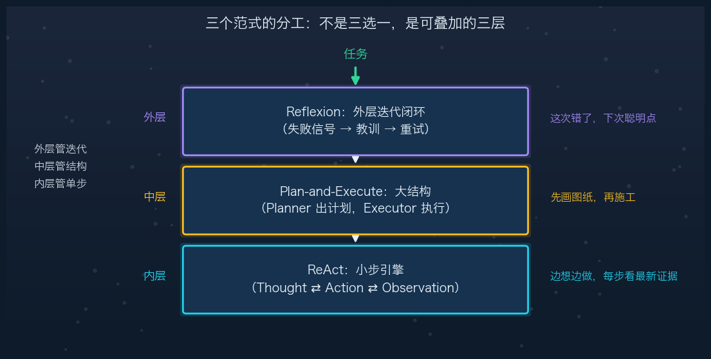
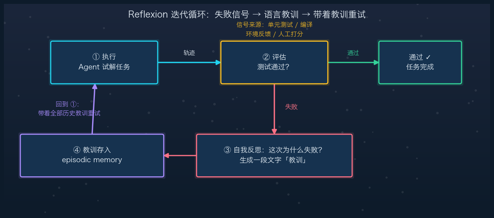

# 第 10 章 Agent 架构范式：ReAct / Plan-and-Execute / Reflexion



## 📖 开篇故事：五个字母的论文，成了明星产品的骨架

2022 年 10 月，普林斯顿大学 NLP 组把一篇论文挂上 arXiv，编号 2210.03629，标题只有五个字母：ReAct。论文没有发布任何新模型，只是提出了一种提示策略：让模型在"思考"与"行动"之间交替，把搜索变成推理链上可以随时插进来的动作。在当时满屏都在卷模型参数量的氛围里，这篇"只是改了提示词"的论文显得有些朴素。但它后来成了 Agent 时代的奠基文献之一：引用数以万计，LangChain、LangGraph 等主流框架的第一个官方模板就叫 ReAct Agent，几乎是所有入门者的第一课。更有意思的是作者们的去向：论文一作姚顺雨后来加入 OpenAI；而 2025 年 1 月 OpenAI 发布的 Operator（那个能自己操作浏览器订餐厅的 Agent）把它的循环拆开看，正是"截图（观察）→ 思考下一步 → 点击输入（行动）→ 再截图"，ReAct 的浏览器版。一篇 2022 年的提示词论文，撑起了 2025 年明星产品的骨架。为什么"边想边做"这么有效？它又有什么先天短板？本章连同另外两个经典范式（先画图纸再施工的 Plan-and-Execute、失败后写复盘的 Reflexion）一起讲透，并且每一份代码都能在你自己的机器上跑起来。

---

> 第 9 章结束时，我们手里有一个 `while` 循环和一个签名固定的决策函数 $\pi_{\text{LLM}}$。循环是骨架，人人一样；真正决定 Agent 聪明与否的，是决策函数内部的**策略**：让它一步一步试探，还是先画好路线图？失败之后要不要复盘？这些策略就叫**架构范式（architecture pattern）**。本章精讲三个最重要的范式：ReAct（边想边做）、Plan-and-Execute（先规划后执行）、Reflexion（失败后反思重来），并用可运行代码让前两者在同一道多跳问题上对垒，亲眼看清两种轨迹的差别。读完本章，你面对任何 Agent 框架（LangGraph 的 ReAct 模板、OpenAI Agents SDK 的工具循环）都能一眼认出它的范式血统。

先用一张图把三个范式的分工钉在墙上，后面每一节都是在展开图中的某一块：



读法提示：三个范式不是三选一的对手，而是三个可叠加的层级：外层 Reflexion 管迭代、中层 P&E 管结构、内层 ReAct 管单步。带着这张图读本章，10.3 到 10.8 节的每一份代码你都知道它在图里的位置。本章共有三份可运行代码：10.3 节 ReAct、10.5 节 P&E（同一道题对垒）、10.8 节 Reflexion（跨任务复用），全部零依赖、mock 双轨，建议边读边跑。范式这种东西，看轨迹是看不会的，跑一遍才会。

## 10.1 为什么 CoT 不够用：从"闭卷考试"到"开卷考试"

第 6 章讲过**思维链（Chain-of-Thought, CoT）**：让模型"一步一步思考"再给答案。它极大提升了纯逻辑题的表现，但有一个先天缺陷——**CoT 是闭卷考试**。模型只能靠参数里冻结的旧知识推理，推理链上每一个"事实"都没有出处：

```text
问：山海公司现任 CEO 的本科母校是哪所大学？
CoT：让我想想……山海公司是家 AI 公司，CEO 应该是张伟，
     张伟毕业于北京大学，所以答案是北京大学。（全程凭"记忆"，一本正经地错）
```

这叫**幻觉（hallucination）**：模型把内部记忆里最相近的模式当成了事实。更糟的是**错误传播**——链条上第 1 步错了，后面全是在错误前提上的正确推理，无法自我修正。

破局的思路朴素得惊人：**既然模型可以生成文本，为什么不把"查资料"也变成它生成的一种动作？** 每写一步推理，就去外部世界拿一点真实反馈，用观察截断错误链条。这就是 ReAct 的出发点。

顺带拆解一个容易矫枉过正的判断：CoT 并非一无是处，在**世界知识不参与**的纯推理题（数学证明、逻辑谜题、代码算法分析）上，闭卷反而是优势，没有外部噪声，链条越长推理越深。判断该用 CoT 还是 ReAct，先问一句：**这道题的答案存在于模型的参数里，还是存在于参数之外的世界里**？前者闭卷，后者开卷。把 ReAct 当万能锤子，会在纯推理任务上白白付出工具调用的延迟与成本。

## 10.2 ReAct：推理与行动交替

**ReAct = Reason + Act**，Shunyu Yao 等人提出（Princeton & Google Brain，ICLR 2023，arXiv:2210.03629）。核心主张：让 LLM 以**交错**方式生成两类输出：**推理轨迹（Reasoning Trace）**与**任务导向的动作（Action）**，两者互相成就：

- **Thought（思考）**：不影响外部环境，但更新内部状态，用来分解目标、跟踪进度、处理意外（"没搜到？换个关键词再试"）；
- **Action（行动）**：真正作用于环境，例如搜索、查数据库、点网页按钮；
- **Observation（观察）**：环境返回的真实反馈，喂回上下文成为下一轮思考的证据。

论文开篇用了一个精准的类比：人在厨房做菜，行动与内心独白交织："菜都切好了，该烧水了"（Thought）；"没盐了，用酱油代替"（处理意外的 Thought）；"面团怎么揉？搜一下"（意识到需要外部信息的 Thought）。ReAct 把这种"边想边做"搬进了 LLM。

```text
Question: 山海公司现任 CEO 的本科母校是哪所大学？
Thought 1: CEO 是谁我还不知道，先查公司信息。
Action 1:   search[山海公司]
Observation 1: 山海公司：2015 年成立于杭州，现任 CEO 为林远舟。
Thought 2: 现在问题转化为"林远舟本科毕业于哪所大学"，继续查。
Action 2:   search[林远舟]
Observation 2: 林远舟：山海公司创始人，本科毕业于浙江大学，博士毕业于清华大学。
Thought 3: 证据齐全，可以作答。
Action 3:  finish[浙江大学]
```

实现上 ReAct **完全不需要训练**：用 few-shot 提示词（1–6 个上面的格式示例）告诉模型输出协议，再由外部循环负责解析 Action、执行工具、把 Observation 拼回上下文。论文的实验结果支撑了它的价值：在 HotpotQA（多跳问答）与 FEVER（事实验证）上，通过与维基百科 API 交互，ReAct 明显缓解了 CoT 的幻觉与错误传播；在 ALFWorld 和 WebShop 两个交互式决策基准上，ReAct 分别以约 **34%** 和约 **10%** 的绝对成功率超过模仿学习与强化学习方法，而且只用了一两个上下文示例。

这个结果在当年相当反直觉：RL 方法要为每个环境训练几千个 episode，ReAct 只在提示词里放两个示例就赢了。它背后的信号后来被反复验证：**在足够强的通用模型上，把"控制结构"写在提示词里，往往比把它端到端训练进参数里更划算**：改提示词的迭代周期是分钟级，改权重的周期是周级。这也是本章所有范式都建立在提示工程而非微调之上的根本原因。

> 🎯 **面试高频**："ReAct 和 Function Calling 是什么关系？"——十个面试九个问。标准答案分两层：**ReAct 是决策策略（范式层），Function Calling 是工具调用的传输机制（协议层）**，两者不在同一层，谈不上替代。ReAct 论文诞生时没有原生工具调用，只能靠提示词约定 `Action: search[山海公司]` 这种文本格式，宿主再用正则解析；后来模型厂商把"输出结构化调用请求"做进了后训练，于是今天的 ReAct Agent 普遍用原生 tool calling 来承载 Action——骨相没变，只是 Action 的表达从"手写暗号"升级成了"官方频道"。一句话总结：**ReAct 决定"何时该动手、动手前想什么"，Function Calling 决定"动手的请求长什么样"**。

## 10.3 动手：用 ReAct 解多跳问答

下面实现一个完整的 ReAct Agent。问题需要**两跳**（公司 → CEO → 母校），一跳也答不出来。延续第 9 章的双轨写法：mock LLM 模拟"基于当前证据决定下一步"的行为，但**循环、解析、终止逻辑与真实版完全一致**，换真模型只改 `mock_llm`。

```python
# ch10_react_agent.py —— mock LLM 版 ReAct：解多跳问答，打印完整轨迹
import re

KB = {
    "山海公司": "山海公司：2015 年成立于杭州，现任 CEO 为林远舟。",
    "林远舟": "林远舟：山海公司创始人，本科毕业于浙江大学，博士毕业于清华大学。",
    "浙江大学": "浙江大学：位于杭州，前身是创建于 1897 年的求是书院。",
    "清华大学": "清华大学：位于北京，创建于 1911 年。",
}

def search(query):
    for key, fact in KB.items():
        if key in query:
            return fact
    return "（知识库中未收录相关词条）"

TOOLS = {"search": search}

def mock_llm(question, history):
    """确定性 mock LLM：模拟真实 LLM '基于当前证据思考下一步' 的行为。"""
    seen = " ".join(history)
    if "林远舟" not in seen:                     # 还不知道 CEO 是谁
        return ("Thought: 问题问的是'山海公司 CEO 的本科母校'。CEO 是谁我还不知道，"
                "先搜索公司信息。\n"
                "Action: search[山海公司]")
    if "本科毕业于" not in seen:                 # 知道 CEO，还不知道母校
        return ("Thought: 观察显示现任 CEO 是林远舟，问题转化为'林远舟本科毕业于哪所大学'。"
                "继续搜索。\n"
                "Action: search[林远舟]")
    school = re.search(r"本科毕业于([^，。]+)", seen).group(1)
    return ("Thought: 证据齐全：山海公司 CEO 是林远舟，其本科毕业于" + school + "，"
            "可以作答。\n"
            "Action: finish[" + school + "]")

def react_agent(question, max_steps=5):
    history = []                                 # 轨迹：每轮 Observation 追加进来
    print(f"问题: {question}\n")
    for i in range(1, max_steps + 1):
        reply = mock_llm(question, history)      # ① LLM 输出 Thought + Action
        thought, _, action = reply.partition("\nAction: ")
        print(f"Thought {i}: {thought.removeprefix('Thought: ')}")
        print(f"Action {i}:   {action}")
        if action.startswith("finish["):          # ② 终止条件：宣布答案
            print(f"\n最终答案: {action[7:-1]}")
            return action[7:-1]
        tool, _, arg = action[:-1].partition("[") # "search[山海公司]" → 拆出工具与参数
        obs = TOOLS[tool](arg)                    # ③ 执行工具，得到 Observation
        print(f"Observation {i}: {obs}\n")
        history.append("Observation: " + obs)     # ④ 观察回填轨迹，进入下一轮
    return "（超过最大步数，失败退出）"

if __name__ == "__main__":
    react_agent("山海公司现任 CEO 的本科母校是哪所大学？")
```

运行结果（Python 3.9+）：

```text
问题: 山海公司现任 CEO 的本科母校是哪所大学？

Thought 1: 问题问的是'山海公司 CEO 的本科母校'。CEO 是谁我还不知道，先搜索公司信息。
Action 1:   search[山海公司]
Observation 1: 山海公司：2015 年成立于杭州，现任 CEO 为林远舟。

Thought 2: 观察显示现任 CEO 是林远舟，问题转化为'林远舟本科毕业于哪所大学'。继续搜索。
Action 2:   search[林远舟]
Observation 2: 林远舟：山海公司创始人，本科毕业于浙江大学，博士毕业于清华大学。

Thought 3: 证据齐全：山海公司 CEO 是林远舟，其本科毕业于浙江大学，可以作答。
Action 3:   finish[浙江大学]

最终答案: 浙江大学
```

这份轨迹里最值得看的一处，是**第 2 轮的搜索词由第 1 轮观察"生"出来**：没有看到"林远舟"，就不可能想到去搜"林远舟"，每一步 Thought 都踩在上一步 Observation 之上，这正是 ReAct 的灵魂，也是纯 CoT 做不到的。同样重要的是**证据可追溯**：最终答案"浙江大学"在 Observation 2 里有白纸黑字的出处，而 CoT 版答案"北京大学"只能靠你信不信。

把这份轨迹和第 9 章 9.5 节的轨迹并排看，你会发现它们是同一个循环的两种灵魂：第 9 章的 `mock_llm` 只输出"下一步干什么"，这里的 `mock_llm` 还多输出了一句"我为什么这么干"（Thought）。就多这一句，调试体验天差地别：出问题时，你能顺着每一步 Thought 找到"它在哪一步想岔了"，而不是面对一条黑盒轨迹发呆。真实项目里请务必保留 Thought 的打印与存档，它是第 17 章轨迹评测的主角。

## 10.4 ReAct vs 纯 CoT：一张表看清幻觉与落地

| 维度 | 纯 CoT | ReAct |
|---|---|---|
| 信息来源 | 模型内部参数（闭卷） | 工具观察喂回的真实事实（开卷） |
| 错误处理 | 一步错、步步错（错误传播） | 观察可截断错误链，重新决策 |
| 幻觉 | 把"最像的记忆"写进推理链 | 每步有证据兜底，论文明确报告幻觉减少 |
| 上下文成本 | 一次生成的长思考 | 轨迹随步数线性膨胀 |
| 延迟与成本 | 单次 LLM 调用 | 每步一次 LLM 调用 + 工具往返 |
| 适用任务 | 纯逻辑/数学推导（世界知识不参与） | 需要外部事实的问答、决策与操作 |

ReAct 也有自己的失败模式：步数多时上下文迅速膨胀，模型可能忘掉早期证据；偶发"搜索词重复、原地打转"。对应的工程对策也成熟：上下文膨胀用轨迹摘要与裁剪（只保留最近几轮与关键证据），原地打转用重复动作检测加"你已经查过 X"的提醒注入，两者都将在第 14 章记忆管理中系统展开。论文里表现最好的配置反而是**两者互补**：ReAct 失败时用 CoT 多数投票兜底，外部证据与内部推理各取所长。记住这个结论，它是范式选型的第一课：**范式不是信仰，是工具**。

还要拆掉两个流行误区。其一："ReAct 就是让模型先说一句'让我想想'再回答。"错，那只是把 CoT 换了个说法。ReAct 的判定特征是**行动后的观察必须回到上下文，并改变下一步决策**；如果"想了"之后的行为与没有观察时一模一样，那就不是 ReAct，是内心戏。其二："ReAct 过时了，被某某新范式替代了。"恰恰相反，今天的 Operator、Claude Code、Deep Research 类产品，内核依然是"观察-思考-行动"的交替循环，变化的只是工具（浏览器、终端、搜索 API）和承载协议（原生 tool calling）。范式会老，循环不老。

## 10.5 Plan-and-Execute：先画路线图，再照图施工

ReAct 是"走一步看一步"。另一条路线来自机器人领域的经典 **plan-and-solve** 思想：**先把整条路线画出来，再照图施工**。Plan-and-Execute 把 LLM 拆成两个角色：

- **Planner（规划器）**：读任务，**一次性**产出完整步骤清单；
- **Executor（执行器）**：逐步执行计划，把观察结果填回去；
- **Replanner（重规划器）**：观察与预期不符时，回头修订计划。

**优点**：规划是一次大模型调用，执行步骤可以用小模型甚至纯代码，步数多时成本和延迟都显著占优；无依赖的步骤还能并行执行。**缺点**：Planner 出计划时还看不到任何观察，只能靠"脑补"写步骤：信息不足时必须依赖占位符与重规划；计划赶不上变化时整体返工。

顺便纠正一个对 P&E 的常见误解："Planner 必须一次画出完美计划，否则就不如 ReAct。"不是的，P&E 的正确预期是"计划只需大体正确，占位符与重规划本来就是为不确定性准备的"。真正让 P&E 翻车的不是计划不完美，而是**重规划被省略**：很多团队只实现 planner + executor，忘了 replanner，干出"计划错了也硬着头皮执行到底"的惨案。看一个 P&E 系统的成熟度，先看它的重规划触发条件写得有多细。

用同一道多跳问题实现对比版。注意 Planner 的计划里只能写占位符（它此刻还不知道 CEO 是谁），执行时用观察填充。这个细节把 P&E 的软肋暴露得明明白白：

```python
# ch10_plan_execute.py —— Plan-and-Execute：同一道题，先出计划再逐步执行
import re
from ch10_react_agent import TOOLS            # 复用 ReAct 版的知识库与 search 工具

def mock_planner(question):
    """确定性 mock 规划器：一次性产出完整计划。此刻还不知道 CEO 姓名与母校，
    只能写下占位符，等执行时用观察结果填充——这正是 planner 的信息局限。"""
    return ["search[山海公司]",      # 步骤 1：查公司，拿到 CEO 姓名
            "search[{CEO}]",         # 步骤 2：占位符，待观察结果填充
            "finish[{母校}]"]        # 步骤 3：占位符，待观察结果填充

def fill(action, facts):
    """把计划中的占位符替换为已观察到的事实；填不上就原样保留
    （等于把'信息不足'暴露给上层，触发重规划——本例用不到，但缺它计划就会空转）。"""
    text = "；".join(facts)
    ceo = re.search(r"现任 CEO 为([^，。]+)", text)
    school = re.search(r"本科毕业于([^，。]+)", text)
    if ceo:
        action = action.replace("{CEO}", ceo.group(1))
    if school:
        action = action.replace("{母校}", school.group(1))
    return action

def plan_execute_agent(question):
    plan = mock_planner(question)
    print("[规划] Planner 一次性产出完整计划：")
    for i, s in enumerate(plan, 1):
        print(f"   {i}. {s}")
    facts, step = [], 0
    while plan:
        action = plan.pop(0)
        filled = fill(action, facts)
        if filled != action:
            print(f"[填充] {action}  →  {filled}")
        action, step = filled, step + 1
        if action.startswith("finish["):
            print(f"[执行 步骤{step}] {action}  →  任务完成")
            print(f"\n最终答案: {action[7:-1]}")
            return action[7:-1]
        tool, _, arg = action[:-1].partition("[")
        obs = TOOLS[tool](arg)
        facts.append(obs)
        print(f"[执行 步骤{step}] {action}  →  观察: {obs}")

if __name__ == "__main__":
    plan_execute_agent("山海公司现任 CEO 的本科母校是哪所大学？")
```

运行结果：

```text
[规划] Planner 一次性产出完整计划：
   1. search[山海公司]
   2. search[{CEO}]
   3. finish[{母校}]
[执行 步骤1] search[山海公司]  →  观察: 山海公司：2015 年成立于杭州，现任 CEO 为林远舟。
[填充] search[{CEO}]  →  search[林远舟]
[执行 步骤2] search[林远舟]  →  观察: 林远舟：山海公司创始人，本科毕业于浙江大学，博士毕业于清华大学。
[填充] finish[{母校}]  →  finish[浙江大学]
[执行 步骤3] finish[浙江大学]  →  任务完成

最终答案: 浙江大学
```

## 10.6 两条轨迹放在一起看

同一个问题、同一个知识库、同一个答案，两种范式走出了完全不同的轨迹：

| 维度 | ReAct | Plan-and-Execute |
|---|---|---|
| LLM 调用模式 | 3 次"大思考"，每次含 Thought | 1 次规划调用 + 3 次可外包的执行 |
| 决策时机 | 边执行边决策（每步都看最新证据） | 前置一次性决策（执行时只有填充权） |
| 抗意外 | 天然适应：观察不同就换路走 | 依赖重规划：观察颠覆计划时整体返工 |
| 可并行性 | 差——下一步依赖上一步观察 | 好——计划中无依赖的步骤可并发 |
| 成本（步数多时） | 每步一次长上下文推理，贵且慢 | 执行便宜，规划只花一次钱 |
| 上下文膨胀 | 每步追加 Thought + Observation | 只追加 Observation |

直觉记法：**ReAct 是特种兵，一个人边侦察边决策；P&E 是工地，总工先画图纸、工人照图施工**。我们的例子里 P&E 靠占位符苟住了两跳任务；但如果第 2 次搜索返回"林远舟查无此人"（比如前任 CEO 刚卸任、知识库滞后），ReAct 会在下一步 Thought 里立刻调整策略，而 P&E 必须触发重规划，回到 Planner 带着新证据重画整张图。反过来，若是"爬取 50 个网页、清洗、汇总成报表"这种 50 步结构化任务，ReAct 每步都让大模型"想一想"就是烧钱，P&E 一次规划、小模型执行则便宜得多。

动手对拍：两份代码就在 `ch10_react_agent.py` 与 `ch10_plan_execute.py`，在同一目录里先后运行，把两份输出并排贴在一起，就是本章最重要的一张"对照表"：同一个问题，一个走了 3 次"大思考"，一个走了 1 次规划加 3 次机械执行。建议再做一处破坏性实验：把 KB 里山海公司的 CEO 换个名字，观察两种范式各自怎么崩、崩在第几步。范式的高下，在失败时刻看得最清楚。

工程实践中两者常常合体：**Planner 产出的每一步，交给一个 ReAct Agent 执行**，大结构上先规划，小步骤里边想边做。LangGraph 的 Plan-and-Execute 模板正是这个思路。

合体的成本结构也值得算一笔：大结构的一次规划调用用强模型（贵但只花一次钱），内层每步的 ReAct 决策用便宜的小模型，遇到小模型搞不定的疑难步骤再升到强模型，这就是后来业界说的"模型分级调度"。反过来，纯 ReAct 大一统的做法等于每一步都开着豪华车送快递，灵活是灵活，账单也灵活。范式选型从来不只是技术问题，也是成本问题。

这也是一道面试高频题："ReAct 和 Plan-and-Execute 怎么选？"先给判据再举例，别背表格。判据三条：**任务的可预见性**（步骤能否在动手前想清楚，能就 P&E）、**意外密度**（环境反馈会不会推翻预期，会就 ReAct）、**步数与预算**（步数多、预算紧，P&E 的成本曲线占优）。再给一个万能的工程答案：**外层 P&E、内层 ReAct 的合体结构**，兼顾大结构的经济性与小步骤的灵活性。面试官听到这句，知道你不只是背了两个名词。

## 10.7 Reflexion：失败之后的"语言强化学习"

前两个范式解决"怎么把任务做对"，Reflexion（Shinn et al., 2023, arXiv:2303.11366）解决另一个问题：**这次做错了，下次能不能聪明一点？** 人类工程师修 bug 后会写下复盘笔记，Reflexion 让 Agent 做同样的事：



它的数学骨架可以和强化学习并排看。标准 RL 用数值奖励更新参数：

$$\theta \leftarrow \theta + \alpha \nabla_\theta J(\theta)$$

Reflexion 的"参数" $\theta$ 一个比特都不动，被更新的是**语言记忆**：

$$\text{memory}_{k+1} = \text{memory}_k \cup \text{reflect}(\tau_k, f_k)$$

其中 $\tau_k$ 是第 $k$ 次尝试的完整轨迹，$f_k$ 是该次尝试的反馈信号；第 $k+1$ 次尝试的策略变成 $\pi_{k+1}(\cdot) = \text{LLM}(\text{task}, \text{memory}_{k+1})$。奖励信号从"标量损失"换成了"自然语言教训"，所以论文称之为**语言强化学习（verbal reinforcement learning）**：不改权重，改上下文。对只能靠提示词驱动的 LLM 来说，这是唯一触手可及的"学习"。

效果相当惊人：在 HumanEval 编程基准上，GPT-4 直接生成通过 80.1% 的题，加上 Reflexion 循环后升到 **91%**（pass@1），越过了当年所有更大的模型。原因在于代码任务天然自带评估器（单元测试），失败信号客观、教训有的放矢。

把 10.7 节开头的四步循环图和第 9 章的核心循环图叠在一起看：内层还是那个"感知→规划→行动→观察"，Reflexion 只是给它套了一个"尝试→评估→反思→重试"的外壳，并用 episodic memory 把失败经验留在循环之外。所以它不是第四种循环，而是给前三种范式都通用的**外挂变速箱**——ReAct 版 Reflexion、P&E 版 Reflexion 都存在，10.8 节的实验就是最小的一个。

这也暴露了它的适用边界：**Reflexion 强依赖"可验证的失败信号"**。有单元测试、编译器、可对答案的游戏，它如鱼得水；换成"帮我写一封得体的邮件"这种无客观对错的任务，自我反思容易沦为自我安慰。另外它要花重试预算：每次迭代都是一次完整 Agent 运行，昂贵任务上需设迭代上限。

> 💡 **深入思考**：Reflexion 更新记忆、RLHF 更新权重——都是"从反馈中学习"，为什么 Agent 工程偏爱前者？因为**上下文就是 Agent 唯一可写的"权重"**。微调改一次参数要数据、要 GPU、要几天，还会忘记旧技能；往 episodic memory 里写一条教训，一次 LLM 调用就完成，立刻生效，且不同任务可以挂不同记忆。代价同样清晰：记忆不跨 session 就蒸发（第 14 章讲怎么补救）、教训质量全靠反思者的水平、容量受上下文窗口约束。所以真实的"学习型 Agent"往往是两条腿走路：**短周期用 Reflexion 攒经验，长周期把高频教训蒸馏进微调数据**。

## 10.8 动手：60 行 Reflexion，看教训如何跨任务复用

Reflexion 的论文读起来复杂，核心循环其实一页纸就能写完。下面的实验把 10.7 节的四步循环完整落地：Agent 依次接两个编程小任务，单元测试做评估器，mock 执行者读着"教训记忆"生成代码，**记忆里有没有那条教训，直接改变它的输出**，这正是 $\pi_{k+1}(\cdot) = \text{LLM}(\text{task}, \text{memory}_{k+1})$ 的直译。实验设计有一个小心思：任务 2（数辅音）与任务 1（数元音）共享同一个陷阱（大写字母），如果任务 1 的教训真的进了记忆，任务 2 就应该一次通过。我们用"跨任务复用"来验证"教训确实在起作用"，而不是重试碰运气：

```python
# ch10_reflexion_agent.py —— 60 行 Reflexion：执行 → 评估 → 语言反思 → 带着教训重试
# 运行：python3 ch10_reflexion_agent.py（Python 3.9+，零依赖）
TASKS = {
    "vowels": "实现 count_vowels(s)：返回字符串中元音字母 a/e/i/o/u 的个数。",
    "consonants": "实现 count_consonants(s)：返回字符串中辅音字母的个数（只统计字母，不含元音）。",
}

TESTS = {
    "vowels": [("hello", 2), ("AEIOU", 5), ("rhythm", 0), ("Python", 1)],
    "consonants": [("bc", 2), ("AEIOU", 0), ("Hello", 3), ("xyz", 3)],
}

def actor(task_id, memory):
    """mock 执行者：读任务 + 教训记忆生成代码。
    与真实 LLM 同构：记忆里有没有那条教训，直接改变它的输出。"""
    if task_id == "vowels":
        correct = 'return sum(1 for c in s.lower() if c in "aeiou")'
    else:
        correct = 'return sum(1 for c in s.lower()\n              if c.isalpha() and c not in "aeiou")'
    buggy = correct.replace("s.lower()", "s")
    return buggy if "大小写归一化" not in "".join(memory) else correct

def evaluator(task_id, code):
    """真实评估器：单元测试铁面无私——这就是 Reflexion 依赖的可验证失败信号。"""
    ns = {}
    name = "count_vowels" if task_id == "vowels" else "count_consonants"
    exec(f"def {name}(s):\n    " + code, ns)      # mock 环境里执行自己生成的代码
    fn = ns[name]
    failures = []
    for s, want in TESTS[task_id]:
        got = fn(s)
        if got != want:
            failures.append(f"{name}({s!r}) 返回 {got}，期望 {want}")
    return failures

def reflector(failures):
    """mock 反思器：把失败信号翻译成一条自然语言教训（真实 LLM 干的就是这步）。"""
    return "教训：统计字母时必须先做大小写归一化（s.lower()），否则大写输入全数漏判。"

def reflexion_agent(task_id, memory, max_attempts=3):
    for attempt in range(1, max_attempts + 1):
        code = actor(task_id, memory)
        print(f"----- 第 {attempt} 次尝试（记忆中已有 {len(memory)} 条教训）-----")
        print("  [执行] 生成代码：\n      " + code.replace("\n", "\n      "))
        failures = evaluator(task_id, code)
        if not failures:
            print(f"  [评估] {len(TESTS[task_id])}/{len(TESTS[task_id])} 个用例全部通过，任务完成！")
            return attempt
        print(f"  [评估] {len(failures)} 个用例失败：")
        for f in failures:
            print("      - " + f)
        lesson = reflector(failures)
        memory.append(lesson)                  # 教训存入 episodic memory，供下一次尝试使用
        print(f"  [反思] 生成教训并存入记忆：\n      「{lesson}」")
    return max_attempts

if __name__ == "__main__":
    memory = []                                # episodic memory：跨任务、跨尝试存活
    print("========== 任务 1：" + TASKS["vowels"] + " ==========")
    n1 = reflexion_agent("vowels", memory)
    print("\n========== 任务 2：" + TASKS["consonants"] + " ==========")
    print(f"（带着任务 1 沉淀的 {len(memory)} 条教训出发）")
    n2 = reflexion_agent("consonants", memory)
    print(f"\n总结：任务 1 用了 {n1} 次尝试；任务 2 只用 {n2} 次——教训跨任务复用了。")
```

实际运行输出（Python 3.9.6）：

```text
========== 任务 1：实现 count_vowels(s)：返回字符串中元音字母 a/e/i/o/u 的个数。 ==========
----- 第 1 次尝试（记忆中已有 0 条教训）-----
  [执行] 生成代码：
      return sum(1 for c in s if c in "aeiou")
  [评估] 1 个用例失败：
      - count_vowels('AEIOU') 返回 0，期望 5
  [反思] 生成教训并存入记忆：
      「教训：统计字母时必须先做大小写归一化（s.lower()），否则大写输入全数漏判。」
----- 第 2 次尝试（记忆中已有 1 条教训）-----
  [执行] 生成代码：
      return sum(1 for c in s.lower() if c in "aeiou")
  [评估] 4/4 个用例全部通过，任务完成！

========== 任务 2：实现 count_consonants(s)：返回字符串中辅音字母的个数（只统计字母，不含元音）。 ==========
（带着任务 1 沉淀的 1 条教训出发）
----- 第 1 次尝试（记忆中已有 1 条教训）-----
  [执行] 生成代码：
      return sum(1 for c in s.lower()
                    if c.isalpha() and c not in "aeiou")
  [评估] 4/4 个用例全部通过，任务完成！

总结：任务 1 用了 2 次尝试；任务 2 只用 1 次——教训跨任务复用了。
```

先看 `actor` 的唯一分支：它判断的不是任务内容，而是"大小写归一化"这条教训在不在记忆里，这正是 Reflexion 公式里 $\pi_{k+1}$ 的直译，教训进记忆、策略随之改变。再看任务 2 的第一次尝试：它没有在"大写漏判"上摔倒，因为任务 1 的教训还在记忆里：语言教训的复用不需要任何再训练，一次 append 就完成了"迁移学习"。最后要诚实地说：`reflector` 在本实验里是写死的规则，真实系统里它是一次 LLM 调用（读失败信息，产出教训），它产出的教训质量，决定了 Reflexion 是"越挫越勇"还是"原地打转"，这也是为什么该范式强依赖可验证的失败信号：失败信号越客观，教训越有的放矢。

再留意一个对照：HumanEval 上 80.1% → 91% 的提升来自单元测试这个"铁面评估器"，本实验的 4 个断言用例是它的最小版。如果你的业务任务找不到任何可自动判定的成功标准（没有测试、没有对答案、没有编译器），那就别硬上 Reflexion：先把"可验证性"本身当作一个工程问题解决掉（哪怕只验证子结果），再谈反思循环。这条边界，比记住公式更重要。

迁移到你自己的项目时，这份 60 行代码可以直接当骨架用：把 `TESTS` 换成你的验收用例，把 `actor` 换成真 LLM 调用（读任务与记忆生成答案），把 `reflector` 换成读失败日志的反思提示词。这三处替换之后，你就拥有了一个能在真实任务上"越挫越勇"的最小 Reflexion 系统。

> ⚠️ **常见误区**："Reflexion 就是重试，多试几次总能碰对。"不是。盲目重试的期望成功率不变（甚至因上下文膨胀而下降）；Reflexion 的增益完全来自**教训进入记忆并改变下一次的策略**。判断你的"反思循环"是不是真 Reflexion，只看一条：第 2 次尝试的决策，是否真的依赖第 1 次失败产出的语言教训？如果去掉那条教训重跑结果不变，你写的就是带复读功能的 while 循环。

## 10.9 其他值得知道的范式（一句话版）

| 范式 | 论文 | 一句话定位 |
|---|---|---|
| **Tree of Thoughts** | arXiv:2305.10601 | 把 CoT 从"一条链"扩成"一棵搜索树"：LLM 对每个分支打分、可回溯，适合需要试错的难题（24 点游戏、填字谜） |
| **Self-Ask** | arXiv:2210.03350 | 让模型显式地"自问自答"把问题拆成子问题逐个搜索，把多跳推理结构化成显式链条 |
| **LLMCompiler** | arXiv:2312.04511 | 给 Agent 配"编译器"：把任务规划成**任务 DAG**，无依赖的函数调用并行执行，延迟比串行 ReAct 大幅下降 |

三个范式共享同一条洞察：**CoT 只用到了 LLM 的"链式生成"，而搜索、分解、并行这些经典计算思想全都可以嫁接到 LLM 上**。理解了这一点，新论文层出不穷也不可怕：万变不离"让 LLM 复用七十年算法积累"这个宗。

给这三者各配一个"什么时候你会真的需要它"：Tree of Thoughts 适合答案空间大、单条路径成功率低、且每步可以廉价打分的难题（数学奥数、谜题类）；Self-Ask 适合问题本身就是链式结构的多跳事实问答，它把 ReAct 隐式的拆解显式化，可控性更好；LLMCompiler 适合工具调用密集且互不依赖的批处理场景（同时查 10 个数据源），它把 ReAct 的串行等待换成了 DAG 并行。注意三者的共同前提：你已经有可靠的工具与可靠的评估。范式放大的是底层能力，底层不可靠时，范式只会把错误放大得更快。

## 10.10 范式选型决策表

| 任务特征 | 推荐范式 | 一句话理由 |
|---|---|---|
| 单步可答，一次工具调用 | 直接调用（不是 Agent） | 最简单方案优先（第 9 章原则） |
| 2–4 步、需要外部证据 | **ReAct** | 边走边看，最灵活，实现最简单 |
| 步骤多、结构清晰、可并行 | **Plan-and-Execute** / LLMCompiler | 规划一次、执行便宜、可并发 |
| 有自动验证器（单测/编译），首次常失败 | **Reflexion** | 教训可积累，pass@1 显著提升 |
| 组合式事实推理（"A 的 B 的 C 是什么"） | Self-Ask | 显式拆解子问题，逐个击破 |
| 探索空间大、需要回溯 | Tree of Thoughts | 搜索树 + 打分剪枝 |
| 高风险、不可逆操作 | 降低自主级 + 人工确认 | 范式再好，也别让 L4 开推土机 |

三条选型经验，比表格本身更重要。**其一，范式可叠加**：常见结构是"外层 P&E 规划、内层每步跑 ReAct、整轮跑挂了再套 Reflexion"，三者是积木不是对手。**其二，范式决定成本曲线**：ReAct 的成本随步数线性走大模型；P&E 把成本压到一次规划；Reflexion 把成本乘以重试次数。预算紧时先看这条曲线。**其三，先跑 10.3 节那 53 行代码**，确认问题真的需要多步 Agent，再谈范式。很多"Agent 项目"最后发现是一次 RAG 调用就能解决的事（第 13 章）。

补一条容易被忽略的第四经验：**范式可以中途降级，但很难中途升级**。从 ReAct 起步的项目，发现步数太多想换 P&E，改动集中在决策层，循环骨架不动；而从 P&E 起步的项目遇到意外频出的环境，想退回 ReAct，往往连提示词、执行器、重试逻辑都要重写。所以环境不确定性高时，宁可先选灵活的 ReAct 再谈优化：灵活是可收敛的，僵化只能推倒重来。

## 本章小结

- **CoT 是闭卷考试**：幻觉 + 错误传播；把"查资料"变成模型可生成的**动作**，让观察回填决策回路，是所有 Agent 范式的共同起点。
- **ReAct（arXiv:2210.03629）**：Thought / Action / Observation 交错，每步思考踩在上一步观察之上；零训练、few-shot 即用；在 HotpotQA/FEVER 上缓解幻觉，在 ALFWorld/WebShop 上大幅超越模仿与 RL 基线；与 CoT 互补使用效果最佳。
- **Plan-and-Execute**：planner 一次性出计划（信息不足只能写占位符），executor 逐步执行、按观察填充，意外时 replan。步数多、结构清晰时成本与延迟占优，可并行；抗意外能力弱于 ReAct。实践中常与 ReAct 合体（大规划、小步 ReAct）。
- **Reflexion（arXiv:2303.11366）**：执行 → 评估 → 语言反思 → 存入 episodic memory → 重试；更新记忆而非权重（$\text{memory}_{k+1} = \text{memory}_k \cup \text{reflect}(\tau_k, f_k)$），故称语言强化学习；强依赖可验证信号（HumanEval 80.1% → 91%），且需重试预算。
- **60 行实验验证了 Reflexion 的两个核心主张**：教训改变策略（actor 的分支看记忆不看任务）、教训可跨任务复用（任务 2 一次通过）。
- **本章三份代码全部可本地跑通**：ReAct（10.3）、P&E（10.5）、Reflexion（10.8），零依赖、mock 双轨，对拍两份输出是理解范式差异最短的路。
- **Thought 不只是装饰**：多输出一句"为什么这么干"，轨迹就从黑盒变成可归因的调试材料，它是第 17 章轨迹评测的主角。
- **选型三原则（+第四条）**：范式可叠加；范式决定成本曲线；先验证任务真的需要 Agent；不确定性高时从灵活的 ReAct 起步（可中途降级，难中途升级）。
- Tree of Thoughts（搜索树）、Self-Ask（显式子问题）、LLMCompiler（并行 DAG）共同印证：**让 LLM 嫁接经典算法思想**，是 Agent 架构创新的主旋律。

## 练习题

**10.1（轨迹分析）** 在 10.3 节的输出里，指出"Thought 2 的内容依赖于哪一行 Observation"。如果删掉这一行观察（模型只看到第 1 轮的 Action 与第 2 轮的搜索结果），ReAct 还能答对吗？由此说明"观察回填记忆"为什么是循环中不可省略的一步。

**10.2（代码）** 给 10.3 节的 `KB` 加一个干扰词条：`"山海科技"` → "山海科技：2016 年成立于深圳，现任 CEO 为周红。"，并把 `search` 改成返回所有子串匹配的结果。观察 mock LLM 的规则是否仍然成立；若失效，修改规则让它能从两条观察中挑选正确的那条，体会真实 LLM 在这里要做的是"证据消歧"。

**10.3（代码/实验）** 把 10.5 节 `mock_planner` 的计划改成写死 `search[林远舟]`（即假设 planner"预先知道"CEO 姓名）。程序仍能跑通。那这个 planner 合理吗？讨论：什么情况下前置计划必须依赖占位符，什么时候可以写死？（提示：知识的时效性与来源。）

**10.4（代码）** 给 `plan_execute_agent` 加上重规划：若某步观察中出现"未收录"，打印 `[重规划]` 并让 planner 带着已有事实重新出计划（上限 2 次）。构造一个会让初始计划失败的 KB 验证你的实现。

**10.5（对比）** 任务："数出 KB 中一共出现了几个'杭州'"。ReAct、P&E、Reflexion 哪个最合适？哪个最不合适？说明理由（提示：这个任务需要的是"执行计划"而不是"决策"）。

**10.6（思考）** Reflexion 更新的是 $\text{memory}$，RLHF 更新的是 $\theta$。两者都是"从反馈中学习"，各举一个"只有对方能学、自己学不了"的场景。（提示：反馈是"这封邮件语气太冲"时，哪个范式能用上它？任务跨 session 重启时，学到的改进还在吗？）

**10.7（阅读挑战）** 读 ReAct 论文的 Figure 1（同一问题下 CoT、Act、ReAct 三条轨迹的对照），找出其中 CoT 出现幻觉的那一步和 Act 陷入无思考循环的那一步，用一句话总结论文为什么要"reason 与 act 各取一半"。

**10.8（代码/实验）** 改造 10.8 节的实验：把 `reflector` 换成"敷衍版"：无论失败什么都返回同一条与失败无关的教训（如"下次仔细一点"）。运行并观察：任务 1 还能通过吗？任务 2 的跨任务复用还成立吗？由此体会"教训质量是 Reflexion 的命门"这句话的分量。

**10.9（思考）** 把本章开篇的三层范式图套到你熟悉的一个产品上（如 Claude Code、Deep Research、某客服系统），指出它各自的内层、中层、外层分别用了什么范式（或什么都没用），并为它提一条"加一层"或"减一层"的建议，说明理由。

**练习提示**：10.1/10.5/10.6 是思想题，答案都在正文的图和表里，先自己写再对图；10.2/10.4/10.8 是改造题，每一题都只需要改动十几行，但每改一题你对一个范式的边界感就深一层。范式的手感是改出来的，不是读出来的。

## 📚 延伸阅读

范式学习的特点是"论文密度高"，以下几篇按与本章的相关度排序，前两篇建议精读，其余读摘要与图即可：

一个提示：arXiv 论文的 v1 与最新版差异可能很大（ReAct 至今仍在更新），引用时以你读到的版本页脚编号为准。

- **ReAct: Synergizing Reasoning and Acting in Language Models**（arXiv:2210.03629）：本章主角的原始论文，Figure 1 的三条轨迹对照值得打印出来贴在工位：https://arxiv.org/abs/2210.03629
- **Reflexion: Language Agents with Verbal Reinforcement Learning**（arXiv:2303.11366）：语言强化学习的出处，10.8 节实验的完整版：https://arxiv.org/abs/2303.11366
- **Plan-and-Solve Prompting**（arXiv:2305.04091）：Plan-and-Execute 思想的提示词源头，可与 10.5 节的工程化实现对照：https://arxiv.org/abs/2305.04091
- **Tree of Thoughts**（arXiv:2305.10601）：把 LLM 推理变成显式搜索的代表作，10.9 节表格的第一行：https://arxiv.org/abs/2305.10601
- **LangChain 博客《Planning in the age of LLMs》**：业界如何把 P&E 落成框架模板的一手思考：https://blog.langchain.dev/planning-in-the-age-of-llms/

（下一章，我们回到协议层，看 Action 从"手写暗号"进化成"官方频道"的完整历程：Function Calling 与工具调用的全部细节。）
