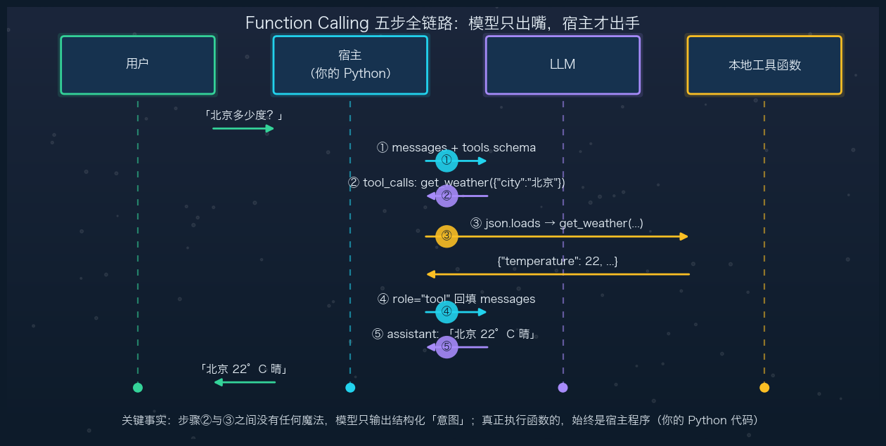

# 第 11 章 工具调用（Function/Tool Calling）原理与实战


## 📖 开篇故事：从"格式暗号"到官方协议，只用了半年

想让 ChatGPT 查个天气，在 2023 年上半年，你得跟模型玩一场"格式暗号"游戏：在提示词里写"如果需要查天气，请输出 TOOL: get_weather(city=北京)"，然后赌它不会随手在冒号前后加空格、不会贴心地套上 markdown 代码块、不会用中文跟你说"我需要调用工具"。每个开发者的收藏夹里都存着几套自己发明的正则解析器，每次模型版本更新都是一次解析器大修。LangChain 早期源码里甚至有一个专门的"输出修复"模块，专治模型不守格式。2023 年 6 月 13 日，OpenAI 一纸公告终结了这场民间 Hack：gpt-3.5-turbo-0613 与 gpt-4-0613 上线原生 Function Calling，开发者用 JSON Schema 声明工具，模型直接输出结构化调用请求。五个月后的首届 OpenAI DevDay 又补上了两块短板：并行函数调用与 JSON 模式。从黑魔法到官方协议，工具调用只用半年就走完了标准化。这一章我们就把这套协议从里到外拆开，并且不依赖任何 API key，用 mock 把整条链路完整跑通。

---

> 一个博学到近乎全知的语言模型，却算不准 `13*17`，记不住今天北京多少度，更没法替你发一封邮件。这不是它不够聪明，而是它的世界里只有文本——**没有手，没有眼，也没有今天**。工具调用（Tool Calling，早期叫 Function Calling）就是给 LLM 装上手脚的标准接口：模型出"嘴"提出请求，宿主程序出"手"真实执行，结果再喂回模型继续思考。这一章我们把它从协议层到工程层完整拆开，并且用零依赖的 mock 版本把整条链路跑通。

## 11.1 为什么 LLM 需要工具

第 6 章讲过，LLM 的全部本领来自"预测下一个 token"。这个机制决定了三个天然缺陷，每一个都对应一种工具：

| 缺陷 | 根因 | 典型翻车现场 | 对应工具 |
|---|---|---|---|
| **知识截止**（knowledge cutoff） | 训练数据有一个截止日期，之后的世界它没见过 | "今天的股价是多少？" | 搜索 / 天气 / 数据库查询 |
| **不会精确计算** | 逐 token 采样，每个数字都是"猜"出来的 | `13*17` 算成 221 或 231，每次还不一样 | 计算器 / 代码解释器 |
| **无法行动** | 输出只能是文本，改动不了任何外部状态 | "帮我把会议改到周四"——它只会说改不了 | 发邮件 / 日历 API / shell |

**类比**：LLM 像一位被关在小黑屋里的天才顾问——上知天文下知地理，但屋里没有报纸、没有计算器、没有电话。你能做的，是在墙上装三个接口：递报纸（检索工具）、递计算器（计算工具）、接电话线（行动工具）。工具调用协议，就是"递东西进小黑屋"的标准方式。

一句话总结：**模型负责想，工具负责干，协议负责把"想"翻译成"干"**。

## 11.2 Function Calling 全链路：模型只出嘴，宿主才出手

初学者最常见的误解是"模型帮我调了工具"。恰恰相反：**模型从头到尾没有执行任何东西，它只是输出了一段特殊格式的文本——'我想调用工具 X，参数是 Y'**。真正动手的是宿主程序（你的 Python 代码）。整个循环分五步：

1. **Schema 定义**：宿主把工具的名称、用途、参数格式（JSON Schema）随请求发给模型；
2. **模型输出结构化调用请求**：模型决定"需要调工具"，输出 `tool_calls` 字段（含工具名 + JSON 参数），而不是普通回答；
3. **宿主执行**：宿主解析这段 JSON，找到对应的本地函数，**真实执行**；
4. **结果回填上下文**：执行结果以 `role="tool"` 消息追加进对话历史；
5. **继续生成**：把更新后的历史再发给模型，它基于工具结果继续回答，或继续提出下一步工具调用。

时序图如下（这就是本章代码将要实现的完整循环）：



图里的关键事实：**步骤 2 与步骤 3 之间没有任何魔法，只是一次普通的函数调用，由你的代码完成**。所谓 Function Calling，本质是模型经微调后学会了"在合适时机输出约定格式的 JSON"，而格式约定由宿主校验和执行。理解了这一点，Agent 框架（LangChain、第 18 章的 Mini-Agent）对你来说就只是"把这个循环封装得更顺手"而已。

> 🎯 **面试高频**："Function Calling 时，模型真的执行了函数吗？"——没有，一个比特都没有执行。模型只输出一段结构化"意图"（工具名 + JSON 参数），执行发生在宿主程序里。追问"为什么要这样设计"时，答案有三层：**安全**（执行权始终在开发者手里，可以校验、拦截、审计）、**可移植**（同一套协议可以接任何后端——本地函数、HTTP API、下一章的 MCP 服务器）、**可迭代**（工具实现改版不需要重训模型）。把"模型出嘴、宿主出手"这六个字答出来，这道题就稳了。

## 11.3 写好工具描述：给模型看的"产品说明书"

模型是否用对工具，七分取决于 JSON Schema 写得好不好——它是模型眼里关于这个工具的**全部**信息。最佳实践：

- **命名**：动词+名词，snake_case（`get_weather` ✅，`query_1` ❌）。名字本身要能回答"这工具干嘛"；
- **描述**写给模型看，要说明**何时该用**而不仅是能干嘛：加一句"任何精确数值计算都必须调用本工具，禁止心算"，能显著压住模型爱自己心算的冲动；
- **参数约束**能收紧就收紧：`enum` 圈定合法值、`maxLength`/`maximum` 限制范围、`required` 标明必填、`additionalProperties: false` 拒绝一切未声明参数（11.8 节它会救你一命）；
- **工具数量**：一次塞几十个工具会稀释模型的注意力，按任务分组、动态装载（第 15 章 Skill 体系的思想雏形）。

```python
{
  "type": "function",
  "function": {
    "name": "get_weather",
    "description": "查询指定城市的实时天气（温度、天气状况）。当用户询问某城市天气、温度时调用。",
    "parameters": {
      "type": "object",
      "properties": {
        "city": {"type": "string", "enum": ["北京", "上海"], "description": "城市名，只支持北京/上海"},
        "unit": {"type": "string", "enum": ["celsius", "fahrenheit"], "description": "温度单位，默认摄氏度"}
      },
      "required": ["city"]
    }
  }
}
```

> 💡 **深入思考**：工具描述其实是"给模型看的用户界面"。人类用户有按钮、菜单、下拉框；模型的全部"界面"就是 schema 里那几行文本——命名是按钮文案，description 是提示语，enum 是下拉框，`additionalProperties: false` 是输入校验。想通这一层，你就明白为什么写 schema 应该拿出做产品 UI 的心思：界面含糊，用户（模型）就会瞎猜；界面精准，行为就稳定。11.9 节的实验会当场演示"描述质量决定选工具的准确率"，它不是玄学，是界面设计。

## 11.4 实战（a）：零依赖 mock 版完整循环

本节代码不依赖任何 API key，`python3 ch11_mock.py` 直接跑通。mock 之处只在"模型那一步"：`MockLLM` 按剧本吐出 `tool_calls`，其余全部是真实的：工具是真实 Python 函数，执行、JSON 解析、上下文回填、多轮循环都是真实逻辑。换成真 LLM 时只需把 `MockLLM.chat` 换成 API 调用（11.5 节）。

```python
"""ch11_mock.py —— 用 mock LLM 实现完整 tool-calling 循环（无 API key，本地可跑）"""
import ast
import json
import operator as op

# ---------- 1. 宿主侧：工具的真实实现 ----------
WEATHER_DB = {
    "北京": {"temp_c": 22, "condition": "晴"},
    "上海": {"temp_c": 26, "condition": "多云"},
}

def get_weather(city: str, unit: str = "celsius") -> dict:
    """真实项目中这里是 HTTP 请求，演示用本地数据"""
    if city not in WEATHER_DB:
        return {"error": f"不支持的城市: {city}，支持: {list(WEATHER_DB)}"}
    w = WEATHER_DB[city]
    if unit == "fahrenheit":
        return {"city": city, "temperature": round(w["temp_c"]*9/5+32, 1), "unit": "F", "condition": w["condition"]}
    return {"city": city, "temperature": w["temp_c"], "unit": "C", "condition": w["condition"]}

_ALLOWED_OPS = {ast.Add: op.add, ast.Sub: op.sub, ast.Mult: op.mul,
                ast.Div: op.truediv, ast.Pow: op.pow, ast.Mod: op.mod,
                ast.USub: op.neg, ast.UAdd: op.pos}

def _safe_eval(node):
    """基于 AST 白名单的算术求值：只放行数字和四则运算节点"""
    if isinstance(node, ast.Expression):
        return _safe_eval(node.body)
    if isinstance(node, ast.Constant) and isinstance(node.value, (int, float)):
        return node.value
    if isinstance(node, ast.BinOp) and type(node.op) in _ALLOWED_OPS:
        return _ALLOWED_OPS[type(node.op)](_safe_eval(node.left), _safe_eval(node.right))
    if isinstance(node, ast.UnaryOp) and type(node.op) in _ALLOWED_OPS:
        return _ALLOWED_OPS[type(node.op)](_safe_eval(node.operand))
    raise ValueError(f"不允许的语法节点: {type(node).__name__}")

def calculator(expression: str) -> dict:
    """四则运算计算器：AST 白名单求值，杜绝 eval 注入"""
    try:
        value = _safe_eval(ast.parse(expression, mode="eval"))
    except ValueError as e:
        return {"error": str(e)}
    except SyntaxError:
        return {"error": f"表达式语法错误: {expression!r}"}
    return {"expression": expression, "result": round(value, 6)}

TOOL_IMPLS = {"get_weather": get_weather, "calculator": calculator}

# ---------- 2. 模型侧：工具的 JSON Schema 描述（见 11.3 节，完整代码略） ----------
TOOLS_SCHEMA = [...]   # get_weather 与 calculator 的 schema，内容见上文

# ---------- 3. mock LLM：脚本化扮演"会发 tool_calls 的模型" ----------
class MockLLM:
    """按剧本出牌：每个元素是一次 assistant 消息（含或不含 tool_calls）"""
    def __init__(self, script):
        self.script = list(script)
    def chat(self, messages):
        return self.script.pop(0)

def make_tool_call(name, args, cid):
    return {"id": cid, "type": "function",
            "function": {"name": name, "arguments": json.dumps(args, ensure_ascii=False)}}

# ---------- 4. 宿主侧：tool-calling 主循环 ----------
def run_agent(user_query, script, max_rounds=8):
    llm = MockLLM(script)
    messages = [{"role": "user", "content": user_query}]
    for round_no in range(1, max_rounds + 1):
        msg = llm.chat(messages)                      # ① 模型看到全部上下文
        messages.append(msg)
        calls = msg.get("tool_calls") or []
        if not calls:                                 # 无工具调用 → 最终回答
            print(f"[第 {round_no} 轮] 模型给出最终回答：{msg['content']}\n")
            return messages
        print(f"[第 {round_no} 轮] 模型请求调用 {len(calls)} 个工具："
              + ", ".join(c["function"]["name"] + "(" + c["function"]["arguments"] + ")" for c in calls))
        for call in calls:                            # ② 宿主逐个真实执行
            name = call["function"]["name"]
            args = json.loads(call["function"]["arguments"])
            result = TOOL_IMPLS[name](**args)
            print(f"           宿主执行 {name} → {json.dumps(result, ensure_ascii=False)}")
            messages.append({"role": "tool", "tool_call_id": call["id"],
                            "name": name, "content": json.dumps(result, ensure_ascii=False)})
    raise RuntimeError("超过最大轮数")
```

两个场景分别跑（实际运行输出）：

```text
============================== 场景 A：并行调用 ==============================
[第 1 轮] 模型请求调用 2 个工具：get_weather({"city": "北京"}), get_weather({"city": "上海", "unit": "fahrenheit"})
           宿主执行 get_weather → {"city": "北京", "temperature": 22, "unit": "C", "condition": "晴"}
           宿主执行 get_weather → {"city": "上海", "temperature": 78.8, "unit": "F", "condition": "多云"}
[第 2 轮] 模型给出最终回答：北京现在 22°C 晴；上海 78.8°F 多云。两地温度换算成同一单位后相差约 8°C。

============================== 场景 B：串行依赖 ==============================
[第 1 轮] 模型请求调用 1 个工具：get_weather({"city": "北京"})
           宿主执行 get_weather → {"city": "北京", "temperature": 22, "unit": "C", "condition": "晴"}
[第 2 轮] 模型请求调用 1 个工具：calculator({"expression": "22*9/5+32"})
           宿主执行 calculator → {"expression": "22*9/5+32", "result": 71.6}
[第 3 轮] 模型给出最终回答：北京当前 22°C（晴），换算成华氏度是 71.6°F。
```

## 11.5 实战（b）：真实 OpenAI SDK 版（需填 key）

把 `MockLLM.chat` 换成一次真实 API 请求，循环结构原封不动。注意几个细节：SDK 返回的消息对象可直接 append 回 `messages`；`tool_choice="auto"` 让模型自主决定；循环设上限防止失控。

```python
"""ch11_real.py —— 真实 OpenAI SDK 的 tool-calling 版本（需填 OPENAI_API_KEY 才能跑通）"""
import ast, json, operator as op
from openai import OpenAI

client = OpenAI()                        # 从环境变量 OPENAI_API_KEY 读取

TOOLS = [{
    "type": "function",
    "function": {
        "name": "calculator",
        "description": "计算四则运算表达式，如 '13*17'。禁止心算。",
        "parameters": {
            "type": "object",
            "properties": {"expression": {"type": "string", "maxLength": 100}},
            "required": ["expression"],
            "additionalProperties": False,
        },
    },
}]

messages = [{"role": "user", "content": "帮我算一下 13*17+5 是多少"}]
for _ in range(4):                        # 工具循环轮数上限，防失控
    resp = client.chat.completions.create(
        model="gpt-4o-mini",
        messages=messages,
        tools=TOOLS,
        tool_choice="auto",               # auto：模型自主决定是否调用
    )
    msg = resp.choices[0].message
    messages.append(msg)                  # SDK 消息对象可直接回填上下文
    if msg.tool_calls:
        for call in msg.tool_calls:
            args = json.loads(call.function.arguments)
            result = f"{args['expression']} = {eval_safe(args['expression'])}"
            print(f"模型请求 {call.function.name}({args}) → {result}")
            messages.append({"role": "tool", "tool_call_id": call.id, "content": result})
    else:
        print("最终回答:", msg.content)
        break
```

`eval_safe` 即 11.4 节的 AST 白名单求值函数，此处省略。本地没有 key 时会收到 `401 AuthenticationError`，这恰好说明请求已抵达服务端、格式合法，只差鉴权；填入自己的 `OPENAI_API_KEY` 即可看到与 mock 版同构的输出。

## 11.6 并行调用与串行依赖

场景 A/B 的差别不是代码写法，而是**数据依赖关系**，判断权交给模型：

- **并行**（场景 A）：问"北京和上海分别什么天气"，两个查询互不依赖，模型在**同一轮**发出两个 `tool_calls`，宿主可并发执行（本例顺序执行也行），一轮拿到全部结果；
- **串行**（场景 B）：问"北京多少度？换算成华氏"，第二个工具的入参 `22*9/5+32` **依赖第一轮的结果 22**，模型没法凭空编出这个表达式，必须等天气查询回填后才能发起计算。这就是 Agent 多步任务的雏形：下一步的输入由上一步的输出决定。

宿主侧要配合的工程点：并行时给每个 `tool_call` 保留独立的 `tool_call_id`，结果按 id 回填，别串；串行时控制**最大轮数**（`max_rounds`），否则一次模型决策失误可能演变成无限循环烧钱。

> ⚠️ **常见误区**："注册的工具越多，Agent 能力越强。"恰恰相反，几十个工具的 schema 一次性塞进请求，模型注意力被稀释，选错工具、混用参数的概率显著上升；而且每个工具的描述都在消耗上下文预算。正确姿势是按任务分组、动态装载：先根据用户意图选出一小组候选工具再下发（11.9 节的"穷人版模型"就是这个思路的雏形），第 15 章的 Skill 体系会把它做成完整方案。孪生误区是"并行调用总是更快"：只有互不依赖的调用才值得并行，有数据依赖却强行并行，只会拿到用旧数据算出来的错误参数。

## 11.7 工具调用 vs 提示词拼装：可靠性差在哪

不用协议也能"半模拟"工具调用：在提示词里写"若需查天气，请输出 `TOOL: get_weather(city=北京)`"，然后宿主正则解析。这条路叫**提示词拼装**（prompt hacking），11.2 节之前它确实曾是非官方标准玩法。两者可靠性对比：

| 维度 | 提示词拼装 | 原生 Tool Calling |
|---|---|---|
| 格式保证 | 模型可能漏写冒号、加markdown、说中文"调用工具" | 后训练专门优化过，输出强约束的 `tool_calls` 结构 |
| 解析成本 | 正则/手工切分，边界情况层出不穷 | `json.loads` 一步到位 |
| 参数合法性 | 靠模型自觉，幻觉出额外参数很常见 | schema 随请求下发，配合校验可严格把关 |
| 多轮衔接 | 工具结果往哪儿塞、格式怎么写全靠自己发明 | `role="tool"` + `tool_call_id` 标准回填 |
| 并行调用 | 几乎无法可靠表达 | 一个 assistant 消息携带多个 `tool_calls` |
| 适用场景 | 不支持工具调用的老旧/小模型 | **生产环境默认选择** |

一句话结论：**提示词拼装是"用自然语言约定机器格式"，天生脆弱；工具调用是把同一件事下沉到受后训练强化的输出通道里**。当然，两者的校验责任相同：无论哪条路，宿主都必须假设"模型给的参数可能是错的"（见下节）。

## 11.8 实战（c）：不安全工具演示：当模型开始幻觉

模型可能幻觉出 schema 里**根本不存在的参数**。下面的演示里，mock 模型给 `get_weather` 塞了一个 `date: "2025-06-01"`，听起来非常合理，但它不在 schema 里。宿主若不校验、直接 `get_weather(**args)`，Python 会抛 `TypeError`；更危险的情形是工具恰好有同名逻辑（比如把 `date` 当过滤条件传给数据库），**幻觉参数就被静默执行了**。防护三件套：

1. **JSON Schema 校验**，且 schema 必须写 `additionalProperties: false`（缺了这条，未知参数会被校验器放行！），用 `pip install jsonschema`；
2. **校验失败不抛异常了事**，而是把错误原因作为 `role="tool"` 消息回填，给模型一次自我修正的机会；
3. **参数重试设上限**，防"幻觉→拒绝→再幻觉"死循环。

```python
"""ch11_unsafe.py —— 模型幻觉参数，宿主校验并拒绝，模型重试成功"""
import json
import jsonschema

GET_WEATHER_SCHEMA = {
    "type": "object",
    "properties": {
        "city": {"type": "string", "enum": ["北京", "上海"], "description": "城市名"},
        "unit": {"type": "string", "enum": ["celsius", "fahrenheit"]},
    },
    "required": ["city"],
    "additionalProperties": False,   # ← 拒绝一切未声明参数的关键开关
}

messages = [{"role": "user", "content": "北京今天天气怎么样？"}]
llm = MockLLM(script)                # 剧本：第 1 步幻觉 date 参数，第 2 步修正，第 3 步作答

for round_no in range(1, 4):
    msg = llm.chat(messages)
    messages.append(msg)
    for call in (msg.get("tool_calls") or []):
        raw_args = call["function"]["arguments"]
        try:                                  # ① 先救 JSON 解析
            args = json.loads(raw_args)
            if not isinstance(args, dict):
                raise ValueError("参数必须是 JSON 对象")
        except (json.JSONDecodeError, ValueError):
            ...  # 回填错误消息，跳过执行
            continue
        try:                                  # ② 再做 JSON Schema 校验
            jsonschema.validate(args, GET_WEATHER_SCHEMA)
        except jsonschema.ValidationError as e:
            reason = f"参数校验失败: {e.message}（出错字段: {'/'.join(map(str, e.absolute_path))}）"
            messages.append({"role": "tool", "tool_call_id": call["id"],
                            "content": json.dumps({"error": reason}, ensure_ascii=False)})
            print(f"[第 {round_no} 轮] 拒绝执行 get_weather：{e.message}")
            continue
        result = get_weather(**args)          # ③ 校验通过才敢真实执行
        print(f"[第 {round_no} 轮] 校验通过，真实执行 get_weather → {json.dumps(result, ensure_ascii=False)}")
        messages.append({"role": "tool", "tool_call_id": call["id"],
                         "content": json.dumps(result, ensure_ascii=False)})
```

实际运行输出。注意第 1 轮被拒绝、错误信息回填、第 2 轮模型自我修正：

```text
[第 1 轮] 拒绝执行 get_weather：Additional properties are not allowed ('date' was unexpected)
[第 2 轮] 校验通过，真实执行 get_weather → {"city": "北京", "temperature": 22, "unit": "C", "condition": "晴"}
[第 3 轮] 最终回答：北京今天 22°C，晴。
```

## 11.9 实验：自己造一个迷你 @tool，从函数签名到 JSON Schema

读到这里你可能已经察觉一件事：本章所有 schema 都是手写的，而它们描述的东西（函数名、参数名、参数类型、参数说明）本来就躺在函数签名和 docstring 里。让机器替你写 schema，就是所有工具框架做的第一件事：LangChain 的 `@tool` 装饰器、下一章 MCP 的 `@mcp.tool`，内核都是下面这 20 行。实验分两幕：第一幕实现装饰器，看 schema 如何从签名里"长"出来；第二幕造一个"穷人版模型"，用关键词重合度模拟"模型靠 description 选工具"，当场验证 11.3 节那句"描述质量决定调用可靠性"不是空话。

```python
# ch11_registry.py —— @tool 装饰器：从函数签名自动生成 JSON Schema + "穷人版模型"选工具
# 运行：python3 ch11_registry.py（Python 3.9+，零依赖）
# 这正是 LangChain @tool / 下一章 @mcp.tool 的内核：写一次函数，schema 自动就位。
import inspect
import json
import re

_REGISTRY = {}          # 工具注册表：name -> {"fn": 函数, "schema": JSON Schema}

def tool(fn):
    """装饰器：读类型注解 + docstring，自动生成 11.3 节那种 JSON Schema。"""
    doc = inspect.getdoc(fn) or ""
    desc, _, _ = doc.partition("\n")                       # docstring 第一行 = 工具描述
    param_docs = dict(re.findall(r":param (\w+): (.+)", doc))   # :param x: 说明 = 参数描述
    type_map = {str: "string", int: "integer", float: "number", bool: "boolean"}
    props, required = {}, []
    for name, p in inspect.signature(fn).parameters.items():
        prop = {"type": type_map.get(p.annotation, "string"),
                "description": param_docs.get(name, "")}
        if p.default is inspect.Parameter.empty:
            required.append(name)                          # 无默认值 = 必填
        else:
            prop["default"] = p.default                    # 有默认值 = 可选
        props[name] = prop
    _REGISTRY[fn.__name__] = {"fn": fn, "schema": {
        "type": "function",
        "function": {"name": fn.__name__, "description": desc,
                     "parameters": {"type": "object", "properties": props,
                                    "required": required,
                                    "additionalProperties": False}}}}
    return fn

# ---------- 1. 只写函数本身，schema 由装饰器自动生成 ----------
@tool
def get_weather(city: str, unit: str = "celsius") -> dict:
    """查询指定城市的实时天气，当用户询问某城市天气、气温时调用。

    :param city: 城市名，如 北京、上海
    :param unit: 温度单位，celsius 或 fahrenheit，默认摄氏度
    """
    DB = {"北京": (22, "晴"), "上海": (26, "多云")}
    if city not in DB:
        return {"error": f"不支持的城市: {city}"}
    t, cond = DB[city]
    return {"city": city, "temperature": round(t * 9 / 5 + 32, 1) if unit == "fahrenheit" else t,
            "unit": "F" if unit == "fahrenheit" else "C", "condition": cond}

@tool
def calculator(expression: str) -> dict:
    """四则运算与温度单位换算计算器，任何精确数值计算、换算成华氏度时必须调用，禁止心算。

    :param expression: 算术表达式，如 (3+4)*2
    """
    if not re.fullmatch(r"[\d.+\-*/() ]+", expression):
        return {"error": "非法表达式"}
    return {"expression": expression, "result": round(float(eval(expression)), 6)}

# ---------- 2. 穷人版模型：用"上下文与工具描述的重合度"选工具 ----------
def bigrams(text):
    """粗糙的中文'分词'：汉字串切成二元组，英文按整词——够用来模拟相关性打分。"""
    bg = set(re.findall(r"[a-zA-Z]+", text.lower()))
    for run in re.findall(r"[\u4e00-\u9fff]+", text):
        bg |= {run[i:i + 2] for i in range(len(run) - 1)}
    return bg

def mock_llm_reply(query, last_result, used):
    """真实模型选工具 = 读懂 query 与 description 的语义相关性；
    我们用二元组重合度模拟这件事（用户当前意图权重加倍，工具结果作参考）——
    粗糙，但方向相同：描述写得越准，选中越稳。"""
    scores = {}
    for name, spec in _REGISTRY.items():
        if name in used:
            continue                                  # 同一轮对话里每个工具只用一次
        d = spec["schema"]["function"]["description"]
        doc_bg = bigrams(d + " " + " ".join(
            spec["schema"]["function"]["parameters"]["properties"]))
        lr = json.dumps(last_result, ensure_ascii=False) if last_result else ""
        scores[name] = 2 * len(bigrams(query) & doc_bg) + len(bigrams(lr) & doc_bg)
    best = max(scores, key=scores.get, default=None)
    if not best or scores[best] == 0:                 # 没有相关工具 → 给最终回答
        return None, None
    return best, scores

def run_turn(query, results):
    """一轮对话：路由选工具 → 宿主真实执行 → 结果回填上下文。"""
    used, last_result = set(), None
    for _ in range(3):                                # 每轮最多 3 次工具调用，防失控
        name, scores = mock_llm_reply(query, last_result, used)
        if name is None:
            return
        context = query + " " + json.dumps(results, ensure_ascii=False)
        if name == "get_weather":                     # 参数提取（真实模型由它生成，这里用规则顶替）
            city = next((c for c in ("北京", "上海") if c in context), "北京")
            args = {"city": city}
        else:
            num = re.search(r"(\d+(?:\.\d+)?)", context).group(1)
            args = {"expression": f"{num}*9/5+32"}
        last_result = _REGISTRY[name]["fn"](**args)   # 宿主真实执行
        results[name] = last_result
        used.add(name)
        print(f"  [模型] 选择工具 {name}({json.dumps(args, ensure_ascii=False)})"
              f"（候选得分 {scores}）→ {json.dumps(last_result, ensure_ascii=False)}")

if __name__ == "__main__":
    print("===== ① 自动生成的 schema（一个字都没手写）=====")
    for spec in _REGISTRY.values():
        print(json.dumps(spec["schema"], ensure_ascii=False, indent=2))
    print("\n===== ② 两轮对话：模型靠 description 自己找工具 =====")
    results = {}
    print("用户：上海天气怎么样？")
    run_turn("上海天气怎么样", results)
    print(f"  [模型] 最终回答：上海 {results['get_weather']['temperature']}°C，"
          f"{results['get_weather']['condition']}。")
    print("\n用户：帮我换算成华氏度")
    run_turn("帮我换算成华氏度", results)
    print(f"  [模型] 最终回答：{results['calculator']['expression']} = "
          f"{results['calculator']['result']}，上海是 {results['calculator']['result']}°F。")
```

实际运行输出（Python 3.9.6，节选 schema 部分，两份结构完整打印，此处为 get_weather 的全文与 calculator 的对照）：

```text
===== ① 自动生成的 schema（一个字都没手写）=====
{
  "type": "function",
  "function": {
    "name": "get_weather",
    "description": "查询指定城市的实时天气，当用户询问某城市天气、气温时调用。",
    "parameters": {
      "type": "object",
      "properties": {
        "city": {
          "type": "string",
          "description": "城市名，如 北京、上海"
        },
        "unit": {
          "type": "string",
          "description": "温度单位，celsius 或 fahrenheit，默认摄氏度",
          "default": "celsius"
        }
      },
      "required": [
        "city"
      ],
      "additionalProperties": false
    }
  }
}
{
  "type": "function",
  "function": {
    "name": "calculator",
    "description": "四则运算与温度单位换算计算器，任何精确数值计算、换算成华氏度时必须调用，禁止心算。",
    "parameters": {
      "type": "object",
      "properties": {
        "expression": {
          "type": "string",
          "description": "算术表达式，如 (3+4)*2"
        }
      },
      "required": [
        "expression"
      ],
      "additionalProperties": false
    }
  }
}

===== ② 两轮对话：模型靠 description 自己找工具 =====
用户：上海天气怎么样？
  [模型] 选择工具 get_weather({"city": "上海"})（候选得分 {'get_weather': 2, 'calculator': 0}）→ {"city": "上海", "temperature": 26, "unit": "C", "condition": "多云"}
  [模型] 最终回答：上海 26°C，多云。

用户：帮我换算成华氏度
  [模型] 选择工具 calculator({"expression": "26*9/5+32"})（候选得分 {'get_weather': 0, 'calculator': 10}）→ {"expression": "26*9/5+32", "result": 78.8}
  [模型] 最终回答：26*9/5+32 = 78.8，上海是 78.8°F。
```

这里最值得先看的是 schema 是"长"出来的：`required: ["city"]` 来自"city 没有默认值"，`default: "celsius"` 来自函数签名的默认参数，对照 11.3 节手写版，字段一一对应。接着看第二幕的选工具，它完全由 description 驱动："帮我换算成华氏度"与 calculator 的描述重合度 10 分、与 get_weather 0 分；如果 calculator 的 description 写成干巴巴的"计算器"，这次调用大概率选错。穷人版模型用最粗糙的方式复现了真模型的核心行为：**读描述、判相关性**。最后要注意自动生成的边界：类型注解表达不了 `enum`（城市白名单丢了）、docstring 写不出参数间的逻辑约束，所以真实框架的装饰器都留了"手动补 schema 片段"的逃生口，下一章 `@mcp.tool` 同样如此。诚实声明：第二幕的参数提取是规则顶替的，真模型的参数生成能力无法用几行代码模拟，这也是 mock 双轨写法的老规矩，把"能确定的交给代码，不能确定的标出来"。

## 11.10 常见坑清单（生产环境必读）

- **参数幻觉**：如上节。最小防护 = `additionalProperties: false` + 校验 + 错误回填。
- **`eval` 直吃模型输出**：`eval(model给的字符串)` 等于把执行权交给模型。任何解释类工具（计算器、代码执行器）都要白名单化（AST 校验、沙箱容器、资源限额）。
- **超时**：网络类工具必须设 `timeout`，并把"工具超时"作为一条普通的错误消息回填。模型收到超时信息后常能换路子（改用另一个工具或请求用户澄清），比宿主直接崩溃好得多。
- **幂等性**：超时后重试，请求可能其实已成功，扣款类工具重复执行就是重复扣款。危险操作先查状态（或用 `idempotency_key`），非幂等操作宁可报错让人介入。
- **重试失控**：总轮数、单工具重试次数、单次会话总 token 三重设限；错误信息回填时附上"这是第 N 次失败"，帮模型意识到该止损了。
- **工具结果过大**：把整个网页塞进 `role="tool"` 消息会瞬间吃光上下文。工具端先摘要/截断（如"只返回前 200 行"）。

## 本章小结

- LLM 三个天然缺陷（知识截止、不会精确计算、无法行动）分别由检索、计算、行动三类工具补齐；**模型负责想，工具负责干，协议负责翻译**。
- 全链路五步：schema 定义 → 模型输出 `tool_calls` → 宿主真实执行 → 结果以 `role="tool"` 回填 → 模型继续生成。**模型从不执行工具，宿主才是唯一的行动者**。
- 工具描述是写给模型的产品说明书：动词命名、说清"何时该用"、enum/maxLength/required 收紧约束、`additionalProperties: false` 拒绝幻觉参数。
- 并行 vs 串行由数据依赖决定：互不依赖的工具可同一轮并发发出；下一步依赖上一步结果的必须串行，且宿主要设最大轮数。
- 提示词拼装靠自然语言约定格式，天生脆弱；原生工具调用经后训练强化，是生产环境的默认选择。
- 安全是宿主的责任：JSON Schema 校验、错误回填给模型重试机会、AST 白名单代替 `eval`、超时与幂等性设计、重试上限。
- **20 行装饰器即可让 schema 从函数签名自动生成**（LangChain `@tool` / MCP `@mcp.tool` 的内核）；"穷人版模型"实验证明工具选择靠 description 的相关性匹配，描述即界面，写得准才选得对。

## 练习题

**11.1（手算/画图）** 仿照 11.2 节时序图，画出"用户问'上海 26 摄氏度是多少华氏度'"的三轮时序图，标出每一步 messages 数组里各消息的 `role` 与 `tool_call_id`。

**11.2（代码）** 给 `ch11_mock.py` 增加第三个工具 `send_email(to, subject, body)`，并写剧本让模型先查天气再发一封邮件摘要。观察：邮件工具和天气工具是并行还是串行？为什么？

**11.3（代码/实验）** 把 `calculator` 的 schema 故意写差：description 删掉"禁止心算"、参数去掉 maxLength。构造剧本对比模型行为差异，体会 schema 质量对调用可靠性的影响（有真实 key 的读者用真模型对比效果更明显）。

**11.4（代码）** 给 `ch11_unsafe.py` 增加"类型幻觉"用例：模型把 `city` 传成数字 `123`，验证 jsonschema 能否拦住，并观察错误消息里 `absolute_path` 的作用。

**11.5（工程）** 给 `run_agent` 实现"工具超时"：用 `concurrent.futures` 的线程池 + 5 秒超时包裹每个工具调用，超时时回填 `{"error": "timeout after 5s"}`。思考：对 `send_email` 这类工具，超时后自动重试安全吗？

**11.6（思考）** 为什么"把工具执行抛出的 Python 异常直接透传给用户"是坏设计？从错误信息泄露（路径、密钥片段）与模型纠错机会两个角度各说一条理由。

**11.7（阅读挑战）** 查阅你所用模型的文档，找出 `tool_choice` 的三种取值（`auto` / `none` / 指定函数名）分别的行为，并解释"强制指定"在什么业务场景下是正确选择（提示：结构化抽取）。

**11.8（代码/实验）** 改造 11.9 节的实验：给 `calculator` 的 description 换成只剩"计算器"三个字，重跑第二幕，观察"帮我换算成华氏度"还能不能选对工具；再把 description 改回来并故意删掉 `@tool` 装饰器上的 `:param` 说明，观察 schema 里 description 字段变成什么。用这两个对照实验写三句话总结"schema 即界面"。

## 📚 延伸阅读

- **OpenAI Function Calling 官方指南**：协议语义与 `tool_choice` 行为的权威出处：https://platform.openai.com/docs/guides/function-calling
- **OpenAI《Function calling and other API updates》**（2023-06-13）：开篇故事的原始公告，"reliable data-driven LLM apps" 一锤定音：https://openai.com/index/function-calling-and-other-api-updates/
- **JSON Schema 官方规范**：`enum`、`additionalProperties` 等关键字的标准语义，11.8 节的校验全靠它：https://json-schema.org/
- **Anthropic Tool Use 文档**：另一家的工具调用实现，对照读会发现协议细节殊途同归：https://docs.anthropic.com/en/docs/build-with-claude/tool-use
- **OpenAI DevDay 2023 发布实录**：并行函数调用与 JSON 模式的发布现场：https://openai.com/index/new-models-and-developer-products-announced-at-devday/

（工具一旦多起来、宿主一旦多起来，"每个工具为每个宿主重写一遍接入代码"的乘法账就会压垮团队。下一章的 MCP 就是来算这笔账的。）
