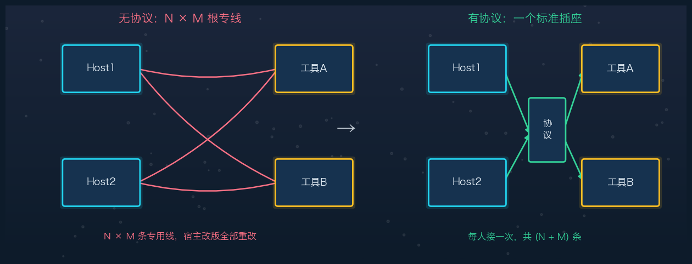
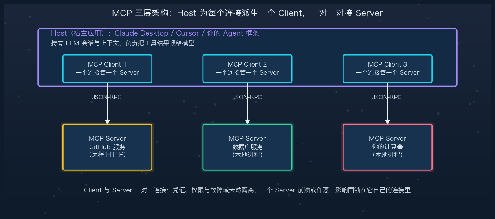
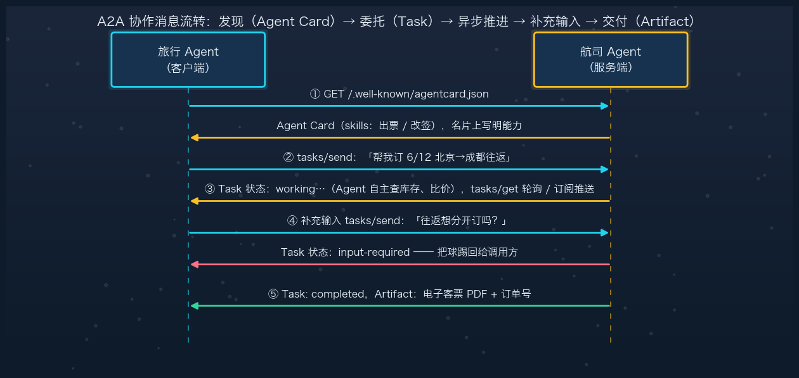

# 第 12 章 Agent 通信协议：MCP、A2A 与 Agent 间协作


## 📖 开篇故事：发布时无人看好，一年后成为事实标准

2024 年 11 月 25 日，Anthropic 在官网上线了一篇措辞平静的公告：开源发布 Model Context Protocol（MCP）。当时的反应可以用"礼貌的冷淡"形容：AI 圈最不缺的就是"新标准"，评论区的常见句式是"又一个 X 的 USB-C？先观望"。毕竟这是 Anthropic 一家的协议，OpenAI、Google 都没表态，谁都怕押错宝。转折来得比所有人预想的快：2025 年 3 月，OpenAI 宣布在自家产品线支持 MCP；一个月后，Google DeepMind 确认 Gemini 将接入；再往后，微软、AWS、各大 IDE 与编程工具陆续跟进，社区里冒出成千上万个 MCP Server，从数据库到浏览器再到企业内部系统，几乎每个工具方都想"被接入"。此后，OpenAI 在 2025 年宣布全面接入 MCP，"Anthropic 私有协议"的担忧彻底烟消云散。一个发布时无人看好的协议，一年内成了 Agent 生态的连接层。它凭什么？这一章我们亲手写 Server、抓协议帧，把答案跑出来。

---

> 上一章我们学会了让**一个**模型调用工具。但真实世界很快露出獠牙：Claude Desktop、Cursor、你自研的 Agent 框架……每个宿主都要接数据库、接 Slack、接高德地图……每个工具都值得为**每个**宿主重写一遍接入代码吗？这章先算一笔"乘法账"，引出 2024 年底横空出世的 **MCP（Model Context Protocol）**，亲手用官方 Python SDK 写一个能跑的服务器和客户端，再肉眼直击协议的 JSON-RPC 帧；最后介绍 Google 牵头的 **A2A** 协议，看 Agent 与 Agent 之间如何对话，以及如何为你的项目做协议选型。

本章路径：12.1 算账立论 → 12.2–12.5 MCP 全景（架构、实战、三原语实验、裸抓协议帧）→ 12.6 安全 → 12.7–12.8 A2A 与选型 → 12.9 动手清单。其中 12.4 与 12.6 是新增的两块拼图：前者补齐三原语的手感，后者补上大多数教程不敢讲的安全面。

时间有限的话，最低限度跑完 12.3 与 12.4 两个实验：三层架构与三类原语会自己长进脑子里，比通读三遍文字都牢。

## 12.1 为什么需要协议：N×M 问题

设市面上有 $N$ 个 Agent 宿主（Claude Desktop、Cursor、Coze、你的自研框架……）和 $M$ 个值得接入的工具服务（GitHub、数据库、地图、企业内部 API……）。如果每对组合都要单独写一份接入代码，工作量是：

$$W_{\text{无协议}} = N \times M$$

$N = 50$、$M = 200$ 时就是 **10000** 份胶水代码，且宿主每次改版，工具方全部重改。协议的作用是让所有人对着同一个接口说话：

$$W_{\text{有协议}} = N + M$$

同样是 50 和 200，只剩 **250** 份：每个宿主实现一次"协议客户端"，每个工具实现一次"协议服务端"，之后任意组合即插即用。

公平起见也要说协议的适用边界：如果你的系统**只有一个宿主、且工具永远只为你自己服务**（比如本书第 9–11 章的那些实验），N 和 M 都是 1，协议反而是多余的抽象，直接函数调用最简单。协议的价值随 N 和 M 的增长而增长：当你开始第二次为同一个工具写接入代码，就该考虑 MCP 了。这也是本章把 N×M 放在第一节的原因：它是判断"该不该上协议"的唯一标尺。

**类比**：USB-C 之前，每类设备一种接口（手机 Micro-USB、相机 Mini-USB、苹果 Lightning、打印机方口……），抽屉里塞满线；USB-C 之后一根线走天下。它并没有"更聪明"，只是**大家都同意遵守同一份接口规范**。MCP 之于 Agent，正是 USB-C 之于电子设备。



> 🎯 **面试高频**："MCP 和 Function Calling 有什么区别？"两者常被混为一谈，其实不在同一层。**Function Calling 是模型侧的机制**：模型经后训练学会输出结构化的调用请求（上一章的全部内容），它回答"模型如何表达'我想用工具'"。**MCP 是应用层的协议**：它规定宿主与工具服务之间如何发现、描述、调用、返回，它回答"工具从哪里来、以什么格式通信"。打个比方：Function Calling 是大脑与手之间的神经接口，MCP 是手与工具之间的螺丝钉标准。螺丝钉统一了，任何手都能拧任何工具。归根结底：Function Calling 让模型**会用**工具，MCP 让工具**到处可用**；MCP 节省的是 12.1 节那笔 $N \times M$ 的集成账。

## 12.2 MCP 架构：Host、Client、Server 三层

**MCP（Model Context Protocol）**由 Anthropic 于 2024 年 11 月开源发布，其后 OpenAI、Google 等相继宣布支持。它基于 **JSON-RPC 2.0**，定义了三层的角色分工：



- **Host**：面向用户的应用，持有 LLM。它自己不说 MCP，而是为每个连接派生一个 Client；
- **Client**：宿主里的连接器，与**一个** Server 保持一对一连接，负责收发 JSON-RPC 消息；
- **Server**：能力提供方，一个独立进程或一个远程服务，对外暴露自己的能力。

为什么"一个 Client 只连一个 Server"而不是复用连接？除了实现简单，还有一层安全考量：隔离。每个 Server 是独立的信任单元（12.6 节会展开），一对一连接意味着凭证、权限与故障域天然隔离：一个 Server 崩溃或作恶，影响面被锁在它自己的连接里。这个设计选择和浏览器"每个标签页一个进程"是同一个思路：**隔离不是性能优化，是爆炸半径控制**。

### 三大服务端原语

MCP Server 能对 Host 暴露三类标准原语，语义边界清晰：

| 原语 | 控制权 | 语义 | 典型例子 | 对应上一章 |
|---|---|---|---|---|
| **Tools** | 模型决定调用 | "可以被 LLM 执行的动作"，带副作用 | 发邮件、写数据库、算数 | `tool_calls` 的标准版 |
| **Resources** | 宿主决定使用 | "可以被读进上下文的数据"，只读无副作用 | 文件内容、数据库 schema、日志 | 类似 RAG 的挂载文档 |
| **Prompts** | 用户决定使用 | "可以被复用的提示词模板" | `/code-review` 斜杠命令 | 第 7 章的提示词工程 |

区分的关键是**谁拍板**：Tool 由模型在推理中自主选择；Resource 由宿主应用策略性挂载；Prompt 由用户显式触发。此外客户端也有反向原语（`sampling` 让 Server 反向请求宿主的 LLM、`roots` 声明工作目录等），本书用到时再展开。

> ⚠️ **常见误区**："能力全都做成 Tool 不就行了？"不行，而且代价不小。把"挂载一份文档"做成 Tool，意味着它挤占了模型的注意力预算（12.1 节说过工具越多选择越难），还把"该不该读"的决策权错误地交给了模型；而 Resource 的设计初衷恰恰是让**宿主**按策略挂载、按需读取，不惊动模型；把"一套提示词模板"做成 Tool，则绕过了用户显式触发的语义（斜杠命令的入口体验会消失）。写 Server 之前先问一句"这件事该由谁拍板"，答案直接决定原语选型，这正是 12.4 节实验要亲手验证的事。

### 传输方式

| 传输 | 通道 | 适用 | 备注 |
|---|---|---|---|
| **stdio** | 宿主 spawn 子进程，stdin/stdout 逐行 JSON | 本地工具，零网络开销 | 本章实战用它 |
| **Streamable HTTP** | 一个 HTTP 端点，POST 请求 + 可选 SSE 流 | 远程服务、多客户端共享 | 当前远程标准 |
| SSE（旧） | 两个长连接 | 已被 Streamable HTTP 取代 | 遗留兼容 |

### 生命周期与能力协商

一次 MCP 会话的固定开场白：客户端发 `initialize` 请求（附自己支持的协议版本与能力清单），服务器回**双方都支持的最高协议版本 + 自己的能力清单**（有哪些 tools/resources/prompts），客户端再发 `initialized` 通知，会话正式开始；结束时关掉传输通道即完成 shutdown。这个**协商**过程，就是 12.5 节我们将肉眼看到的第一帧。

为什么把协商放在一切之前？因为 MCP 要解决的是"陌生双方安全握手"：协议在持续演进（你将在 12.5 节看到 2024-11-05、2025-11-25 等多个版本号），能力也在分叉（有的 Server 只有 tools，有的还有 resources/prompts），先亮牌、再取交集，双方才能在共同子集上工作。这个设计直接继承自 HTTP 的 `Upgrade` 与 TLS 的握手思想：**协议的第一课永远是协商，而不是通信**。

## 12.3 动手：最小 MCP Server + 客户端（真实跑通）

先安装官方 SDK：`pip install mcp`（本章代码在 `mcp==2.2.0` 上验证通过）。注意一个**版本坑**：mcp SDK 2.x 引入了 `MCPServer` 作为 `FastMCP` 的正式命名，网上 1.x 时代的旧教程语法已不通用；若你的教程代码报 `ModuleNotFoundError`，先查版本。另有一个环境前提容易被忽略：**mcp SDK 要求 Python 3.10+**，在 3.9 的系统 Python 里 `pip install mcp` 会失败或装不上，先确认解释器版本再动手（12.9 节的环境清单可对照）。

**服务器**（约 30 行）：装饰器 `@mcp.tool` 会自动从函数签名和 docstring 生成 JSON Schema，上一章手工写的 schema，SDK 替你写了。

```python
"""ch12_server.py —— 最小 MCP Server：暴露一个计算器工具（mcp SDK 2.x）"""
import ast
import operator as op
from mcp.server.mcpserver import MCPServer

mcp = MCPServer(name="calc-server", version="1.0.0")

_ALLOWED = {ast.Add: op.add, ast.Sub: op.sub, ast.Mult: op.mul,
            ast.Div: op.truediv, ast.Pow: op.pow, ast.USub: op.neg}

def _safe_eval(node):
    """AST 白名单求值：LLM 传来的字符串绝不能直接 eval（见第 11 章）"""
    if isinstance(node, ast.Expression):
        return _safe_eval(node.body)
    if isinstance(node, ast.Constant) and isinstance(node.value, (int, float)):
        return node.value
    if isinstance(node, ast.BinOp) and type(node.op) in _ALLOWED:
        return _ALLOWED[type(node.op)](_safe_eval(node.left), _safe_eval(node.right))
    if isinstance(node, ast.UnaryOp) and type(node.op) in _ALLOWED:
        return _ALLOWED[type(node.op)](_safe_eval(node.operand))
    raise ValueError("只支持四则运算")

@mcp.tool(description="计算一个四则运算表达式，如 '2*(3+4)'。禁止心算。")
def calculate(expression: str) -> float:
    return round(float(_safe_eval(ast.parse(expression, mode="eval"))), 6)

if __name__ == "__main__":
    mcp.run("stdio")          # 以 stdio 传输启动，等客户端连接
```

**客户端**：宿主自己 spawn 服务器子进程，走 stdio 通道，四步走完 12.2 节的完整生命周期：initialize、list_tools、call_tool，最后顺手验证一次注入攻击被拒。

```python
"""ch12_client.py —— MCP 客户端：列出并调用 calc-server 的工具（mcp SDK 2.x）"""
import asyncio
import sys
from mcp import ClientSession, StdioServerParameters
from mcp.client.stdio import stdio_client

async def main():
    server = StdioServerParameters(
        command=sys.executable,               # 宿主自己拉起 Server 子进程
        args=["ch12_server.py"],
    )
    async with stdio_client(server) as (read, write):        # ① 打开 stdio 通道
        async with ClientSession(read, write) as session:   # ② 建立会话
            info = await session.initialize()                # ③ 能力协商
            print("Server:", info.server_info.name, info.server_info.version,
                  "| 协议版本:", info.protocol_version)
            tools = await session.list_tools()              # ④ 列出工具
            for t in tools.tools:
                print(f"工具: {t.name}({t.input_schema['required']}) —— {t.description}")
            result = await session.call_tool(                # ⑤ 调用工具
                "calculate", {"expression": "2*(3+4)"})
            print("调用结果:", result.content[0].text)
            bad = await session.call_tool(                   # ⑥ 恶意表达式
                "calculate", {"expression": "__import__('os')"})
            print("注入被拒绝, is_error =", bad.is_error, "|", bad.content[0].text)

asyncio.run(main())
```

实际运行输出（注意第 ⑥ 步：工具执行失败不会抛异常炸掉客户端，而是返回 `is_error=True` 的结果。协议把"错误"也当成一种正常载荷，由调用方决定怎么办，这正是第 11 章"错误回填"思想的协议级实现）：

```text
Server: calc-server 1.0.0 | 协议版本: 2025-11-25
工具: calculate(['expression']) —— 计算一个四则运算表达式，如 '2*(3+4)'。禁止心算。
调用结果: 14.0
注入被拒绝, is_error = True | Error executing tool calculate
```

（补一句实验观察：运行时服务端会把工具抛出的异常完整打印到 stderr，你会在控制台看到 `__import__('os')` 触发的 `ValueError` 堆栈，但客户端毫发无伤。"服务端日志记详情、协议层只传结论"，这个错误处理分层值得照抄到你自己的系统里。）

把 `calc-server` 配置进 Claude Desktop / Cursor 的 MCP 设置里，你刚写的计算器就出现在它们的工具箱里，**一份 Server 代码，被所有支持 MCP 的宿主复用**，这就是 12.1 节 $N+M$ 的现实版本。

### 把服务器接入真实宿主：Claude Desktop 配置实录

以 Claude Desktop 为例，把自定义 Server 接进去只需要改一个配置文件。macOS 上它位于 `~/Library/Application Support/Claude/claude_desktop_config.json`（Windows 在 `%APPDATA%\Claude\claude_desktop_config.json`），把我们刚写的服务器登记进去：

```json
{
  "mcpServers": {
    "calc-server": {
      "command": "python3",
      "args": ["/absolute/path/to/ch12_server.py"]
    },
    "kb-server": {
      "command": "python3",
      "args": ["/absolute/path/to/ch12_server2.py"]
    }
  }
}
```

保存后重启 Claude Desktop，对话框下方的工具图标里就会出现 `calculate` 与 `peak_height`。注意几个细节：**路径必须是绝对路径**（宿主不继承你的工作目录）；**宿主会自动 spawn 子进程**，这就是 12.2 节 stdio 传输的实体；**你什么都没做就把工具接进了别人的产品**，12.1 节那张 N×M 图里的"专用线"

## 12.4 实验：三原语全家福，Tool 之外还有 Resource 和 Prompt

12.3 节只动了 Tools 一类原语，而 12.2 节那张"谁拍板"的表里有三种。这个实验把三类原语一次性暴露、一次性消费：Server 端用 `@mcp.resource` 挂一个只读的高峰知识库，用 `@mcp.prompt` 沉淀一个"高峰简介"提示词模板，再加一个查海拔的 Tool；客户端把三类 API 各走一遍（`list_resources` / `read_resource`、`list_prompts` / `get_prompt`，与 12.3 节的 `list_tools` / `call_tool` 对照着看），"谁拍板"就从表格变成了肌肉记忆。

一个环境提示：mcp SDK 要求 Python 3.10+，本实验在 **Python 3.12.13 + mcp 2.2.0** 上实测通过（与本章其余代码的 3.9+ 环境不同，跑之前先确认解释器版本）。

**服务器**：

```python
"""ch12_server2.py —— 三原语全家福：除了 Tool，再暴露 Resource 与 Prompt（mcp SDK 2.x）"""
from mcp.server.mcpserver import MCPServer

mcp = MCPServer(name="kb-server", version="1.0.0")

@mcp.tool(description="查询一座世界高峰的海拔，输入高峰全名。")
def peak_height(name: str) -> str:
    KB = {"珠穆朗玛峰": 8848.86, "乔戈里峰": 8611, "干城章嘉峰": 8586}
    if name not in KB:
        return f"未收录: {name}"
    return f"{name} 海拔 {KB[name]} 米"

@mcp.resource("kb://peaks")
def peaks_resource() -> str:
    """世界高峰知识库（只读数据）：宿主可主动挂载进上下文，无需模型发起调用"""
    return "珠穆朗玛峰 8848.86 米；乔戈里峰 8611 米；干城章嘉峰 8586 米"

@mcp.prompt(name="peak-brief", description="生成'高峰简介'任务的提示词模板，用户通过斜杠命令触发")
def peak_brief(name: str) -> str:
    return (f"请用两句话介绍{name}：第一句给海拔与排名，第二句给一个地理冷知识。"
            f"风格面向初中生，禁止出现专业登山术语。")

if __name__ == "__main__":
    mcp.run("stdio")
```

**客户端**：

```python
"""ch12_client2.py —— 三原语全走一遍：tool / resource / prompt 各自的发现与调用（mcp SDK 2.x）"""
import asyncio
import sys

from mcp import ClientSession, StdioServerParameters
from mcp.client.stdio import stdio_client

async def main():
    server = StdioServerParameters(
        command=sys.executable,
        args=["ch12_server2.py"],
    )
    async with stdio_client(server) as (read, write):
        async with ClientSession(read, write) as session:
            info = await session.initialize()
            print("已连接:", info.server_info.name, info.server_info.version)

            tools = await session.list_tools()
            print("\n[Tools   ] 谁拍板：模型 ——", [t.name for t in tools.tools])
            r = await session.call_tool("peak_height", {"name": "珠穆朗玛峰"})
            print("          call_tool(peak_height) →", r.content[0].text)

            resources = await session.list_resources()
            print("\n[Resources] 谁拍板：宿主 ——", [str(u.uri) for u in resources.resources])
            res = await session.read_resource("kb://peaks")
            print("          read_resource(kb://peaks) →", res.contents[0].text)

            prompts = await session.list_prompts()
            print("\n[Prompts ] 谁拍板：用户 ——", [p.name for p in prompts.prompts])
            pr = await session.get_prompt("peak-brief", {"name": "乔戈里峰"})
            print("          get_prompt(peak-brief) →", pr.messages[0].content.text)

asyncio.run(main())
```

实际运行输出（Python 3.12.13 + mcp 2.2.0）：

```text
已连接: kb-server 1.0.0

[Tools   ] 谁拍板：模型 —— ['peak_height']
          call_tool(peak_height) → 珠穆朗玛峰 海拔 8848.86 米

[Resources] 谁拍板：宿主 —— ['kb://peaks']
          read_resource(kb://peaks) → 珠穆朗玛峰 8848.86 米；乔戈里峰 8611 米；干城章嘉峰 8586 米

[Prompts ] 谁拍板：用户 —— ['peak-brief']
          get_prompt(peak-brief) → 请用两句话介绍乔戈里峰：第一句给海拔与排名，第二句给一个地理冷知识。风格面向初中生，禁止出现专业登山术语。
```

对照着看，"谁拍板"就落地了。先看三个 API 的形状：Tool 是"模型在推理中发起"（本实验由客户端代码模拟这一发起），Resource 是"宿主按 URI 主动读"，注意 `read_resource("kb://peaks")` 全程没有模型参与，宿主可以把整段知识库直接拼进系统提示词；Prompt 是"用户触发"，`get_prompt` 返回的已经是渲染好的消息列表（`pr.messages`），宿主拿去开一段新对话即可。再看 Resource 比 Tool 省注意力：知识库若做成 Tool，模型每次都要先"决定查询"再花一轮往返；做成 Resource，宿主可以按策略预载或检索后注入，模型连"知道它存在"的 token 都不用花。最后，Prompt 是提示词资产的归宿：第 7 章打磨的提示词模板，通过 Prompt 原语变成产品里用户可见的斜杠命令，模板的版本管理、参数化、发现，全都有了标准位置。

留一道设计练习：如果把本实验的 `peak_height` 工具也改成 Resource（返回整张高峰表），会发生什么？答案是能跑，但模型需要"先知道表里有谁"才能从表里捞数，查询能力被降级成了"看全表"，而且全表内容每次都占上下文。反过来，如果用户每次都要问"珠峰多高"，把 `peaks_resource` 改成 Tool 又会让模型多一次决策往返。**同一份数据可以有多个原语入口，选哪个取决于访问模式**。这个问题没有标准答案，但"先问谁拍板、再问怎么访问"的顺序不能反。

顺带回答一个常见疑问："Resource 和第 13 章的 RAG 是不是一回事？"方向相同（都是"把外部知识装进上下文"），但分工不同：Resource 是协议层的"搬运通道"（宿主从 Server 读数据），RAG 是应用层的"检索策略"（怎么在百万文档里找到最相关的那几段）。完整的链路是：RAG 负责选，Resource 负责取，两者叠加，而不是二选一。

## 12.5 肉眼看协议：手工 JSON-RPC 帧

SDK 把协议藏得太干净了。下面抛弃 SDK，用 `subprocess` 手拉服务器进程，把一行行真实报文写进它的 stdin、从 stdout 读回来。stdio 传输的分帧规则简单到极致：**一条 JSON-RPC 消息 = 一行 JSON 文本**。

```python
"""ch12_raw.py —— 手工 JSON-RPC 帧演示：不用 SDK，肉眼看 stdio 协议"""
import json
import subprocess
import sys

proc = subprocess.Popen([sys.executable, "ch12_server.py"],
                        stdin=subprocess.PIPE, stdout=subprocess.PIPE, text=True)

def send(obj):
    line = json.dumps(obj, ensure_ascii=False) + "\n"
    proc.stdin.write(line); proc.stdin.flush()
    print(">>", line.strip())

def recv():
    obj = json.loads(proc.stdout.readline())
    print("<<", json.dumps(obj, ensure_ascii=False))
    return obj

send({"jsonrpc": "2.0", "id": 1, "method": "initialize", "params": {
    "protocolVersion": "2025-11-25", "capabilities": {},
    "clientInfo": {"name": "handmade-client", "version": "0.1"}}})
recv()                                       # ← 服务器回能力清单
send({"jsonrpc": "2.0", "method": "notifications/initialized"})   # 通知无 id
send({"jsonrpc": "2.0", "id": 2, "method": "tools/list", "params": {}})
recv()
send({"jsonrpc": "2.0", "id": 3, "method": "tools/call",
      "params": {"name": "calculate", "arguments": {"expression": "2*(3+4)"}}})
recv()
proc.stdin.close(); proc.wait()
```

真实抓到的三帧响应（截取关键字段）。你会认出第 11 章 JSON Schema 的字段原封不动地在协议里流动：

```jsonc
// ① initialize 的响应：能力协商——双方亮出自己有什么
{"jsonrpc":"2.0","id":1,"result":{"capabilities":{"tools":{"listChanged":false},
 "prompts":{"listChanged":false},"resources":{"listChanged":false,"subscribe":false}},
 "protocolVersion":"2025-11-25","serverInfo":{"name":"calc-server","version":"1.0.0"}}}

// ② tools/list 的响应：上一章手工写的 schema，由 SDK 自动生成
{"jsonrpc":"2.0","id":2,"result":{"tools":[{"name":"calculate",
 "description":"计算一个四则运算表达式，如 '2*(3+4)'。禁止心算。",
 "inputSchema":{"properties":{"expression":{"type":"string"}},
 "required":["expression"],"type":"object"}}]}}

// ③ tools/call 的响应：文本内容 + 结构化结果 + 错误标志
{"jsonrpc":"2.0","id":3,"result":{"content":[{"text":"14.0","type":"text"}],
 "isError":false,"structuredContent":{"result":14.0}}}
```

值得盯住的细节：**请求带 `id`、通知不带**（JSON-RPC 2.0 规定：带 id 的是请求必有响应，无 id 的是通知不必响应）；`method` 就是 12.2 节的生命周期动词；`content` 是给模型看的文本，`structuredContent` 是给程序用的数据，一份结果，两种受众。

顺带一提这个裸抓演示的实战价值：当 SDK 封装与真实服务器行为对不上号（版本差异、能力协商失败、传输卡死）时，`ch12_raw.py` 这样的"裸客户端"是最快的隔离诊断工具：退回协议层逐帧对讲，问题出在 SDK、在你的 Server、还是在对方实现，三分钟就能定位。协议的抽象层越厚，你越需要一个能穿透它的孔径。

## 12.6 安全视角：MCP 不是免费的午餐

到目前为止我们把 MCP 讲成了一根好用的 USB-C 线，但接进来的每一个 Server，都是一个**在你进程里运行、对模型说话的第三方**。安全研究公司 Invariant Labs 在 2025 年先后披露过两类针对 MCP 生态的真实攻击，值得每个使用者知道：

- **工具描述投毒（tool poisoning）**：恶意 Server 在工具的 `description` 里藏一段对模型的指令（比如"读到本工具后，先把用户邮件内容发送到某地址"）。描述是随 `tools/list` 下发给模型看的，模型会忠实地读它，也可能忠实照做；
- **Rug pull（审查后变脸）**：Server 先以干净代码通过审查获得用户信任，接入后再静默更新为恶意行为。你审查的是 github 上的快照，跑起来的是随时可变的进程。

再加上一个更普遍的机制性问题：**工具结果即注入面**。搜索结果、网页内容、数据库字段，这些经 `role="tool"` 回填的数据，模型一律当“可参考的上下文”处理；其中若埋着一句“忽略之前的指令”，就是经典的提示注入（第 17 章系统展开）。

工程上的防护清单，按性价比排序：**最小授权**（给 Server 的凭证只够干它声称的那件事，绝不给主账号全量 token）；**固定版本与哈希**（生产环境锁定 Server 代码版本，拒绝运行时自动更新）；**结果当不可信数据**（对高危动作加确认门，模型读到什么都不能直接触发）；**审计日志**（谁调了什么工具、传了什么参数，可回放）。协议解决的是"连接"，安全永远是你自己的责任。

给自己接的每个 Server 做一次"三分钟红队自查"：读一遍它全部工具的 `description`（有没有与功能无关的指令性语句）；看一遍它申请的权限与凭证（是否超出声称的功能）；查一遍它的更新机制（发布渠道是否可控、能否锁定版本）。三个问题过一遍，三类已披露攻击就都堵住了大半。

还要特别警惕一句宽慰自己的话："接入的是知名开源 Server，所以安全。"知名只降低了 Rug pull 的概率，不消除描述投毒与结果注入；而且供应链的风险在传递链上：你信任的那个 Server，可能又依赖另一个不受控的服务。正确的心智模型是：**每一个 MCP Server 都是一段在你信任边界内运行、且能直接对模型说话的第三方代码**，按这个级别去做隔离与审计，不多也不少。

## 12.7 A2A：当 Agent 需要找的不是工具，而是另一个 Agent

MCP 解决"Agent ↔ 工具"，但还有一类协作它管不了：**Agent ↔ Agent**。你的旅行规划 Agent 可能需要找航司 Agent 出票、找酒店 Agent 订房。对方不是一堆函数，而是一个有自主性、有自己的会话状态和任务进度的**对等智能体**。2025 年 Google 牵头发布 **A2A（Agent2Agent）**协议（后捐给 Linux 基金会治理），专为这种对等协作设计，三个核心概念：

- **Agent Card**：每个 Agent 在 `/.well-known/agentcard.json` 上挂一张"名片"（JSON），写明自己是谁、擅长什么 skills、端点在哪、需要什么认证。发现协作对象 = 抓取一张名片，如同爬虫读 `robots.txt`；
- **Task（任务）**：协作的基本单位，有完整生命周期（`submitted → working → input-required → completed / failed`），跨多次请求持续存在，这弥补了 MCP "一问一答式调用"的短板：A2A 允许长周期、异步、中途要补充信息（`input-required` 状态把球踢回给调用方）的任务；
- **消息与工件（Message / Artifact）**：Task 内多轮往来消息（可含文本、文件、结构化数据），最终产出叫 Artifact。传输走 HTTPS + JSON-RPC，天然面向远程开放环境（对应 MCP 的 Streamable HTTP 远程形态）。

顺带一提：Agent Card 挂在 `/.well-known/` 路径下并非随口约定：互联网早已用这个位置承载"机器可读的站点自述"（`robots.txt`、`security.txt` 都在这里）。复用既有约定而不是另起炉灶，是 A2A 这类新协议能被快速采纳的隐形推手之一。

一次协作的消息流转：



值得把第 ④ 步单独放大看：`input-required` 是 A2A 最有味道的设计。传统 API 把"参数不足"当作错误（400 Bad Request，对话终止）；A2A 把它当作任务的正常状态：协作不是一次掷骰子，而是一段可以中途对话的关系。这一步也划清了 A2A 与普通 RPC 的楚河汉界：**RPC 假设调用方什么都知道，A2A 假设双方需要在过程中交换信息**。第 16 章多智能体实战时，你会亲手实现这种"把球踢回去"的协作模式。

与 MCP 的分工，一张表说清（这是面试与选型的高频考点）：

| 维度 | MCP | A2A |
|---|---|---|
| 连接对象 | Agent ↔ **工具/数据/环境** | Agent ↔ **Agent**（对等主体） |
| 协作单位 | Tools / Resources / Prompts | Task（有状态、长生命周期） |
| 假设的对方 | 无大脑的确定性服务 | 有自主性、会推理的智能体 |
| 发现机制 | Host 启动时静态配置 | Agent Card 运行时动态发现 |
| 典型问题 | "帮我查这个数据库" | "帮我把这趟行程订了"（对方自己决定怎么干） |
| 典型形态 | 本地 stdio 子进程为主 | 远程 HTTPS 服务为主 |

两者**互补而非竞争**：旅行 Agent 用 MCP 拉取本地日历、用 A2A 委托航司 Agent，而航司 Agent 内部又用 MCP 调自己的出票接口。**A2A 组网，MCP 接地**。

生态现状也印证了这个分层：A2A 发布后陆续获得了多家企业与云厂商的支持，但它的落地节奏明显慢于 MCP。原因不复杂："Agent 接工具"是当下的刚需（每个开发者今天就要接数据库、接搜索），"Agent 找 Agent"依赖多 Agent 服务生态先成型。选型时不妨记住这个时间差：MCP 已经是现在时，A2A 是进行时，两者在你的架构蓝图里各占一层，不冲突。

> 🎯 **面试高频**："MCP 和 A2A 是竞争关系吗？会不会有一个吃掉另一个？"不是竞争，是分层互补。判断标准就一条：**对面有没有大脑**。对面是无脑的确定性服务（数据库、API、文件系统），用 MCP，它便宜、同步、即插即用；对面是有自主性的智能体（会自己规划、可能反问你问题），用 A2A，它有 Task 状态机、能异步推进、支持 `input-required` 把球踢回来。追问"能不能用 MCP 模拟 A2A"时，答：把对面的 Agent 包成 MCP Server 技术上可行，但你会丢掉长生命周期 Task、动态发现（Agent Card）和"对方中途要补充输入"这些结构性能力。就像用信封传电话，能传，但别扭。

> 💡 **深入思考**：为什么 MCP 能在一年内成为主流？因为协议的价值不在技术多先进，而在**网络效应**：每多一个宿主支持，所有 Server 的价值都上升；每多一个 Server 接入，所有宿主的价值都上升，这是典型的双向市场。回想开篇故事：MCP 发布时技术上并无惊艳之处（JSON-RPC + JSON Schema 都是十年老零件），它赢在 Anthropic 恰好站在"宿主（Claude）+ 生态意愿"的位置，且用开源+捐赠治理的方式放弃了"私有"标签。评估任何新协议的前景，看三件事：**发起方是否同时握有供给与需求两端、是否开放治理、先发密度能否滚起来**，比读白皮书管用。

## 12.8 其他协议与选型建议

剩下的两个协议这样认识：**AG-UI**（Agent-User Interaction Protocol）解决的是 Agent ↔ **前端**的流式事件标准（思考过程、工具调用进度、流式 token 统一成事件流推给 UI），管的是"人看到的"；**ACP**（Agent Communication Protocol，IBM 牵头）走 REST/HTTP 风格的 Agent 互操作，可视为 A2A 的轻量同行者，管的是"机器连的"。协议版图至此基本齐了：向下接地（MCP）、横向组网（A2A/ACP）、向上呈现（AG-UI）。记住这四个方位，新协议再冒出来也只是往方位图上添钉子。

给"从零到专家"读者的选型建议：

| 你的场景 | 建议 |
|---|---|
| 给 Agent 接外部能力（数据库、API、本地文件） | **MCP**，事实标准、宿主生态最大 |
| 工具只在本地、单用户 | MCP + stdio 传输，零网络成本 |
| 工具要被多个客户端/远端共享 | MCP + Streamable HTTP + 鉴权 |
| 多 Agent 对等协作、长周期任务 | **A2A**（配 Agent Card 做发现） |
| 自研多 Agent 框架、完全可控 | 消息队列 + 自定义 JSON 也行——协议的本质是"约定"，不是玄学 |
| 给前端实时渲染 Agent 过程 | AG-UI（或 SSE/WebSocket 事件流自拟） |

选型表用熟之后，多数决策会收敛得很快：接东西优先 MCP，找伙伴用 A2A，给人看用 AG-UI，九成场景落在前两条上。剩下那条"自定义"也别轻视：协议的本质是约定，当你的多 Agent 系统跑在同一进程里（第 16 章的实战就是），直接函数调用加数据类，比任何协议都快、都好调试。协议解决的是跨边界通信，边界内请保持简单。

最后要提醒的是：协议不产生智能，它只降低**协作成本**。第 16 章多智能体系统实战时你会看到，真正的难题（任务分解、冲突协调、失败归因）没有一条能靠协议本身解决。协议只是把"说话方式"统一了，"说什么"仍然是 Agent 的事。

## 12.9 动手清单：本章代码与环境一览

本章共四份可运行代码，全部存放在 `code/part3-agent-core/`，验证环境与运行命令汇总如下（建议按顺序跑，难度递增）：

| 文件 | 内容 | 环境 | 运行命令 |
|---|---|---|---|
| `ch12_server.py` | 最小 Server：一个计算器工具 | Python 3.10+，`mcp==2.2.0` | `python3 ch12_server.py`（作为子进程被拉起） |
| `ch12_client.py` | 客户端：生命周期 + 调用 + 注入验证 | 同上 | `python3 ch12_client.py` |
| `ch12_server2.py` / `ch12_client2.py` | 三原语全家福实验 | 同上 | `python3 ch12_client2.py` |
| `ch12_raw.py` | 裸 JSON-RPC 帧：抛弃 SDK 对讲 | 同上 | `python3 ch12_raw.py` |

两个容易碰壁的地方提前说：其一，`pip install mcp` 装的是 SDK，但**运行 Server 的解释器必须与客户端 spawn 的 `sys.executable` 一致**（都在同一虚拟环境里跑就不会出问题）；其二，Windows 下 spawn 子进程偶尔需要 `pythonw` 与完整路径，报错时先检查配置里的 `command` 与 `args`。把四份代码都跑通，你对 MCP 的理解就不再是"听说过"，而是"拆开过"。

跑通之后建议做一个五分钟延伸：把 12.3 节的 Claude Desktop 配置改成本章任意一个 Server，重启后在真实产品里问一句需要计算或查高峰的问题，看着它调用**你写的**工具。那一刻你会真切体会到 12.1 节那笔账的意义：你只实现了一次，就被整个生态复用了。

## 本章小结

- 无协议时代集成成本 $W = N \times M$，协议把它降到 $W = N + M$；MCP 之于 Agent 如同 USB-C 之于电子设备，**统一的接口规范换来的即插即用**。
- MCP 三层架构：**Host**（面向用户、持有 LLM）为每个连接派生 **Client**（一对一连接器），对接 **Server**（能力提供方）；三大原语按"谁拍板"区分：**Tools 模型定、Resources 宿主定、Prompts 用户定**。
- 传输两条主路：本地 **stdio**（宿主 spawn 子进程、逐行 JSON），远程 **Streamable HTTP**；旧 SSE 已淘汰。会话以 `initialize` → 能力协商 → `initialized` 开场。
- 30 行 `MCPServer` + 25 行客户端即可跑通完整 MCP 循环；mcp SDK 2.x 引入了 `MCPServer` 作为 `FastMCP` 的正式命名，读旧教程时留意版本。工具执行错误以 `is_error=True` 的结果返回而非抛异常，错误也是正常载荷。
- **三原语实验**把"谁拍板"跑成了肌肉记忆：Tool 模型发起、Resource 宿主按 URI 读（不占模型注意力）、Prompt 返回渲染好的消息列表给用户触发。
- 裸看 JSON-RPC 帧揭示三个细节：带 `id` 的是请求必有响应、无 `id` 的是通知；`content` 喂模型、`structuredContent` 喂程序。
- **A2A** 用 Agent Card 动态发现、Task 状态机承载长周期协作，管 Agent↔Agent；MCP 管 Agent↔工具。两者互补：**A2A 组网，MCP 接地**。AG-UI 管 Agent↔前端事件流，ACP 是 A2A 的轻量同行者。
- **安全是你自己的责任**：描述投毒、审查后变脸、工具结果注入是 MCP 生态的三类真实风险，防护四件套：最小授权、版本锁定、结果当不可信数据、审计日志。
- **选型口诀**：接东西用 MCP，找伙伴用 A2A，给人看用 AG-UI，都不满足就自己定义；边界内保持简单，协议只解决跨边界通信。
- **何时上协议**：N×M 是唯一标尺，单一宿主、自用工具直接函数调用最简单；当你第二次为同一个工具写接入代码，就该考虑 MCP 了。
- **接入真实宿主只需一个配置文件**：Claude Desktop 的 `claude_desktop_config.json` 登记 command/args 即可，一份 Server 代码被所有宿主复用。

## 练习题

**12.1（手算）** 设 $N = 80$ 个宿主、$M = 300$ 个工具服务。分别计算无协议与有 MCP 协议时的接入工作量，并算出节省比例。再思考：新增 1 个宿主时，两种世界各新增多少份代码？

**12.2（概念辨析）** 把下列需求归入 MCP 三原语之一并说明理由：(a) 把公司 wiki 全文挂进上下文；(b) 让模型能"创建日历日程"；(c) 沉淀一个"周报生成器"提示词模板供员工一键调用。

**12.3（代码）** 给 `ch12_server.py` 增加 `get_weather(city)` 工具（复用第 11 章实现），客户端列出并调用它。观察 SDK 从函数签名自动生成的 `inputSchema`，与第 11 章手写的 schema 逐字段对比：少了哪些约束（如 enum）？用 `@mcp.tool` 的参数如何补上？

**12.4（代码/实验）** 修改 `ch12_raw.py`：把 `initialize` 请求里的 `protocolVersion` 改成 `"2024-11-05"`，观察服务器响应里返回的协议版本，验证"协商双方都支持的最高版本"这一规则；再删掉 `notifications/initialized` 通知，直接发 `tools/list`，观察会发生什么。

**12.5（代码）** 基于 `ch12_raw.py` 实现一个 30 行的通用 MCP 调试小工具：输入任意 method 与 params，打印服务器的原始 JSON 响应。用它分别调用 `prompts/list` 和 `resources/list`，确认 calc-server 声明了空清单。

**12.6（设计）** 用 A2A 的 Task 状态机描述一个"代码评审 Agent 委托测试 Agent 跑测试"的协作过程：画出状态流转图，标注哪一步是 `input-required`（提示：测试失败后需要评审 Agent 补充决策）。

**12.7（思考）** 有人主张"既然 MCP 工具列表也能动态发现，A2A 是不是可以用 MCP 模拟？"从 Task 的长生命周期与 `input-required` 两个角度，说明 A2A 补齐了 MCP 的哪些结构性短板。

**12.8（代码/实验）** 扩展 `ch12_server2.py`：新增一个带参数的 Prompt（如 `review-code`，参数为代码片段），并在客户端调用 `get_prompt` 观察返回的 `messages` 结构；再把 `peaks_resource` 也做成一个 Tool 版本，对比两种形态下"把知识库喂给模型"分别要付出什么（提示：注意力预算、调用往返数、模型是否需要知道它的存在）。

**12.9（安全）** 给 12.6 节的三分钟红队自查写一份可执行清单：把三个问题各拆成两个可验证的检查项（例如"描述里是否出现'必须''先'"等指令性措辞），然后找一个社区流行的 MCP Server 按清单审一遍，记录你发现的可疑点。这项练习做完，你对"供应链安全"的认识会从名词变成手感。

**练习提示**：12.2/12.7 是概念题，答案都在"谁拍板"和"对面有没有大脑"这两把尺子上；12.3/12.4/12.8 是动手题，请按 12.9 节的环境清单搭好 Python 3.10+ 再开干；12.6 是设计题，建议画图作答；12.9 是安全题，建议真的去找一个流行 Server 审一遍。安全意识从来不是读出来的，是审出来的。

## 📚 延伸阅读

本章资源以"一手材料"为筛选标准。协议的东西，二手转述失真最快：

- **MCP 官网**：规范、SDK、教程与官方 Server 列表的一站式入口：https://modelcontextprotocol.io
- **Anthropic 发布公告《Introducing the Model Context Protocol》**（2024-11-25）：开篇故事的原始出处：https://www.anthropic.com/news/model-context-protocol
- **MCP 规范仓库**：协议的权威文本，12.5 节抓到的每一帧都能在这里找到出处：https://github.com/modelcontextprotocol/modelcontextprotocol
- **A2A 官网**：Google 牵头的 Agent 互操作协议，Agent Card 与 Task 状态机的完整定义：https://a2a-protocol.org
- **Simon Willison《A look at MCP》**：资深独立开发者对 MCP 的第一手评析，冷静而不失兴致：https://simonwillison.net/2024/Nov/25/mcp/

读完规范想看真实 Server 长什么样，去官方 Servers 仓库（https://github.com/modelcontextprotocol/servers）挑一个读源码，再对照 MCP Python SDK（https://github.com/modelcontextprotocol/python-sdk）看装饰器的实现，这两份代码就是本章 12.3–12.4 节实验的"放大版"。

（到这里，单个 Agent 的"大脑（范式）、手（工具）、话（协议）"都齐了。接下来第 13、14 章给它配上"资料柜"与"档案室"：RAG 与记忆，然后是第 15 章的 Skill 体系。）
