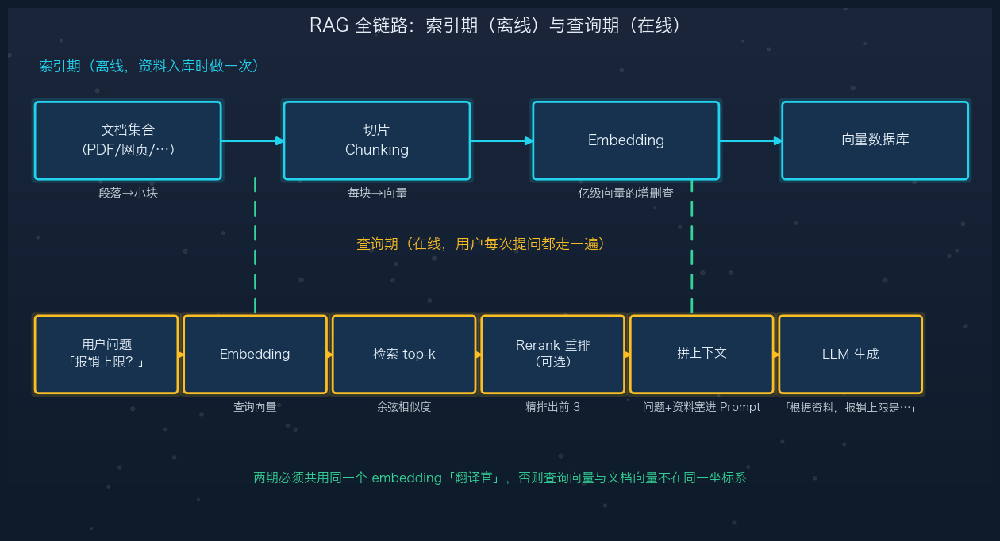
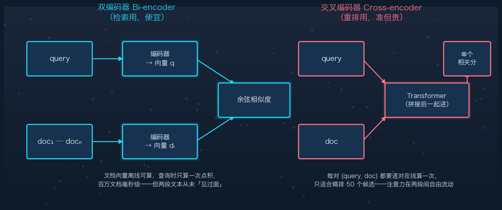

# 第 13 章 RAG 检索增强生成：原理、切片、向量数据库


第 11 章我们给 Agent 装上了"手"（工具调用），但它的大脑里依然只有训练时背下的知识。你问它"我们公司的差旅报销制度"，它会一本正经地编一个——**LLM 不知道你的私有数据，也不保证自己知道的一切仍然正确**。本章的主角 **RAG（Retrieval-Augmented Generation，检索增强生成）** 就是给 Agent 外接一个"资料柜"：先查资料，再回答。读完本章，你将用纯 NumPy 写出一个 60 行的 Mini-RAG，并在真实知识库上跑通"检索→命中→生成"全链路（本章代码已在 **Python 3.9.6 + NumPy 2.0.2** 上实测通过；embedding 用自实现的 bigram TF-IDF，不依赖任何 API key，语义差距见 13.6 节）。

## 📖 开篇故事

2020 年，Facebook AI 实验室里，Patrick Lewis 和几位同事正在啃一个看起来与聊天机器人毫无关系的问题：**开放域问答（Open-Domain QA）**。他们后来在 NeurIPS 上发表的论文标题相当朴素：《Retrieval-Augmented Generation for Knowledge-Intensive NLP Tasks》。当年最先进的做法是"闭卷"，把维基百科知识全部塞进模型参数（如 DPR 训练的 T5 模型，参数量动辄上百亿），每更新一次知识就要重训一遍，贵到怀疑人生。论文作者的反问很妙：人类考试遇到不会的题尚且可以翻书，为什么模型不行？于是他们给一个不大的 BART 生成器外接了一个维基百科向量索引（用 DPR 双编码器检索），模型在问答时先"翻书"再作答，**四个知识密集型任务里三个拿了 SOTA**。这就是 RAG 的出生证明：一个为"省钱又聪明"而生的工程妥协。谁也没料到，ChatGPT 爆火之后，这个为学术基准设计的架构会摇身变成全球企业的标配，从微软 Copilot 到各家知识库问答，无一不是它的徒子徒孙。

---

## 13.1 为什么需要 RAG

裸用 LLM 回答问题，会撞上三堵墙：**知识截止**（模型知识冻结在训练截止日，今天的新闻它一概不知）、**幻觉**（模型是概率生成器而非数据库，缺知识时不会闭嘴，而是流畅地编造引文、数字与法条）、**私有数据不可见**（公司内部文档、用户数据从未进入训练集，也**不应该**进去）。朴素解法是把资料塞进上下文窗口，但窗口是硬上限，资料库动辄几个 GB，塞不下也塞不起。另一个解法是微调，但两者分工不同：

| 维度 | 微调 Fine-tuning | RAG |
|---|---|---|
| 擅长注入 | **行为与风格**：术语、语气、格式 | **事实与知识**：文档、数据、最新信息 |
| 知识更新 | 重新训练，天级/周级 | 重建索引，分钟级 |
| 成本 | GPU 训练 + 存储 | 几乎零训练，只要检索 |
| 可溯源 | 不可（知识融进权重） | **可**（答案附带原文出处） |
| 幻觉风险 | 仍会幻觉，且更难发现 | 有原文"垫底"，可对照 |

工业界共识：**知识用 RAG，技能用微调**，二者常常组合。RAG 的本质，就是把"闭卷考试"（微调）改成"开卷考试"（检索）。

> 🎯 **面试高频**：**"RAG 和长上下文模型（如 Gemini 的百万 token 窗口）谁会取代谁？"** 这是 2024 年以来面试官最爱问的问题。标准答案框架分三层：① **成本**：长窗口的注意力计算开销随长度平方级增长，且每次对话都要重新"读"全部资料，而 RAG 的索引离线建好、在线只付 top-k 的钱；② **知识规模**：百万 token 约等于一本厚书，企业知识库动辄几个 GB，窗口再涨十倍也塞不下，而向量库天然支持十亿级切片；③ **可溯源与权限**：RAG 能给出"答案出自哪份文档第几段"，还能按用户权限过滤检索范围，长窗口把资料混在一起读，做不到这两点。但长上下文也确实吃掉了一块 RAG 的地盘：**小规模、单次性、无需权限隔离**的场景（比如"帮我总结这份 200 页 PDF"），直接塞窗口反而更简单可靠。结论一句话：**长窗口让 RAG 的适用边界收窄，但在"大规模、常更新、要溯源、要权限"的企业场景里，RAG 没有替代品**。

---

## 13.2 RAG 全链路

RAG 系统分两期，一横一纵（两期必须共用同一个 embedding"翻译官"，否则文档向量与查询向量在不同"坐标系"里，余弦相似度毫无意义）：



---

## 13.3 切片策略：RAG 效果的第一道关

切片（Chunking）把长文档切成可检索单元，是**对效果影响最大、却最常被忽视**的环节。三种主流策略：

| 策略 | 原理 | 优点 | 缺点 | 适用 |
|---|---|---|---|---|
| **固定长度** | 每 N 字切一刀，可加重叠 | 实现最简单，长度可控 | 把句子、表格、代码拦腰斩断 | 结构均匀的日志、纯文本 |
| **递归切片** | 依次尝试 段落→句子→字符 分隔符 | 切在自然边界，语义较完整 | 只看长度不看主题，需硬切兜底 | **默认首选**（LangChain 默认） |
| **语义切片** | 相邻句做 embedding，相似度骤降处断开 | 每块主题单一，检索最准 | 依赖 embedding 质量，成本高 | 高质量要求、异构文档 |

用一段 160 余字的咖啡机说明书做真实实验（完整代码，可直接运行）：

```python
# -*- coding: utf-8 -*-
"""实验 1：三种切片策略对比（固定长度 / 递归 / 语义切片）"""
import re

DOC = (
    "云雀智饮 X1 是一款智能全自动咖啡机，搭载双锅炉加热系统。"
    "它可以在萃取浓缩咖啡的同时打发奶泡，制作一杯拿铁仅需 90 秒。\n\n"
    "清洁保养：建议每制作 200 杯后运行一次自动清洗程序。\n"
    "水箱务必使用纯净水，否则容易产生水垢。\n\n"
    "常见故障：若屏幕显示 E4，说明水泵压力异常，请先检查水箱是否装满。"
    "若显示 E1，请联系售后，售后电话 400-800-1234。"
)

def fixed_chunk(text, size=60, overlap=10):   # 策略一：每 60 字切一刀，重叠 10 字
    return [text[i:i + size] for i in range(0, len(text), size - overlap)]

def recursive_chunk(text, max_size=60):      # 策略二：按句子边界贪婪装箱，装不下才另起
    chunks, buf = [], ""
    for sent in re.split(r"(?<=[。；])", text.replace("\n\n", "\n")):
        sent = sent.strip()
        if not sent:
            continue
        if len(buf) + len(sent) > max_size and buf:
            chunks.append(buf); buf = ""
        buf += sent
    return chunks + ([buf] if buf else [])

def bigrams(s):                              # 语义度量用：字符 bigram 词袋
    s = re.sub(r"[^\u4e00-\u9fffA-Za-z0-9]", "", s)
    return {s[i:i+2] for i in range(len(s) - 1)}

def cosine(a, b):
    inter = len(a & b)
    return inter / ((len(a) * len(b)) ** 0.5) if inter else 0.0

def semantic_chunk(text, threshold=0.08):    # 策略三：相邻句相似度低于阈值处断开
    sents = [s.strip() for s in re.split(r"(?<=[。])", text) if s.strip()]
    chunks, cur = [], sents[0]
    for prev, nxt in zip(sents, sents[1:]):
        if cosine(bigrams(prev), bigrams(nxt)) < threshold:
            chunks.append(cur); cur = nxt
        else:
            cur += nxt
    return chunks + [cur]

for name, chunks in [("固定长度(60字,重叠10)", fixed_chunk(DOC)),
                     ("递归切片(≤60字/块)",    recursive_chunk(DOC)),
                     ("语义切片(阈值0.08)",    semantic_chunk(DOC))]:
    print(f"== {name}: {len(chunks)} 块 ==")
    for i, c in enumerate(chunks, 1):
        c = c.strip()
        mark = " <<< 疑似截断" if not c.endswith(("。", "；")) else ""
        print(f"  [{i}] ({len(c)}字) {c}{mark}")
    print()
```

真实运行输出：

```text
== 固定长度(60字,重叠10): 4 块 ==
  [1] (59字) 云雀智饮 X1 是一款智能全自动咖啡机，搭载双锅炉加热系统。它可以在萃取浓缩咖啡的同时打发奶泡，制作一杯拿铁仅需 90 <<< 疑似截断
  [2] (60字) 一杯拿铁仅需 90 秒。

清洁保养：建议每制作 200 杯后运行一次自动清洗程序。
水箱务必使用纯净水，否则容易产生水 <<< 疑似截断
  [3] (60字) 净水，否则容易产生水垢。

常见故障：若屏幕显示 E4，说明水泵压力异常，请先检查水箱是否装满。若显示 E1，请联系售后 <<< 疑似截断
  [4] (29字) 示 E1，请联系售后，售后电话 400-800-1234。

== 递归切片(≤60字/块): 4 块 ==
  [1] (30字) 云雀智饮 X1 是一款智能全自动咖啡机，搭载双锅炉加热系统。
  [2] (60字) 它可以在萃取浓缩咖啡的同时打发奶泡，制作一杯拿铁仅需 90 秒。清洁保养：建议每制作 200 杯后运行一次自动清洗程序。
  [3] (53字) 水箱务必使用纯净水，否则容易产生水垢。常见故障：若屏幕显示 E4，说明水泵压力异常，请先检查水箱是否装满。
  [4] (31字) 若显示 E1，请联系售后，售后电话 400-800-1234。

== 语义切片(阈值0.08): 5 块 ==
  [1] (30字) 云雀智饮 X1 是一款智能全自动咖啡机，搭载双锅炉加热系统。
  [2] (32字) 它可以在萃取浓缩咖啡的同时打发奶泡，制作一杯拿铁仅需 90 秒。
  [3] (28字) 清洁保养：建议每制作 200 杯后运行一次自动清洗程序。
  [4] (19字) 水箱务必使用纯净水，否则容易产生水垢。
  [5] (65字) 常见故障：若屏幕显示 E4，说明水泵压力异常，请先检查水箱是否装满。若显示 E1，请联系售后，售后电话 400-800-1234。
```

三种策略的真实差距一目了然：

1. **固定长度 4 块里 3 块被拦腰斩断**：块 [1] 结尾"制作一杯拿铁仅需 90"与块 [2] 开头"秒"被切进两块，检索命中块 [1] 时，答案关键信息"90 秒"根本不在上下文里，这是 RAG 最典型的失败模式（13.10 节还会遇到它）。10 字重叠能部分缓解（块 [2] 把"90 秒"接了回来），代价是重复存储；
2. **递归切片全部落在句号边界**，但贪婪装箱**只看长度不看主题**：块 [2] 把"拿铁 90 秒"与"清洁保养"装进了同一块，检索"怎么清洗"时这块一半内容无关；**语义切片**则把 E4、E1、售后电话三个"故障"句子聚成最纯的主题块（用词高度相似），代价是阈值（0.08）这类超参数需调优。块长同样没有万能值：太短→上下文碎片化，太长→混入无关主题且挤占 Prompt 预算（经验起点：英文 256~1024 token、中文 300~800 字）。

> ⚠️ **常见误区**：**"切块越小检索越准"**。很多人直觉上认为小块语义更纯、更易命中，于是把 chunk_size 压到 100 字以下，结果检索命中率确实上去了，**答案质量却崩了**。原因正是实验 1 里"90 秒"的遭遇：检索命中的块只包含答案的一半，另一半在被切碎的隔壁块里，模型拿到的上下文是断头的。正确的思路是让**"检索粒度"与"阅读粒度"分离**：用小块做向量匹配（准），命中后再向前后各扩展一个块拼成完整上下文送给 LLM（全）。LangChain 的 `ParentDocumentRetriever`、LlamaIndex 的 `SentenceWindowNodeParser` 都是这个套路。

---

## 13.4 向量相似度：余弦相似度

有了向量，怎么定义"像不像"？最常用的是**余弦相似度**——只看方向，不看长短：

$$\text{cos}(\mathbf{q}, \mathbf{d}) = \frac{\mathbf{q} \cdot \mathbf{d}}{\|\mathbf{q}\| \, \|\mathbf{d}\|} = \frac{\sum_i q_i d_i}{\sqrt{\sum_i q_i^2} \sqrt{\sum_i d_i^2}}$$

取值 $[-1, 1]$，文本检索里通常落在 $[0, 1]$（TF-IDF 向量非负）：**1 = 方向完全相同，0 = 没有共同词**。为什么不用欧氏距离？长文档的向量模长大，欧氏距离会系统性地"欺负"长文档；余弦只问"说的是不是同一件事"。设词表只有 4 维 `[咖啡机, 拿铁, 奶泡, 水垢]`，手算一遍：query「咖啡机怎么做拿铁」得 $\mathbf{q}=(2,1,0,0)$，文档一《拿铁做法》得 $\mathbf{d}_1=(2,1,1,0)$，文档二《除垢指南》得 $\mathbf{d}_2=(1,0,1,2)$。点积 $\mathbf{q}\cdot\mathbf{d}_1 = 2\times2+1\times1 = 5$，模长 $\|\mathbf{q}\|=\sqrt{5}\approx 2.236$、$\|\mathbf{d}_1\|=\sqrt{6}\approx 2.449$，故 $\text{cos}(\mathbf{q},\mathbf{d}_1) = 5/5.477 \approx 0.913$；同理 $\mathbf{q}\cdot\mathbf{d}_2 = 2$，$\text{cos}(\mathbf{q},\mathbf{d}_2) \approx 0.365$。《拿铁做法》与查询几乎同方向，《除垢指南》只擦个边。NumPy 三行验证手算：

```python
import numpy as np
cos = lambda a, b: a @ b / (np.linalg.norm(a) * np.linalg.norm(b))   # NumPy 实现
q, d1, d2 = np.array([2,1,0,0]), np.array([2,1,1,0]), np.array([1,0,1,2])
print(round(cos(q, d1), 4), round(cos(q, d2), 4))
```

```text
0.9129 0.3651
```

生产中会把向量库整体归一化（模长置 1），此时余弦相似度退化为一次点积，GPU 一次算完百万级文档。

> 🎯 **面试高频**：**"向量检索为什么比关键词检索好？它一定更好吗？"** 高分答法是先讲机制再讲边界：关键词（BM25）是**词面匹配**，查询和文档必须共享同一个词（或词干）；向量检索把文本压进语义空间，**"意思相近"就能命中**，"机器坏了保修几年"能匹配"两年整机质保"，靠的是 embedding 模型在海量语料里学到"保修"与"质保"出现在相似上下文。但它**不是全面更好**：① 精确匹配场景（报错码 E4、法条编号、型号 SKU）向量反而容易输给 BM25：语义空间的连续性会稀释精确 token 的辨识度；② 黑话、代号、新造词超出通用 embedding 的训练分布，语义向量会"猜错意思"；③ 向量检索结果不可解释，出问题没法跟业务方解释"为什么检到这条"。所以 13.6 节的结论是**混合检索才是生产默认**，而不是"向量取代关键词"。

---

## 13.5 60 行 Mini-RAG：从零跑通全链路

现在把 13.2 的架构图变成真代码。知识库是 10 条自建中文文档（虚构公司"云雀智饮"的说明书）；embedding 用**字符 bigram TF-IDF**：中文没有空格难以分词，我们退而求其次，把**相邻两个字组成的 bigram**（"咖啡"、"啡机"）当作词。索引期与查询期共用同一个 `embed` 函数，保证坐标系一致：

```python
# -*- coding: utf-8 -*-
"""实验 3：Mini-RAG（字符 bigram TF-IDF + 余弦检索 + 模拟生成）"""
import re
import numpy as np

DOCS = [  # 10 条迷你中文知识库：虚构公司"云雀智饮"
    "云雀智饮 X1 咖啡机搭载双锅炉系统，可同时萃取咖啡和打发奶泡。",
    "X1 制作一杯拿铁需要 90 秒，制作美式咖啡只需要 60 秒。",
    "咖啡机水箱容量为 1.8 升，必须使用纯净水，否则容易产生水垢。",
    "建议每制作 200 杯咖啡后运行一次自动清洗程序，日常保养很省心。",
    "若开机后屏幕显示 E4，表示水泵压力异常，请先检查水箱是否装满。",
    "若屏幕显示 E1，说明温度传感器可能故障，请拨打售后电话 400-800-1234。",
    "云雀智饮提供两年整机质保，其中研磨刀头属于耗材不在质保范围内。",
    "X1 支持手机 App 远程预约，出门前用 App 点单，到家即可出咖啡。",
    "公司成立于 2018 年，总部在杭州，创始团队来自浙江大学机器人实验室。",
    "研磨度共分 12 档，做意式浓缩建议用 3 到 5 档，做手冲建议 8 档。",
]

def bigrams(s):  # 中文没有空格，用相邻两字组成的"字符 bigram"当作词
    s = re.sub(r"[^\u4e00-\u9fffA-Za-z0-9]", "", s)
    return [s[i:i+2] for i in range(len(s) - 1)]

vocab = sorted({g for d in DOCS for g in bigrams(d)})
idx = {g: i for i, g in enumerate(vocab)}
df = np.zeros(len(vocab))                      # 每个 bigram 出现于几篇文档
for d in DOCS:
    for g in set(bigrams(d)):
        df[idx[g]] += 1
idf = np.log(1 + (10 - df + 0.5) / (df + 0.5)) # 平滑 IDF（借用 BM25 的思路）

def embed(text):
    v = np.zeros(len(vocab))
    for g in bigrams(text):
        if g in idx:                            # 知识库没见过的词直接忽略
            v[idx[g]] += 1
    v[v > 0] = 1 + np.log(v[v > 0])            # 1 + log(TF)
    return v * idf

M = np.stack([embed(d) for d in DOCS])         # 索引期：知识库整体向量化

def rag_answer(query, top_k=2):
    q = embed(query)                            # 查询期 1：query 向量化
    sims = np.einsum("ij,j->i", M, q) / (np.linalg.norm(M, axis=1) * np.linalg.norm(q) + 1e-9)
    hits = sims.argsort()[::-1][:top_k]         # 查询期 2：余弦检索 top-k
    ctx = "\n".join(f"[资料{i+1}] {DOCS[i]}" for i in hits)  # 3：拼上下文
    print(f"Q: {query}")
    print("  命中: " + ", ".join(f"doc{h+1}(sim={sims[h]:.3f})" for h in hits))
    print(f"  模拟生成: 根据[{', '.join('资料'+str(h+1) for h in hits)}]，"
          f"回答：{DOCS[hits[0]]}\n")

rag_answer("做一杯拿铁需要多少时间")
rag_answer("机器报错 E4 怎么办")
rag_answer("你们公司总部在哪里")
```

真实运行输出（三个查询全部命中正确文档）：

```text
Q: 做一杯拿铁需要多少时间
  命中: doc2(sim=0.522), doc10(sim=0.000)
  模拟生成: 根据[资料2, 资料10]，回答：X1 制作一杯拿铁需要 90 秒，制作美式咖啡只需要 60 秒。

Q: 机器报错 E4 怎么办
  命中: doc5(sim=0.142), doc9(sim=0.132)
  模拟生成: 根据[资料5, 资料9]，回答：若开机后屏幕显示 E4，表示水泵压力异常，请先检查水箱是否装满。

Q: 你们公司总部在哪里
  命中: doc9(sim=0.324), doc10(sim=0.000)
  模拟生成: 根据[资料9, 资料10]，回答：公司成立于 2018 年，总部在杭州，创始团队来自浙江大学机器人实验室。
```

> ⚠️ **常见误区**：**"换个更强的 embedding 模型，RAG 就会全面提升"**。真实项目里，把通用 embedding 换成更强的通用 embedding，收益往往只有个位数百分点；而把切片策略从"固定 512 字"改成"按标题+段落边界"，收益可能是两位数。检索链路是木桶：embedding 只是其中一块板，切片、查询改写、top-k、rerank 每一块都可能更短。调优顺序应该是**先修切片与查询（便宜且收益大），再动 embedding（贵且边际递减）**。这也是为什么本章把切片放在 13.3 而 embedding 选型只占半节。

代码里藏着五个工业级概念：**TF-IDF**（$(1+\log \text{TF}) \times \text{idf}$，词在本篇越多、在全局越罕见权重越大）；**OOV 处理**（`if g in idx` 跳过未登录词）；**索引矩阵 M**（一次 `np.stack` 完成全库向量化，即"批量离线建库"）；**相似度计算**（`einsum` 一行算完全库余弦，生产中这就是向量数据库的核心操作）；**拼上下文**（`ctx` 即 Prompt 里的"参考资料区"，真实系统把它连同问题发给 LLM 即闭环，本章用模板模拟、聚焦检索）。

---

## 13.6 BM25 vs 向量检索 vs 混合检索

向量检索并非唯一选择。检索界的"老前辈" **BM25** 是纯词面匹配打分：查询词在文档里出现得越多、文档越短、词本身越罕见，得分越高：

$$\text{BM25}(q, d) = \sum_{t \in q} \text{idf}(t) \cdot \frac{f(t,d)\,(k_1+1)}{f(t,d) + k_1\left(1 - b + b\cdot\frac{|d|}{\text{avg}}\right)}$$

其中 $f(t,d)$ 是词频，$|d|$ 是文档长度，$k_1 \approx 1.5$ 控制**词频饱和**（出现 5 次不代表比 1 次相关 5 倍），$b \approx 0.75$ 控制长文档惩罚。在实验 3 的同一脚本中追加三路对比：

```python
print("=" * 46)
TOK = [bigrams(d) for d in DOCS]
L, AVG = [len(t) for t in TOK], sum(map(len, TOK)) / len(TOK)

def bm25(query, k1=1.5, b=0.75):
    scores = np.zeros(len(DOCS))
    for g in set(bigrams(query)):
        dfq = sum(g in t for t in TOK)
        if dfq == 0:
            continue
        idfq = np.log((10 - dfq + 0.5) / (dfq + 0.5) + 1)
        for i, t in enumerate(TOK):
            f = t.count(g)
            scores[i] += idfq * f * (k1 + 1) / (f + k1 * (1 - b + b * L[i] / AVG))
    return scores

def vector(query):  # 向量路：直接沿用 13.5 节的 embed() 与索引矩阵 M
    q = embed(query)
    return np.einsum("ij,j->i", M, q) / (np.linalg.norm(M, axis=1) * np.linalg.norm(q) + 1e-9)

def hybrid(query, alpha=0.5):  # 两路分数各自 min-max 归一后加权
    b, v = bm25(query), vector(query)
    nb = (b - b.min()) / (b.max() - b.min() + 1e-9)
    nv = (v - v.min()) / (v.max() - v.min() + 1e-9)
    return alpha * nb + (1 - alpha) * nv

for q in ["做一杯拿铁需要多长时间", "机器坏了保修几年"]:
    print(f"Q: {q}")
    for name, fn in [("BM25", bm25), ("向量", vector), ("混合", hybrid)]:
        top = fn(q).argsort()[::-1][:3]
        print(f"  {name:>2}: " + " | ".join(f"doc{i+1}({DOCS[i][:14]}...)" for i in top))
    print()
```

真实运行输出：

```text
Q: 做一杯拿铁需要多长时间
  BM25: doc2(X1 制作一杯拿铁需要 90...) | doc10(研磨度共分 12 档，做意式...) | doc9(公司成立于 2018 年，总...)
  向量: doc2(X1 制作一杯拿铁需要 90...) | doc10(研磨度共分 12 档，做意式...) | doc9(公司成立于 2018 年，总...)
  混合: doc2(X1 制作一杯拿铁需要 90...) | doc10(研磨度共分 12 档，做意式...) | doc9(公司成立于 2018 年，总...)

Q: 机器坏了保修几年
  BM25: doc9(公司成立于 2018 年，总...) | doc10(研磨度共分 12 档，做意式...) | doc8(X1 支持手机 App 远程...)
  向量: doc9(公司成立于 2018 年，总...) | doc10(研磨度共分 12 档，做意式...) | doc8(X1 支持手机 App 远程...)
  混合: doc9(公司成立于 2018 年，总...) | doc10(研磨度共分 12 档，做意式...) | doc8(X1 支持手机 App 远程...)
```

1. **第一问（含精确关键词"拿铁"）三路全部命中**。词面匹配能解决的，BM25 又快又稳（无需 GPU、无需 embedding 模型）；
2. **第二问三路全错**：正确答案应是 doc7（"两年整机质保"），但用户说"保修"、文档写"质保"，词面完全对不上。**这本该是向量检索赢的地方**，可我们的 TF-IDF 向量本质上仍是词袋，"保修"与"质保"没有共同 bigram，照样错。真正能弥合同义改写的是**语义 embedding**（如 BGE、OpenAI text-embedding-3，在几十亿句语料里学过"保修"与"质保"出现在相似上下文），而非任何词面算法；
3. **混合检索**为对冲"单路翻车"而生：两路各自归一化后加权（$\alpha=0.5$ 五五开），任何一路命中就能把正确文档抬上来。工业上常用 **RRF（Reciprocal Rank Fusion）** $\text{score}(d) = \sum_r 1/(k + \text{rank}_r(d))$（$k$ 常取 60），只用排名不用分值，对不同打分尺度天然免疫。

| 检索路 | 强项 | 弱项 | 典型用途 |
|---|---|---|---|
| **BM25** | 精确词、型号、报错码、专名 | 同义改写、跨语言、错别字全失明 | 法律条文、日志、工单 |
| **向量检索** | 同义改写、口语化提问、跨语言 | 精确 token 可能输给 BM25；难解释 | 客服问答、FAQ、主题检索 |
| **混合检索** ★ | 两路互补，最稳 | 两套索引、两倍成本、需调融合参数 | **生产默认**（ES 8+、Milvus、Qdrant 原生支持） |

---

## 13.7 重排序：先"广撒网"再"精挑"

检索阶段追求**召回率**（宁多勿漏），用便宜方法取 top-50；但塞给 LLM 的上下文只装得下 3~5 块，需要追求**精度**，这就是**重排（Rerank）**。核心是两种架构的分工：



**双编码器**把 query 与文档**分别**编码，文档向量离线算好，查询时只算一次点积，百万文档毫秒级——但两段文本从未"见过面"。**交叉编码器**（如 BGE-reranker、Cohere Rerank）把 query 与文档**拼接后**一起进 Transformer，注意力在两段间自由流动，能判断"问的 90 秒与答的 1.5 分钟是不是一回事"，代价是每对都要跑一次完整前向，只适合精排 50 个候选。**先召回后重排 = 先海选后面试**。

### 动手实验 2：MMR：当 top-k 全是"复读机"

重排阶段除了"更准"，还有一类被低估的问题：**冗余**。用户问"咖啡机日常怎么保养清洁"，朴素 top-3 可能返回三条内容几乎相同的文档：相关度拉满，信息量却只有一条的量，白白浪费两个上下文名额。经典解法是 **MMR（Maximal Marginal Relevance，最大边际相关）**：选第 2、3 名时，不再只看与 query 的相似度，还要惩罚"与已选结果太像"的候选：

$$\text{MMR}(d) = \arg\max_{d \in R \setminus S} \left[ \lambda \cdot \text{sim}(d, q) - (1-\lambda) \cdot \max_{s \in S} \text{sim}(d, s) \right]$$

$\lambda$ 是"相关性 vs 多样性"的旋钮：$\lambda=1$ 退化为朴素 top-k，$\lambda$ 越小越鼓励"选不一样的"。我们在 Mini-RAG 的 10 条知识库基础上补两条近重复文档（doc11、doc12），真实跑一遍（完整代码见 `code/ch13_rag/exp_mmr.py`，核心逻辑如下）：

```python
Mn = M / (np.linalg.norm(M, axis=1, keepdims=True) + 1e-9)   # 归一化后余弦=点积

def mmr_select(sims, k, lam):
    # MMR：每一步都在'与 query 相关'和'与已选结果不重复'之间折中
    selected = [int(np.argmax(sims))]                    # 第 1 个：纯相关性最高
    while len(selected) < k:
        best, best_score = None, -1e9
        for i in range(len(DOCS)):
            if i in selected:
                continue
            redundancy = max(float(np.einsum("i,i->", Mn[i], Mn[j])) for j in selected)
            score = lam * sims[i] - (1 - lam) * redundancy     # MMR 核心公式
            if score > best_score:
                best, best_score = i, score
        selected.append(best)
    return selected
```

真实运行输出（query："咖啡机日常怎么保养清洁"，top-3）：

```text
朴素 top-3     doc4(0.205) | doc12(0.189) | doc1(0.089)
  doc4: 建议每制作 200 杯咖啡后运行一次自动清洗程序，日常保养很省心。
  doc12: 保养提示：机器每满 200 杯会提醒清洗，同时别忘记清洁奶泡管。
  doc1: 云雀智饮 X1 咖啡机搭载双锅炉系统，可同时萃取咖啡和打发奶泡。

MMR λ=0.7    doc4(0.205) | doc12(0.189) | doc3(0.079)
  doc4: 建议每制作 200 杯咖啡后运行一次自动清洗程序，日常保养很省心。
  doc12: 保养提示：机器每满 200 杯会提醒清洗，同时别忘记清洁奶泡管。
  doc3: 咖啡机水箱容量为 1.8 升，必须使用纯净水，否则容易产生水垢。

朴素 top-3 覆盖主题词: 3/8 -> ['保养', '奶泡', '清洗']
MMR   top-3 覆盖主题词: 5/8 -> {覆盖 '水垢', '纯净水' 等新信息}

-- λ 旋钮扫描（λ=1 退化为朴素 top-k，λ 越小越强调多样性）--
  λ=1.0  -> ['doc4', 'doc12', 'doc1']  覆盖 3/8 个主题词
  λ=0.7  -> ['doc4', 'doc12', 'doc3']  覆盖 5/8 个主题词
  λ=0.5  -> ['doc4', 'doc12', 'doc3']  覆盖 5/8 个主题词
  λ=0.3  -> ['doc4', 'doc1', 'doc3']  覆盖 5/8 个主题词
```

看点有三：① 朴素 top-3 的第三名 doc1（双锅炉介绍）与"保养清洁"关系最弱，纯粹是"咖啡机"这个词面撞上来的；② MMR 把它换成了 doc3（水垢/纯净水），同样是保养话题，但**信息不重复**：朴素 top-3 只覆盖 3 个主题词，MMR 版覆盖 5 个，上下文的"信息密度"实打实提高了；③ λ 扫描显示 0.5~0.7 是稳定区间，工程上常取 0.7 起步。**检索的终极目标不是"最像的 k 条"，而是"拼起来信息最全的 k 条"**——相关性负责不跑题，多样性负责不浪费，两者缺一不可。

> 💡 **深入思考**：为什么"top-k 全是近重复文档"在真实企业知识库中尤其严重？因为企业文档天然存在**版本冗余**：同一份制度有 2019 版、2021 版、2023 版，同一件事在手册、FAQ、工单总结里各写一遍。向量检索按相似度排序，近重复文档的分数几乎一样高，很容易包揽整个 top-k。更凶险的是：旧版本可能排在 New 版本前面（旧版被引用得多，用词更"标准"），于是 Agent 拿着三年前的报销制度回答今天的用户。这也是 13.9 节失败模式 6（索引更新不同步）的一个变种解法：**入库时做近重复检测（余弦 > 0.95 的候选打版本链），检索时按时间戳取最新**。


### 高级 RAG 一句话清单

RAG 近年的进化都在打磨查询期链路的某个环节，一句话扫盲：**HyDE**（先让 LLM 虚构一个假设答案，拿它去检索：答案与文档在向量空间里往往比问题与文档更近）；**查询改写**（把"那继续刚才的"这类依赖上下文的口语 query 改写成独立完整的检索 query；多查询扩展、子问题拆解同属此类）；**GraphRAG**（先抽取实体关系建知识图谱，检索时沿图多跳扩展，擅长全局关联类问题）；**Self-RAG**（让模型边生成边自审：需要检索吗？资料相关吗？生成有依据吗？按需触发而非每次都检）。

## 13.8 向量数据库选型

Mini-RAG 把向量放进 NumPy 矩阵，10 条文档绰绰有余；到了千万级切片，就需要**近似最近邻（ANN）** 索引（HNSW、IVF 等）把"逐个比较"变成"分块查找"，这正是向量数据库的核心价值。

| 系统 | 定位 | 规模 | 特点 |
|---|---|---|---|
| **Chroma** | 单机嵌入式 | 百万级 | `pip install` 即用，本地开发与原型首选 |
| **FAISS** | 库（非服务） | 十亿级，GPU | Meta 出品，纯索引库，最快，但无服务化、无元数据过滤 |
| **Milvus** | 分布式数据库 | 十亿级，云原生 | 生产级横向扩展，混合检索原生支持 |
| **Qdrant** | 服务型数据库 | 亿级 | Rust 实现，元数据过滤性能突出，Hybrid Query 内置 |
| **pgvector** | Postgres 插件 | 千万级 | "会 SQL 就会用"，与业务库同库一致，中小项目性价比之王 |

选型经验：**原型用 Chroma，重搜索用 Qdrant/Milvus，业务数据本就在 Postgres 就上 pgvector**。把 13.5 节的 `embed()` 换成真实 embedding API（OpenAI `text-embedding-3-small`、开源 `BAAI/bge-m3` 等）并接入上述任一库，就是一条可上线的 RAG 链路。

## 13.9 常见失败模式清单

RAG 系统"上线即翻车"的位置高度集中，接诊清单如下：

| # | 症状 | 病因 | 药方 |
|---|---|---|---|
| 1 | 检索结果与问题风马牛不相及 | 查询与文档词面/语义都不匹配 | 混合检索、查询改写、换领域 embedding |
| 2 | 命中了文档，答案却在隔壁块 | 切片切碎了上下文（见 13.3 的"90 秒"） | 加重叠、加大块、句子边界切片 |
| 3 | 该找到的文档排在第 11 名 | top-k 太小，或该文档 embedding 平庸 | 加大召回 k + Rerank 精排 |
| 4 | 通用语料好，私有语料全错 | 通用 embedding 与领域不匹配（黑话、代号） | 领域微调 embedding，或补 BM25 路 |
| 5 | 资料在上下文里，模型仍答错 | 生成端未约束，或资料居中被"迷路"（lost in the middle） | Prompt 强约束"仅依据资料"，重要资料放头尾 |
| 6 | 答案过时 | 索引更新不同步 | 增量更新管道 + 文档版本/时间戳过滤 |

调试心法：**先看检索，再看生成**——80% 的"答错"其实是"没检到"。把每次检索的 top-k 与相似度分数打出来看，是 RAG 工程师的第一习惯。

## 13.10 实验：给 RAG 打分：没有度量就没有优化

13.9 的失败清单靠经验排查，但"改了一版切片策略，效果到底变好没变"需要一个**数字**来回答。RAG 评估分两层：**检索质量**（该找到的文档排进 top-k 了吗）与**生成质量**（答案对不对、有没有编造）。前者便宜且决定性，80% 的问题出在检索层，所以我们先做检索评估。核心指标是 **Recall@k**：对每个问题，人工标注"正确答案所在文档"（gold），看检索 top-k 是否包含它：

$$\text{Recall@k} = \frac{\text{命中 gold 的问题数}}{\text{总问题数}}$$

给 Mini-RAG 配一个 5 题迷你评测集（完整代码见 `code/ch13_rag/exp_recall.py`）：

```python
# 评测集：5 个问题 + 人工标注的标准答案文档（gold）
EVAL = [
    ("做一杯拿铁要多久",      {2}),
    ("屏幕显示 E4 怎么处理",  {5}),
    ("公司总部在哪个城市",    {9}),
    ("研磨度怎么选",          {10}),
    ("机器坏了保修几年",      {7}),     # 13.6 节的同款"刁钻改写"
]
```

真实运行输出：

```text
问题              gold   top-1 top-3                 R@1  R@3
做一杯拿铁要多久        [2]    2     [2, 10, 9]            √    √
屏幕显示 E4 怎么处理    [5]    5     [5, 6, 10]            √    √
公司总部在哪个城市       [9]    9     [9, 10, 8]            √    √
研磨度怎么选          [10]   10    [10, 7, 9]            √    √
机器坏了保修几年        [7]    9     [9, 10, 8]            ×    ×

Recall@1 = 4/5 = 80%    Recall@3 = 4/5 = 80%

漏检复盘——'机器坏了保修几年' 对 doc7 的相似度仅 0.000（排名第 8）
query bigram 有 '保修'，doc7 只有 '质保'，词面完全错开，必须靠语义 embedding 或同义词扩展补救。
```

这个 80% 不是巧合，它精确复现了 13.6 节"保修 vs 质保"的漏检，把"我感觉检索还行"变成了"5 题里错 1 题，错在同义改写"。这就是评测的价值：**把模糊的体感变成可对比的数字，让每一次调参都有对照组**。工程上把这套流程做大：几十到几百条标注问答、按问题类型分桶（精确匹配类 / 改写类 / 多跳类）、每次改动跑一遍出报表，就是 RAG 版的"回归测试"。开源工具 RAGAS 把这件事自动化了（faithfulness、answer relevance 等指标），但手工造 20 条 gold 的"土法评测"永远是第一课：**没有 gold 集，一切优化都是玄学**。

> 💡 **深入思考**：Recall@k 里的 k 该选多大？一个反直觉的事实是：**RAG 系统的检索 k 与最终答案质量不是单调正相关**。k 太小，gold 没进上下文，必错；k 太大，无关文档涌入，干扰项会稀释模型的注意力（13.9 失败模式 5 的"迷路"），而且成本线性上涨。正确做法是把 k 当超参数扫一遍：固定生成模型，k 取 1/3/5/8/10 分别跑端到端答案准确率，画出"倒 U 形"曲线，取峰值附近（通常峰值出现在 3~5，且曲线右侧下滑越明显，说明你的 reranker 越值得投入）。


## 本章小结

- **RAG = 检索 + 生成**：用"开卷考试"对抗知识截止、幻觉与私有数据不可见；知识用 RAG、技能用微调；
- 全链路分**索引期**（切片→embedding→入库）与**查询期**（embedding→检索→重排→拼上下文→生成），两期必须共用同一个"翻译官"；
- **切片是第一道关**：固定长度快而破碎，递归切片保句子边界但可能混主题，语义切片按主题聚块；块太短碎片化，太长混主题；
- 60 行 **Mini-RAG**（bigram 词表 + TF-IDF + 余弦 top-k + 拼上下文）三个查询全部命中：**余弦相似度** $\frac{\mathbf{q}\cdot\mathbf{d}}{\|\mathbf{q}\|\|\mathbf{d}\|}$ 只比方向不比长短，归一化后退化为点积，检索端没有魔法，全是线性代数；
- **BM25 管词面、向量管语义、混合最稳**；词面方法理解不了"保修≈质保"，这正是语义 embedding 的价值；**重排**用交叉编码器精挑 top-3，先海选后面试；
- 向量库按规模选：Chroma（原型）→ pgvector（同库业务）→ Qdrant/Milvus（生产搜索）。


## 📚 延伸阅读

- **RAG 原始论文**：Lewis et al., *Retrieval-Augmented Generation for Knowledge-Intensive NLP Tasks*（NeurIPS 2020）：一切的起点，读它你会发现 RAG 出生时只为开放域问答：<https://arxiv.org/abs/2005.11401>
- **DPR 论文**：Karpukhin et al., *Dense Passage Retrieval for Open-Domain Question Answering*（EMNLP 2020）：双编码器检索的开山之作，与 RAG 论文同期同源：<https://arxiv.org/abs/2004.04906>
- **Self-RAG**：Asai et al.（ICLR 2024）：让模型自己决定"要不要检索、检索到的能不能用"：<https://arxiv.org/abs/2310.11511>
- **GraphRAG 论文与项目**：微软研究院，把知识图谱引入 RAG 处理全局性问题：<https://arxiv.org/abs/2404.16130>，代码仓库 <https://github.com/microsoft/graphrag>
- **Lost in the Middle**：Liu et al.（TACL 2024）："资料在上下文里模型却答错"的实证研究，13.9 失败模式 5 的出处：<https://arxiv.org/abs/2307.03172>
- **BGE 系列 embedding**：北京智源开源的中英文检索模型（bge-m3 同时支持稠密/稀疏/多向量三路检索），把本章 `embed()` 换成它，"保修 vs 质保"级同义改写即可命中：<https://huggingface.co/BAAI/bge-m3>

## 练习题

1. **概念题**：为什么索引期与查询期必须使用同一个 embedding 模型？若换了模型却只重建了文档索引，会发生什么？
2. **手算题**：设词表为 `[猫, 狗, 鱼]`，查询"猫吃鱼"的词频向量为 $(2, 0, 1)$，文档 A 为 $(1, 0, 2)$，文档 B 为 $(1, 1, 1)$。手算两个余弦相似度并给出排序。
3. **实验题**：把 13.3 节 `fixed_chunk` 的 `overlap` 改为 0 和 20 分别重跑，"疑似截断"数量如何变化？再调整 `semantic_chunk` 的阈值（如 0.02 / 0.3），观察块数如何随阈值单调变化并解释原因。
4. **实验题**：给 Mini-RAG 提 3 个新问题（如"质保几年""怎么用 App 预约"），再提 2 个故意刁钻的改写问题（如"机器坏了保修几年"），观察是否复现 13.6 节的漏检，并解释原因。
5. **工程题**：将 `rag_answer` 的"模拟生成"替换为真实 LLM 调用（本地 Ollama 或任一 OpenAI 兼容 API），Prompt 要求"仅依据资料回答并注明资料编号"，记录替换前后的答案质量差异。
6. **实验题**：把 13.10 节评测集扩到 10 题（其中至少 3 题是同义改写类），分别统计"精确匹配类"与"改写类"的 Recall@3，你会得到两个差距悬殊的数字，这正是混合检索/语义 embedding 该发力的地方。
7. **实验题**：在 `exp_mmr.py` 中把 `exp_recall.py` 的评测集跑一遍（检索器换成 `mmr_select`，λ 取 0.5/0.7/0.9），观察 MMR 对 Recall@3 的影响，并解释为什么 MMR 可能**降低** Recall 而仍值得使用。

（检索解决了"知识从哪来"，但 Agent 还有一块短板：一聊完就失忆，教训不跨 session。下一章给它装上记忆，从上下文窗口这块"工作台"，到 episodic memory 与 MemGPT 的分层档案室。）
