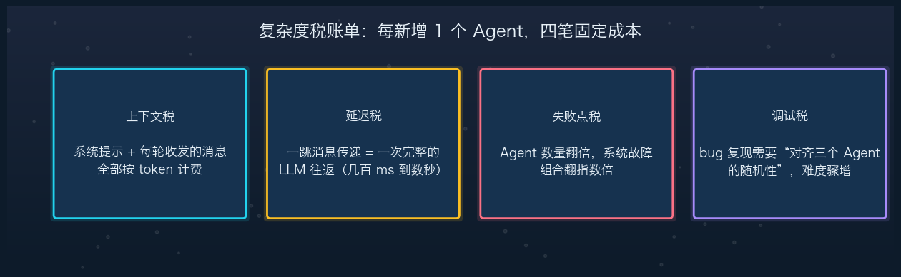
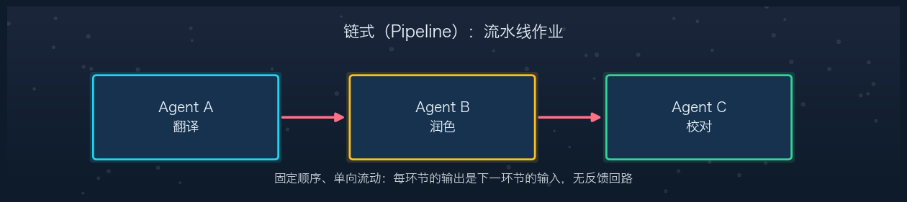
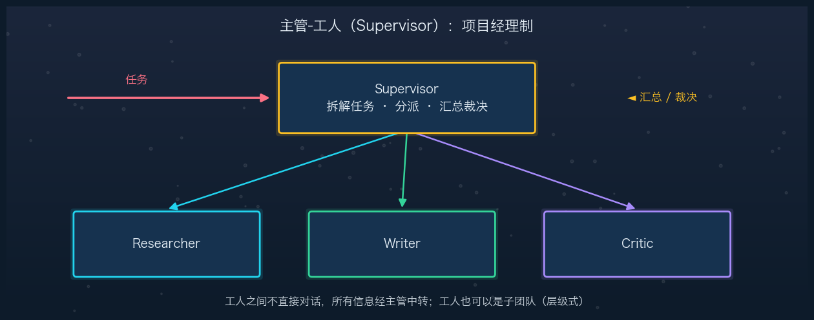
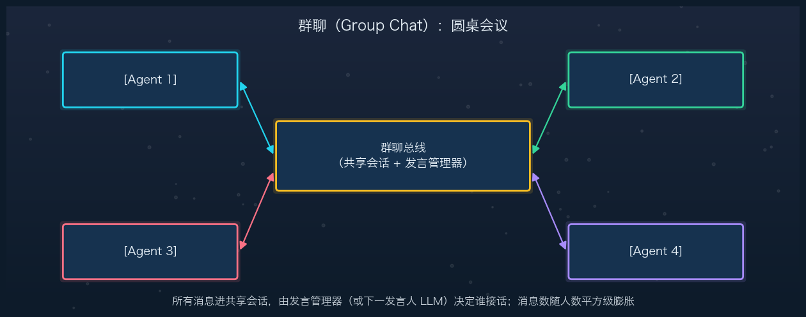
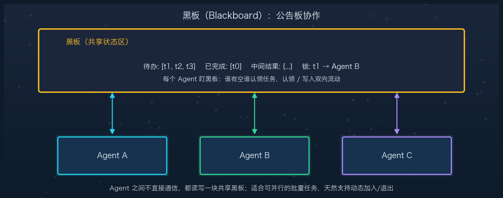
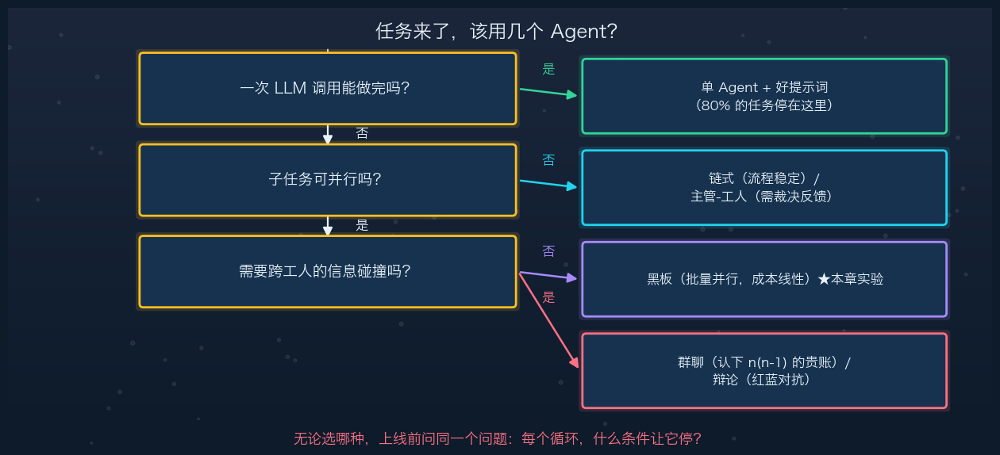

# 第 16 章 多智能体系统（Multi-Agent）：协作的艺术


> 一个 Agent 能力再强，也有天花板：上下文装不下所有领域知识、单一角色容易"既当运动员又当裁判"、串行任务快不起来。多智能体系统（Multi-Agent System）的思路很朴素：**把一项复杂任务拆给多个各司其职、互相通信的 Agent**，就像把一个全能员工换成一支小团队。但"团队"不是免费的：协调成本、消息损耗、无限开会，都是多 Agent 特有的坑。本章讲清"什么时候值得上多 Agent、有哪些协作模式"，并亲手实现一个可运行的 Supervisor 三角色系统。

## 📖 开篇故事

2023 年，一个名叫 MetaGPT 的开源项目在 GitHub 上演了一场教科书级的传播：它把"软件公司"搬进了多智能体系统，产品经理 Agent 收到一句话需求写 PRD，架构师 Agent 据此输出系统设计与接口文档，工程师 Agent 再生成代码，QA 最后写测试用例。作者（深度赋智团队）给它起的中文名掷地有声："**让 AI 软件公司替你干活**"。项目开源后星标数一路狂飙，数月破万，一年冲上 4 万 star，成为 2023 年增长最快的 AI 项目之一，论文也中了 ICLR 2024 oral。但真正值得复盘的不是热度，而是它的核心洞察：**多 Agent 协作出错的根源是"聊天式协作"，人人都说话，信息像传话游戏一样层层失真**。MetaGPT 的答案是让 Agent 像真公司一样"交付结构化工件"：产品经理不"聊"需求，而是交付一份 PRD；架构师读的是 PRD 而非聊天记录。这个"以文档为中心"的思路与本章的主线不谋而合：多 Agent 的关键从来不是"多"，而是**协作的协议**。同年，微软 AutoGen、CrewAI 相继走红，2024 年 OpenAI 的 Swarm 用极简"移交"原型再掀讨论，多 Agent 成了 Agent 工程的第二增长曲线，而翻车故事也同样精彩，我们后面会讲。

本章的行文路线是"先泼冷水、再给工具、最后算账"：16.1 用"复杂度税"劝退不该上多 Agent 的场景；16.2~16.4 给出五大协作模式与主流框架的选型地图；16.5 亲手实现 Supervisor 三角色系统（mock LLM，零 API 依赖）；16.6~16.7 复盘翻车模式并算清群聊的平方级成本账。读完的检验标准：给你一个任务，你能画出协作架构图、标注熔断点、并估出 token 账单。

## 16.1 什么时候需要多 Agent？先交"复杂度税"

先把"税单"列明白：每多一个 Agent，你至少付出四笔固定成本：



这笔税逃不掉，能决定的只有"值不值得交"。上多 Agent 之前先问四个问题，命中越多，越值得拆：

| 信号 | 说明 | 单 Agent 的替代方案 |
|:---|:---|:---|
| **单一职责过载** | 一个系统提示里塞了 5 种角色说明，模型顾此失彼 | 拆分 Skill（第 15 章），而非拆 Agent |
| **上下文隔离** | 子任务中间产物太长（如全量搜索结果），会污染主任务上下文 | 子 Agent 用完即弃，只回传摘要 |
| **并行加速** | 多个子任务互不依赖，可同时进行 | 单 Agent 也能顺序做，只是慢 |
| **对抗性校验** | 生成质量需要"第二双眼睛"（写 vs 审） | 自我反思（Reflexion）有时就够 |

表格里最容易被忽视的是第一行：**"单一职责过载"的标准解法是拆 Skill 而不是拆 Agent**。一个系统提示塞五种角色说明，问题出在"知识太杂"，第 15 章的 Skill 体系（按需加载操作手册）比多 Agent（增加通信开销）便宜且对症。想清楚这一行，能避开一半的过度设计。

反过来，这些情况**不要**用多 Agent：任务一次调用就能完成；步骤间强依赖且无法并行；预算敏感（每个 Agent 都按 token 计费）；调试能力有限（多 Agent 的 bug 复现难度指数级上升）。**经验法则：先用单 Agent + 好的提示工程做到 80 分，剩下 20 分的瓶颈如果恰好落在上面四个信号上，再拆。**

> 🎯 **面试高频**：**"什么任务不该用多 Agent？"** 这道题专治"多 Agent 焦虑症"：看到别人上了多 Agent 就觉得自己也该上。反方清单至少五条：① **线性短任务**（翻译一段话、总结一篇文章），一次调用的事，拆成流水线只会增加延迟与出错点；② **强依赖串行任务**（每步的输入都依赖上一步的完整输出），没有可并行的子任务，多 Agent 只带来传话损耗；③ **预算敏感场景**，token 成本至少翻倍，群聊模式可达 3-5 倍；④ **需要端到端可解释的场景**，多跳消息传递后，"为什么得出这个结论"的归因链条会断；⑤ **评测体系还没建好**，单 Agent 都没法稳定评估，多 Agent 的回归测试更是无从谈起。一个加分总结：**多 Agent 是"组织解决方案"，只在"协作本身是瓶颈"时才有正收益**，就像两个人抬钢琴才需要喊号子，一个人拎包就别喊了。

## 16.2 协作模式全景

组织行为学里总结过人类团队的若干经典协作形态（流水线、科层制、辩论制、圆桌、看板），多 Agent 的模式大多能在其中找到影子。这不算巧合：**协作的难题在人队和 Agent 队里大体同构**，区别只在"个体"是碳基还是硅基。

### 16.2.1 链式（Pipeline）：流水线作业



固定顺序、单向流动，每个环节的输出是下一环节的输入。**适合**流程稳定的内容加工（翻译→润色→审校、抽取→清洗→汇总）。**缺点**：无反馈回路，前面错了后面跟着错；灵活性差。

链式虽然最简单，却是最常见的第一选择，因为它**可调试**：三个环节任何一环出错，日志里一眼定位；换成群聊，出错的归因可能要回溯十几条互相打断的消息。生产系统的常见形态是"链式为骨架、主管统一编排"：主流程线性推进，由一个 Supervisor 集中调度、传递状态，需要裁决时再插入 Critic 型环节，第 20 章的新闻流水线就是这种结构。

### 16.2.2 主管-工人（Supervisor / Hierarchical）：项目经理制

主管负责拆解任务、分派、收集结果、决定下一步；工人只对主管汇报。**这是最常用、最可控的模式**：控制流集中在一处，容易加超时、重试、轮数上限。工人也可以是子团队（层级式 Hierarchical）。16.5 的实现就是它。



主管模式还有一重隐性收益：**审计与回放**。所有决策经过一点，意味着 `self.log` 里的一条时间线就是完整的系统行为记录，出问题时逐条重放即可归因，而不需要在多份分散的对话记录里拼图。对合规敏感的场景（金融、医疗），"所有决策可回溯到一次显式的调度"几乎是硬性要求，主管模式天然满足。

### 16.2.3 辩论（Debate）：红蓝对抗

两个（或多个）Agent 就同一问题给出对立立场，多轮交锋后由裁判（或人）裁决。


**适合**事实核查、方案评审、降低单一模型的幻觉与盲点。代价是 token 成本约为单 Agent 的 3-5 倍。

辩论模式有一个广被引用的学术背书：Du et al.（2023，*Improving Factuality and Reasoning in Language Models through Multiagent Debate*）让多个同一底座的 LLM 就数学与事实推理题各自作答、互相审视、迭代修订，仅靠"多观点对撞"就显著提升了正确率，没有任何一个 Agent 变聪明，**聪明的是协议**。但也要注意后续研究的冷水：辩论的收益对任务类型高度敏感，开放式生成任务里"互相说服"容易演变成"互相恭维"（见 16.6 角色同质化），届时 3-5 倍的成本买来的只是复读。

### 16.2.4 群聊（Group Chat）：圆桌会议

所有消息进共享会话，由一个"发言管理器"（或下一发言人 LLM）决定谁接话。AutoGen 的 GroupChat 是典型实现。



**适合**头脑风暴、开放式讨论。**缺点**：消息数随人数平方级膨胀，极易跑题与循环（见 16.6）。

群聊有一个反直觉的工程真相：**发言权管理器本身就是一个关键 Agent**。AutoGen 允许用 LLM 决定"下一个该谁说话"，这个小小的路由角色若失灵（连续指定同一个健谈者发言），群聊立刻退化成独角戏；若过度平均（人人轮流），又会拉长战线、稀释重点。生产系统常给发言管理器叠加硬规则：同一 Agent 不得连续发言两轮、每轮最多 N 次发言、检测到重复观点时强制收敛。

### 16.2.5 市场 / 黑板（Blackboard）：公告板协作

Agent 之间不直接通信，都读写一块共享"黑板"：认领任务、写入结果。



**适合**可并行的批量任务（批量爬取、多文件重构），天然支持动态加入/退出。代价是要处理任务争抢与状态一致性。

黑板模式的现代变体随处可见：`Claude Code` 的并行子任务、各类 "Deep Research" 产品的多路检索，本质上都是"任务上板、工人认领、结果回写"，只是"工人"换成了带工具的 LLM Agent。


### 动手实验：黑板模式真实实现，10 个任务、3 个工人，谁有空谁认领

16.2.5 只给了示意图，现在把它跑成真代码：一块带锁的共享"黑板"，三个速度不同的工人线程循环"看板→认领→干活→写回"（完整代码见 `code/ch16_multiagent/exp_blackboard.py`，核心逻辑如下）：

```python
class Blackboard:
    # 共享状态区：任务表 + 认领锁 + 结果区。所有 Worker 只跟黑板打交道。
    def __init__(self, tasks):
        self.lock = threading.Lock()                  # 一把锁：防止两个工人抢到同一任务
        self.todo = list(enumerate(tasks))            # [(任务号, 任务描述)]
        self.results = {}                             # {任务号: 执行者+结果}
        self.claim_log = []                           # 认领轨迹（谁在何时抢了什么）

    def claim(self, worker):
        with self.lock:                               # 临界区：检查+认领必须原子完成
            if not self.todo:
                return None
            tid, desc = self.todo.pop(0)              # 取队首任务并从待办中移除
            self.claim_log.append(f"{worker} 认领任务{tid}")
            return tid, desc

    def write(self, tid, worker, result):
        with self.lock:
            self.results[tid] = (worker, result)

class Worker(threading.Thread):
    # 工人线程：循环'看黑板->认领->干活->写回'，直到黑板清空。
    def run(self):
        while True:
            job = self.board.claim(self.name_)
            if job is None:                           # 黑板空了，收工
                return
            tid, desc = job
            time.sleep(self.speed)                    # 模拟干活耗时（工人速度不同）
            self.board.write(tid, self.name_, f"[{desc} 完成]")
```

真实运行输出（10 个"爬取论文"任务，三个工人速度分别为 0.05s / 0.08s / 0.12s）：

```text
认领顺序: W1 认领任务0 -> W2 认领任务1 -> W3 认领任务2 -> W1 认领任务3 -> W2 认领任务4
        -> W1 认领任务5 -> W3 认领任务6 -> W1 认领任务7 -> W2 认领任务8 -> W1 认领任务9

各工人完成数: {'W1': 5, 'W2': 3, 'W3': 2}（快的 W1 多干，慢的 W3 少干——负载自动倾斜）
并行总耗时: 0.27s；若由单个 Agent 顺序完成至少需 0.50s
```

对照输出再确认一遍涌现行为：认领序列 `W1→W2→W3→W1→W2→W1→W3→...` 里，快手 W1 五次入场、慢手 W3 只在开场和中段各领一次，没有任何调度器规划这个分配。

这套行为里没有调度器的影子：任务不是"平均分给三个人"，而是谁空闲谁认领，快手 W1 干了 5 个，慢手 W3 只接了 2 个，**负载均衡是涌现出来的**，不是规划出来的。锁保护的是"检查+认领"这个复合动作：只锁 `pop` 不锁 `if not self.todo` 的话，两个工人可能同时看到最后一个任务然后双双认领（多 Agent 版的"超卖"）。工人还可以动态增减，再加一个 W4 线程，它开工就能认领，无需通知任何人。这就是黑板模式对"批量并行任务"的统治力：主管模式里每个工人汇报完毕都要排队等主管裁决，黑板模式里工人之间**根本不需要认识彼此**。

> ⚠️ **常见误区**：**"黑板 = 全局变量"**。黑板与随手定义的 `global state` 有本质区别：黑板是**带协议的共享状态**：认领有原子性保证（锁）、写入有固定格式（结果区）、消费有可见性规则（认领即移除）。而全局变量最擅长制造的恰恰是竞态、覆盖与"谁改了我的字段"。把黑板做对的三要素：**互斥的认领、结构化的写入、审计友好的日志**（本实验的 `claim_log` 就是天然的任务级 Trace）。 Trace 的正式形态见第 17 章。

OpenAI 2024 年的实验框架 Swarm 可以看作黑板思想的"对话版"变体：Agent 之间不认领任务，而是在对话中**移交（handoff）**：把整个会话的控制权连同上下文递给下一个 Agent。思路殊途同归：**协作的关键是控制权如何转移，而不是谁在说话**。

### 16.2.6 模式选择速查

| 模式 | 控制流 | 反馈回路 | 适用 | 主要风险 |
|:---|:---|:---|:---|:---|
| 链式 | 固定 | 无 | 流程稳定的流水加工 | 错误顺流而下 |
| 主管-工人 | 集中 | 有（主管裁决） | 大多数复杂任务 | 主管成为瓶颈 |
| 辩论 | 对抗 | 强 | 审核、事实核查 | 成本高、互相说服跑偏 |
| 群聊 | 分布 | 有 | 开放讨论、头脑风暴 | 循环、跑题、成本爆炸 |
| 黑板 | 分布 | 弱 | 大规模并行子任务 | 状态一致性、争抢 |

速查表的用法是"先读'适用'列，再核对'主要风险'列"。每种模式的收益和它的死法是一体两面：链式的效率来自无反馈，死因也是无反馈；群聊的创意来自全员在场，成本爆炸也来自全员在场。**选模式就是选你愿意承担哪种风险**。

## 16.3 通信设计：共享内存 vs 消息传递

多 Agent 的"话怎么说"有两种流派，与操作系统的进程间通信如出一辙（又一个"Agent 工程向系统设计借智慧"的例子：第 14 章借了虚拟内存，这里借 IPC）：

- **共享内存（Shared State）**：所有 Agent 读写同一个状态对象（黑板、全局 dict、共享文档）。优点是信息不丢失、实现简单；缺点是**隐式耦合**：谁都可能改坏别人依赖的字段，且长历史会撑爆每个 Agent 的上下文。
- **消息传递（Message Passing）**：Agent 之间只通过显式消息（`{from, to, content}`）交流，各自维护私有记忆。优点是边界清晰、可审计（消息轨迹天然就是日志）、容易分布式部署；缺点是信息可能重复或丢失，需要设计消息格式与路由。

| 维度 | 共享内存 | 消息传递 |
|:---|:---|:---|
| 耦合度 | 高（共享结构即契约） | 低（消息格式即契约） |
| 可观测性 | 需额外埋点 | 轨迹天然可打印/回放 |
| 上下文控制 | 难（历史无限增长） | 易（每条消息可裁剪） |
| 典型框架 | MetaGPT（共享消息池） | AutoGen、CrewAI（对话传递） |

实践建议：**小规模用共享内存 + 快照日志，规模一大就切消息传递**，并给消息加上类型标签（`task / result / feedback / control`），让"任务指令"和"闲聊内容"不会混在一锅粥里。

消息类型标签不是文档洁癖，它直接决定系统的**可观测与可调控**。一段最小示例（与 16.5 的 Supervisor 风格一致）：

```python
def say(self, src, dst, mtype, content):          # mtype: task / result / feedback / control
    self.log.append((src, dst, mtype, content))   # 轨迹天然带类型，可按类型过滤回放
    if mtype == "control":                        # 控制类消息（超时/熔断）单独告警
        alert_ops(f"[{src}->{dst}] {content}")
```

有了类型标签，"重放一次执行""只看裁决类消息""统计 feedback 轮数"都变成了日志过滤，一行 `grep` 的事；没有标签，这些全是人肉读日志。练习题 3 就是把这个示例真正接进 16.5 的 `Supervisor`。

> 💡 **深入思考**：多 Agent 系统里的"Agent"一定都是 LLM 吗？不必。真正稳健的多 Agent 系统往往是**异构的**：Supervisor 是 LLM（因为它要做模糊裁决），但工人可以是纯代码（爬虫、SQL 查询、正则解析），本章的 `MockLLM` 其实已经暗示了这一点。把"确定性任务交给代码 Agent、模糊性任务交给 LLM Agent"是一条重要的降本增效路线：代码工人零 token 成本、零幻觉、可单测。反过来，MetaGPT 让每个角色都是 LLM，是因为它的目标场景（从需求到代码）每一步都含模糊性。设计多 Agent 系统时先问一句：**这个环节真的需要"理解"吗？**不需要就别给它配大脑。

## 16.4 主流框架对比

| 框架 | 协作模式 | 抽象方式 | 上手难度 | 适合场景 |
|:---|:---|:---|:---|:---|
| **CrewAI** | Crew + 主管可选 | 角色化 Agent（role/goal/backstory） | 低 | 快速搭建角色分工流水线 |
| **AutoGen**（微软） | 群聊/对话式 | 可对话 Agent + 发言管理 | 中 | 研究探索、人机协作对话 |
| **MetaGPT** | 标准化作业（SOP） | 公司角色（产品/架构师/工程师）+ 共享消息池 | 中 | 软件开发类结构化产出 |
| **LangGraph / Swarm** | 图状态机 / 轻量移交 | 节点=Agent，边=控制流 | 中高 | 需要精确控制流与检查点的生产系统 |

把这张表放到时间线上看更清楚：2023 年下半年是"角色派"的爆发期（AutoGen 8 月、MetaGPT 开源后走红、CrewAI 10 月），核心信念是"给 Agent 好角色，协作自然涌现"；2024 年风向转向"控制派"（LangGraph 快速迭代、OpenAI Swarm 10 月发布），核心信念是"涌现不可靠，控制流要显式"。两派不是对错之争，而是**探索期与工程化期的重心迁移**，这与你个人技能树的最佳路径一致：先用角色派体会协作的味道，再用控制派把它钉牢。

初学者建议路径：先用本章的纯 Python 理解控制流 → 用 CrewAI 感受"角色声明式"开发 → 生产系统考虑 LangGraph（状态可控、支持人审检查点）。

选框架时还有一个常被忽略的维度：**迁移成本**。框架的抽象一旦深度渗入你的业务代码（装饰器、回调、状态对象），换框架就等于重写。降低耦合的实践技巧：把"协作协议"（谁在什么条件下给谁发什么消息）写在自己的配置或代码里，框架只当"执行引擎"用，协议是你的，引擎可以换。这也是先手写纯 Python 的另一个理由：你已经拥有了协议的所有权。

> 💡 **深入思考**：为什么多 Agent 框架的数量远多于 Agent 本身？因为多 Agent 框架真正卖的不是"多"，而是**协作协议**：CrewAI 卖"角色分工"、AutoGen 卖"对话协商"、MetaGPT 卖"结构化工件"、LangGraph 卖"状态机控制"。每种协议对应一类协作信念：你相信"角色清晰就够了"就选 CrewAI，相信"沟通出真理"就选 AutoGen，相信"文档即接口"就选 MetaGPT。但框架的抽象层也意味着**黑盒**：控制流被藏进装饰器和运行时，出问题时你既看不清消息怎么走的，也插不进自己的钩子。这就是为什么本书坚持先用纯 Python 手写实现：**先看见协议本身，再决定要不要让别人替你封装它**。工程上的清醒判断是：原型期用框架换速度没问题，生产期若每条消息都要审计，回到"自己写的 Supervisor"反而是最可控的选择。

## 16.5 动手实现：Supervisor 三角色系统

在写代码之前，先想清楚我们要实现的协作契约：三个角色各自的输入、输出与终止协议：

| 角色 | 输入 | 输出 | 契约要点 |
|:---|:---|:---|:---|
| Researcher | 调研主题 | 编号要点列表 | **只输出事实**，不发挥 |
| Writer | 主题 + 参考材料（或原文 + 修改意见） | 短文/改写稿 | 忠实于材料，按意见修改 |
| Critic | 待评审草稿 | "通过" 或 "需修改 + 意见" | **裁决是结构化的**，循环靠它终止 |
| Supervisor | 用户任务 | 调度与中转 | 持有消息日志，控制轮数熔断 |

这张表就是 Supervisor 模式的"宪法"：每个 Agent 只需认识自己的契约，无需知道全局，正是"单一职责"的落地。注意 Critic 的输出被刻意设计成可机器判定的格式（以"通过"开头与否），这是**让循环可终止的关键**；如果 Critic 输出的是散文式评审，Supervisor 就只能再雇一个 Agent 来"读懂评审"，系统的复杂度立刻失控。

代码位于 `code/ch16_multiagent/supervisor.py`（本机 Python 3.9 运行通过）。目标：三个工人 Agent（Researcher/Writer/Critic）在 Supervisor 调度下"写一篇短文并迭代修改一轮"。LLM 用 mock 替身，规则化地模拟角色行为；接真实 LLM 时只需替换 `MockLLM.call`（见文末说明）。

**为什么坚持用 mock 而不是直接接 API？** 因为这一章的主角是**协作协议**，不是模型能力。mock 把"模型会说什么"钉死成确定行为，让控制流的每一步都可复现、可断言（你能精确预知 Critic 第几轮通过）。接上真 LLM 后，同一个协议的行为波动、成本、循环风险才会暴露，这也是 16.6 常见误区里"mock 通了真 LLM 不一定通"的由来。**先用确定性验证协议，再用随机性考验协议**，是贯穿本书的实验方法论。

```python
# -*- coding: utf-8 -*-
import re

# ============ 1. mock LLM：用规则模拟"角色化"的生成行为 ============
class MockLLM:
    """本地 mock 版：按角色返回固定风格的文本。
    真实版：把 system_prompt + messages 交给任何 Chat API（openai / anthropic），
    return client.chat.completions.create(...)。需自行填 API key。"""

    def call(self, role: str, prompt: str) -> str:
        if role == "Researcher":
            return self._research(prompt)
        if role == "Writer":
            return self._write(prompt)
        return self._critique(prompt)

    @staticmethod
    def _research(prompt: str) -> str:
        topic = re.search(r"调研主题：(.+)", prompt).group(1)
        return (f"关于「{topic}」的三条要点：\n"
                "1. 定义：Agent 是能感知环境、调用工具、自主决策的系统；\n"
                "2. 机制：主流范式是 ReAct——思考与行动交替进行；\n"
                "3. 价值：把人从重复流程中解放出来，聚焦判断与创造。")

    @staticmethod
    def _write(prompt: str) -> str:
        if "修改意见" in prompt:                      # 第二轮：带着意见改稿
            missing = re.findall(r"缺少：(.+?)(?:\n|$)", prompt)
            add = "\n" + "\n".join(f"- 补充：{m.strip()}" for m in missing)
            return (prompt.split("原文：")[-1].split("修改意见")[0]).strip() + add
        topic = re.search(r"主题：(.+)", prompt).group(1)
        material = prompt.split("参考材料：\n")[-1]
        bullets = [ln.strip() for ln in material.splitlines()
                   if re.match(r"^\d+\.", ln.strip())]      # 只取编号要点行
        body = "。".join(b.split("：", 1)[1].rstrip("；。") for b in bullets)
        return f"{topic}，正在改变我们与软件交互的方式。{body}。"

    @staticmethod
    def _critique(draft: str) -> str:
        problems = []
        if "挑战" not in draft:
            problems.append("缺少：对挑战的讨论（如可靠性与成本）")
        if "未来" not in draft and "展望" not in draft:
            problems.append("缺少：结尾的未来展望")
        verdict = "通过" if not problems else "需修改"
        return verdict + ("\n" + "\n".join(problems) if problems else "")
```

```python
# ============ 2. Agent 基类与角色定义 ============
class Agent:
    def __init__(self, name, role, llm, system_prompt):
        self.name, self.role = name, role
        self.llm, self.system_prompt = llm, system_prompt

    def act(self, prompt: str) -> str:
        full = f"[{self.system_prompt}]\n{prompt}"
        return self.llm.call(self.role, full)


# ============ 3. Supervisor：唯一的调度者 ============
class Supervisor:
    def __init__(self):
        llm = MockLLM()
        self.team = {
            "Researcher": Agent("Alice", "Researcher", llm, "你是调研员，只输出事实要点"),
            "Writer":     Agent("Bob",   "Writer",     llm, "你是写手，把材料写成短文"),
            "Critic":     Agent("Cindy", "Critic",     llm, "你是评审，只输出 通过/需修改+意见"),
        }
        self.log = []                                 # 消息轨迹：谁、对谁、说了什么

    def say(self, src, dst, content):
        self.log.append((src, dst, content))
        print(f"\n┌─[{src}] ──► [{dst}]")
        for line in content.splitlines():
            print(f"│  {line}")

    def say_and_get(self, src, dst, content):
        self.say(src, dst, content)
        return self.team[dst].act(content)

    def run(self, topic: str, max_rounds: int = 3) -> str:
        print(f"═══ Supervisor 启动：任务 = 写一篇关于「{topic}」的短文 ═══")
        self.say("User", "Supervisor", f"写一篇关于「{topic}」的短文")

        material = self.say_and_get("Supervisor", "Researcher", f"调研主题：{topic}")
        draft = self.say_and_get("Supervisor", "Writer", f"主题：{topic}\n参考材料：\n{material}")

        for rnd in range(1, max_rounds + 1):
            verdict = self.say_and_get("Supervisor", "Critic", f"评审草稿：\n{draft}")
            if verdict.startswith("通过"):
                print(f"\n═══ 第 {rnd} 轮评审通过，任务完成 ═══")
                self.say("Supervisor", "User", f"最终成稿：\n{draft}")
                return draft
            self.say("Supervisor", "Writer", f"修改意见（第 {rnd} 轮）：\n{verdict}")
            draft = self.say_and_get("Supervisor", "Writer",
                                     f"根据意见改写。\n原文：{draft}\n修改意见：{verdict}")
        raise RuntimeError("超过最大轮数仍未通过评审——警惕无限循环！")


if __name__ == "__main__":
    Supervisor().run("AI Agent")
```

**本机运行结果**（消息轨迹节选，完整输出约 60 行）：

```text
═══ Supervisor 启动：任务 = 写一篇关于「AI Agent」的短文 ═══

┌─[User] ──► [Supervisor]
│  写一篇关于「AI Agent」的短文

┌─[Supervisor] ──► [Researcher]
│  调研主题：AI Agent

┌─[Supervisor] ──► [Writer]
│  主题：AI Agent
│  参考材料：
│  关于「AI Agent」的三条要点：
│  1. 定义：Agent 是能感知环境、调用工具、自主决策的系统；
│  ...

┌─[Supervisor] ──► [Critic]
│  评审草稿：
│  AI Agent，正在改变我们与软件交互的方式。Agent 是能感知环境、...

┌─[Supervisor] ──► [Writer]
│  修改意见（第 1 轮）：
│  需修改
│  缺少：对挑战的讨论（如可靠性与成本）
│  缺少：结尾的未来展望

┌─[Supervisor] ──► [Writer]
│  根据意见改写。
│  原文：AI Agent，正在改变我们与软件交互的方式。...
│  修改意见：需修改 ...

┌─[Supervisor] ──► [Critic]
│  评审草稿：
│  AI Agent，正在改变我们与软件交互的方式。...
│  - 补充：对挑战的讨论（如可靠性与成本）
│  - 补充：结尾的未来展望

═══ 第 2 轮评审通过，任务完成 ═══

┌─[Supervisor] ──► [User]
│  最终成稿：
│  AI Agent，正在改变我们与软件交互的方式。...
│  - 补充：对挑战的讨论（如可靠性与成本）
│  - 补充：结尾的未来展望
```

对照 16.5 开头的契约表跑一遍验证：Researcher 的输出确实是编号要点（事实契约）；Writer 二轮改稿时把"缺少：xxx"逐条转为"补充：xxx"（修改契约）；Critic 的"通过/需修改"精确驱动了循环终止（裁决契约）；Supervisor 的 `self.log` 记录了每一次调度（审计契约）。四个契约全部兑现，这就是"模式正确"的可验证形态。

Critic 天然形成收敛条件，它检查的"挑战/展望"在第一稿中缺失、在修改稿中出现，循环自动终止。`max_rounds=3` 是防无限循环的**硬保险**，多 Agent 系统中每一类循环都必须有这种熔断。`self.log` 记录了完整的消息轨迹，这就是第 17 章可观测性（Trace）的雏形。工人之间**从不直接对话**，所有信息经主管中转，控制流因此完全可预测。**接真实 LLM**：把 `MockLLM.call` 换成对 Chat API 的调用（`client.chat.completions.create`，需填 `OPENAI_API_KEY`），每个 Agent 的 `system_prompt` 原样进 messages，其余代码零改动。

> ⚠️ **常见误区**：**"mock 跑通了，接上真 LLM 也一定通"**。三处会立刻现形：① **格式漂移**：MockLLM 的 Critic 永远规矩地输出"通过"或"需修改 + 意见"，真实 LLM 可能输出"这一版基本通过了，不过还有一点小问题……"，`verdict.startswith("通过")` 直接失配，循环控制权旁落。生产代码要用结构化输出（JSON 字段 `verdict: pass/fail`）或更宽容的解析（正则匹配关键词）；② **无限循环换了形态**：mock 里是 Critic 永不满足，真实系统里更常见的是 Writer 和 Critic 打太极："已按意见修改""仍有不足"反复拉扯，`max_rounds` 熔断从保险丝变成了常客；③ **成本失控于无形**：一次完整的"调研→写作→评审→改稿"每个环节都是全量 Prompt 重发，长上下文下四五个角色跑三轮就是一次不小的账单。把 mock 换成真 LLM 的正确姿势：先加结构化输出约束，再上线轮数监控，最后盯一次 token 账单。

## 16.6 多 Agent 常见翻车模式与对策

先讲一类在社区流传甚广的翻车现场（细节经过概括，模式是真实的）：有团队用群聊模式搭了一个"产品策划组"，市场、设计、工程三个 Agent 讨论新功能方案。上线当晚，监控发现三个 Agent 互相恭维了几十轮（"这个想法很好""感谢认可，我再补充一点"），token 账单烧掉了好几天的预算，方案一个字没落地。排查发现：三个角色用的是同一个模型、温度都没调、提示词里都写着"保持友好协作"。**它们不是在协作，是在合奏**。下表就是这类事故的病理图谱。

| 翻车模式 | 症状 | 根因 | 对策 |
|:---|:---|:---|:---|
| **无限对话循环** | 两个 Agent 互相"你说得对，但是……"几十轮 | 无终止条件；角色都在附和 | 轮数上限熔断；引入明确的"通过/不通过"裁决消息类型 |
| **角色同质化** | 三个 Agent 说法雷同，辩论变成复读 | 相同模型 + 相似提示 | 给每个角色不同的提示立场/温度/材料；必要时混用不同模型 |
| **成本爆炸** | 群聊模式消息数随人数平方增长，账单一晚翻 10 倍 | 全员可见全员发言 | 限制发言人/轮次；摘要压缩历史；贵任务降级为单 Agent |
| **传话失真** | 主管转述后语义丢失，工人答非所问 | 中转时截断/改写 | 传结构化消息而非转述散文；关键信息附原文引用 |
| **死锁** | 黑板模式下互相等对方的结果 | 任务依赖成环 | 任务 DAG 校验，禁止循环依赖 |

给"传话失真"配一个真实感十足的微缩案例：Supervisor 让 Researcher 调研"Agent 框架"，转述给 Writer 时压缩成"调研了框架"（丢掉了范围），Writer 写出的文章大谈"建筑框架"；Critic 评审"是否覆盖主流 Agent 框架"自然不通过，但所有人都以为别人出了错。**根因是 Supervisor 在转述时做了有损压缩**。对策永远是把结构化原文（而非自己的复述）传给下游，让"转述"变成"附带说明的转发"。

**一条元原则：多 Agent 系统的每个循环都要回答"什么条件让它停？"**回答不出来就不要上线。

## 16.7 动手算账：群聊模式的成本为什么爆炸

练习题 7 的公式值得当场验证。设 $n$ 个 Agent 每轮全员发言、每条消息平均 $m$ token、共 $r$ 轮，则**单条消息的受众是其余 $n-1$ 个 Agent**，每条消息被复制进 $n-1$ 份上下文：

$$\text{Total} = r \times n \times (n-1) \times m$$

关键性质是 $n(n-1)$ 的**平方级**增长，4 个 Agent 3 轮的群聊，消息复制量是 2 个 Agent 的 6 倍。用数字体会一下（$m=500$ token）：

```text
n=2, r=3:  3 × 2 × 1 × 500   =     3,000 token
n=4, r=3:  3 × 4 × 3 × 500   =    18,000 token（6 倍）
n=6, r=5:  5 × 6 × 5 × 500   =    75,000 token（25 倍）
n=6, r=10: 10 × 6 × 5 × 500  =   150,000 token（还没算系统提示的常驻开销）
```

同样 $n=6$，**主管模式的成本是 $O(r \cdot n \cdot m)$（线性）**：每轮主管分别与一个工人点对点通信，工人之间互不可见。这就是 16.6 "成本爆炸"行的数学本质：群聊用"人人都听得到"换信息流通，代价是把 $n-1$ 写进了每一跳的复制成本里。工程结论顺理成章：**群聊人数压到 4~6 以内、发言轮次设熔断、历史定期摘要压缩**，三条对策对应的正是公式里的三个因子 $n$、$r$、$m$。AutoGen 群聊默认限制参与人数，不是随意为之。

黑板实验的实测数字可以放进同一张账单：10 个任务、三工人并行耗时 0.27s，单 Agent 顺序完成至少 0.50s，**并行收益 1.9 倍**，而且任务数越多收益越接近"最慢工人独扛"的上界。但注意这个收益的前提是任务**互不依赖**：一旦任务成链（论文 B 的摘要依赖论文 A 的结论），同样的三工人并行收益会跌到接近 1。**并行加速的上限由任务依赖图的最长链决定**，与工人数量无关（Amdahl 定律的多 Agent 版）。评估并行收益时永远先画**任务依赖 DAG**。

> 💡 **深入思考**：既然平方级这么贵，为什么群聊模式还没死？（这道题本身也是面试高频，被问"多 Agent 成本为什么爆炸"时，能把 $r \cdot n(n-1) \cdot m$ 公式与"信息对称性"的取舍一起讲清，就是满分答案。）因为它买到的东西是其他模式给不了的：**信息对称性**。主管模式里工人 B 永远不知道工人 A 说了什么，跨工人的洞察（"A 的调研结论推翻了 B 的假设"）只能靠主管转述，而转述必有损耗。头脑风暴类任务恰恰依赖"意外相逢"：B 听到 A 的一句闲话突然产生了新点子。所以选型的深层逻辑是**按信息流通的必要密度选模式**：任务可拆分、信息流单向（批处理）→ 黑板；任务需裁决、信息汇于一点（写作-评审）→ 主管；任务本身是"涌现"的（创意、规划）→ 群聊，并且认这笔贵账。


## 本章小结

- 多 Agent 的收益来自**单一职责、上下文隔离、并行、对抗校验**四类信号；每加一个 Agent 都要交"复杂度税"，先单 Agent 后拆分是铁律。
- 五大协作模式各有领地：**链式**求稳、**主管-工人**求可控、**辩论**求严谨、**群聊**求发散、**黑板**求并行；模式选择本质上是"按信息流通的必要密度"付费，群聊买对称性、黑板买吞吐、主管买可控。
- 通信设计三件事：小规模用共享内存、规模化切消息传递；给消息加**类型标签**（task/result/feedback/control）换回"按类型过滤回放"的观测能力；把协作协议写在自己的代码里、框架只当执行引擎，保住迁移自由。别忘了异构性：确定性环节交给代码 Agent、模糊性环节才配 LLM。
- Supervisor 的三要素是**集中的控制流、结构化的消息、明确的终止条件**（评审通过 + 轮数熔断双保险），配套契约四件套：结构化裁决、消息日志、轮数熔断、原文转发。实现方法论是先用确定性验证协议（mock 可断言），再用真 LLM 考验协议（暴露波动与循环风险）。
- 翻车模式有对策可依：无限循环、角色同质化（合奏）、成本爆炸靠**控制发言权、压缩上下文、设熔断器**，格式漂移与传话失真分别靠结构化输出与原文转发化解。
- 群聊成本的数学本质是 $r \times n \times (n-1) \times m$ 的平方级复制，群聊人数必须压在 4~6；黑板实验则证明**负载均衡可以涌现**，靠"谁空闲谁认领"的协议自然达成。决策口诀：一次调用能做完选单 Agent；可并行且无需互通选黑板；需要裁决与反馈选主管；需要碰撞与涌现选群聊/辩论，并**先画任务依赖 DAG 再谈加速**。

一张决策图收束全章：



无论选哪种，上线前问同一个问题：**每个循环，什么条件让它停？**


多 Agent 一旦上线，新的问题随之而来：三个 Agent 各自翻车时，你怎么知道是哪个环节的锅？下一章的可观测性与评测（Trace、Error 累积、裁判模型偏差）就是为"看清协作现场"准备的。**系统的复杂度每上一个台阶，观测能力必须先上一个台阶**。

## 📚 延伸阅读

- **MetaGPT 论文**：Hong et al., *MetaGPT: Meta Programming for a Multi-Agent Collaborative Framework*（ICLR 2024 oral）："以文档为中心"协作协议的完整论证，16 章开篇故事的主角：<https://arxiv.org/abs/2308.00352>，代码仓库 <https://github.com/FoundationAgents/MetaGPT>
- **AutoGen 论文**：Wu et al.（Microsoft，2023）：对话式多 Agent 协作的代表作，群聊与发言管理的细节出处：<https://arxiv.org/abs/2308.08155>，代码仓库 <https://github.com/microsoft/autogen>
- **CrewAI 文档**：角色声明式开发的上手首选，10 分钟能跑通第一个 Crew：<https://docs.crewai.com/>
- **LangGraph 文档**：图状态机 + 检查点 + 人审中断，生产级控制流的标杆：<https://langchain-ai.github.io/langgraph/>
- **OpenAI Swarm**：极简多 Agent "移交"原型（实验性框架），几百行源码，读一遍胜过看十篇综述：<https://github.com/openai/swarm>

## 练习题

1. **概念题**：把 16.2 的五种协作模式各对应到一家真实公司里的一个场景（如"主管-工人 ↔ 项目经理派活"），并说明每种模式下"谁对最终质量负责"。
2. **分析题**：任务"对 100 篇论文各生成摘要，再汇总成综述"适合哪种模式？画出 ASCII 图，标出哪些环节可并行、汇总环节的输入如何控制长度。
3. **计算题**：设群聊模式 $n=5$、$r=4$、$m=800$，主管模式同样任务只需 $2 \times n \times r \times m$（主管与工人各收发一次）。计算两种模式的 token 开销与比值；若把 $n$ 翻倍，比值如何变化？（16.7 节公式的直接应用）
4. **代码题**：给 16.5 的 `Supervisor` 增加消息类型标签（task/result/feedback），并让 `say()` 在打印时显示类型；再实现 `replay()` 方法，从 `self.log` 重放全部轨迹（不重新调用 LLM）。
5. **实验题**：把 `MockLLM._critique` 的两个检查条件改为永不满足（例如检查"完美"一词），观察 `max_rounds` 熔断如何触发。这就是无限循环的微缩现场。
6. **实验题**：把 Writer 和 Critic 的 `system_prompt` 都改成"你是通用助手"，观察输出会发生什么变化，解释角色同质化是如何产生的。
7. **编程题**：实现 16.2.5 的黑板模式雏形：一个 `Blackboard` 类（任务列表 + 认领锁 + 结果区），三个 mock Worker 随机认领 10 个互不依赖的任务并写回结果，最后打印完成情况与耗时。
8. **思考题**：群聊模式中若 $n$ 个 Agent 每轮全员发言，消息总量按什么增长？若每条消息平均 $m$ token、共 $r$ 轮，写出总 token 消耗公式，并据此解释为什么 AutoGen 群聊通常限制在 4-6 个 Agent。（16.7 节已给出参考推导，试着不看答案先自己推一遍）
9. **实验题**：给 `exp_blackboard.py` 的 `Blackboard` 加一个 `add_task(desc)` 方法，在 Worker 跑到一半时主线程动态投入 3 个新任务，验证"工人无需改动即可消化增量任务"；再故意去掉 `claim()` 里的锁，用大量短任务复现"同一任务被两个工人重复认领"的竞态。
10. **实验题**：把 `exp_blackboard.py` 的三个 Worker 速度改成相同（如都是 0.06s），各工人完成数还像本次实验这样悬殊吗？解释"负载自动倾斜"成立的前提条件。
11. **设计题**：为"自动审稿系统"设计多 Agent 方案：输入一篇论文，输出"接受/修改/拒稿"决议与审稿意见。要求：至少 3 个 Agent、防止审稿人互相恭维（角色同质化）、每轮成本可控、决议可追溯到具体理由。画出架构图，标注每个 Agent 的契约与熔断点，并估算单篇论文的 LLM 调用次数。

完成最后一道设计题后，你就拥有了一份可以带进面试的"多 Agent 系统设计答卷"：从需求分析、模式选型、协议设计到成本估算，一条完整的设计链。
