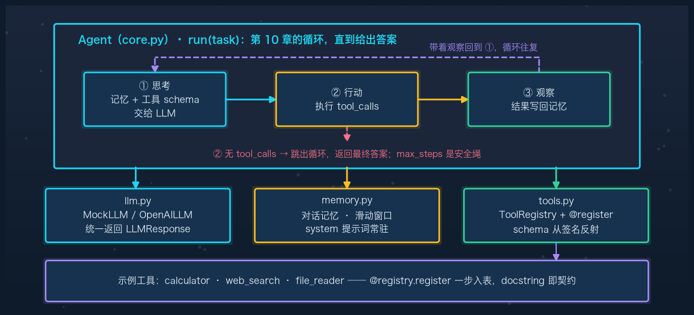

# 第 18 章 从零手写一个 Mini-Agent 框架（< 500 行）


> **📖 开篇故事**
>
> 2022 年 10 月，一位二十多岁的工程师 Harrison Chase 把自己的业余项目开源了，名字叫 **LangChain**。最初版本的核心小得让人意外：一个把 prompt、模型、工具串起来的执行器，关键的 Agent 循环部分不过一两百行 Python。但正是这几百行踩中了时代的需求：LLM 应用开发者们涌进来，项目在 2023 年上半年从几千 star 涨到数万，一度成为 GitHub 上增长最快的项目之一，Chase 也顺势拿到了 Benchmark 领投的种子轮。回头看，LangChain 早期的爆发与其说赢在功能全，不如说赢在它把"LLM + 工具 + 循环"这个最小骨架讲清楚了。骨架从来没多复杂，本章我们就亲手把这副骨架写一遍，写完你再去看任何框架的源码，都像回自己家。

> 前面十七章，我们把 Agent 的零件一件件拆开来玩过：第 10 章的 **Agent 循环**、第 11 章的**工具调用**、第 14 章的**对话记忆**……零件再多，不组装就永远只是零件。本章做一件"蠢事"：不依赖 LangChain 或任何框架，用不到 500 行纯 Python 从零写一个能真正跑起来的 Agent 框架。写完你会获得一种宝贵能力：**看穿一切 Agent 框架的核心循环**，它们不过是本章这几十行代码的精装修版。

> ⚠️ **常见误区**：学 Agent 的第一站就是装 LangChain、LangGraph，把框架当黑盒调参数。
> 黑盒化的代价很快显现：出问题时不知道是 prompt 的锅、循环的锅还是框架的锅；想加一个小特性（比如工具报错重试）都要去翻框架源码找钩子。正确顺序是反过来的：**先把裸循环亲手写一遍，再让框架为你打工**。框架能替你省掉的，应该只是你已亲手体会过的重复劳动。

## 18.1 设计目标：小而全

框架叫 **miniagent**，目标是"小而全"：

- **小**：四个模块加一个 demo，共 253 行，一个晚上能读完；
- **全**：覆盖 Agent 的最小完备集：**Agent 循环**（观察→思考→行动）、**工具注册装饰器**（自动从函数签名生成 schema）、**对话记忆**（带滑动窗口）、**可插拔 LLM 后端**（Mock 与 OpenAI 双轨，换后端不改业务代码）。

同时明确**不做什么**：不做并发、不做流式输出、不做持久化、不做可视化编排，这些是 LangGraph 们的护城河，留到 18.7 节对比。

## 18.2 整体架构



数据流只有一条主线：**记忆 + 工具 schema → LLM →（工具调用 | 最终答案）→ 结果回写记忆**。链路里没有任何魔法，每一环你都可以打断点看。下面四个文件都放在 `miniagent/` 包内（另需一个 `__init__.py` 导出各模块）。

> 💡 **深入思考**：把这张架构图记熟，你就有了一张"框架照妖镜"。之后无论打开 LangChain、AutoGen 还是某个国产框架，都按四个问题拆它：循环引擎在哪？工具 schema 怎么生成？记忆怎么裁剪？LLM 后端怎么抽象？凡是这四问答不利索的设计（比如工具契约靠手写 JSON 维护、循环藏在回调地狱里），日后都会变成你踩的坑。

## 18.3 tools.py：注册装饰器与 schema 自动生成

工具系统回答两个问题：LLM 怎么**知道**有哪些工具？框架怎么**执行**被选中的工具？前者靠从函数签名反射出 JSON Schema（第 11 章的"工具描述即契约"），后者靠一张按名字分发的注册表。

```python
"""miniagent/tools.py —— 工具系统：注册装饰器 + 从函数签名自动生成 schema。"""
import inspect
from typing import Callable, Dict, Any, List

_TYPE_MAP = {str: "string", int: "integer", float: "number", bool: "boolean"}


class Tool:
    """一个工具 = 可调用函数 + 一份给 LLM 看的 JSON Schema。"""

    def __init__(self, func: Callable):
        self.func = func
        self.name = func.__name__
        self.schema = self._build_schema(func)

    @staticmethod
    def _build_schema(func: Callable) -> Dict[str, Any]:
        """反射签名与文档字符串，生成 OpenAI 风格的 function schema。"""
        sig = inspect.signature(func)
        doc = inspect.getdoc(func) or ""
        lines = [ln.strip() for ln in doc.splitlines() if ln.strip()]
        description = lines[0] if lines else f"工具 {func.__name__}"
        param_docs = {}                       # 解析 ":param 名字: 描述" 行
        for ln in lines[1:]:
            if ln.startswith(":param ") and ":" in ln[len(":param "):]:
                pname, pdesc = ln[len(":param "):].split(":", 1)
                param_docs[pname.strip()] = pdesc.strip()
        properties, required = {}, []
        for pname, param in sig.parameters.items():
            ptype = _TYPE_MAP.get(param.annotation, "string")
            properties[pname] = {"type": ptype,
                                 "description": param_docs.get(pname, "")}
            if param.default is inspect.Parameter.empty:
                required.append(pname)
        return {"type": "function",
                "function": {"name": func.__name__, "description": description,
                             "parameters": {"type": "object",
                                            "properties": properties,
                                            "required": required}}}


class ToolRegistry:
    """工具注册表：启动时把 schemas 交给 LLM，执行时按名字分发。"""

    def __init__(self):
        self._tools: Dict[str, Tool] = {}

    def register(self, func: Callable) -> Callable:
        """装饰器入口：@registry.register 挂在普通函数上。"""
        self._tools[func.__name__] = Tool(func)
        return func                           # 返回原函数，不影响直接调用

    def schemas(self) -> List[Dict[str, Any]]:
        return [t.schema for t in self._tools.values()]

    def execute(self, name: str, args: Dict[str, Any]) -> str:
        if name not in self._tools:
            return f"[ToolError] 未注册的工具: {name}"
        try:
            return str(self._tools[name].func(**args))
        except Exception as exc:              # 报错也喂回 LLM，让它自我纠错
            return f"[ToolError] {type(exc).__name__}: {exc}"
```

注意 `execute` 的异常处理：**工具报错不抛出，而是作为文本结果回喂给 LLM**。这是实战框架的标准做法：LLM 看到 `[ToolError]` 往往会自行修正参数重试，直接抛异常反而打断它的自我纠错链路。这个设计的实际效果，18.8 节会专门做一次实验给你看。

## 18.4 memory.py：带滑动窗口的对话记忆

第 14 章讨论过记忆的必要性与膨胀问题。这里给最小实现：消息列表 + 滑动窗口，`system` 提示词常驻，历史只留最近 $W$ 条。

```python
"""miniagent/memory.py —— 对话记忆：存消息、控窗口、给 LLM 提供上下文。"""
from typing import Dict, List, Optional


class ConversationMemory:
    """最小可用的对话记忆：system 提示词常驻，历史消息只留最近 window 条。"""

    def __init__(self, system_prompt: str = "", window: int = 20):
        self.window = window
        self._messages: List[Dict] = []
        if system_prompt:
            self._messages.append({"role": "system", "content": system_prompt})

    def add(self, role: str, content: str,
            tool_calls: Optional[list] = None, name: Optional[str] = None):
        msg = {"role": role, "content": content}
        if tool_calls:
            msg["tool_calls"] = tool_calls
        if name:
            msg["name"] = name
        self._messages.append(msg)

    def get(self) -> List[Dict]:
        """裁剪后的消息列表：system 永远在，历史只留最近 window 条。"""
        system = [m for m in self._messages if m["role"] == "system"]
        rest = [m for m in self._messages if m["role"] != "system"]
        return system + rest[-self.window:]
```

## 18.5 llm.py：Mock 与 OpenAI 双后端

全书一贯的双轨写法：**Mock 后端离线跑通所有逻辑，OpenAI 后端留好真实接口**。关键设计是统一返回结构 `LLMResponse`：上层循环永远面对同一种数据，换后端零改动。

```python
"""miniagent/llm.py —— 可插拔 LLM 后端：统一接口 chat(messages, tool_schemas)。"""
import json
import re
from dataclasses import dataclass, field
from typing import Dict, List, Optional


@dataclass
class LLMResponse:
    """LLM 一次回复的统一表示：要么是最终文本，要么是一组工具调用。"""
    content: str = ""
    tool_calls: List[Dict] = field(default_factory=list)  # [{"name":..., "args": {...}}]


class MockLLM:
    """规则驱动的假 LLM：零成本、行为确定，适合教学与单元测试。
    "推理" = 读历史里的工具结果决定下一步：读文件 -> 算面积 -> 搜公式 -> 作答。
    """

    def chat(self, messages: List[Dict], tool_schemas: List[Dict]) -> LLMResponse:
        file_out = self._tool_result(messages, "file_reader")
        calc_out = self._tool_result(messages, "calculator")
        search_out = self._tool_result(messages, "web_search")
        if file_out is None:                  # 第 1 步：还没读文件 -> 提取路径去读
            user_msg = next((m["content"] for m in messages
                             if m["role"] == "user"), "")
            m = re.search(r"读取\s*(\S+)", user_msg)
            return LLMResponse(tool_calls=[
                {"name": "file_reader",
                 "args": {"path": m.group(1) if m else "data.txt"}}])
        if calc_out is None:                  # 第 2 步：取出半径数值 -> 调计算器
            r = re.search(r"半径\s*r?\s*=\s*([\d.]+)", file_out)
            expr = f"3.1415926 * {r.group(1)} ** 2" if r else "0"
            return LLMResponse(tool_calls=[
                {"name": "calculator", "args": {"expression": expr}}])
        if search_out is None:                # 第 3 步：已算出结果 -> 搜索验证公式
            return LLMResponse(tool_calls=[
                {"name": "web_search", "args": {"query": "圆的面积公式"}}])
        return LLMResponse(content=(          # 第 4 步：信息齐全 -> 汇总作答
            f"文件内容：{file_out.strip()}；"
            f"calculator 计算结果：{calc_out.strip()}；"
            f"web_search 证实公式无误。结论：圆面积约为 {calc_out.strip()}。"))

    @staticmethod
    def _tool_result(messages: List[Dict], tool_name: str) -> Optional[str]:
        """在历史里找某个工具最近一次返回的内容；没找到返回 None。"""
        for m in reversed(messages):
            if m["role"] == "tool" and m.get("name") == tool_name:
                return m["content"]
        return None


class OpenAILLM:
    """真实后端：OpenAI 兼容接口的函数调用。
    使用前 pip install openai 并设置 OPENAI_API_KEY。本类未在书中实际运行。
    """

    def __init__(self, model: str = "gpt-4o-mini", base_url: Optional[str] = None):
        from openai import OpenAI             # 延迟导入：装了 openai 才会用到
        self.client = OpenAI(base_url=base_url)
        self.model = model

    def chat(self, messages: List[Dict], tool_schemas: List[Dict]) -> LLMResponse:
        resp = self.client.chat.completions.create(
            model=self.model, messages=messages, tools=tool_schemas or None)
        msg = resp.choices[0].message
        calls = [{"name": tc.function.name, "args": json.loads(tc.function.arguments)}
                 for tc in (msg.tool_calls or [])]
        return LLMResponse(content=msg.content or "", tool_calls=calls)
```

MockLLM 不是"作弊"，而是**把 LLM 的决策替换成确定性的状态机**。框架要验证的是"循环、分发、记忆回写"这条管道对不对；管道对了，真 LLM 接进来只是换个"大脑"。这也是所有 Agent 框架写单测的标准姿势。

> 💡 **深入思考**：MockLLM 读的是 `messages`（对话历史）而不是某个全局变量，这一点很关键。它意味着 MockLLM 与真 LLM 站在同一条信息起跑线上：**只凭对话历史决定下一步**。如果 Mock 偷看了 Agent 的内部状态或提前知道了答案，测试就与真实运行脱钩了。写测试替身（test double）时永远问一句：它能看到的信息，和被替换的组件一样多吗？

## 18.6 core.py：循环引擎 + 实战 demo

核心循环只做一件事：**问 LLM 下一步做什么，照做，把观察结果写回记忆，再问**。`max_steps` 是安全绳，防止 LLM 陷入死循环烧钱。

```python
"""miniagent/core.py —— Agent 循环引擎：LLM 决策 -> 执行工具 -> 观察 -> 再决策。"""
import json

from .llm import LLMResponse
from .memory import ConversationMemory
from .tools import ToolRegistry

SYSTEM_PROMPT = ("你是一个任务导向的 Agent。你可以调用工具来完成任务；"
                 "每轮最多调用一个工具；信息齐全后给出最终答案。")


class Agent:
    """把 LLM、记忆、工具注册表缝在一起的最小 Agent。"""

    def __init__(self, llm, registry: ToolRegistry,
                 max_steps: int = 8, verbose: bool = True):
        self.llm = llm
        self.registry = registry
        self.max_steps = max_steps
        self.verbose = verbose
        self.memory = ConversationMemory(system_prompt=SYSTEM_PROMPT)

    def run(self, task: str) -> str:
        """第 10 章的 Agent 循环，直到给出答案或步数耗尽。"""
        self.memory.add("user", task)
        self._log(f"[run] 任务: {task}")
        for step in range(1, self.max_steps + 1):
            # 思考：把记忆与工具清单交给 LLM，让它决定下一步
            resp: LLMResponse = self.llm.chat(self.memory.get(),
                                              self.registry.schemas())
            if resp.tool_calls:               # 分支一：执行工具，结果喂回记忆
                self.memory.add("assistant", content=resp.content,
                                tool_calls=resp.tool_calls)
                for call in resp.tool_calls:
                    self._log(f"[step {step}] 调用工具 {call['name']}"
                              f"({json.dumps(call['args'], ensure_ascii=False)})")
                    result = self.registry.execute(call["name"], call["args"])
                    self._log(f"[step {step}] 工具返回: {result}")
                    self.memory.add("tool", result, name=call["name"])
                continue                      # 观察完毕，进入下一轮思考
            self.memory.add("assistant", content=resp.content)   # 分支二：收工
            self._log(f"[step {step}] 最终答案: {resp.content}")
            return resp.content
        self._log(f"[run] 超过最大步数 {self.max_steps}，强制结束")  # 安全绳
        return "（未能在限定步数内完成任务）"

    def _log(self, text: str):
        if self.verbose:
            print(text)
```

最后注册三个工具，跑一个需要**三轮工具调用**的任务（读文件 → 算面积 → 搜公式）：

```python
"""demo.py —— 运行：python demo.py。任务：读半径 -> 算面积 -> 搜公式 -> 作答。"""
from pathlib import Path

from miniagent import Agent, ToolRegistry, MockLLM

# 准备任务素材：一个写着半径的文件
Path("data.txt").write_text("实验记录：圆形样品的半径 r = 7，请计算其面积。", encoding="utf-8")

registry = ToolRegistry()


@registry.register
def calculator(expression: str) -> float:
    """计算一个数学表达式并返回结果。

    :param expression: 合法的 Python 数学表达式，如 3.14 * 7 ** 2
    """
    allowed = set("0123456789+-*/(). **e")
    if not set(expression) <= allowed:
        raise ValueError(f"表达式含非法字符: {expression}")
    return round(eval(expression, {"__builtins__": {}}, {}), 2)


@registry.register
def web_search(query: str) -> str:
    """搜索互联网，返回与查询最相关的摘要。（本 demo 为离线 mock 数据）

    :param query: 搜索关键词
    """
    fake_index = {"圆的面积公式": "圆的面积 S = π * r^2，其中 r 为半径，π ≈ 3.1415926。"}
    return fake_index.get(query, f"（mock）未找到与 {query} 相关的结果")


@registry.register
def file_reader(path: str) -> str:
    """读取本地文本文件的内容。

    :param path: 文件路径
    """
    return Path(path).read_text(encoding="utf-8")


if __name__ == "__main__":
    agent = Agent(llm=MockLLM(), registry=registry)   # 换成 OpenAILLM() 即可上真模型
    answer = agent.run("请读取 data.txt 里的半径，计算圆面积，再搜索验证一下公式。")
    print("\n最终答案:", answer)
```

本机真实运行的完整输出：

```text
[run] 任务: 请读取 data.txt 里的半径，计算圆面积，再搜索验证一下公式。
[step 1] 调用工具 file_reader({"path": "data.txt"})
[step 1] 工具返回: 实验记录：圆形样品的半径 r = 7，请计算其面积。
[step 2] 调用工具 calculator({"expression": "3.1415926 * 7 ** 2"})
[step 2] 工具返回: 153.94
[step 3] 调用工具 web_search({"query": "圆的面积公式"})
[step 3] 工具返回: 圆的面积 S = π * r^2，其中 r 为半径，π ≈ 3.1415926。
[step 4] 最终答案: 文件内容：实验记录：圆形样品的半径 r = 7，请计算其面积。；calculator 计算结果：153.94；web_search 证实公式无误。结论：圆面积约为 153.94。

最终答案: 文件内容：实验记录：圆形样品的半径 r = 7，请计算其面积。；calculator 计算结果：153.94；web_search 证实公式无误。结论：圆面积约为 153.94。
```

逐行读这段 trace：**第 1 步** LLM 决定读文件；**第 2 步**它从历史里取出半径 7，构造表达式交给计算器；**第 3 步**搜索验证公式；**第 4 步**汇总作答。整个过程中 `core.py` 没有一行代码知道"圆面积"是什么：决策完全由 LLM 端做出，框架只负责**循环、分发、记忆**。这就是 Agent 框架的本质。

> 🎯 **面试高频**：*"Agent 框架的核心循环是什么？为什么 max_steps 是必需的？"*
> 一句话版本：**拿到记忆与工具清单 → 交给 LLM 决策 → 若返回工具调用就执行并把结果写回记忆 → 否则输出最终答案**，循环往复。max_steps 必需的原因有两个：一是真实 LLM 会"原地打转"（反复调用同一工具、或永远觉得信息不齐），二是每一次空转都在烧真金白银的 token，所以安全绳不是可选项，是成本控制的第一道闸。

## 18.7 与 LangGraph 的差距：从小车到坦克

我们的框架能跑，但离生产级还远。对照 LangGraph 看差距，也看清进阶路线：

| 能力 | miniagent（本章） | LangGraph 等生产框架 |
|---|---|---|
| 控制流 | 单线程循环，`max_steps` 兜底 | **状态机/图**：节点 + 条件边，可分支、回环、并行 |
| 状态管理 | 内存里的消息列表 | **持久化 Checkpointer**：断电续跑、时间旅行回放 |
| 人机协作 | 无 | **Human-in-the-loop**：中断执行等人工审批再续跑 |
| 并发 | 顺序执行 | 节点级并行、map-reduce 式子任务分发 |
| 可观测性 | print trace | LangSmith 式全链路追踪、token 级成本统计 |

进阶路线建议：**第一步**，啃透本章代码并做练习 18.2、18.3，真正理解装饰器反射与循环收敛；**第二步**，给框架加"中断-审批-续跑"（练习 18.5），体会状态持久化的必要；**第三步**再打开 LangGraph 源码，你会发现 `StateGraph` 无非把我们的 `run()` 循环换成显式的图，每个节点仍是"LLM 调用或工具执行"。框架没有秘密，只有取舍。

## 18.8 动手实验（一）：故意让 Agent 犯错，看它自己改对

18.3 节埋了一个设计伏笔：**工具报错不抛出，而是回喂 LLM**。真实世界里，LLM 生成的参数经常不合法：表达式里混进变量名、参数类型不对、路径拼错。框架对这类"坏调用"的态度，决定了 Agent 是一错到底，还是自我修复。这个实验把伏笔兑现。

代码位于 `code/ch18-mini-agent-framework/selfheal_demo.py`。设计一个 `SelfHealLLM`：它的规则里**故意埋一个错误**：第一次调用 calculator 时，把从文件里读到的变量 `r` 原样写进表达式（`3.1415926 * r ** 2`），而 calculator 的字符白名单不允许字母。工具抛 `ValueError`，`ToolRegistry.execute` 捕获后转成 `[ToolError]` 文本写回记忆；下一轮，`SelfHealLLM` 在历史里读到报错，从文件内容里重新提取数字，改写成合法表达式重试：

```python
"""selfheal_demo.py —— 工具报错回喂 LLM 的"自我纠错"实验。"""
import re
from pathlib import Path

from miniagent import Agent, ToolRegistry, LLMResponse

Path("data.txt").write_text("实验记录：圆形样品的半径 r = 7，请计算其面积。",
                            encoding="utf-8")

registry = ToolRegistry()


@registry.register
def calculator(expression: str) -> float:
    """计算一个数学表达式并返回结果。

    :param expression: 合法的 Python 数学表达式，如 3.14 * 7 ** 2
    """
    allowed = set("0123456789+-*/(). **e")
    if not set(expression) <= allowed:
        raise ValueError(f"表达式含非法字符: {expression}")
    return round(eval(expression, {"__builtins__": {}}, {}), 2)


@registry.register
def file_reader(path: str) -> str:
    """读取本地文本文件的内容。

    :param path: 文件路径
    """
    return Path(path).read_text(encoding="utf-8")


class SelfHealLLM:
    """规则驱动且"会犯错也会改错"的假 LLM。
    第 1 步读文件；第 2 步故意把变量名 r 写进表达式（非法）；
    第 3 步读到 [ToolError] 后改写为合法表达式重试；第 4 步收工。
    """

    @staticmethod
    def _last_result(messages, tool_name):
        """在历史里找某个工具最近一次返回的内容；没找到返回 None。"""
        for m in reversed(messages):
            if m["role"] == "tool" and m.get("name") == tool_name:
                return m["content"]
        return None

    def chat(self, messages, tool_schemas):
        file_out = self._last_result(messages, "file_reader")
        calc_out = self._last_result(messages, "calculator")

        if file_out is None:                       # 还没读文件
            return LLMResponse(tool_calls=[
                {"name": "file_reader", "args": {"path": "data.txt"}}])

        if calc_out is None:                       # 第一次算：埋一个错误
            return LLMResponse(tool_calls=[
                {"name": "calculator",
                 "args": {"expression": "3.1415926 * r ** 2"}}])   # r 是非法字符!

        if calc_out.startswith("[ToolError]"):    # 看到报错 -> 自我纠错
            r = re.search(r"半径\s*r?\s*=\s*(\d+)", file_out)
            fixed = f"3.1415926 * {r.group(1)} ** 2"
            print(f"    [SelfHealLLM] 观察到报错，改写表达式 -> {fixed}")
            return LLMResponse(tool_calls=[
                {"name": "calculator", "args": {"expression": fixed}}])

        return LLMResponse(content=                # 修好了，收工
                           f"半径从 data.txt 读得为 7；第一次表达式含非法字符 r 被拒，"
                           f"改写后重试成功。圆面积 = {calc_out.strip()}。")


if __name__ == "__main__":
    agent = Agent(llm=SelfHealLLM(), registry=registry, max_steps=6)
    print("[实验] 故意犯错 -> 观察 ToolError -> 自我纠错 -> 重试\n")
    answer = agent.run("读取 data.txt 里的半径并计算圆面积。")
    print("\n最终答案:", answer)
```

`python3 selfheal_demo.py` 本机真实输出：

```text
[实验] 故意犯错 -> 观察 ToolError -> 自我纠错 -> 重试

[run] 任务: 读取 data.txt 里的半径并计算圆面积。
[step 1] 调用工具 file_reader({"path": "data.txt"})
[step 1] 工具返回: 实验记录：圆形样品的半径 r = 7，请计算其面积。
[step 2] 调用工具 calculator({"expression": "3.1415926 * r ** 2"})
[step 2] 工具返回: [ToolError] ValueError: 表达式含非法字符: 3.1415926 * r ** 2
    [SelfHealLLM] 观察到报错，改写表达式 -> 3.1415926 * 7 ** 2
[step 3] 调用工具 calculator({"expression": "3.1415926 * 7 ** 2"})
[step 3] 工具返回: 153.94
[step 4] 最终答案: 半径从 data.txt 读得为 7；第一次表达式含非法字符 r 被拒，改写后重试成功。圆面积 = 153.94。

最终答案: 半径从 data.txt 读得为 7；第一次表达式含非法字符 r 被拒，改写后重试成功。圆面积 = 153.94。
```

请注意整个过程中 **`core.py` 和 `tools.py` 一行都没改**：纠错发生在"LLM 读历史、改参数、重试"这条链路上，框架的管道天然支持它：只要错误以文本形式回到对话历史，Agent 就获得了"看见错误"的机会。反过来，如果 `execute` 把异常直接抛出打断循环，这条自我修复链路就不存在了。这正是 18.3 节那句"报错也喂回 LLM"的分量：它不只是防御性编程，而是**把错误变成了可被推理的观察**。

当然，自我纠错不是免费的：它多花了一个 step（对应真实场景里多一次 LLM 调用），而且依赖 `max_steps` 留足余量。若任务很紧、工具很贵，就要在 system prompt 里同时给"调用前自查参数"的规则，让错误尽量不发生。**预防一步，纠错三步**。

## 18.9 动手实验（二）：检查自动生成的工具契约

18.3 节说 schema "从函数签名自动生成"，避免两份维护。耳听为虚，代码位于 `code/ch18-mini-agent-framework/schema_inspect.py` 的实验直接把生成的 JSON 打出来，再模拟 LLM 端三种典型坏调用（缺参数、多余参数、错类型），看 `execute` 如何兜底：

```python
"""schema_inspect.py —— 工具 schema 自动生成的"契约检查"实验。"""
import json
from datetime import datetime

from miniagent import ToolRegistry

registry = ToolRegistry()


@registry.register
def calculator(expression: str) -> float:
    """计算一个数学表达式并返回结果。

    :param expression: 合法的 Python 数学表达式，如 3.14 * 7 ** 2
    """
    allowed = set("0123456789+-*/(). **e")
    if not set(expression) <= allowed:
        raise ValueError(f"表达式含非法字符: {expression}")
    return round(eval(expression, {"__builtins__": {}}, {}), 2)


@registry.register
def current_time() -> str:
    """返回当前的本地时间。
    """
    return datetime.now().strftime("%Y-%m-%d %H:%M:%S")


# ---------- 1. 打印自动生成的 schema ----------
print("=== 自动生成的工具 schema ===")
for schema in registry.schemas():
    fn = schema["function"]
    print(f"\n[{fn['name']}] {fn['description']}")
    print(json.dumps(fn["parameters"], ensure_ascii=False, indent=2))

# ---------- 2. 三种典型的"LLM 坏调用" ----------
print("\n=== LLM 端坏调用的容错行为 ===")
cases = [
    ("缺参数",         {"name": "calculator", "args": {}}),
    ("多余参数",       {"name": "current_time", "args": {"timezone": "UTC"}}),
    ("错类型",         {"name": "calculator", "args": {"expression": 123}}),
    ("正常调用（对照）", {"name": "calculator", "args": {"expression": "3.14 * 2 ** 2"}}),
]
for label, call in cases:
    result = registry.execute(call["name"], call["args"])
    print(f"{label:<10} {call['name']}({call['args']}) -> {result}")
```

`python3 schema_inspect.py` 本机真实输出：

```text
=== 自动生成的工具 schema ===

[calculator] 计算一个数学表达式并返回结果。
{
  "type": "object",
  "properties": {
    "expression": {
      "type": "string",
      "description": "合法的 Python 数学表达式，如 3.14 * 7 ** 2"
    }
  },
  "required": [
    "expression"
  ]
}

[current_time] 返回当前的本地时间。
{
  "type": "object",
  "properties": {},
  "required": []
}

=== LLM 端坏调用的容错行为 ===
缺参数        calculator({}) -> [ToolError] TypeError: calculator() missing 1 required positional argument: 'expression'
多余参数       current_time({'timezone': 'UTC'}) -> [ToolError] TypeError: current_time() got an unexpected keyword argument 'timezone'
错类型        calculator({'expression': 123}) -> [ToolError] TypeError: 'int' object is not iterable
正常调用（对照）   calculator({'expression': '3.14 * 2 ** 2'}) -> 12.56
```

- **docstring 真的进了契约**：`:param expression:` 那行出现在 schema 的 `description` 里，LLM 恰恰是靠这段话决定传什么的。写工具时多写一句参数说明，命中率就高一分，这不是文档洁癖，是工程杠杆；
- **无参工具的 `required` 是空数组**：`current_time()` 生成的 schema 参数区为空、`required: []`，OpenAI 接口接受这种形态。空参数工具是新手最容易写坏的一类（练习 18.2 让你亲手踩过）；
- **三种坏调用都变成了 `[ToolError]` 文本而非崩溃**：与 18.8 的实验呼应，错误统一走"回喂"通道。注意"错类型"那条报错信息（`'int' object is not iterable`）来自 `set(expression)`，对人不太可读；生产级实现应按 schema 的 `type` 字段先做参数校验（练习 18.1 的作业），报出"expression 应为 string"这种 LLM 能读懂的话。**给 LLM 的报错信息，本身也是 prompt**。

## 本章小结

- **Agent 框架的最小完备集** = 循环引擎 + 工具注册 + 记忆 + 可插拔 LLM 后端；本章用 253 行（含 demo）全部实现并跑通。
- **工具 schema 应自动生成**：从签名与 docstring 反射，避免"代码与契约两份维护"的漂移；工具异常要回喂 LLM 而非抛出，实验证明这让 Agent 获得自我纠错能力（18.8）。
- **统一抽象是插拔的前提**：`LLMResponse` 统一"文本回答"与"工具调用"，`ToolRegistry` 统一注册与分发，循环因此与具体 LLM 解耦。
- **Mock LLM 是正经工程手段**：用确定性规则替换真模型验证管道，是 Agent 单测的标准姿势；接真模型只需把 `MockLLM()` 换成 `OpenAILLM()`。
- 与 LangGraph 的差距集中在**状态机表达力、持久化、人机回环、并发与可观测性**，而这些都是同一核心循环之上的增量。
- **给 LLM 的错误信息也是 prompt**：容错与纠错设计要贯穿工具层（18.8/18.9 两个实验一以贯之）。

## 练习题

**18.1（代码）** 给 `execute` 加参数类型校验：按 schema 的 `type` 字段检查 `args` 各值的 Python 类型，不符时返回 `[ToolError]`。用错误类型调用 `calculator` 验证。

**18.2（代码）** 新增无参工具 `current_time()`（返回当前时间字符串），观察 `_build_schema` 对空参数列表的处理，`required` 是否为空数组，修正发现的问题。

**18.3（代码）** 把任务改成"读取 data.txt，把半径加 1 后再算面积"。只改 MockLLM 的规则，不改 `core.py`，体会"业务逻辑在 LLM 端，管道在框架端"的分工。

**18.4（代码）** 实现 `OllamaLLM`：调用本机 Ollama 的 `/api/chat` 接口（`requests` 即可）。验证换后端后 demo 的 trace 结构不变。

**18.5（扩展挑战）** 加**人机回环**：执行 `calculator` 前打印参数等待用户输入 `y/n`，`n` 则把"用户拒绝"写回记忆让 LLM 换方案。这距离 LangGraph 的 `interrupt` 机制还差什么？

**18.6（扩展挑战）** 实现**记忆持久化**：给 `ConversationMemory` 加 `save(path)` / `load(path)`（JSON），让 Agent 重启后接着上次对话。思考 `tool_calls` 字段序列化有哪些坑。

**18.7（实验：连环纠错）** 把 `selfheal_demo.py` 改造成"连环犯错版"：第一次表达式带变量 `r`，第二次故意把 `**` 写成 `^`（同样非法），第三次才改对。观察 `max_steps` 至少要设为几，体会"纠错余量"与步数预算的换算。

骨架到此完工，但一台引擎还不能上路。下一章把它装进最常见的真实需求里：个人知识库 Agent。到那时你会发现，循环还是本章这个循环，零件还是第 11、13、14 章这些零件，真正的新东西全在框架之外：**切片怎么切、检索怎么评、出处怎么给**。产品好不好用，往往不取决于引擎的马力，而取决于你喂给它的数据。

## 📚 延伸阅读

- **ReAct: Synergizing Reasoning and Acting in Language Models**（Yao et al., 2022）：Agent 循环的思想源头，第 10 章与本章循环的学术出处。https://arxiv.org/abs/2210.03629
- **LangGraph 官方文档**：对照 18.7 的差距表，看 StateGraph、Checkpointer、interrupt 的生产级实现。https://langchain-ai.github.io/langgraph/
- **Building Effective Agents**（Anthropic，2024）：从"workflow 到 agent"的工程判断框架，与 18.7 的进阶路线互为印证。https://www.anthropic.com/research/building-effective-agents
- **OpenAI Function Calling 指南**：工具 schema 的官方规范，18.3 反射生成的就是这种格式。https://platform.openai.com/docs/guides/function-calling
- **LangChain 源码仓库**：开源史的主角。别怕大，带着本章的四问去读 `agents/` 与 `core/`，你会发现熟悉的部分。https://github.com/langchain-ai/langchain
