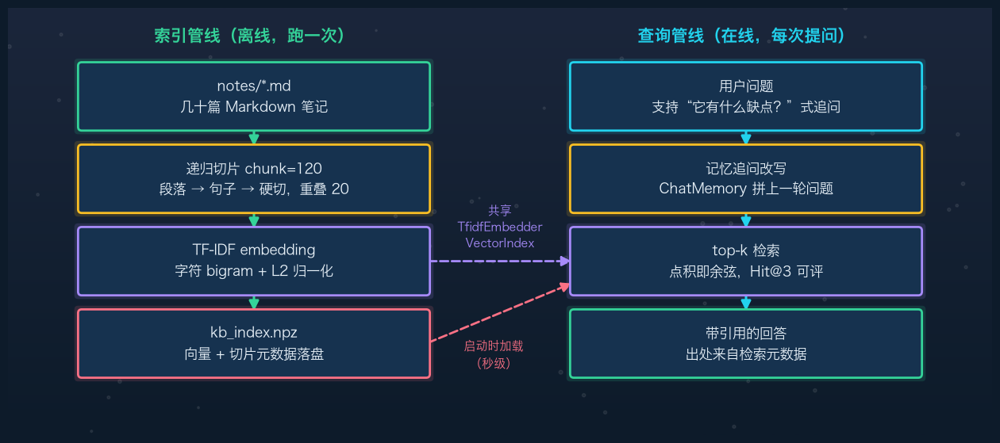

# 第 19 章 实战：搭建你的个人知识库 Agent


> **📖 开篇故事**
>
> 2024 年 7 月，Gartner 发布预测：**到 2025 年底，至少 30% 的生成式 AI 项目将在验证概念之后被放弃**。原因被归为三样：节节攀升的成本、无从证明的 ROI，以及最扎心的一条：**数据准备不足**。企业知识库 Agent 恰恰是这三重的重灾区。复盘那些倒下的项目，失败姿势惊人地一致：几万篇文档一股脑塞进向量库，切片按 500 字符一刀切；没有评估集，"效果好不好"全靠领导现场点几个问题；答案不带引用，用户不知道哪句是笔记、哪句是模型即兴发挥，两周蜜月期后，产品被员工默默弃用。而活下来的项目往往没换什么黑科技，只是把三件朴素的事做对了：**切片守语义边界、检索有评估集、回答带出处**。本章就把这三件事，用一个不到 240 行的实现完整走一遍。

> 学了 RAG（第 13 章）和记忆（第 14 章）之后，最常听到的抱怨是："道理都懂，但我的笔记还是一摊死文件。"本章把这两章拼成一个完整产品：一个能**扫描你的 Markdown 笔记、建立向量索引、带引用回答问题、支持追问**的知识库 Agent。全程只用 NumPy，不装任何重型依赖，索引落盘成 `.npz` 文件，第二次启动秒开。

> ⚠️ **常见误区**：检索效果不好，第一反应是"换个更强的 embedding 模型"。
> 排查顺序应该是反的：**切片 → 检索 → 重排 → 生成**，而 embedding 排在第二位之后。19.9 节的消融实验会给你一个量化证据：在玩具语料上，把切片上限从 60 改到 120（不换任何模型），"答案句完整保留率"立刻从 5/6 变 6/6。语料切得支离破碎时，再贵的模型也是在残缺的证据上作答。

## 19.1 需求分析

假设你有一个 `notes/` 目录，里面散落着几十篇学习笔记（`.md` 文件）。你要的 Agent 应当：

1. **索引管线**：扫描目录 → 把长文切成语义完整的切片 → 算向量 → 持久化到磁盘；
2. **查询管线**：用户提问 → 检索 top-k 相关切片 → 生成**带引用出处**的回答；
3. **多轮能力**：支持"它有什么缺点？"这类指代上一轮的**追问**；
4. **可评估**：有一组带标准答案的问题，能量化检索质量，而不是凭感觉。

约束：笔记以**中文**为主；没有 GPU 和 embedding API，正好逼我们用纯 NumPy 实现 TF-IDF，看清 embedding 的本质。

> 💡 **深入思考**："没有 embedding API"看起来是自缚手脚，其实是教学红利。当你用 TF-IDF 手搓出整套检索后，"embedding"在你眼里就不再是神秘黑箱，而是**把词面匹配换成语义匹配的升级件**：接口不变、语料不变、评估集不变，只换向量的来源。以后你换 BGE、换 OpenAI text-embedding，都只是这条管线上的一个零件更换，而不是一次重新设计。

## 19.2 整体架构



两条管线共享同一个 `TfidfEmbedder` 与 `VectorIndex`；Agent 本体只做编排，不含检索逻辑。

## 19.3 索引管线：扫描目录与递归切片

切片的黄金原则：**优先在语义边界（段落、句子）断开，万不得已才硬切**。下面的 `recursive_chunk` 按 `\n\n → \n → 。` 的顺序递归降级，并给相邻切片留 20 字符重叠，缓解边界切断语义。示例笔记由代码首次运行时自动创建（6 篇，覆盖本书多个主题）：

```python
"""kb_agent.py —— 个人知识库 Agent：扫描 Markdown -> TF-IDF 索引 -> 带引用的问答。
依赖：仅 numpy。首次运行自动创建 6 篇示例笔记并构建索引，
再次运行直接加载 kb_index.npz。运行：python kb_agent.py
"""
import json
import re
from pathlib import Path

import numpy as np

NOTES_DIR = Path("notes")
INDEX_PATH = Path("kb_index.npz")
CHUNK_SIZE, CHUNK_OVERLAP, TOP_K = 120, 20, 3

# ---------- 1. 示例笔记：首次运行时自动创建 ----------
SAMPLE_NOTES = {
    "agent_loop.md": """# Agent 循环
Agent 循环是智能体的核心控制结构，经典形式是 ReAct：观察（Observation）->思考（Thought）-> 行动（Action）三步交替进行，直到任务完成。
每一轮中，LLM 根据历史决定是调用工具还是给出最终答案。工程上必须设置最大步数作为安全绳，防止模型陷入死循环持续烧钱。
Agent 循环与普通的函数调用不同：下一步做什么由模型在运行时动态决定。""",
    "rag_basics.md": """# RAG 检索增强生成
RAG 把回答拆成检索与生成两段：先用向量检索从知识库找出相关切片，再把切片塞进提示词让 LLM 基于资料作答，从而缓解幻觉并支持私有数据。
RAG 的典型痛点是检索质量：切片太大噪声多，太小又丢失上下文。进阶手段包括混合检索（向量 + BM25）、重排序 Rerank 与查询改写。
评估 RAG 常用命中率与答案忠实度两个指标。""",
    "attention.md": """# Transformer 注意力机制
注意力机制的核心公式是 softmax(QK^T / sqrt(d_k)) V：查询 Query 去匹配键 Key，按匹配度对值 Value 加权求和。
除以根号 d_k 是为了防止点积随维度增大导致 softmax 饱和、梯度消失。多头注意力把维度切成多份并行计算，每个头捕捉一种相关模式。
因果 mask 保证生成时每个位置只能看到自己及之前的 token。""",
    "vector_db.md": """# 向量数据库
向量数据库专门存储和检索高维 embedding 向量，核心操作是近似最近邻搜索 ANN。主流产品包括 Chroma、Milvus、Qdrant 与 pgvector。
Chroma 适合本地原型，pip 安装后几行代码即可建库；Milvus 面向生产级海量数据。常见索引算法有 HNSW 和 IVF，本质都是用精度换速度。
小规模项目其实用 NumPy 存向量加余弦相似度暴力搜索就足够了。""",
    "prompt_engineering.md": """# 提示词工程
提示词工程是低成本撬动 LLM 能力的第一杠杆。常用技巧：角色设定、few-shot 示例、思维链 CoT、结构化输出约束。
给模型清晰的输出格式要求（如 JSON Schema）比长篇说教更有效。系统提示词应该短而硬：只写不可违反的规则，细节放到用户消息里。
调试提示词的科学方法是固定输入、单变量修改、保留版本记录。""",
    "memory.md": """# Agent 的记忆系统
没有记忆的 Agent 每条消息都是初次见面。记忆分短期与长期两层。短期记忆就是对话历史，工程上常用滑动窗口或摘要压缩防止上下文爆炸。
长期记忆把用户偏好、历史结论向量化存进数据库，需要时检索注入。写入长期记忆前要做价值判断：不是所有对话都值得记住。记忆检索与 RAG 同源，区别只在写入时机和数据来源。""",
}


def create_sample_notes() -> None:
    NOTES_DIR.mkdir(exist_ok=True)
    for name, text in SAMPLE_NOTES.items():
        (NOTES_DIR / name).write_text(text, encoding="utf-8")


# ---------- 2. 递归切片：先按段落，不够再按句子，最后硬切 ----------
def recursive_chunk(text: str, size: int = CHUNK_SIZE) -> list:
    def split_rec(t: str, seps) -> list:
        if len(t) <= size or not seps:
            return [t[i:i + size] for i in range(0, len(t), size)] if len(t) > size else [t]
        sep, rest = seps[0], seps[1:]
        parts = t.split(sep) if sep else list(t)
        out, buf = [], ""
        for p in parts:
            piece = buf + (sep if buf else "") + p
            if len(piece) <= size:
                buf = piece
            else:
                if buf:
                    out.append(buf)
                buf = p if len(p) <= size else ""
                if not buf:
                    out.extend(split_rec(p, rest))    # 仍超长 -> 换更细的分隔符递归
        if buf:
            out.append(buf)
        return out

    chunks = split_rec(text, ["\n\n", "\n", "。", ""])
    # 相邻切片保留 overlap 个字符的重叠，缓解边界切断语义
    merged = [(chunks[i - 1][-CHUNK_OVERLAP:] + c) if i > 0 else c
              for i, c in enumerate(chunks)]
    return [c.strip() for c in merged if c.strip()]
```

## 19.4 NumPy TF-IDF embedding 与向量索引

没有 embedding 模型，就回到最经典的词频向量。**TF-IDF** 的直觉：一个词在本文档出现越多（TF 高）、在全体文档出现越少（IDF 高），越能代表本文档：

$$\text{tfidf}(t, d) = \frac{\text{count}(t, d)}{|d|} \times \left(\ln\frac{1 + N}{1 + \text{df}(t)} + 1\right)$$

中文不空格分词，这里用**字符二元组（bigram）**："注意力" → `注意 / 意力`。只用 bigram 不用单字，可以避开"是、的"这类高频虚字噪声。检索用余弦相似度：向量都做过 L2 归一化，**点积即余弦**，一次矩阵乘法算完全部切片：

```python
# ---------- 3. 分词 + NumPy TF-IDF embedding ----------
def tokenize(text: str) -> list:
    """中文按字符二元组（bigram）切，英文按单词切，兼容中英混排。
    只用 bigram 不用单字，避免“是/的”这类高频字带来噪声。"""
    text = text.lower()
    en_words = re.findall(r"[a-z0-9_]+", text)
    zh_chars = re.findall(r"[一-鿿]", text)
    bigrams = [a + b for a, b in zip(zh_chars, zh_chars[1:])]
    return en_words + bigrams


class TfidfEmbedder:
    """纯 NumPy 的 TF-IDF：fit 学词表与 idf，transform 输出 L2 归一化向量。"""

    def fit(self, texts: list):
        df = {}
        for t in texts:
            for tok in set(tokenize(t)):
                df[tok] = df.get(tok, 0) + 1
        self.vocab = {tok: i for i, tok in enumerate(sorted(df))}
        n = len(texts)
        self.idf = np.array([np.log((1 + n) / (1 + df[t])) + 1
                             for t in sorted(df)])
        return self

    def transform(self, texts: list) -> np.ndarray:
        mat = np.zeros((len(texts), len(self.vocab)))
        for r, t in enumerate(texts):
            toks = tokenize(t)
            for tok in toks:
                if tok in self.vocab:
                    mat[r, self.vocab[tok]] += 1.0      # 原始 tf
            if toks:
                mat[r] /= len(toks)                     # 按词数归一
        mat *= self.idf
        norm = np.linalg.norm(mat, axis=1, keepdims=True)
        return mat / np.maximum(norm, 1e-9)             # L2 归一化


# ---------- 4. 向量索引：余弦相似度检索，.npz 持久化 ----------
class VectorIndex:
    def __init__(self):
        self.meta, self.vectors = [], None

    def build(self, chunks: list, vectors: np.ndarray):
        self.meta, self.vectors = chunks, vectors

    def save(self, path: Path):
        np.savez(path, vectors=self.vectors,
                 meta=np.array(json.dumps(self.meta, ensure_ascii=False)))

    def load(self, path: Path):
        data = np.load(path, allow_pickle=False)
        self.vectors = data["vectors"]
        self.meta = json.loads(str(data["meta"]))

    def search(self, query_vec: np.ndarray, k: int = TOP_K) -> list:
        with np.errstate(all="ignore"):               # macOS Accelerate 的误报警告
            scores = self.vectors @ query_vec           # 均已归一化，点积即余弦
        top = np.argsort(scores)[::-1][:k]
        return [(float(scores[i]), self.meta[i]) for i in top]
```

**持久化是容易被忽视的生产细节**：索引重建要扫描全部笔记，而加载 `.npz` 只要几毫秒。`np.savez` 一个文件同时装下向量矩阵和切片元数据（JSON 字符串），`allow_pickle=False` 是加载不可信文件时的安全习惯。

## 19.5 查询管线：记忆、Mock LLM 与编排

追问的关键是**查询改写**：用户说"它有哪些痛点？"，检索前先把上一轮的"什么是 RAG？"拼进去。Mock LLM 则模拟真实 RAG 的生成端：从 top-1 切片中抽出与问题重合度最高的句子，附上所有命中出处：

```python
# ---------- 5. 对话记忆（第 14 章）：支持"它"这类追问 ----------
class ChatMemory:
    def __init__(self, window: int = 10):
        self.turns, self.window = [], window

    def add(self, role: str, content: str):
        self.turns.append({"role": role, "content": content})
        self.turns = self.turns[-self.window * 2:]

    def context_query(self, question: str) -> str:
        """追问改写：问题含指代词时，拼接上一轮问题补全语义。"""
        has_ref = re.search(r"它|这个|那种|该", question)
        last_q = next((t["content"] for t in reversed(self.turns)
                       if t["role"] == "user"), "")
        return (last_q + " " + question) if has_ref and last_q else question


# ---------- 6. Mock LLM：从命中切片抽句，拼装带引用的回答 ----------
def mock_llm_answer(question: str, hits: list) -> str:
    """真实版：把 hits 拼进 prompt 调 LLM。这里用模板 + 抽句模拟生成。"""
    best_score, best = hits[0]
    q_tokens = set(tokenize(question))
    sents = [s for s in re.split(r"[。\n]", best["text"])
             if len(s) > 6 and not s.lstrip().startswith("#")]
    best_sent = max(sents, key=lambda s: len(q_tokens & set(tokenize(s))),
                    default=best["text"][:40])
    cites = " ".join(f"[{i+1}] {h[1]['source']}" for i, h in enumerate(hits))
    return f"根据你的笔记：{best_sent.strip()}。（相似度 {best_score:.2f}）\n引用：{cites}"


# ---------- 7. 知识库 Agent：索引管线 + 查询管线 ----------
class KnowledgeBaseAgent:
    def __init__(self):
        self.embedder, self.index, self.memory = TfidfEmbedder(), VectorIndex(), ChatMemory()
        if INDEX_PATH.exists():             # 有索引直接加载，秒级启动
            self.index.load(INDEX_PATH)
            texts = [c["text"] for c in self.index.meta]
            self.embedder.fit(texts)          # 词表重建（真实项目应一并持久化）
            print(f"[init] 加载索引 {INDEX_PATH}：{len(texts)} 个切片")
        else:
            self.build_index()

    def build_index(self):
        create_sample_notes()
        chunks = []
        for md in sorted(NOTES_DIR.glob("*.md")):
            for j, c in enumerate(recursive_chunk(md.read_text(encoding="utf-8"))):
                chunks.append({"source": f"{md.name}#切片{j}", "text": c})
        vectors = self.embedder.fit([c["text"] for c in chunks]).transform(
            [c["text"] for c in chunks])
        self.index.build(chunks, vectors)
        self.index.save(INDEX_PATH)
        print(f"[init] 新建索引：{len(chunks)} 个切片，向量维度 {vectors.shape[1]}，"
              f"已持久化到 {INDEX_PATH}")

    def chat(self, question: str) -> str:
        query = self.memory.context_query(question)       # 追问改写
        q_vec = self.embedder.transform([query])[0]
        hits = self.index.search(q_vec, TOP_K)
        print(f"[retrieval] 查询: {query!r}")
        for score, h in hits:
            print(f"  {score:.3f}  {h['source']}  {h['text'][:38]}...")
        answer = mock_llm_answer(question, hits)
        self.memory.add("user", question)
        self.memory.add("assistant", answer)
        return answer
```

## 19.6 运行演示：三个问答 + 一次追问

```python
if __name__ == "__main__":
    agent = KnowledgeBaseAgent()
    print("\n=== 演示 1：三个独立问答 ===")
    for q in ["Agent 循环是什么？", "RAG 的检索和生成分别做什么？",
              "小规模项目一定要上向量数据库吗？"]:
        print(f"\nQ: {q}\nA: {agent.chat(q)}")
    print("\n=== 演示 2：追问（依赖对话记忆） ===")
    agent.chat("什么是 RAG？")
    print(f"\nQ: 它有哪些典型痛点？\nA: {agent.chat('它有哪些典型痛点？')}")
    print("\n=== 演示 3：检索评估 ===")
    evaluate(agent)
```

本机真实运行输出（节选，命中切片的长文本行做了折叠）：

```text
[init] 新建索引：12 个切片，向量维度 649，已持久化到 kb_index.npz

=== 演示 1：三个独立问答 ===
[retrieval] 查询: 'Agent 循环是什么？'
  0.315  agent_loop.md#切片0  # Agent 循环 / Agent 循环是智能体的核心控制结构...
  0.172  agent_loop.md#切片1  ction）三步交替进行，直到任务完成。每一轮中...
  0.079  memory.md#切片0  # Agent 的记忆系统 / 没有记忆的 Agent...

Q: Agent 循环是什么？
A: 根据你的笔记：Agent 循环是智能体的核心控制结构，经典形式是 ReAct：观察（Observation）->思考（Thought）-> 行动（Action）三步交替进行，直到任务完成。（相似度 0.32）
引用：[1] agent_loop.md#切片0 [2] agent_loop.md#切片1 [3] memory.md#切片0

Q: RAG 的检索和生成分别做什么？
A: 根据你的笔记：RAG 把回答拆成检索与生成两段：先用向量检索从知识库找出相关切片，再把切片塞进提示词让 LLM 基于资料作答，从而缓解幻觉并支持私有数据。（相似度 0.26）
引用：[1] rag_basics.md#切片0 [2] rag_basics.md#切片1 [3] agent_loop.md#切片1

Q: 小规模项目一定要上向量数据库吗？
A: 根据你的笔记：向量数据库专门存储和检索高维 embedding 向量，核心操作是近似最近邻搜索 ANN。（相似度 0.29）
引用：[1] vector_db.md#切片0 [2] vector_db.md#切片1 [3] memory.md#切片1

=== 演示 2：追问（依赖对话记忆） ===
[retrieval] 查询: '什么是 RAG？ 它有哪些典型痛点？'   <- “它”被记忆改写补全
Q: 它有哪些典型痛点？
A: 根据你的笔记：RAG 的典型痛点是检索质量：切片太大噪声多，太小又丢失上下文。（相似度 0.22）
引用：[1] rag_basics.md#切片1 [2] rag_basics.md#切片0 [3] agent_loop.md#切片1
```

注意追问那行：`context_query` 把"它"扩写成了 `什么是 RAG？ 它有哪些典型痛点？`，检索因此准确命中 RAG 笔记。第二次运行程序，输出第一行会变成 `[init] 加载索引 kb_index.npz：12 个切片`，索引持久化生效。

> 💡 **深入思考**：为什么"引用"必须是 `source` 字段的原文渲染，而不是让 LLM 自己写出处？
> 因为**引用来自检索元数据，LLM 只是转抄员**。让模型"凭记忆"生成引用，等于把最容易核实的字段交给了最容易幻觉的组件，业界无数"编造参考文献"的事故都源于此。同理，练习 19.4 的忠实度检查（答案句必须在笔记里逐字可寻）也是这个原则的延伸：**凡是能从检索结果机械推导的，就不要让生成模型自由发挥**。

## 19.7 评估：5 个带标准答案的问题

第 17 章说过：**没有评估的 Agent 只是玩具**。这里用最朴素的指标，检索命中率 Hit@3：标准出处出现在 top-3 里就算命中。

```python
# ---------- 8. 评估：5 个带标准出处的问题，计算检索命中率 ----------
EVAL_SET = [
    ("Agent 循环的三个步骤是什么？", "agent_loop.md"),
    ("RAG 如何缓解大模型幻觉？", "rag_basics.md"),
    ("注意力公式里为什么要除以根号 d_k？", "attention.md"),
    ("本地原型适合用哪个向量数据库？", "vector_db.md"),
    ("长期记忆写入前要注意什么？", "memory.md"),
]


def evaluate(agent: KnowledgeBaseAgent) -> None:
    hit = 0
    for q, gold in EVAL_SET:
        q_vec = agent.embedder.transform([q])[0]
        hits = agent.index.search(q_vec, TOP_K)
        ok = any(h["source"].startswith(gold) for _, h in hits)
        hit += ok
        print(f"  {'HIT ' if ok else 'MISS'} | {q} -> {hits[0][1]['source']}（期望 {gold}）")
    print(f"检索命中率 Hit@{TOP_K} = {hit}/{len(EVAL_SET)} = {hit/len(EVAL_SET):.0%}")
```

运行结果：

```text
  HIT  | Agent 循环的三个步骤是什么？ -> agent_loop.md#切片0（期望 agent_loop.md）
  HIT  | RAG 如何缓解大模型幻觉？ -> rag_basics.md#切片0（期望 rag_basics.md）
  HIT  | 注意力公式里为什么要除以根号 d_k？ -> attention.md#切片0（期望 attention.md）
  ...（第 4、5 题同样 HIT，略）...
  检索命中率 Hit@3 = 5/5 = 100%
```

5/5 当然是因为题库小且笔记主题区分度高，**这恰恰说明了评估集的意义**：等你换上自己的几百篇真实笔记，这个数字会立刻掉下来，此时每改一版切片策略或 embedding，都有了客观的比较基准。

> 🎯 **面试高频**：*"RAG 效果不好，你怎么排查？"*
> 按管线顺序切分定位，别上来就换模型。第一步看**检索层**：用一组带标准出处的问题测 Hit@k（分层定位是检索的问题还是生成的问题）；第二步看**切片**：抽样检查 top-1 切片是否"找对了文档但证据残缺"（19.9 节的答案句保留率就是干这个的）；第三步才是**换 embedding / 加混合检索 / 加 Rerank**；最后看**生成层**：答案是否忠实于切片、引用是否来自元数据。能说出"先分层、再归因"的候选人，比背产品名的候选人值钱得多。

## 19.8 扩展清单：从玩具到产品

1. **换真 embedding**：BGE / OpenAI text-embedding 替换 TF-IDF，语义匹配能力质变，`VectorIndex` 接口不用动；
2. **接 Chroma**：数据量过万后 NumPy 暴力检索（$O(Nd)$）开始吃力，换 ANN 索引（练习 19.3）；
3. **加 Rerank**：检索先召回 top-20，再用交叉编码器精排 top-3，用一次额外调用的代价把最相关的切片顶到最前面；
4. **混合检索**：向量 + BM25 加权融合，缓解专有名词向量召回差的问题；
5. **Web UI**：套一层 Gradio / Streamlit，三十行代码变成能分享的网页应用。

清单列完了。下面两节把第 4 条（混合检索）和切片这条主线做成可运行的消融实验。

## 19.9 动手实验（一）：切片粒度消融——粒度惩罚的不是"命中"，是"证据完整性"

代码位于 `code/ch19-knowledge-base-agent/chunk_ablation.py`。实验设计得很克制：**同一批笔记、同一个 TF-IDF embedder、同一评估集，唯一变量是 `CHUNK_SIZE`**（60/120/240/480）。因为玩具语料的主题区分度太高，Hit@3 大概率会满分到底，所以我们再加一个更严苛的指标：**答案句保留率**，检查 top-1 切片是否"逐字完整包含"标准答案句。切片太小时，答案句可能被切在两半，检索"命中"的只是半句话，生成端拿到的证据是残缺的：

```python
"""chunk_ablation.py —— 切片粒度对检索质量影响的消融实验。"""
from kb_agent import (NOTES_DIR, create_sample_notes, recursive_chunk,
                      TfidfEmbedder, VectorIndex, EVAL_SET, TOP_K)

create_sample_notes()                       # 幂等：笔记已存在则跳过重写

# 每题：(查询词, 标准答案句片段, 标准出处)。片段必须逐字出现在笔记原文中。
FRAG_SET = [
    ("死循环", "工程上必须设置最大步数作为安全绳", "agent_loop.md"),
    ("幻觉", "缓解幻觉并支持私有数据", "rag_basics.md"),
    ("饱和", "导致 softmax 饱和、梯度消失", "attention.md"),
    ("索引算法", "本质都是用精度换速度", "vector_db.md"),
    ("调试", "固定输入、单变量修改、保留版本记录", "prompt_engineering.md"),
    ("价值判断", "不是所有对话都值得记住", "memory.md"),
]


def build_index(size: int):
    chunks = []
    for md in sorted(NOTES_DIR.glob("*.md")):
        for j, c in enumerate(recursive_chunk(md.read_text(encoding="utf-8"), size)):
            chunks.append({"source": f"{md.name}#切片{j}", "text": c})
    texts = [c["text"] for c in chunks]
    embedder = TfidfEmbedder().fit(texts)
    index = VectorIndex()
    index.build(chunks, embedder.transform(texts))
    return chunks, embedder, index


def main():
    n_doc, n_frag = len(EVAL_SET), len(FRAG_SET)
    print("固定变量：同一批笔记 / 同一 TF-IDF embedder / 同一评估集")
    print("自变量：CHUNK_SIZE（切片粒度）\n")
    print(f"{'切片上限':>6} {'切片数':>5} {'词表':>5} {'平均长度':>7} "
          f"{'Hit@3':>7} {'答案句保留率':>9}")

    for size in (60, 120, 240, 480):
        chunks, embedder, index = build_index(size)

        hit = 0
        for q, gold in EVAL_SET:                 # 指标一：文档级命中
            hits = index.search(embedder.transform([q])[0], TOP_K)
            hit += any(h["source"].startswith(gold) for _, h in hits)

        frag_ok = 0
        for kw, frag, gold in FRAG_SET:          # 指标二：答案句完整保留
            top1 = index.search(embedder.transform([kw])[0], 1)[0][1]
            frag_ok += (frag in top1["text"]
                        and top1["source"].startswith(gold))

        avg_len = sum(len(c["text"]) for c in chunks) / len(chunks)
        dim = embedder.transform([chunks[0]["text"]]).shape[1]
        print(f"{size:>6} {len(chunks):>5} {dim:>5} {avg_len:>7.0f} "
              f"{hit}/{n_doc:<5} {frag_ok}/{n_frag}")


if __name__ == "__main__":
    main()
```

`python3 chunk_ablation.py` 本机真实输出：

```text
固定变量：同一批笔记 / 同一 TF-IDF embedder / 同一评估集
自变量：CHUNK_SIZE（切片粒度）

  切片上限   切片数    词表    平均长度   Hit@3    答案句保留率
    60    34   650      46 5/5     5/6
   120    12   649     102 5/5     6/6
   240      6   646     186 5/5     6/6
   480      6   646     186 5/5     6/6
```

这张表最诚实的地方是它"一半满分一半报警"：**Hit@3 四行全满**（玩具语料主题区分度高，文档级命中太粗，测不出粒度的代价），而**答案句保留率立刻暴露问题**：60 字符切片下，"工程上必须设置最大步数作为安全绳"这句被拦腰切断，top-1 命中的只是半句话。这才是切片粒度的真实杀伤面：**粒度影响的不是"找没找到"，而是"找到的证据完不完整"**。真实的几百篇笔记语料上，两个指标都会开始惩罚极端值，太小切碎语义、太大稀释信号，120-500 字符之间通常藏着拐点，而拐点位置只能靠你自己的评估集找出来。

另一个值得注意的细节是词表列：切片变细几乎不改变词表大小（650 → 649 → 646 → 646）。词表由语料内容决定，粒度改变的是**词在切片间的分布**，这解释了为什么"只看词表统计"永远发现不了粒度问题：它只影响检索行为，不影响统计指标。

## 19.10 动手实验（二）：混合检索与"该不该回答"的置信度门槛

19.8 扩展清单的第 4 条是混合检索（向量 + BM25）。代码位于 `code/ch19-knowledge-base-agent/hybrid_search.py`，做三件事：对比三种方案的 Hit@3；测**判别余量**（top1 与 top2 的分差）；实验**离题查询**：当用户问"怎么减肥最快"时，一个不知道自己"不知道"的知识库 Agent 会硬凑答案，而带置信度门槛的版本会老实说"笔记里没有"：

```python
"""hybrid_search.py —— 向量 + BM25 混合检索与置信度门槛实验。"""
import math
from collections import Counter

import numpy as np

from kb_agent import (NOTES_DIR, create_sample_notes, recursive_chunk,
                      TfidfEmbedder, VectorIndex, tokenize, EVAL_SET, TOP_K)

CHUNK_SIZE = 120
W_VECTOR = 0.5                    # 混合权重：0.5 * 余弦 + 0.5 * BM25
CONF_GATE = 0.05                  # 置信度门槛：top-1 混合分低于它 -> 拒答

create_sample_notes()

# ---------- 建库：切片 + TF-IDF 向量 ----------
chunks = []
for md in sorted(NOTES_DIR.glob("*.md")):
    for j, c in enumerate(recursive_chunk(md.read_text(encoding="utf-8"), CHUNK_SIZE)):
        chunks.append({"source": f"{md.name}#切片{j}", "text": c})
texts = [c["text"] for c in chunks]
embedder = TfidfEmbedder().fit(texts)
index = VectorIndex()
index.build(chunks, embedder.transform(texts))

# ---------- BM25 索引：词频表 + 文档频率 + 平均长度 ----------
chunk_tokens = [tokenize(t) for t in texts]
df = Counter(tok for toks in chunk_tokens for tok in set(toks))
N, avgdl = len(texts), sum(len(t) for t in chunk_tokens) / len(texts)


def bm25_scores(query: str) -> np.ndarray:
    """标准 BM25（k1=1.5, b=0.75），得分归一化到 [0,1]。"""
    k1, b = 1.5, 0.75
    scores = np.zeros(N)
    q_toks = [t for t in tokenize(query) if t in df]
    for i, toks in enumerate(chunk_tokens):
        tf = Counter(toks)
        s = 0.0
        for tok in q_toks:
            idf = math.log((N - df[tok] + 0.5) / (df[tok] + 0.5) + 1)
            s += idf * tf[tok] * (k1 + 1) / (tf[tok] + k1 * (1 - b + b * len(toks) / avgdl))
        scores[i] = s
    return scores / scores.max() if scores.max() > 0 else scores


def search(query: str, w: float = W_VECTOR, k: int = TOP_K) -> list:
    """w=1 纯向量，w=0 纯 BM25，其余为线性混合。"""
    with np.errstate(all="ignore"):               # macOS Accelerate 误报警告
        cos = np.asarray(index.vectors @ embedder.transform([query])[0])
    fused = w * cos + (1 - w) * bm25_scores(query)
    top = np.argsort(fused)[::-1][:k]
    return [(float(fused[i]), chunks[i]) for i in top]


def answer_with_gate(query: str) -> str:
    """带置信度门槛的回答：分数过低时老实说'笔记里没有'，不硬凑。"""
    score, best = search(query, k=1)[0]
    if score < CONF_GATE:
        return f"（top-1 混合分仅 {score:.3f} < {CONF_GATE}）笔记中没有相关内容，无法回答"
    return f"（top-1 混合分 {score:.3f}）根据 {best['source']}：{best['text'][:40]}..."


def main():
    # ---------- 1. Hit@3 ----------
    print(f"评估集 {len(EVAL_SET)} 题，k=3。三种检索方案对比：")
    for w, name in ((1.0, "纯 TF-IDF 余弦"), (0.0, "纯 BM25     "), (W_VECTOR, "混合 w=0.5   ")):
        hit = 0
        for q, gold in EVAL_SET:
            hits = search(q, w)
            hit += any(h["source"].startswith(gold) for _, h in hits)
        print(f"  {name} Hit@3 = {hit}/{len(EVAL_SET)}")

    # ---------- 2. 判别余量 ----------
    print("\n判别余量（top1 - top2 平均分差，越大 top-1 越可信）：")
    for w, name in ((1.0, "纯 TF-IDF 余弦"), (0.0, "纯 BM25     "), (W_VECTOR, "混合 w=0.5   ")):
        margins = []
        for q, _ in EVAL_SET:
            fused = np.sort(np.asarray(
                [s for s, _ in search(q, w)]))[::-1]
            margins.append(float(fused[0] - fused[1]))
        print(f"  {name} 平均余量 = {sum(margins) / len(margins):.3f}")

    # ---------- 3. 离题查询：置信度门槛拒答 ----------
    print(f"\n离题查询实验（门槛 {CONF_GATE}，混合分低于它就拒答）：")
    for q in ["Agent 循环的三个步骤是什么？",                    # 笔记内有答案
              "RAG 的典型痛点是什么？",                          # 笔记内有答案
              "怎么减肥最快？", "推荐一部周末看的电影"]:
        print(f"  Q: {q}")
        print(f"  A: {answer_with_gate(q)}")


if __name__ == "__main__":
    main()
```

`python3 hybrid_search.py` 本机真实输出：

```text
评估集 5 题，k=3。三种检索方案对比：
  纯 TF-IDF 余弦 Hit@3 = 5/5
  纯 BM25      Hit@3 = 5/5
  混合 w=0.5    Hit@3 = 5/5

判别余量（top1 - top2 平均分差，越大 top-1 越可信）：
  纯 TF-IDF 余弦 平均余量 = 0.061
  纯 BM25      平均余量 = 0.173
  混合 w=0.5    平均余量 = 0.097

离题查询实验（门槛 0.05，混合分低于它就拒答）：
  Q: Agent 循环的三个步骤是什么？
  A: （top-1 混合分 0.612）根据 agent_loop.md#切片0：# Agent 循环
Agent 循环是智能体的核心控制结构，经典形式是 ReA...
  Q: RAG 的典型痛点是什么？
  A: （top-1 混合分 0.638）根据 rag_basics.md#切片1：于资料作答，从而缓解幻觉并支持私有数据。RAG 的典型痛点是检索质量：切片太大噪...
  Q: 怎么减肥最快？
  A: （top-1 混合分仅 0.000 < 0.05）笔记中没有相关内容，无法回答
  Q: 推荐一部周末看的电影
  A: （top-1 混合分仅 0.000 < 0.05）笔记中没有相关内容，无法回答
```

- **Hit@3 三方案全满**。在这个 6 篇笔记的玩具语料上，混合检索没有可施展的空间（BM25 擅长救回的"专有名词型查询"，TF-IDF bigram 恰好也能接住）。这不是实验失败，是评估集饱和的又一次现身；真实大语料上，专有名词的向量召回会明显弱于词面匹配，混合的价值才浮出水面；
- **判别余量立刻分出了高下**：BM25 的 top1-top2 平均分差（0.173）是 TF-IDF 余弦（0.061）的近三倍。余量大意味着 top-1 更"笃定"，这正是置信度门槛能工作的物理基础：分数分布要能拉开，"低于阈值就拒答"才不是玄学；
- **离题查询全部被拦下**：top-1 混合分塌到 0.000，一个 0.05 的门槛就能让 Agent 说"笔记中没有相关内容"。这是 RAG 防幻觉最便宜的一招：**先判断"该不该答"，再判断"答什么"**。注意这条防线与练习 19.4 的忠实度检查正互补：一个在检索前拦住"没有证据的问题"，一个在生成后核验"答案是否忠于证据"。

## 本章小结

- 知识库 Agent = **索引管线（扫描→切片→embedding→持久化）+ 查询管线（改写→检索→带引用生成）+ 记忆**，本章 240 行全部跑通。
- **递归切片**按语义边界逐级降级分割，配重叠窗口；切片质量对检索效果的影响大于 embedding 模型的选择，19.9 的消融实验给出了量化证据。
- **TF-IDF + 字符 bigram** 是零依赖的中文检索基线：$\text{tfidf} = \frac{\text{count}}{|d|} \cdot (\ln\frac{1+N}{1+\text{df}} + 1)$，L2 归一化后点积即余弦。
- **引用来自检索元数据而非 LLM 生成**（防编造）；**追问 = 查询改写**；**评估要趁早**，5 道题的小题库也能暴露检索问题。
- **混合检索与拒答门槛**（19.10）：判别余量是置信度门槛的地基；"该不该答"先于"答什么"，是 RAG 防幻觉的第一道也是最便宜的闸门。

## 练习题

**19.1（代码）** 在 19.9 的四个粒度之外，把 `CHUNK_SIZE` 改成 30 和 960，补齐消融表的两端。先预测 Hit@3 与答案句保留率会怎么变，再跑一遍验证。

**19.2（代码）** 给 `tokenize` 加上停用词表（至少包含"什么、怎么、为什么"），观察对检索分数分布的影响。

**19.3（代码）** 用 Chroma 替换 `VectorIndex`（`pip install chromadb`），保持 `build/save/load/search` 接口签名不变。对比两次评估结果。

**19.4（扩展挑战）** 实现**答案忠实度检查**：`mock_llm_answer` 生成的句子必须能在某个命中切片中逐字找到，否则回答"笔记中没有相关内容"。想想这个规则换成真 LLM 后还成立吗？

**19.5（扩展挑战）** 把评估升级成**答案级评估**：标准答案不仅给出处还给关键词列表，回答命中全部关键词才算对。用真 LLM（填 key）生成答案，对比 mock 与真模型的答案级得分。

**19.6（实验：阈值扫描）** 把 19.10 的 `CONF_GATE` 从 0.05 扫到 0.5，画出"拒答率-误答率"曲线：门槛越低越敢答（但开始硬凑），越高越保守（但漏答真问题）。这条曲线与 17.9 的"Judge 弃权"实验在结构上有什么共同点？

到这里，你手里有了引擎（第 18 章）和第一辆整车（本章）。但总有一些任务，一个 Agent 忙不过来，也不是多挂几个工具能解决的：当流程天然分成几段、各段的变更节奏还不一样时，就该让几个 Agent 分工了。最后一章把镜头拉远：Supervisor 只管调度，四个专职 Agent 各干一件事，全程挂 Trace。那也是全书的收官之战，前面十八章的零件将在同一条流水线上全部到齐。

## 📚 延伸阅读

- **Retrieval-Augmented Generation for Knowledge-Intensive NLP Tasks**（Lewis et al., 2020）：RAG 的原始论文，第 13 章与本章的源头。https://arxiv.org/abs/2005.11401
- **Okapi BM25（Wikipedia）**：BM25 公式与直觉的最简明参考，19.10 实现的就是这个公式。https://en.wikipedia.org/wiki/Okapi_BM25
- **Pinecone：Chunking Strategies**：按语义边界切片的进阶实践，与 19.3 的递归切片互为印证。https://www.pinecone.io/learn/chunking-strategies/
- **RAGAS 文档**：RAG 专用评估框架，提供忠实度、答案相关性、上下文召回率等指标的生产级实现，19.7 朴素 Hit@k 的工业升级版。https://docs.ragas.io/
- **Chroma 官网**：练习 19.3 的替换对象，本地向量库的默认起点。https://www.trychroma.com/
