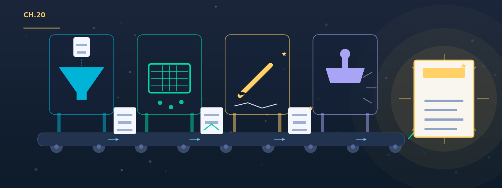
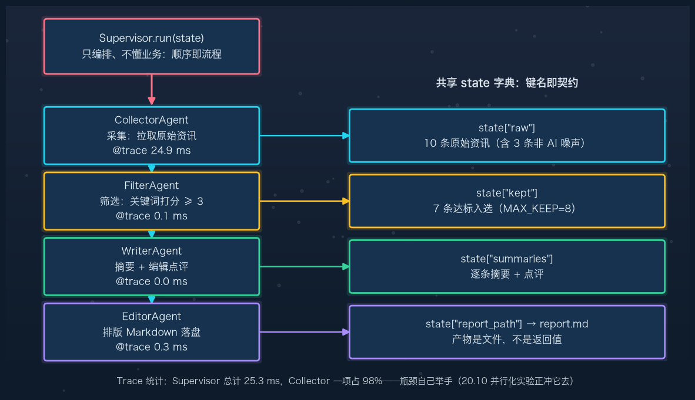

# 第 20 章 实战：多 Agent 协作的自动化工作流



> **📖 开篇故事**
>
> 故事要从 2014 年说起。那一年，美联社（Associated Press）和 Automated Insights 公司合作，用 Wordsmith 自动写作平台接管了一件最枯燥的活：企业财报新闻。效果立刻显形：季度财报报道量从大约 300 篇猛增到 4400 篇，短短几个月翻了一个数量级；编辑从"填空式写作"中解放出来，把精力还给调查报道。十二年后，当 LLM 把"读、筛、写、排"全都学会之后，每个内容团队都在重演这个故事的升级版：每天十几条 AI 资讯，读一遍、筛一遍、写摘要、排个版。这类任务流程固定、素材零碎、价值稳定，正是**流水线自动化**的理想标的。本章就用多 Agent 把这条流水线搭出来：四个专职 Agent 各干一件事，一个 Supervisor 只管调度，全程带 Trace。读完这一章，你就把全书的核心概念都用过一遍了。

> 前面两章你分别造了"引擎"（第 18 章的框架）和"单车"（第 19 章的知识库 Agent）。本章进入最后一个实战：**多 Agent 协作**：把一条"每日 AI 资讯简报"流水线拆给 4 个专职 Agent，由一个 Supervisor 统一编排。这是第 16 章多 Agent 模式的完整落地，同时把第 17 章的 Trace 可观测性接进来。

## 20.1 场景与需求

假设你每天要读十几条 AI 资讯再写成简报发给团队，流程固定但繁琐：**采集**（从数据源拉原始条目）→ **筛选**（只留 AI 相关）→ **摘要**（每条写一句话+点评）→ **排版**（生成 Markdown 报告）。四个环节职责清晰、输入输出明确，这是把任务拆给多 Agent 的理想场景：

- 每个环节封装成**专职 Agent**，内部实现可独立替换（今天关键词打分，明天换 LLM 打分）；
- **Supervisor** 只负责按序调度、传递共享状态 `state`，不懂任何业务细节；
- 全程挂 **Trace 装饰器**，谁在干活、花了多少时间，一目了然。

约束照旧：零外部依赖、离线可跑，数据源用内置 mock，真实接法留到扩展挑战。

> 🎯 **面试高频**：*"什么时候值得拆多 Agent？什么时候一个 Agent 加几个工具就够了？"*
> 判断标准不是"任务大不大"，而是"**流程的段落感强不强**"。四个信号：① 环节有天然的分界（采集/筛选/写作/排版，输入输出异构）；② 各环节的**变更节奏不同**（筛选规则天天调，排版半年不动）；③ 有独立的验证需求（筛选要单独评 F1）；④ 有并行化空间（多数据源同时抓）。四条中两条以上成立，拆分才开始回本，因为拆分本身有代价：状态契约、通信开销、调试链路变长。一条都不占的任务，单 Agent + 工具是更便宜的正确答案。

## 20.2 架构：Supervisor + 4 个专职 Agent



设计要点是**状态字典**：所有 Agent 读写同一个 `state`，谁的产出叫什么键名就是契约。这与 LangGraph 的 `State` 思路一致，只是我们用最朴素的 dict 实现。

> 💡 **深入思考**：`state` 里每个键名都是一份**微型契约**。`raw`、`kept`、`summaries`、`report_path` 这四个名字一旦定下，四个 Agent 就彼此解耦：Collector 不需要知道下游是谁，只管按契约交货；Filter 重构内部实现，只要 `kept` 的形态不变，Writer 一行不改。反过来说，**随意改键名或键内结构，是多人/多 Agent 协作里成本最高的一类破坏**。生产级框架（LangGraph 的 TypedDict State）无非是给这份契约加了类型约束与 schema 校验。

## 20.3 Trace 装饰器：可观测性先行

第 17 章说过"先能观测，再谈优化"。这个装饰器在**函数入口**就记录（保证父子调用顺序正确），退出时回填耗时：

```python
"""news_pipeline.py —— 多 Agent 协作的"每日 AI 资讯简报"自动化流水线。

Supervisor 编排 4 个专职 Agent：Collector -> Filter -> Writer -> Editor，
全程用第 17 章的 Trace 装饰器记录耗时与调用链，最终产物写到 report.md。
依赖：仅标准库。运行：python news_pipeline.py
"""
import functools
import time
from datetime import date
from pathlib import Path

# ---------- 第 17 章的 Trace 装饰器：记录耗时 + 调用链 ----------
RECORDS, _STACK = [], []


def trace(func):
    @functools.wraps(func)
    def wrapper(*args, **kwargs):
        depth = len(_STACK)
        _STACK.append(func.__qualname__)
        rec = {"name": func.__qualname__, "depth": depth, "ms": 0.0}
        RECORDS.append(rec)                    # 入口即记录，保证调用顺序正确
        t0 = time.perf_counter()
        result = func(*args, **kwargs)
        rec["ms"] = (time.perf_counter() - t0) * 1000
        _STACK.pop()
        print("  " * depth + f"[trace] {func.__qualname__} 完成，耗时 {rec['ms']:.1f} ms")
        return result
    return wrapper
```

## 20.4 数据源与采集、筛选 Agent

mock 数据源内置 10 条资讯，**故意混入 3 条非 AI 噪声**（数码、财经、娱乐），让 Filter 有事可做。Filter 的打分规则：关键词命中标题权重翻倍，标题的语义密度远高于正文。

```python
# ---------- mock 数据源：10 条资讯，混入了 3 条非 AI 噪声 ----------
MOCK_FEED = [
    {"title": "OpenAI 发布新一代旗舰模型，上下文窗口翻倍", "source": "TechWeb",
     "body": "新模型在长文档理解和代码生成上大幅提升，API 价格下调 30%。", "tags": ["模型"]},
    {"title": "国产开源大模型登顶 HuggingFace 热榜", "source": "开源社",
     "body": "该模型以 7B 参数在多项基准上超越同规模对手，权重完全开放。", "tags": ["模型", "开源"]},
    {"title": "某品牌手机推出春季新配色", "source": "数码前线",
     "body": "本次更新仅为外观调整，硬件配置与上一代保持一致。", "tags": ["数码"]},
    {"title": "多 Agent 框架 AutoFlow 发布 2.0：支持可视化编排", "source": "AI 前线",
     "body": "新版本引入人机回环节点和持久化状态机，企业用户增长迅速。", "tags": ["Agent"]},
    {"title": "机器人公司获 10 亿元融资，押注具身智能", "source": "创投日报",
     "body": "本轮资金主要用于人形机器人量产线和 VLA 大模型研发。", "tags": ["机器人", "融资"]},
    {"title": "本地楼市成交量环比小幅回升", "source": "财经网",
     "body": "分析师认为与季节性因素有关，长期趋势仍待观察。", "tags": ["财经"]},
    {"title": "新论文提出 Agent 评估基准 AgentBench-Pro", "source": "arXiv 速递",
     "body": "基准覆盖工具调用、长期规划与多轮协作，已对 20 个主流 Agent 完成评测。", "tags": ["论文", "Agent"]},
    {"title": "向量数据库 PineDB 宣布支持十亿级向量检索", "source": "InfoQ",
     "body": "新版采用改进的 HNSW 索引，RAG 场景延迟降低 40%。", "tags": ["RAG", "开源"]},
    {"title": "某明星新电影定档春节档", "source": "娱乐周刊",
     "body": "片方发布首支预告片，主打合家欢喜剧路线。", "tags": ["娱乐"]},
    {"title": "DeepMind 用 LLM 辅助数学猜想证明取得突破", "source": "量子位",
     "body": "该系统通过强化学习搜索证明路径，解决了两个悬置多年的组合问题。", "tags": ["论文", "模型"]},
]

# Filter 的关键词权重表：命中标题权重翻倍
KEYWORDS = {"模型": 3, "Agent": 3, "agent": 3, "开源": 2, "论文": 2,
            "机器人": 2, "RAG": 2, "向量": 2, "LLM": 2, "融资": 1, "智能": 1}


# ---------- 4 个专职 Agent：各自只干一件事 ----------
class CollectorAgent:
    """采集：从数据源拉取原始资讯（此处为内置 mock，真实版换 RSS/API）。"""

    @trace
    def run(self, state: dict) -> None:
        time.sleep(0.02)                      # 模拟网络 IO
        state["raw"] = MOCK_FEED
        print(f"  [Collector] 采集到 {len(state['raw'])} 条原始资讯")


class FilterAgent:
    """筛选：按关键词打分，保留得分达标的条目（MAX_KEEP 是安全上限）。"""

    MIN_SCORE, MAX_KEEP = 3, 8

    @trace
    def run(self, state: dict) -> None:
        def score(item):
            text = item["title"] + " " + item["body"] + " " + " ".join(item["tags"])
            s = sum(w for kw, w in KEYWORDS.items() if kw in text)
            return s * 2 if any(kw in item["title"] for kw in KEYWORDS) else s

        scored = sorted(((score(it), it) for it in state["raw"]),
                        key=lambda x: -x[0])
        kept = [it for s, it in scored if s >= self.MIN_SCORE]
        state["kept"] = kept[:self.MAX_KEEP]
        for s, it in scored:
            mark = "✓" if it in state["kept"] else "✗"
            print(f"  [Filter] {mark} 得分 {s:2d} | {it['title'][:22]}")
```

## 20.5 Writer 与 Editor：生成与排版

Writer 用模板模拟 LLM 的"摘要+点评"（真实版换成一次 `chat.completions` 调用）；Editor 把结构化数据渲染成 Markdown 并落盘。**产物是文件而不是返回值**，这是工作流类 Agent 的常见形态。

```python
class WriterAgent:
    """写作：为每条入选资讯生成一句话摘要 + 编辑点评（mock LLM 模板）。"""

    @trace
    def run(self, state: dict) -> None:
        state["summaries"] = [self._summarize(it) for it in state["kept"]]
        print(f"  [Writer] 已生成 {len(state['summaries'])} 条摘要")

    @staticmethod
    def _summarize(item: dict) -> dict:
        first_clause = item["body"].split("，")[0].split("。")[0]
        angle = {"模型": "值得开发者尽快上手体验", "Agent": "Agent 工程化的风向标",
                 "开源": "利好本地部署与二次开发", "论文": "建议跟进原文方法细节",
                 "机器人": "具身智能赛道持续升温", "RAG": "RAG 基础设施的重要拼图"
                 }.get(item["tags"][0], "值得持续关注")
        return {"title": item["title"], "source": item["source"], "tag": item["tags"][0],
                "summary": f"{first_clause}（{item['source']}）", "angle": angle}


class EditorAgent:
    """排版：把摘要组织成结构化 Markdown 报告并写入磁盘。"""

    @trace
    def run(self, state: dict) -> None:
        lines = [f"# 每日 AI 资讯简报（{date.today()}）", "",
                 f"> 采集 {len(state['raw'])} 条，入选 {len(state['kept'])} 条，"
                 "由多 Agent 流水线自动生成。", "", "## 今日精选", ""]
        for i, s in enumerate(state["summaries"], 1):
            lines += [f"### {i}. {s['title']}", "",
                      f"- **摘要**：{s['summary']}",
                      f"- **编辑点评**：{s['angle']}",
                      f"- **分类**：{s['tag']}", ""]
        lines += ["---", "*by Collector / Filter / Writer / Editor*"]
        Path("report.md").write_text("\n".join(lines), encoding="utf-8")
        state["report_path"] = "report.md"
        print("  [Editor] 报告已写入 report.md")
```

## 20.6 Supervisor：只编排，不懂业务

Supervisor 的全部智慧就是一张列表：**顺序即流程**。想插入新环节（比如加一个 Reviewer 做人工审批），只需往 `self.pipeline` 里塞一个新 Agent，其他代码不动。

```python
# ---------- Supervisor：第 16 章的编排者模式 ----------
class Supervisor:
    def __init__(self):
        self.pipeline = [CollectorAgent(), FilterAgent(), WriterAgent(), EditorAgent()]

    @trace
    def run(self) -> dict:
        state: dict = {}
        for agent in self.pipeline:
            agent.run(state)                  # 串行传递同一个 state
        return state


def print_trace_stats() -> None:
    print("\n=== Trace 统计（第 17 章） ===")
    for r in RECORDS:
        print("  " * r["depth"] + f"{r['name']:<28} {r['ms']:6.1f} ms")
    total = sum(r["ms"] for r in RECORDS if r["name"] == "Supervisor.run")
    print(f"流水线总耗时: {total:.1f} ms，共记录 {len(RECORDS)} 次调用")


if __name__ == "__main__":
    state = Supervisor().run()
    print_trace_stats()
    print("\n=== report.md 内容 ===")
    print(Path(state["report_path"]).read_text(encoding="utf-8"))
```

## 20.7 运行结果

本机真实运行输出（Filter 的逐条打分与 Trace 统计）：

```text
  [Collector] 采集到 10 条原始资讯
  [trace] CollectorAgent.run 完成，耗时 24.9 ms
  [Filter] ✓ 得分 14 | 机器人公司获 10 亿元融资，押注具身智能
  [Filter] ✓ 得分 14 | DeepMind 用 LLM 辅助数学猜想证
  [Filter] ✓ 得分 12 | 向量数据库 PineDB 宣布支持十亿级向量
  [Filter] ✓ 得分 10 | 国产开源大模型登顶 HuggingFace 
  [Filter] ✓ 得分 10 | 新论文提出 Agent 评估基准 Agent
  [Filter] ✓ 得分  6 | OpenAI 发布新一代旗舰模型，上下文窗口
  [Filter] ✓ 得分  6 | 多 Agent 框架 AutoFlow 发布
  [Filter] ✗ 得分  0 | 某品牌手机推出春季新配色    ← 3 条噪声全部拦截
  [Filter] ✗ 得分  0 | 本地楼市成交量环比小幅回升
  [Filter] ✗ 得分  0 | 某明星新电影定档春节档
  [trace] FilterAgent.run 完成，耗时 0.1 ms
  [Writer] 已生成 7 条摘要
  [Editor] 报告已写入 report.md

=== Trace 统计（第 17 章） ===
Supervisor.run                 25.3 ms
  CollectorAgent.run           24.9 ms      <- 唯一耗时段：模拟网络 IO
  FilterAgent.run               0.1 ms
  WriterAgent.run               0.0 ms
  EditorAgent.run               0.3 ms
流水线总耗时: 25.3 ms，共记录 5 次调用
```

生成的 `report.md` 片段（完整文件由代码写入磁盘）：

```markdown
# 每日 AI 资讯简报（2026-11-11）

> 采集 10 条，入选 7 条，由多 Agent 流水线自动生成。

## 今日精选

### 1. 机器人公司获 10 亿元融资，押注具身智能

- **摘要**：本轮资金主要用于人形机器人量产线和 VLA 大模型研发（创投日报）
- **编辑点评**：具身智能赛道持续升温
- **分类**：机器人

### 2. DeepMind 用 LLM 辅助数学猜想证明取得突破

- **摘要**：该系统通过强化学习搜索证明路径（量子位）
- **编辑点评**：建议跟进原文方法细节
- **分类**：论文

...（第 3-7 条结构相同，略）...

---
*by Collector / Filter / Writer / Editor*
```

> ⚠️ **常见误区**：看 Trace 统计时只关心"总耗时多少"，看不到结构。
> 这份统计最有价值的恰恰是**结构**：Collector 一项占了 98% 的耗时（24.9/25.3ms），而它只是模拟网络 IO；如果这是一条真实流水线，优化清单的第一行就自动生成了：**并行化采集**（20.10 节的实验会把它做掉）、缓存上游源、或把 Writer/Editor 与下一天的采集重叠。没有结构化 Trace，这些决策靠拍脑袋；有了它，瓶颈自己举手。

## 20.8 为什么不是一个 200 行的大函数？

这个规模的任务，一个大函数也能写完。多 Agent 拆分的价值在**变化时**才显现：

- **替换成本**：Filter 从关键词换成 LLM 打分时，只改 `FilterAgent` 一个类；大函数里你要在大段代码中小心手术。
- **独立测试**：每个 Agent 输入输出都是 `state` dict，单测只需构造字典断言。
- **可观测性**：`@trace` 以 Agent 为粒度记录耗时，瓶颈定位零成本（本次运行里 Collector 占了 98% 时间，一眼可见）。
- **编排灵活性**：并行化（Collector 抓多个源）、条件分支（Filter 入选为 0 时跳过 Writer）、人工审批（Editor 前插入确认节点），在大函数里都是伤筋动骨的改动，在 Supervisor 里是一行列表的事。

这正是第 16 章的结论：**多 Agent 不是让系统更聪明，而是让系统更可演化**。

> 💡 **深入思考**：多 Agent 的"可演化"红利有一个隐藏前提：**每个 Agent 的质量要能被独立度量**。20.8 列的四条价值里，"替换成本"和"独立测试"都依赖一件事：你能给单个 Agent 单独出题、单独打分。Filter 换成 LLM 打分之后好不好，不能靠看报告顺眼程度判断，那要一份带金标的评估集。下一节就把这份"成绩单"补上：它既是筛选环节的质量闸门，也是"能不能换 LLM"这个决策的依据。

## 20.9 动手实验（一）：给 Filter 补一份成绩单（P/R/F1 + 阈值扫描 + 调参）

第 17 章的方法论落地：**任何想替换的模块，先有评估集，再谈替换**。代码位于 `code/ch20-multi-agent-workflow/filter_eval.py`。评估集 = 流水线的 10 条 mock 资讯（按剧情标注，7 条 AI / 3 条噪声）+ 10 条新写的标注资讯（5 条 AI / 5 条噪声），合计 20 条（12 条 AI 相关 / 8 条噪声）；其中故意埋了两条"词面不含关键词的 AI 新闻"，专考召回：

```python
"""filter_eval.py —— FilterAgent 关键词打分的准确率/召回率/F1 评估。"""
from news_pipeline import MOCK_FEED, KEYWORDS

# ---------- 人工标注的评估集：10 条 mock + 10 条新写 ----------
NOISE_TITLES = {"某品牌手机推出春季新配色", "本地楼市成交量环比小幅回升", "某明星新电影定档春节档"}
LABELED = [(item, 0 if item["title"] in NOISE_TITLES else 1) for item in MOCK_FEED]

EXTRA = [
    ("开源社区发布推理加速引擎 vLLM 的新替代品", "该引擎宣称推理延迟降低 40%，权重开放。", ["开源"], 1),
    ("某互联网公司季度财报营收超预期", "广告业务回暖带动整体增长，股价应声上涨。", ["财经"], 0),
    ("Kaggle 机器学习竞赛冠军方案复盘", "冠军用模型集成与特征工程拿下榜首，代码已开源。", ["机器学习"], 1),
    ("深度学习框架 PyTorch 3.0 发布，训练提速 50%", "新版自动并行策略大幅减少显存碎片。", ["框架"], 1),
    ("手机厂商推出拍照新算法，夜景样张流出", "本次以多帧合成算法为主，硬件无变化。", ["数码"], 0),
    ("智能音箱新品上市，支持方言语音唤醒", "主打家庭场景，价格下探至百元档。", ["消费电子"], 0),
    ("AI 医疗影像公司完成 B 轮融资", "资金用于肺结节筛查产品的临床推进。", ["融资"], 1),
    ("央行宣布下调金融机构存款准备金率", "市场流动性预期改善，债市走强。", ["财经"], 0),
    ("具身智能机器人团队开源训练仿真环境", "环境内置 200 个操作任务，支持域随机化。", ["机器人", "开源"], 1),
    ("新能源汽车销量创历史新高", "插混车型贡献主要增量，出口同步增长。", ["汽车"], 0),
]
for title, body, tags, label in EXTRA:
    LABELED.append(({"title": title, "source": "扩展集", "body": body, "tags": tags}, label))

MIN_SCORE = 3                                    # 与 FilterAgent 一致


def score(item, keywords):
    text = item["title"] + " " + item["body"] + " " + " ".join(item["tags"])
    s = sum(w for kw, w in keywords.items() if kw in text)
    return s * 2 if any(kw in item["title"] for kw in keywords) else s


def evaluate(keywords, threshold):
    tp = fp = fn = 0
    for item, gold in LABELED:
        pred = 1 if score(item, keywords) >= threshold else 0
        tp += (pred == 1 and gold == 1)
        fp += (pred == 1 and gold == 0)
        fn += (pred == 0 and gold == 1)
    precision = tp / (tp + fp) if tp + fp else 0.0
    recall = tp / (tp + fn) if tp + fn else 0.0
    f1 = 2 * precision * recall / (precision + recall) if precision + recall else 0.0
    return tp, fp, fn, precision, recall, f1


def main():
    n_pos = sum(g for _, g in LABELED)
    print(f"评估集共 {len(LABELED)} 条（AI 相关 {n_pos} / 噪声 {len(LABELED) - n_pos}）\n")

    # ---------- 1. 原关键词表 + 阈值 3 ----------
    tp, fp, fn, p, r, f1 = evaluate(KEYWORDS, MIN_SCORE)
    print(f"原关键词表（阈值 >= {MIN_SCORE}）：TP={tp} FP={fp} FN={fn}")
    print(f"  精确率 P = {p:.2f}   召回率 R = {r:.2f}   F1 = {f1:.2f}")
    for item, gold in LABELED:
        pred = 1 if score(item, KEYWORDS) >= MIN_SCORE else 0
        if pred != gold:
            why = "漏了 AI 相关" if gold == 1 else "放进来了噪声"
            print(f"    判错 -> {why}（得分 {score(item, KEYWORDS)}）| {item['title']}")

    # ---------- 2. 阈值扫描：P/R 跷跷板 ----------
    print("\n阈值扫描（原关键词表）：")
    print(f"  {'阈值':>4} {'P':>5} {'R':>5} {'F1':>5}")
    best = None
    for t in (1, 2, 3, 4, 5):
        _, _, _, p, r, f1 = evaluate(KEYWORDS, t)
        print(f"  {t:>4} {p:>5.2f} {r:>5.2f} {f1:>5.2f}")
        if best is None or f1 > best[1]:
            best = (t, f1)
    print(f"  最优阈值 = {best[0]}（F1 = {best[1]:.2f}）")

    # ---------- 3. 调关键词表：补上漏掉的 AI 词 ----------
    TUNED = dict(KEYWORDS)
    TUNED.update({"机器学习": 3, "深度学习": 3, "AI": 3, "训练": 2, "算法": 1})
    _, fp, fn, p, r, f1 = evaluate(TUNED, MIN_SCORE)
    print(f"\n调参后关键词表（补 机器学习/深度学习/AI 等，阈值 >= {MIN_SCORE}）：")
    print(f"  TP/FP/FN 改善 -> FP={fp} FN={fn}")
    print(f"  精确率 P = {p:.2f}   召回率 R = {r:.2f}   F1 = {f1:.2f}")


if __name__ == "__main__":
    main()
```

`python3 filter_eval.py` 本机真实输出：

```text
评估集共 20 条（AI 相关 12 / 噪声 8）

原关键词表（阈值 >= 3）：TP=10 FP=0 FN=2
  精确率 P = 1.00   召回率 R = 0.83   F1 = 0.91
    判错 -> 漏了 AI 相关（得分 0）| 深度学习框架 PyTorch 3.0 发布，训练提速 50%
    判错 -> 漏了 AI 相关（得分 2）| AI 医疗影像公司完成 B 轮融资

阈值扫描（原关键词表）：
    阈值     P     R    F1
     1  0.92  0.92  0.92
     2  0.92  0.92  0.92
     3  1.00  0.83  0.91
     4  1.00  0.83  0.91
     5  1.00  0.83  0.91
  最优阈值 = 1（F1 = 0.92）

调参后关键词表（补 机器学习/深度学习/AI 等，阈值 >= 3）：
  TP/FP/FN 改善 -> FP=0 FN=0
  精确率 P = 1.00   召回率 R = 1.00   F1 = 1.00
```

逐段读这份成绩单：

- **基线的画像很典型：精确率 1.00、召回率 0.83**。关键词打分是保守的：不认识就扔掉。两条漏网之鱼都"词面上不像 AI"：一条是 PyTorch 新版本（关键词表里没有"深度学习/训练"），一条是 AI 医疗融资（"AI"本身不在词表里）；
- **阈值扫描画出标准的跷跷板**：阈值从 3 降到 1，召回上去了（AI 医疗那条得分 2 被捞回来），代价是"智能音箱"（得分 2，实为消费电子）混进来，精确率掉到 0.92。**没有免费的午餐，只有可定价的交换**，扫描表就是那张价目表；
- **调词表比调阈值划算**：只往表里加了 5 个词，P/R/F1 全部到 1.00。因为它对症下药：召回的缺口本来就是"词面缺词"，加词直接补上，而不用降低阈值去承受误放。这就是关键词方案能把 F1 推过 0.9 的路径：对症补词，而不是调阈值。

但别高兴太早：评估集只有 20 条，全满分很可能是过拟合（关键词表就是照着这 20 条调的）。**词表会随语料漂移**：今天补"深度学习"，明天来一条讲"联邦学习"的新闻照样漏。这份成绩单的真正结论是第 17 章那句老话：LLM 打分替换关键词打分之前，先把评估集扩到几百条，否则换不换都只是感觉良好。

## 20.10 动手实验（二）：并行化 Collector——Trace 统计里的第一优化项

20.7 的 Trace 统计已经点名：Collector 占了 98% 的耗时（模拟网络 IO）。20.8 把"并行化"列为多 Agent 的核心红利之一，现在兑现它。代码位于 `code/ch20-multi-agent-workflow/parallel_pipeline.py`：模拟 3 个数据源各 20ms 的抓取延迟，对比串行与 `ThreadPoolExecutor` 并行，并演示**共享 `state` 的并发写纪律**（worker 只交局部结果，主线程统一合并）：

```python
"""parallel_pipeline.py —— Collector 并行抓取实验。"""
import time
from concurrent.futures import ThreadPoolExecutor

SOURCES = ["TechWeb-RSS", "AI前线-RSS", "开源社-RSS"]
FAKE_LATENCY = 0.02                              # 每个源 20ms 的模拟网络 IO


def fetch(source: str) -> list:
    time.sleep(FAKE_LATENCY)                     # 模拟网络 IO（GIL 会放行 sleep）
    return [{"source": source, "title": f"{source} 的一条资讯", "score": 1}]


def collect_serial(state: dict) -> None:
    t0 = time.perf_counter()
    raw = []
    for src in SOURCES:                          # 一个抓完再抓下一个
        raw += fetch(src)
    state["raw"] = raw
    ms = (time.perf_counter() - t0) * 1000
    print(f"串行抓取：{len(raw)} 条，墙钟 {ms:.1f} ms（= 3 x 20ms）")
    state["serial_ms"] = ms


def collect_parallel(state: dict) -> None:
    t0 = time.perf_counter()
    with ThreadPoolExecutor(max_workers=len(SOURCES)) as pool:
        results = list(pool.map(fetch, SOURCES)) # 三个源同时抓
    raw = [item for chunk in results for item in chunk]
    state["raw"] = raw                           # 主线程统一合并写 state
    ms = (time.perf_counter() - t0) * 1000
    print(f"并行抓取：{len(raw)} 条，墙钟 {ms:.1f} ms（= 最慢源耗时 + 调度开销）")
    state["parallel_ms"] = ms


def main():
    state: dict = {}
    print(f"3 个数据源，每个模拟 IO 耗时 {FAKE_LATENCY * 1000:.0f} ms\n")
    collect_serial(state)
    collect_parallel(state)
    speedup = state["serial_ms"] / state["parallel_ms"]
    print(f"\n加速比 = 串行 {state['serial_ms']:.1f} ms / 并行 {state['parallel_ms']:.1f} ms"
          f" = {speedup:.1f}x")


if __name__ == "__main__":
    main()
```

`python3 parallel_pipeline.py` 本机真实输出：

```text
3 个数据源，每个模拟 IO 耗时 20 ms

串行抓取：3 条，墙钟 67.6 ms（= 3 x 20ms）
并行抓取：3 条，墙钟 21.9 ms（= 最慢源耗时 + 调度开销）

加速比 = 串行 67.6 ms / 并行 21.9 ms = 3.1x
```

**3.1 倍加速，只重写了 Collector 一个函数**。Supervisor、Filter、Writer、Editor 一行没动，这正是 20.8 里"替换成本"那一条的现场演示：

- **加速比来自 IO 等待，不是"多核"**：`time.sleep` 会释放 GIL，所以线程池有效。若 Collector 是纯 CPU 计算（比如本地跑一个 embedding 模型），线程版拿不到任何加速，得换进程池；判断依据是"瓶颈在等还是在算"，又回到 Trace 统计：**先观测，再优化**；
- **并行后墙钟 = 最慢源 + 调度开销**（21.9ms ≈ 20ms + 1.9ms）。数据源越多、越参差，并行红利越大，但**被最慢源封顶**（木桶效应）；真实世界还要加超时熔断，免得一个挂死的 RSS 拖垮整条流水线；
- **`state` 的并发写纪律**：三个 worker 各自返回局部结果，主线程统一合并写 `state["raw"]`。"谁都不在飞行中写共享字典"，一行规则避免一整类竞态 bug：并发写 `state` 不是加锁那么简单，而是**约定写权只归编排者**。

## 本章小结

- 多 Agent 工作流 = **Supervisor 编排 + 专职 Agent + 共享 state 字典**；顺序即流程，加环节只改列表。
- 每个 Agent 只干一件事：Collector 采集、Filter 打分筛选、Writer 生成摘要、Editor 排版落盘，内部实现可独立替换。
- **Trace 装饰器在函数入口记录**以保证调用链顺序；耗时统计把瓶颈直接点名在 IO 而非计算。
- 关键词打分（标题命中权重翻倍）是零成本的内容筛选基线；产物写成 `report.md` 文件，工作流类 Agent 的产物通常落在磁盘。
- 多 Agent 的核心价值不是智能而是**可演化性**：替换成本、独立测试、可观测性、编排灵活性。两个实验分别兑现了"独立评估"（20.9 的 F1 成绩单）与"编排灵活性"（20.10 的 3.1x 并行加速）。

## 扩展挑战

**20.1（接真实数据源）** 把 `CollectorAgent` 换成真实 RSS：用 `feedparser` 抓取两个 AI 资讯源，注意加去重（按标题哈希）与异常处理（单源失败不拖垮流水线）。

**20.2（接真 LLM）** 把 `WriterAgent._summarize` 换成 OpenAI 调用（需 `OPENAI_API_KEY`），提示词要求输出 JSON `{"summary": ..., "angle": ...}`。对比模板版与 LLM 版的报告质量。

**20.3（并行化进阶）** 把 20.10 的并行 Collector 移植回 `news_pipeline.py` 的完整流水线，跑通全流程并对比 Trace 统计中 Collector 耗时的变化；再给其中一个数据源额外加 50ms 延迟，验证"并行后被最慢源封顶"的木桶效应，并检查 `state` 的写权纪律在移植后是否仍然成立。

**20.4（定时任务）** 用 `schedule` 库或 crontab 让流水线每天 9:00 自动运行，报告文件名带日期（`report-2026-11-11.md`）。

**20.5（人工审批节点）** 在 Editor 前插入 `ReviewerAgent`：打印入选条目清单，等待终端输入 `y/n`，`n` 则让用户输入要剔除的序号后重新排版。这距离第 18 章练习里的人机回环有多远？

**20.6（评估闭环）** 在 20.9 的评估集之外自己再标注 20 条新资讯（重点收录你所在领域的"边界地带"条目），把评估集扩到 40 条后重跑成绩单，观察 F1 是否回落。对照 20.9 关于"词表照着评估集调参"的过拟合提醒，解释你看到的现象。

**20.7（实验：灰区标注）** 给 20.9 的评估集加一个"边界地带"标注层：把"AI 医疗融资"这类跨界新闻标成 0.5 权重（算半个正例），重新定义命中规则并重算 F1。什么时候"非黑即白的标注"本身就是评估的误差来源？

## 📚 延伸阅读

- **AutoGen: Enabling Next-Gen LLM Applications via Multi-Agent Conversation**（Wu et al., Microsoft, 2023）：多 Agent 协作框架的代表作，第 16 章 Supervisor 模式的工业级实现。https://arxiv.org/abs/2308.08155
- **Why Do Multi-Agent LLM Systems Fail?**（Cemri et al., 2025）：对真实多 Agent 失败案例的系统性归因研究：拆分不是银弹，失败模式里排名第一的恰是"编排与协作失调"。https://arxiv.org/abs/2503.13657
- **CrewAI 文档**：角色化多 Agent 编排框架，对比本章"Supervisor + 专职 Agent"思路的另一种表达。https://docs.crewai.com/
- **LangGraph Multi-Agent 概念页**：Supervisor、hierarchical、handoff 等编排拓扑的官方图解。https://langchain-ai.github.io/langgraph/concepts/multi_agent/
- **AP 自动化财报写作报道**：开篇故事的原型，新闻业自动化的起点案例，值得读一遍原文感受"流水线自动化"的真实历史。https://blog.ap.org/announcements/the-automated-quarterly-earnings-reports-are-here

## 🎓 全书结语：零件已到齐，路才刚开始

合上这一章，前言里画的那条路线就走完了：从 1958 年的一个神经元，到手算一遍注意力，再到 253 行的 miniagent 和今天这条四个 Agent 的流水线。六个部分说的其实是同一座塔：**塔基是模型怎么学，塔身是模型怎么工作，塔尖是模型怎么行动**；三个实战项目，则是把塔尖接到真实的地面上。

回望全程，这本书真正想交到你手里的不是多少个 API，而是三样更耐用的东西：**最小可运行的实现**，每个核心概念都手算或手写过一遍，黑箱在你面前拆开过；**评估的意识**，先有成绩单，再谈替换，第 18、19、20 章的四个实验反复演练的都是这一件事；**诚实的边界**，什么时候不该用 Agent、什么时候一个大函数更便宜，和怎么搭同样重要。

至于"专家"，从来不是一个读完的状态。真实的产品总在你没料到的地方翻车：评估集会饱和，关键词表会漂移，多 Agent 会协作失调。这些散落在各章的坑，你一个都绕不开，只能亲手踩过、修好、记下来。所以下一步很具体：挑一个你自己的真实问题，从评估集开始，把这条流水线按你的业务重搭一遍，让它接上真模型、挂上 Trace、被人使用、被人抱怨，然后变得更好。

前言的结尾说："现在，轮到你了。翻开第 1 章，从一个 1958 年的神经元开始。"此刻这句话可以说得更响一点：你已经从零走到了专家的门口，剩下的路，用你自己的问题来铺。
